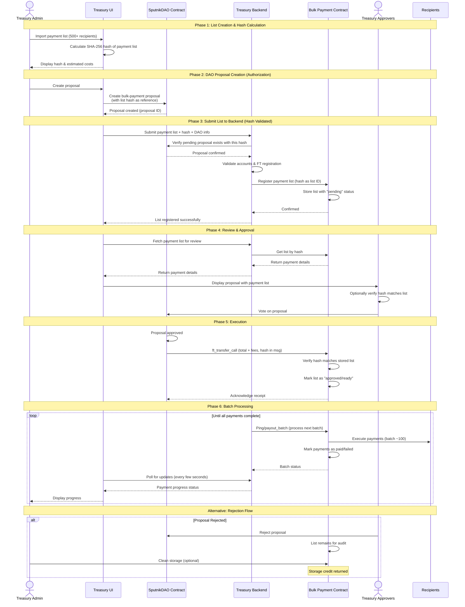

# Trezu implementation reference

Fetched: 2026-11-11T11:53:23.796Z

Upstream: https://github.com/NEAR-DevHub/trezu

Pinned revision: `62cf0e41d4b2d2358a496d47c80fcd2e59094247`

## How to use this file

Use for Trezu architecture, payment proposal construction, backend proposal retrieval, and receipt interpretation. Source files document this revision of Trezu; internal frontend helpers and backend routes are not a promised public SDK. Confirm authentication, service availability and compatibility before designing an adapter. Bulk payment is a reference option, not a selected dependency.

This is a local reference bundle, not application code. Upstream setup commands are reference material only; do not execute them automatically. MDX components and relative links are preserved as source text and may require consulting the linked upstream file. Embedded sources are delimited with long fences so their internal Markdown remains intact.

## Contents

- Authentication implementation supplement (search this heading): wallet store, selector, challenge/login/session verification.

- [README.md](https://github.com/NEAR-DevHub/trezu/blob/62cf0e41d4b2d2358a496d47c80fcd2e59094247/README.md)
- [nt-fe/README.md](https://github.com/NEAR-DevHub/trezu/blob/62cf0e41d4b2d2358a496d47c80fcd2e59094247/nt-fe/README.md)
- [nt-be/README.md](https://github.com/NEAR-DevHub/trezu/blob/62cf0e41d4b2d2358a496d47c80fcd2e59094247/nt-be/README.md)
- [nt-fe/near-connect/README.md](https://github.com/NEAR-DevHub/trezu/blob/62cf0e41d4b2d2358a496d47c80fcd2e59094247/nt-fe/near-connect/README.md)
- [nt-fe/lib/near-proposal-builders.ts](https://github.com/NEAR-DevHub/trezu/blob/62cf0e41d4b2d2358a496d47c80fcd2e59094247/nt-fe/lib/near-proposal-builders.ts)
- [nt-fe/app/(treasury)/[treasuryId]/payments/utils/proposal-builder.ts](https://github.com/NEAR-DevHub/trezu/blob/62cf0e41d4b2d2358a496d47c80fcd2e59094247/nt-fe/app/(treasury)/%5BtreasuryId%5D/payments/utils/proposal-builder.ts)
- [nt-fe/lib/proposals-api.ts](https://github.com/NEAR-DevHub/trezu/blob/62cf0e41d4b2d2358a496d47c80fcd2e59094247/nt-fe/lib/proposals-api.ts)
- [nt-fe/features/proposals/types/index.ts](https://github.com/NEAR-DevHub/trezu/blob/62cf0e41d4b2d2358a496d47c80fcd2e59094247/nt-fe/features/proposals/types/index.ts)
- [nt-fe/features/proposals/utils/receipt-utils.ts](https://github.com/NEAR-DevHub/trezu/blob/62cf0e41d4b2d2358a496d47c80fcd2e59094247/nt-fe/features/proposals/utils/receipt-utils.ts)
- [nt-be/src/handlers/proposals/mod.rs](https://github.com/NEAR-DevHub/trezu/blob/62cf0e41d4b2d2358a496d47c80fcd2e59094247/nt-be/src/handlers/proposals/mod.rs)
- [nt-be/src/handlers/proposals/get_proposals.rs](https://github.com/NEAR-DevHub/trezu/blob/62cf0e41d4b2d2358a496d47c80fcd2e59094247/nt-be/src/handlers/proposals/get_proposals.rs)
- [contracts/bulk-payment/README.md](https://github.com/NEAR-DevHub/trezu/blob/62cf0e41d4b2d2358a496d47c80fcd2e59094247/contracts/bulk-payment/README.md)
- [contracts/bulk-payment/docs/ARCHITECTURE.md](https://github.com/NEAR-DevHub/trezu/blob/62cf0e41d4b2d2358a496d47c80fcd2e59094247/contracts/bulk-payment/docs/ARCHITECTURE.md)

## README.md

Source: https://raw.githubusercontent.com/NEAR-DevHub/trezu/62cf0e41d4b2d2358a496d47c80fcd2e59094247/README.md

`````markdown
# Treasury26

A comprehensive treasury management platform for NEAR DAOs. Manage members, process payments, create vesting schedules, track balances, and handle multi-signature approvals through Sputnik DAO integration.

## Project Structure

| Directory | Description | Documentation |
|-----------|-------------|---------------|
| [nt-be](./nt-be/) | Backend API (Rust/Axum) - Balance tracking, monitoring, CSV export | [README](./nt-be/README.md) |
| [nt-fe](./nt-fe/) | Frontend (Next.js) - Web interface for treasury management | [README](./nt-fe/README.md) |
| [contracts](./contracts/) | NEAR smart contracts for bulk payments | [README](./contracts/README.md) |
| [sandbox](./sandbox/) | Local development environment with Docker | [README](./sandbox/README.md) |
| [e2e-tests](./e2e-tests/) | End-to-end tests for contract integration | [README](./e2e-tests/bulk-payment/README.md) |

## Quick Links

- **Production Backend**: https://near-treasury-backend.onrender.com
- **Add Account for Tracking**: See [nt-be/README.md](./nt-be/README.md#1-register-an-account-for-monitoring)

## Features

### Treasury Management
- Create and configure treasuries with custom policies
- Member management with role-based permissions (proposer, approver, financial member)
- Dashboard with total balance overview and USD valuations

### Financial Operations
- Single and bulk payments in NEAR, NEP-141 tokens, and cross-chain via Intents
- Token vesting schedules with cliff dates and configurable release
- Automatic balance tracking and historical charts
- CSV export of transaction history

### DAO Integration
- Sputnik DAO proposal creation and management
- Multi-signature approval workflows
- Proposal filtering by status, token type, date, and participants

### Balance Monitoring
- Register accounts for automatic balance tracking
- Real-time balance change detection across multiple token types
- Staking rewards tracking
- Historical balance data with gap-filling

### Smart Contracts
- Bulk payment processing (up to 100 payments per batch)
- Storage credit system for batch operations
- Content-addressed payment lists (SHA-256)
- Support for NEAR, fungible tokens, and NEAR Intents

## Development

See individual README files for setup instructions:

- Backend: [nt-be/README.md](./nt-be/README.md)
- Frontend: [nt-fe/README.md](./nt-fe/README.md)
- Contracts: [contracts/README.md](./contracts/README.md)
- Local sandbox: [sandbox/README.md](./sandbox/README.md)

### Telegram Bot (Local Development)

The platform supports Telegram notifications for treasury events. To develop and test the Telegram integration locally:

#### 1. Create a Bot

Open Telegram, message [@BotFather](https://t.me/BotFather), and run `/newbot`. Save the bot token it gives you.

#### 2. Expose Your Local Backend via ngrok

Telegram requires an HTTPS URL to deliver webhook updates. Use [ngrok](https://ngrok.com/) to tunnel to your local backend (port 3002 by default):

```bash
ngrok http 3002
```

Copy the `https://` forwarding URL from the ngrok output (e.g. `https://ab12-34-56.ngrok-free.app`).

#### 3. Register the Webhook

Open this URL in your browser (replace the placeholders):

```
https://api.telegram.org/bot<BOT_TOKEN>/setWebhook?url=<NGROK_URL>/api/telegram/webhook&secret_token=1234567890
```

You should see `{"ok":true,"result":true,"description":"Webhook was set"}`.

#### 4. Set Environment Variables

> **Note:** Telegram rejects `localhost` URLs in bot messages (e.g. connect-treasury links). Use `127.0.0.1` instead.

Backend (`nt-be`):
```bash
export TELEGRAM_BOT_TOKEN=<your-bot-token>
export TELEGRAM_WEBHOOK_SECRET=1234567890
export FRONTEND_BASE_URL=http://127.0.0.1:3001
```

Frontend (root `.env`):
```bash
export CORS_ALLOWED_ORIGINS=http://127.0.0.1:3001
export NEXT_PUBLIC_BACKEND_API_BASE=http://127.0.0.1:3002
```

Then start the backend and frontend as usual. Add the bot to a Telegram group — it should respond with a "Connect Treasury" button linking to your local frontend.

`````

## nt-fe/README.md

Source: https://raw.githubusercontent.com/NEAR-DevHub/trezu/62cf0e41d4b2d2358a496d47c80fcd2e59094247/nt-fe/README.md

`````markdown
# Treasury26 Frontend

Next.js frontend for Treasury26 - a cross-chain multisig security platform for managing digital assets on NEAR Protocol.

## Features

- 🔐 **Ledger Hardware Wallet Support** - Secure authentication with Ledger Nano X/S/Flex
- 💼 **Treasury Management** - Multi-signature wallet management
- 💸 **Payment Requests** - Create and approve payment proposals
- 📊 **Dashboard** - Overview of treasury assets and activity

## Getting Started

### Prerequisites

- [Bun](https://bun.sh/) (recommended) or Node.js 18+
- For Ledger support: Chrome/Edge browser with WebHID API support

### Installation

```bash
bun install
```

### Development

#### Option 1: Using Production Backend (Recommended for Testing)

When developing locally but connecting to the production backend (https://api.trezu.app), you need to use the CORS proxy to avoid cross-origin issues:

1. **Start the proxy server** (in one terminal):
   ```bash
   bun run proxy
   ```
   This starts a CORS proxy on `http://localhost:8888` that forwards requests to the production backend.

2. **Start the dev server** (in another terminal):
   ```bash
   NEXT_PUBLIC_BACKEND_API_BASE=http://localhost:8888 bun run dev
   ```

3. Open [http://localhost:3000](http://localhost:3000)

#### Option 2: Using Local Backend

If you have the backend running locally:

```bash
NEXT_PUBLIC_BACKEND_API_BASE=http://localhost:8080 bun run dev
```

### CORS Proxy Server

The `proxy-server.js` provides a simple HTTP proxy that:
- Forwards API requests from `localhost:8888` to the production backend
- Handles CORS headers automatically
- Logs all proxied requests for debugging

**Environment Variables:**
- `PROXY_PORT` - Port for the proxy server (default: 8888)
- `BACKEND_PROXY_TARGET` - Target backend URL (default: https://api.trezu.app)

**Example:**
```bash
PROXY_PORT=9000 BACKEND_PROXY_TARGET=https://api.trezu.app bun run proxy
```

### Viewing a testnet DAO locally (omni chain-signature proposals)

The production backend is mainnet-only. To open a NEAR **testnet** DAO in the UI
without building `nt-be`, run the dev-only mock backend, which serves proposals,
policy and config straight from testnet RPC view calls and forwards every other
`/api` route to the real backend:

```bash
bun run testnet:mock
```

then in a second terminal:

```bash
NEXT_PUBLIC_NEAR_NETWORK=testnet \
NEXT_PUBLIC_NEAR_RPC_URL=https://rpc.testnet.fastnear.com \
NEXT_PUBLIC_BACKEND_API_BASE=http://127.0.0.1:8889 \
bun run dev
```

and open `http://localhost:3000/<dao>.sputnik-v2.testnet/requests`. Use
`127.0.0.1`, not `localhost`, for `NEXT_PUBLIC_BACKEND_API_BASE`: Next's
server-side fetch may resolve `localhost` to `::1`. Options: `MOCK_PORT`,
`MOCK_NEAR_RPC_URL`, `MOCK_FORWARD_TARGET` (see
`scripts/testnet-mock-backend.mjs`). Execution-transaction links, assets and
activity stay empty for testnet DAOs (no indexer).

## Scripts

- `bun run dev` - Start development server
- `bun run dev:ledger` - Watch and rebuild Ledger wallet on changes
- `bun run build` - Build for production (includes Ledger wallet)
- `bun run build:ledger` - Build Ledger wallet only
- `bun run start` - Start production server
- `bun run proxy` - Start CORS proxy server
- `bun run testnet:mock` - Dev-only mock backend for viewing a NEAR testnet DAO
- `bun run lint` - Run Biome linter
- `bun run format` - Format code with Biome
- `bun run test:e2e` - Run Playwright E2E tests
- `bun run test:e2e:ui` - Run E2E tests with UI

## Ledger Support

This application supports Ledger hardware wallets (Nano X, Nano S, Nano S Plus, Flex) for secure authentication using NEP-413 message signing.

### Requirements

- **Browser:** Chrome, Edge, or any Chromium-based browser with WebHID support
- **Ledger App:** NEAR app v2.4.3+ installed via Ledger Live
- **Ledger Device:** Unlocked with NEAR app open during sign-in

### Implementation Details

The Ledger integration uses:
- WebHID/WebUSB/WebBLE API for device communication
- NEP-413 message signing standard
- NEP-366 delegate actions (meta-transactions)
- Borsh serialization for payload formatting
- Base64 encoding for signatures

## Project Structure

```
nt-fe/
├── app/                    # Next.js app directory
│   ├── (init)/            # Onboarding and authentication flows
│   ├── (treasury)/        # Main treasury application
│   └── api/               # API routes (if any)
├── components/            # Reusable UI components
├── features/              # Feature-specific components and logic
├── hooks/                 # Custom React hooks
├── lib/                   # Utility functions and API clients
├── stores/                # Zustand state management
├── types/                 # TypeScript type definitions
└── proxy-server.js        # Development CORS proxy

```

## Environment Variables

- `NEXT_PUBLIC_BACKEND_API_BASE` - Backend API base URL (default: http://localhost:8080)
- `NEXT_PUBLIC_GTM_ID` - Google Tag Manager container ID (for example: GTM-XXXXXXX). Marketing configures conversion tags and ad pixels inside GTM.
- `NEXT_PUBLIC_GA_MEASUREMENT_ID` - Google Analytics 4 measurement ID (for example: G-XXXXXXXXXX). Loaded alongside GTM for direct GA4 tracking.

## Tech Stack

- **Framework:** Next.js 16 with App Router
- **Language:** TypeScript
- **Styling:** Tailwind CSS
- **State Management:** Zustand
- **Data Fetching:** TanStack Query
- **Wallet Integration:** @hot-labs/near-connect
- **Hardware Wallet:** Ledger WebHID
- **Package Manager:** Bun

## Learn More

- [Next.js Documentation](https://nextjs.org/docs)
- [NEAR Protocol](https://near.org)
- [NEP-413 Standard](https://github.com/near/NEPs/blob/master/neps/nep-0413.md)
- [Ledger Developer Docs](https://developers.ledger.com/)

`````

## nt-be/README.md

Source: https://raw.githubusercontent.com/NEAR-DevHub/trezu/62cf0e41d4b2d2358a496d47c80fcd2e59094247/nt-be/README.md

`````markdown
# Treasury26 Backend - Treasury History APIs

## Overview

Treasury activity, charts, and balances are served from the unified gold
ledger (`gold_treasury_ledger_events`), one table covering both public
(sputnik DAO) and confidential (intents) treasuries. Rows are projected from
the medallion pipeline (bronze chain events → silver transfer legs/balance
history → gold) and verified against on-chain / 1Click balances at projection
time.

- **NEAR** - Native NEAR token
- **FT Tokens** - NEP-141 fungible tokens
- **Intents Tokens** - Multi-token balances on intents.near (NEP-141 and NEP-245)
- **Staking** - Staked balances observed per pool and shown as chart series

## Quick Start

### 1. Register an Account for Monitoring

**Production** (https://near-treasury-backend.onrender.com):
```bash
curl -X POST https://near-treasury-backend.onrender.com/api/monitored-accounts \
  -H "Content-Type: application/json" \
  -d '{
    "account_id": "your-treasury.sputnik-dao.near",
    "enabled": true
  }'
```

**Local development**:
```bash
curl -X POST http://localhost:3000/api/monitored-accounts \
  -H "Content-Type: application/json" \
  -d '{
    "account_id": "webassemblymusic-treasury.sputnik-dao.near",
    "enabled": true
  }'
```

### 2. Query Treasury Activity

```bash
# All activity for an account (newest first)
curl "http://localhost:3000/api/balance-changes?accountId=webassemblymusic-treasury.sputnik-dao.near"

# Filter by token
curl "http://localhost:3000/api/balance-changes?accountId=webassemblymusic-treasury.sputnik-dao.near&tokenIds=near"

# Paginate
curl "http://localhost:3000/api/balance-changes?accountId=webassemblymusic-treasury.sputnik-dao.near&limit=50&offset=50"
```

## API Reference

### Get Balance Changes

**GET** `/api/balance-changes`

Query parameters (camelCase):
- `accountId` (required) - Account to query
- `tokenIds` / `excludeTokenIds` (optional) - Comma-separated token filters
- `transactionTypes` (optional) - `incoming`, `outgoing`, `exchange`
- `startTime` / `endTime` (optional) - ISO 8601 range
- `minAmount` / `maxAmount` (optional) - Decimal-adjusted, single-token filter only
- `txHash` (optional) - Partial transaction-hash match
- `fromAccounts` / `toAccounts` (+ `...Not` variants) (optional) - Counterparty filters
- `limit` / `offset` (optional) - Pagination (default limit 100, max 1000)
- `includeMetadata` / `includePrices` / `includeChainMetadata` (optional) - Enrichment flags

Exchanges are returned as a single fulfillment row carrying the full swap
(sent + received legs) in the `swap` object.

### Recent Activity (UI feed)

**GET** `/api/recent-activity` - Paginated feed with plan-limit windowing,
token metadata, and USD values.
**GET** `/api/recent-activity/senders` / `/api/recent-activity/recipients` -
Distinct counterparty options for the feed's filter dropdowns.

### Charts and Exports

**GET** `/api/balance-history/chart` - Balance snapshots at
hourly/daily/weekly/monthly intervals, with USD series and freshness metadata
(`chartMeta.status`: `ok` / `stale` / `unavailable`).
**GET** `/api/balance-history/export?format=csv|json|xlsx` - Accounting
export; consumes an export credit and honors plan history limits.

## Development

### Run Tests

```bash
# All tests (needs a local Postgres with migrations applied)
cargo test

# One suite
cargo test --test balance_history_apis_test
```

### Database Setup

See [DATABASE.md](./DATABASE.md) for PostgreSQL setup instructions.

## Token Format

### FT Tokens
Simple contract address: `wrap.near`, `token.v2.ref-finance.near`

### Intents Tokens
Full path format: `intents.near:nep141:btc.omft.near`
- Preserves the underlying FT contract for metadata queries
- Format: `intents.near:{standard}:{ft_contract}`

### Staking
Staked balances appear in charts as `staking:{pool_contract}` series derived
from staking observations; the activity feed shows only user-visible
transfers.

`````

## nt-fe/near-connect/README.md

Source: https://raw.githubusercontent.com/NEAR-DevHub/trezu/62cf0e41d4b2d2358a496d47c80fcd2e59094247/nt-fe/near-connect/README.md

`````markdown
# NEAR Connect Plugin for Trezu

[NEAR Connect](https://github.com/azbang/near-connect) is a wallet selector for NEAR Protocol wallets. This is a plugin that enables Trezu support there.

See it in action [here](https://youtu.be/CVWi5OMeFhY).

This implementation is a stripped down version of `near-connect/near-wallets` with only Trezu Wallet implementation.

## Build

```
bun install
bun run build
```

`````

## nt-fe/lib/near-proposal-builders.ts

Source: https://raw.githubusercontent.com/NEAR-DevHub/trezu/62cf0e41d4b2d2358a496d47c80fcd2e59094247/nt-fe/lib/near-proposal-builders.ts

`````typescript
import type { FunctionCallAction, FunctionCallKind } from "@/lib/proposals-api";
import {
    FT_TRANSFER_GAS,
    STORAGE_DEPOSIT_AMOUNT,
    STORAGE_DEPOSIT_GAS,
} from "@/lib/near-ft-gas";
import {
    getBatchStorageDepositIsRegistered,
    isSponsorStorageAllowed,
} from "@/lib/api";
import { isValidNearAddressFormat } from "@/lib/near-validation";
import { decodeArgs, jsonToBase64 } from "@/lib/utils";
import { NEAR_NETWORK_ID, WRAP_NEAR_TOKEN_ID } from "@/constants/network-ids";
import Big from "@/lib/big";

export function buildIntentsTransferProposal(
    tokenAddress: string,
    depositAddress: string,
    amountIn: string,
): FunctionCallKind {
    return {
        FunctionCall: {
            receiver_id: "intents.near",
            actions: [
                {
                    method_name: "mt_transfer",
                    args: jsonToBase64({
                        receiver_id: depositAddress,
                        amount: amountIn,
                        token_id: tokenAddress,
                    }),
                    deposit: "1",
                    gas: FT_TRANSFER_GAS,
                },
            ],
        },
    };
}

export function buildNativeNearIntentsKind(
    depositAddress: string,
    amountIn: string,
): FunctionCallKind {
    return {
        FunctionCall: {
            receiver_id: WRAP_NEAR_TOKEN_ID,
            actions: [
                {
                    method_name: "near_deposit",
                    args: jsonToBase64({}),
                    deposit: amountIn,
                    gas: STORAGE_DEPOSIT_GAS,
                },
                {
                    method_name: "ft_transfer",
                    args: jsonToBase64({
                        receiver_id: depositAddress,
                        amount: amountIn,
                    }),
                    deposit: "1",
                    gas: FT_TRANSFER_GAS,
                },
            ],
        },
    };
}

/** DAO-paid NEP-141 registration. The token contract refunds this when the account is already registered. */
export function storageDepositAction(accountId: string): FunctionCallAction {
    return {
        method_name: "storage_deposit",
        args: jsonToBase64({
            account_id: accountId,
            registration_only: true,
        }),
        deposit: STORAGE_DEPOSIT_AMOUNT,
        gas: STORAGE_DEPOSIT_GAS,
    };
}

/**
 * Prepend `storage_deposit` actions onto a FunctionCall whose receiver is the
 * token contract. Same-proposal ordering is required: a separate proposal's
 * cross-contract call is not finished before the transfer starts.
 */
export function prependStorageDeposits(
    kind: FunctionCallKind,
    accountIds: string[],
): FunctionCallKind {
    if (accountIds.length === 0) return kind;
    return {
        FunctionCall: {
            receiver_id: kind.FunctionCall.receiver_id,
            actions: [
                ...accountIds.map(storageDepositAction),
                ...kind.FunctionCall.actions,
            ],
        },
    };
}

/**
 * Accounts the proposal must register itself. Empty when the sponsor pays
 * (token is allowlisted) or every account is already registered.
 * A failed allowlist or registration check is treated as "not sponsored",
 * so the treasury pays rather than the relayer calling an unknown contract.
 */
export async function accountsNeedingProposalStorageDeposit(
    tokenId: string,
    accountIds: string[],
): Promise<string[]> {
    const unique = [
        ...new Set(
            accountIds.filter((accountId) =>
                isValidNearAddressFormat(accountId),
            ),
        ),
    ];
    if (unique.length === 0) return [];
    if (await isSponsorStorageAllowed(tokenId)) return [];

    const statuses = await getBatchStorageDepositIsRegistered(
        unique.map((accountId) => ({ accountId, tokenId })),
    );
    const registered = new Set(
        statuses
            .filter((status) => status.isRegistered)
            .map((status) => status.accountId),
    );
    return unique.filter((accountId) => !registered.has(accountId));
}

export function buildNearFtIntentsKind(
    tokenAddress: string,
    depositAddress: string,
    amountIn: string,
): FunctionCallKind {
    return {
        FunctionCall: {
            receiver_id: tokenAddress,
            actions: [
                {
                    method_name: "ft_transfer",
                    args: jsonToBase64({
                        receiver_id: depositAddress,
                        amount: amountIn,
                    }),
                    deposit: "1",
                    gas: FT_TRANSFER_GAS,
                },
            ],
        },
    };
}

export interface IntentsDepositCall {
    residency: "Near" | "Ft" | "Intents";
    /** Display token id: `near`, the NEP-141 contract, or the intents token id. */
    tokenId: string;
    /** Recipient of the `ft_transfer` or `mt_transfer`, not a leading `storage_deposit`. */
    depositAddress: string;
    amountRaw: string;
}

function parseTransferArgs(
    args: string,
): { depositAddress: string; amountRaw: string; tokenId?: string } | null {
    const decoded = decodeArgs(args);
    if (!decoded || typeof decoded !== "object") return null;
    const { receiver_id, amount, token_id } = decoded as Record<
        string,
        unknown
    >;
    if (typeof receiver_id !== "string" || receiver_id.length === 0) {
        return null;
    }
    if (typeof amount !== "string" || !/^[0-9]+$/.test(amount)) return null;
    if (Big(amount).lte(0)) return null;
    return {
        depositAddress: receiver_id,
        amountRaw: amount,
        tokenId: typeof token_id === "string" ? token_id : undefined,
    };
}

/**
 * Decode and validate a public-to-confidential move call — exactly the
 * shapes the builders above produce (wrap-and-transfer, single `ft_transfer`,
 * single `mt_transfer`), with decodable args, a receiver, a positive amount
 * and (for wrap) `near_deposit` == the transferred amount. An Ft call may
 * start with one or more `storage_deposit` actions whose deposit is
 * `STORAGE_DEPOSIT_AMOUNT`; the decoded recipient is still the `ft_transfer`
 * receiver. The requests list uses this same parser. Anything else is not a
 * move.
 */
export function parseIntentsDepositKind(
    kind: unknown,
): IntentsDepositCall | null {
    if (!kind || typeof kind !== "object" || !("FunctionCall" in kind)) {
        return null;
    }
    const { receiver_id, actions } = (kind as FunctionCallKind).FunctionCall;
    if (receiver_id === WRAP_NEAR_TOKEN_ID) {
        if (actions.length !== 2) return null;
        const [wrap, transfer] = actions;
        if (
            wrap.method_name !== "near_deposit" ||
            transfer.method_name !== "ft_transfer" ||
            transfer.deposit !== "1"
        ) {
            return null;
        }
        const parsed = parseTransferArgs(transfer.args);
        if (!parsed || wrap.deposit !== parsed.amountRaw) return null;
        return {
            residency: "Near",
            tokenId: NEAR_NETWORK_ID,
            depositAddress: parsed.depositAddress,
            amountRaw: parsed.amountRaw,
        };
    }
    if (receiver_id === "intents.near") {
        if (actions.length !== 1 || actions[0].deposit !== "1") return null;
        const action = actions[0];
        if (action.method_name !== "mt_transfer") return null;
        const parsed = parseTransferArgs(action.args);
        if (!parsed?.tokenId) return null;
        return {
            residency: "Intents",
            tokenId: parsed.tokenId,
            depositAddress: parsed.depositAddress,
            amountRaw: parsed.amountRaw,
        };
    }
    const transferIndex = actions.findIndex(
        (action) => action.method_name === "ft_transfer",
    );
    if (transferIndex < 0 || transferIndex !== actions.length - 1) return null;
    const transfer = actions[transferIndex];
    if (transfer.deposit !== "1") return null;
    const deposits = actions.slice(0, transferIndex);
    if (
        deposits.some(
            (action) =>
                action.method_name !== "storage_deposit" ||
                action.deposit !== STORAGE_DEPOSIT_AMOUNT,
        )
    ) {
        return null;
    }
    const parsed = parseTransferArgs(transfer.args);
    if (!parsed) return null;
    return {
        residency: "Ft",
        tokenId: receiver_id,
        depositAddress: parsed.depositAddress,
        amountRaw: parsed.amountRaw,
    };
}

export function isIntentsDepositKind(kind: unknown): kind is FunctionCallKind {
    return parseIntentsDepositKind(kind) !== null;
}

`````

## nt-fe/app/(treasury)/[treasuryId]/payments/utils/proposal-builder.ts

Source: https://raw.githubusercontent.com/NEAR-DevHub/trezu/62cf0e41d4b2d2358a496d47c80fcd2e59094247/nt-fe/app/(treasury)/%5BtreasuryId%5D/payments/utils/proposal-builder.ts

`````typescript
import type { FunctionCallKind, TransferKind } from "@/lib/proposals-api";
import type { Token } from "@/components/token-input";
import { default_near_token } from "@/constants/token";
import { FT_TRANSFER_GAS } from "@/lib/near-ft-gas";
import { jsonToBase64 } from "@/lib/utils";

// ─── Proposal builders ────────────────────────────────────────────────────────
//
// Allowlisted token contracts are registered by the backend at approval time.
// A token outside that list gets a `storage_deposit` action on the proposal
// itself (`buildDirectFtTransferCallKind` plus `prependStorageDeposits`).
// Intents kinds are built via the `*Kind` helpers in @/lib/near-proposal-builders.

/**
 * Builds a Transfer kind for a direct NEAR or NEAR FT payment.
 * Native NEAR uses token_id="" as per the DAO contract convention.
 */
export function buildDirectTransferKind(
    address: string,
    token: Token,
    parsedAmount: string,
    isConfidential: boolean,
): TransferKind {
    const isNEAR = token.address === default_near_token(isConfidential).address;
    return {
        Transfer: {
            token_id: isNEAR ? "" : token.address,
            receiver_id: address,
            amount: parsedAmount,
            msg: null,
        },
    };
}

/**
 * Direct FT payment as a FunctionCall, so a `storage_deposit` for an
 * unregistered recipient can sit in front of `ft_transfer` on the same
 * token contract. Used when the sponsor will not pay that registration.
 */
export function buildDirectFtTransferCallKind(
    address: string,
    tokenAddress: string,
    parsedAmount: string,
): FunctionCallKind {
    return {
        FunctionCall: {
            receiver_id: tokenAddress,
            actions: [
                {
                    method_name: "ft_transfer",
                    args: jsonToBase64({
                        receiver_id: address,
                        amount: parsedAmount,
                    }),
                    deposit: "1",
                    gas: FT_TRANSFER_GAS,
                },
            ],
        },
    };
}

`````

## nt-fe/lib/proposals-api.ts

Source: https://raw.githubusercontent.com/NEAR-DevHub/trezu/62cf0e41d4b2d2358a496d47c80fcd2e59094247/nt-fe/lib/proposals-api.ts

`````typescript
import { getProposalStatus } from "@/features/proposals/utils/proposal-utils";
import Big from "@/lib/big";
import { http as axios } from "@/lib/http";
import { isAxiosErrorWithStatus } from "@/lib/query-retry";
import { nanosToMs } from "@/lib/utils";
import type { Policy, VotePolicy } from "@/types/policy";

const BACKEND_API_BASE = `${process.env.NEXT_PUBLIC_BACKEND_API_BASE}/api`;

export type ProposalStatus =
    | "Approved"
    | "Rejected"
    | "InProgress"
    | "Expired"
    | "Removed"
    | "Moved"
    | "Failed";

export type Vote = "Approve" | "Reject" | "Remove";

export interface TransferKind {
    Transfer: {
        amount: string;
        msg: string | null;
        receiver_id: string;
        token_id: string;
    };
}

export interface FunctionCallAction {
    args: string;
    deposit: string;
    gas: string;
    method_name: string;
}

export interface FunctionCallKind {
    FunctionCall: {
        actions: FunctionCallAction[];
        receiver_id: string;
    };
}

export interface ChangePolicyKind {
    ChangePolicy: {
        policy: {
            bounty_bond: string;
            bounty_forgiveness_period: string;
            default_vote_policy: {
                quorum: string;
                threshold: [number, number] | string;
                weight_kind: string;
            };
            proposal_bond: string;
            proposal_period: string;
            roles: Array<{
                kind: {
                    Group: string[];
                };
                name: string;
                permissions: string[];
                vote_policy: Record<
                    string,
                    {
                        quorum: string;
                        threshold: string | [number, number];
                        weight_kind: string;
                    }
                >;
            }>;
        };
    };
}

export interface ChangeConfigKind {
    ChangeConfig: {
        config: {
            metadata: string;
            purpose: string;
            name: string;
        };
    };
}

export interface ChangePolicyUpdateParametersKind {
    ChangePolicyUpdateParameters: {
        parameters: {
            bounty_bond: string | null;
            bounty_forgiveness_period: string | null;
            proposal_bond: string | null;
            proposal_period: string | null;
        };
    };
}

export interface AddMemberToRoleKind {
    AddMemberToRole: {
        member_id: string;
        role: string;
    };
}

export interface RemoveMemberFromRoleKind {
    RemoveMemberFromRole: {
        member_id: string;
        role: string;
    };
}

export interface UpgradeSelfKind {
    UpgradeSelf: {
        hash: string;
    };
}

export interface UpgradeRemoteKind {
    UpgradeRemote: {
        receiver_id: string;
        method_name: string;
        hash: string;
    };
}

export interface SetStakingContractKind {
    SetStakingContract: {
        staking_id: string;
    };
}

export interface Bounty {
    description: string;
    token: string;
    amount: string;
    times: number;
    max_deadline: string;
}

export interface AddBountyKind {
    AddBounty: {
        bounty: Bounty;
    };
}

export interface BountyDoneKind {
    BountyDone: {
        bounty_id: number;
        receiver_id: string;
    };
}

export interface VoteKind {
    Vote: {};
}

export interface FactoryInfo {
    factory_id: string;
    auto_update: boolean;
}

export interface FactoryInfoUpdateKind {
    FactoryInfoUpdate: {
        factory_info: FactoryInfo;
    };
}

export type RoleKind =
    | { Everyone: {} }
    | { Member: string }
    | { Group: string[] };

export type WeightKind = "TokenWeight" | "RoleWeight";

export type WeightOrRatio = { Weight: string } | { Ratio: [number, number] };

export interface RolePermission {
    name: string;
    kind: RoleKind;
    permissions: string[];
    vote_policy: Record<string, VotePolicy>;
}

export interface ChangePolicyAddOrUpdateRoleKind {
    ChangePolicyAddOrUpdateRole: {
        role: RolePermission;
    };
}

export interface ChangePolicyRemoveRoleKind {
    ChangePolicyRemoveRole: {
        role: string;
    };
}

export interface ChangePolicyUpdateDefaultVotePolicyKind {
    ChangePolicyUpdateDefaultVotePolicy: {
        vote_policy: VotePolicy;
    };
}

export type ProposalKind =
    | TransferKind
    | FunctionCallKind
    | ChangePolicyKind
    | ChangePolicyUpdateParametersKind
    | ChangeConfigKind
    | AddMemberToRoleKind
    | RemoveMemberFromRoleKind
    | UpgradeSelfKind
    | UpgradeRemoteKind
    | SetStakingContractKind
    | AddBountyKind
    | BountyDoneKind
    | VoteKind
    | FactoryInfoUpdateKind
    | ChangePolicyAddOrUpdateRoleKind
    | ChangePolicyRemoveRoleKind
    | ChangePolicyUpdateDefaultVotePolicyKind;

export interface VoteCounts {
    [roleName: string]: [number, number, number];
}

export interface Proposal {
    description: string;
    id: number;
    kind: ProposalKind;
    last_actions_log: string | null;
    proposer: string;
    status: ProposalStatus;
    submission_time: string;
    vote_counts: VoteCounts;
    votes: {
        [account: string]: Vote;
    };
    /** Populated by backend for confidential (v1.signer) proposals */
    confidential_metadata?: {
        quote_metadata?: {
            quote: {
                amountIn: string;
                amountInFormatted: string;
                amountInUsd: string;
                amountOut: string;
                amountOutFormatted: string;
                amountOutUsd: string;
                minAmountOut: string;
                timeEstimate: number;
                depositAddress: string;
                deadline: string;
            };
            quoteRequest: {
                originAsset: string;
                destinationAsset: string;
                recipient: string;
                amount: string;
                [key: string]: unknown;
            };
            signature: string;
            timestamp: string;
        };
        status?: string;
        correlation_id?: string;
        notes?: string;
        proposal_created_at?: string | null;
        proposal_executed_at?: string | null;
        gold_metadata?: {
            amount_in_usd?: string | null;
            amount_out_usd?: string | null;
            usd_change?: string | null;
        };
        /**
         * Public-to-confidential move binding (set for proposals carrying the
         * `public-to-confidential` marker). `verified` means the backend
         * matched the call's deposit address + asset to a 1Click quote in
         * this DAO's confidential history.
         */
        public_move?: {
            verified: boolean;
            deposit_address: string;
            origin_asset: string;
            amount_raw: string;
            status?: string | null;
            quote_created_at?: string | null;
            amount_in_formatted?: string | null;
        };
        /** Bulk-payment overlay (only set for bulk header proposals). */
        bulk?: {
            status: string;
            bulk_account_id: string;
            proposal_id?: number | null;
            recipients: Array<{
                payload_hash: string;
                quote_metadata?: Record<string, unknown> | null;
                status: string;
                submit_result?: Record<string, unknown> | null;
            }>;
        };
    };
    /**
     * Persisted 1Click outcome of the swap an approved intents-routed request
     * paid for, attached by the backend from its own history tables. The
     * backend buckets the request into the Failed tab from the same value,
     * so a status derived from it always matches the tab it sits in. Absent
     * when the request is not intents-routed or no outcome is stored yet.
     */
    swap_status?: SwapStatus | null;
    /** Populated by backend for public payment/exchange proposals */
    public_metadata?: {
        proposal_created_at?: string | null;
        proposal_executed_at?: string | null;
        gold_metadata?: {
            amount_in_usd?: string | null;
            amount_out_usd?: string | null;
            usd_change?: string | null;
            transaction_type?: "sent" | "exchange" | string;
        };
    };
}

export interface ProposalsResponse {
    page: number;
    page_size: number;
    total: number;
    proposals: Proposal[];
}

/**
 * Sputnik unit-variant kinds (only `Vote` today) serialize to plain JSON
 * strings in the contract state the backend passes through verbatim.
 * Normalize them to the object form the rest of the app expects, so
 * `"Vote" in proposal.kind` checks work.
 */
function normalizeProposalKind(proposal: Proposal): Proposal {
    if (typeof proposal.kind === "string") {
        return {
            ...proposal,
            kind: { [proposal.kind]: {} } as unknown as ProposalKind,
        };
    }
    return proposal;
}

export type StakeType = "stake" | "unstake" | "Withdraw Earnings" | "whitelist";

export type SourceType = "sputnikdao" | "intents" | "lockup";

export type SortBy = "CreationTime" | "ExpiryTime";

export type SortDirection = "asc" | "desc";

export interface ProposalFilters {
    // Status filters
    statuses?: ProposalStatus[];

    // Search filters
    search?: string;
    search_not?: string[];

    // Request type filters
    types?: string[];
    types_not?: string[];

    proposal_types?: string[];

    // User filters
    proposers?: string[];
    proposers_not?: string[];
    approvers?: string[];
    approvers_not?: string[];
    voter_votes?: string; // format: "account:vote,account:vote" where vote is "approved", "rejected", or "no_voted"

    // Payment-specific filters
    recipients?: string[];
    recipients_not?: string[];
    token?: string;
    token_not?: string;
    amount_min?: string;
    amount_max?: string;
    amount_equal?: string;

    // Stake delegation filters
    stake_type?: StakeType[];
    stake_type_not?: StakeType[];
    validators?: string[];
    validators_not?: string[];

    // Source filters
    source?: SourceType[];
    source_not?: SourceType[];

    // Date filters (YYYY-MM-DD format)
    created_date_from?: string;
    created_date_to?: string;
    created_date_from_not?: string;
    created_date_to_not?: string;

    // Pagination & sorting
    page?: number;
    page_size?: number;
    sort_by?: SortBy;
    sort_direction?: SortDirection;
}

/**
 * Get proposals for a specific DAO with optional filtering
 */
export async function getProposals(
    daoId: string,
    filters?: ProposalFilters,
): Promise<ProposalsResponse> {
    if (!daoId) {
        return { page: 0, page_size: 0, total: 0, proposals: [] };
    }

    try {
        const url = `${BACKEND_API_BASE}/proposals/${daoId}`;

        // Build query parameters
        const params: Record<string, string> = {};

        if (filters) {
            // Array filters - join with commas
            if (filters.statuses) params.statuses = filters.statuses.join(",");
            if (filters.types) params.types = filters.types.join(",");
            if (filters.types_not)
                params.types_not = filters.types_not.join(",");
            if (filters.proposal_types)
                params.proposal_types = filters.proposal_types.join(",");
            if (filters.proposers)
                params.proposers = filters.proposers.join(",");
            if (filters.proposers_not)
                params.proposers_not = filters.proposers_not.join(",");
            if (filters.approvers)
                params.approvers = filters.approvers.join(",");
            if (filters.approvers_not)
                params.approvers_not = filters.approvers_not.join(",");
            if (filters.recipients)
                params.recipients = filters.recipients.join(",");
            if (filters.recipients_not)
                params.recipients_not = filters.recipients_not.join(",");
            if (filters.token) params.token = filters.token;
            if (filters.token_not) params.token_not = filters.token_not;
            if (filters.stake_type)
                params.stake_type = filters.stake_type.join(",");
            if (filters.stake_type_not)
                params.stake_type_not = filters.stake_type_not.join(",");
            if (filters.validators)
                params.validators = filters.validators.join(",");
            if (filters.validators_not)
                params.validators_not = filters.validators_not.join(",");
            if (filters.source) params.source = filters.source.join(",");
            if (filters.source_not)
                params.source_not = filters.source_not.join(",");
            if (filters.search_not)
                params.search_not = filters.search_not.join(",");

            // String filters
            if (filters.search) params.search = filters.search;
            if (filters.amount_min) params.amount_min = filters.amount_min;
            if (filters.amount_max) params.amount_max = filters.amount_max;
            if (filters.amount_equal)
                params.amount_equal = filters.amount_equal;
            if (filters.created_date_from)
                params.created_date_from = filters.created_date_from;
            if (filters.created_date_to)
                params.created_date_to = filters.created_date_to;
            if (filters.created_date_from_not)
                params.created_date_from_not = filters.created_date_from_not;
            if (filters.created_date_to_not)
                params.created_date_to_not = filters.created_date_to_not;
            if (filters.voter_votes) params.voter_votes = filters.voter_votes;

            // Pagination and sorting
            if (filters.page !== undefined)
                params.page = filters.page.toString();
            if (filters.page_size)
                params.page_size = filters.page_size.toString();
            if (filters.sort_by) params.sort_by = filters.sort_by;
            if (filters.sort_direction)
                params.sort_direction = filters.sort_direction;
        }

        const response = await axios.get<ProposalsResponse>(url, {
            params,
            withCredentials: true,
        });

        return {
            ...response.data,
            proposals: response.data.proposals.map(normalizeProposalKind),
        };
    } catch (error) {
        console.error(`Error getting proposals for DAO ${daoId}`, error);
        return { page: 0, page_size: 0, total: 0, proposals: [] };
    }
}

export async function getProposal(
    daoId: string,
    proposalId: string,
): Promise<Proposal | null> {
    if (!daoId || !proposalId) {
        return null;
    }

    try {
        const url = `${BACKEND_API_BASE}/proposal/${daoId}/${proposalId}`;
        const response = await axios.get<Proposal>(url, {
            withCredentials: true,
        });
        return normalizeProposalKind(response.data);
    } catch (error) {
        console.error(
            `Error getting proposal for DAO ${daoId} and proposal ${proposalId}`,
            error,
        );
        return null;
    }
}

export interface ProposersResponse {
    proposers: string[];
    total: number;
}

export interface ApproversResponse {
    approvers: string[];
    total: number;
}

export interface ProposalTransactionResponse {
    transaction_hash: string;
    nearblocks_url: string;
    block_height: number;
    timestamp: number;
}

/**
 * Get all unique proposers for a specific DAO
 */
export async function getDaoProposers(daoId: string): Promise<string[]> {
    if (!daoId) {
        return [];
    }

    try {
        const url = `${BACKEND_API_BASE}/proposals/${daoId}/proposers`;
        const response = await axios.get<ProposersResponse>(url, {
            withCredentials: true,
        });
        return response.data.proposers;
    } catch (error) {
        console.error(`Error getting proposers for DAO ${daoId}`, error);
        return [];
    }
}

/**
 * Get all unique approvers (voters) for a specific DAO
 */
export async function getDaoApprovers(daoId: string): Promise<string[]> {
    if (!daoId) {
        return [];
    }

    try {
        const url = `${BACKEND_API_BASE}/proposals/${daoId}/approvers`;
        const response = await axios.get<ApproversResponse>(url, {
            withCredentials: true,
        });
        return response.data.approvers;
    } catch (error) {
        console.error(`Error getting approvers for DAO ${daoId}`, error);
        return [];
    }
}

/**
 * Get the execution transaction for a specific proposal
 */
export async function getProposalTransaction(
    daoId: string,
    proposal: Proposal,
    policy: Policy,
): Promise<ProposalTransactionResponse | null> {
    if (!daoId || !proposal || !policy) {
        return null;
    }

    if (proposal.status === "InProgress" || proposal.status === "Expired") {
        return null;
    }

    try {
        const url = `${BACKEND_API_BASE}/proposal/${daoId}/${proposal.id}/tx`;

        // Calculate the proposal timeframe using the actual proposal timestamps
        const submissionTimestamp = Big(proposal.submission_time);
        const expirationTimestamp = submissionTimestamp.add(
            policy.proposal_period,
        );

        // Convert nanoseconds to milliseconds and create UTC dates
        const submissionDate = new Date(
            nanosToMs(submissionTimestamp.toFixed(0)),
        );
        const expirationDate = new Date(
            nanosToMs(expirationTimestamp.toFixed(0)),
        );

        const afterDate = new Date(
            submissionDate.getTime() - 24 * 60 * 60 * 1000,
        )
            .toISOString()
            .split("T")[0];
        const beforeDate = new Date(
            expirationDate.getTime() + 7 * 24 * 60 * 60 * 1000,
        )
            .toISOString()
            .split("T")[0]; // Add 7 days buffer

        const status = getProposalStatus(proposal, policy);
        const action =
            status === "Executed" || status === "Failed"
                ? "VoteApprove"
                : status === "Rejected"
                  ? "VoteReject"
                  : "VoteRemove";

        // Build query parameters for time constraints
        const params: Record<string, string> = {
            afterDate,
            beforeDate,
            action,
        };

        const response = await axios.get<ProposalTransactionResponse>(url, {
            params,
        });
        return response.data;
    } catch (error) {
        // 404 is the backend's normal answer while NearBlocks has not indexed
        // the execution yet (or never will, for non-mainnet DAOs); the caller
        // polls, so this is not an error worth logging.
        if (isAxiosErrorWithStatus(error, 404)) {
            return null;
        }
        console.error(
            `Error getting transaction for proposal ${daoId}/${proposal.id}`,
            error,
        );
        return null;
    }
}

export interface ProposalStakingAmountResponse {
    amount: string | null;
    blockHeight: number;
    poolId: string;
    method: string;
    kind: "unstake" | "withdraw";
}

/**
 * Resolve the actual NEAR amount moved by a full-amount staking proposal
 * (unstake_all / withdraw_all / withdraw_all_from_staking_pool).
 * Only valid for executed proposals.
 */
export async function getProposalStakingAmount(
    daoId: string,
    proposal: Proposal,
    policy: Policy,
): Promise<ProposalStakingAmountResponse | null> {
    if (!daoId || !proposal || !policy) return null;
    if (proposal.status === "InProgress" || proposal.status === "Expired") {
        return null;
    }

    try {
        const url = `${BACKEND_API_BASE}/proposal/${daoId}/${proposal.id}/staking-amount`;

        const submissionTimestamp = Big(proposal.submission_time);
        const expirationTimestamp = submissionTimestamp.add(
            policy.proposal_period,
        );
        const submissionDate = new Date(
            nanosToMs(submissionTimestamp.toFixed(0)),
        );
        const expirationDate = new Date(
            nanosToMs(expirationTimestamp.toFixed(0)),
        );
        const afterDate = new Date(
            submissionDate.getTime() - 24 * 60 * 60 * 1000,
        )
            .toISOString()
            .split("T")[0];
        const beforeDate = new Date(
            expirationDate.getTime() + 7 * 24 * 60 * 60 * 1000,
        )
            .toISOString()
            .split("T")[0];

        const status = getProposalStatus(proposal, policy);
        const action =
            status === "Executed" || status === "Failed"
                ? "VoteApprove"
                : status === "Rejected"
                  ? "VoteReject"
                  : "VoteRemove";

        const response = await axios.get<ProposalStakingAmountResponse>(url, {
            params: { afterDate, beforeDate, action },
        });
        return response.data;
    } catch (error) {
        console.error(
            `Error getting staking amount for proposal ${daoId}/${proposal.id}`,
            error,
        );
        return null;
    }
}

/**
 * Swap status types and API
 */
export type SwapStatus =
    | "KNOWN_DEPOSIT_TX"
    | "PENDING_DEPOSIT"
    | "INCOMPLETE_DEPOSIT"
    | "PROCESSING"
    | "SUCCESS"
    | "REFUNDED"
    | "FAILED";

export interface SwapStatusResponse {
    status: SwapStatus;
    updatedAt: string;
}

export interface SwapQuoteResponse {
    amountInFormatted?: string | null;
    amountOutFormatted?: string | null;
    amountInUsd?: string | null;
    amountOutUsd?: string | null;
}

export interface TokenPriceAtTimestampResponse {
    priceUsd: number | null;
    source: "token_prices";
}

export type ReceiptMetric = "generated" | "print";

/**
 * Get swap execution status for an asset exchange proposal
 */
/**
 * Get the last proposal ID from the DAO contract via NEAR RPC.
 * Returns the count of proposals (the next proposal will have ID = count).
 */
export async function getLastProposalId(daoId: string): Promise<number> {
    const rpcUrl =
        process.env.NEXT_PUBLIC_NEAR_RPC_URL ||
        "https://archival-rpc.mainnet.fastnear.com";

    const resp = await fetch(rpcUrl, {
        method: "POST",
        headers: { "Content-Type": "application/json" },
        body: JSON.stringify({
            jsonrpc: "2.0",
            id: 1,
            method: "query",
            params: {
                request_type: "call_function",
                finality: "final",
                account_id: daoId,
                method_name: "get_last_proposal_id",
                args_base64: Buffer.from("{}").toString("base64"),
            },
        }),
    });

    if (!resp.ok) {
        throw new Error(
            `RPC request failed with status ${resp.status}: ${resp.statusText}`,
        );
    }

    const data = await resp.json();

    if (data?.error) {
        throw new Error(
            `RPC error: ${data.error.message || JSON.stringify(data.error)}`,
        );
    }

    const resultBytes: number[] = data?.result?.result;
    if (!resultBytes) {
        throw new Error(
            "Failed to query get_last_proposal_id: no result bytes in RPC response",
        );
    }
    const decoded = new TextDecoder().decode(new Uint8Array(resultBytes));
    return JSON.parse(decoded) as number;
}

export async function getSwapStatus(
    depositAddress: string,
    depositMemo?: string,
    daoId?: string,
): Promise<SwapStatusResponse | null> {
    if (!depositAddress) {
        return null;
    }

    try {
        const response = await axios.get<SwapStatusResponse>(
            `${BACKEND_API_BASE}/intents/swap-status`,
            {
                params: {
                    depositAddress,
                    depositMemo,
                    daoId,
                },
            },
        );
        return response.data;
    } catch (error) {
        if (isAxiosErrorWithStatus(error, 404)) {
            return null;
        }
        console.error(
            `Error getting swap status for deposit address ${depositAddress}`,
            error,
        );
        throw error;
    }
}

export async function getQuoteByDepositAddress(
    depositAddress: string,
    depositMemo?: string,
): Promise<SwapQuoteResponse | null> {
    if (!depositAddress) {
        return null;
    }

    try {
        const response = await axios.get<SwapQuoteResponse>(
            `${BACKEND_API_BASE}/intents/quote-by-deposit-address`,
            {
                params: {
                    depositAddress,
                    depositMemo,
                },
            },
        );
        return response.data;
    } catch (error) {
        if (isAxiosErrorWithStatus(error, 404)) {
            return null;
        }
        console.error(
            `Error getting quote by deposit address ${depositAddress}`,
            error,
        );
        throw error;
    }
}

export async function getTokenPriceAtTimestamp(
    tokenId: string,
    timestamp: string,
): Promise<TokenPriceAtTimestampResponse | null> {
    if (!tokenId || !timestamp) {
        return null;
    }

    try {
        const response = await axios.get<TokenPriceAtTimestampResponse>(
            `${BACKEND_API_BASE}/prices/token-at-timestamp`,
            {
                params: {
                    tokenId,
                    timestamp,
                },
            },
        );
        return response.data;
    } catch (error) {
        if (isAxiosErrorWithStatus(error, 404)) {
            return null;
        }
        console.error(
            `Error getting token price at timestamp for token ${tokenId}`,
            error,
        );
        throw error;
    }
}

export async function recordReceiptMetric(
    daoId: string,
    metric: ReceiptMetric,
): Promise<void> {
    if (!daoId) {
        return;
    }

    try {
        await axios.post(
            `${BACKEND_API_BASE}/dao/receipt-metric`,
            {
                daoId,
                metric,
            },
            {
                withCredentials: true,
            },
        );
    } catch (error) {
        console.error(
            `Error recording receipt metric '${metric}' for DAO ${daoId}`,
            error,
        );
    }
}

`````

## nt-fe/features/proposals/types/index.ts

Source: https://raw.githubusercontent.com/NEAR-DevHub/trezu/62cf0e41d4b2d2358a496d47c80fcd2e59094247/nt-fe/features/proposals/types/index.ts

`````typescript
import type { WRAP_NEAR_TOKEN_ID } from "@/constants/network-ids";
import type { OmniProposalData } from "@/features/omni/types";
import type { ProposalPermissionKind } from "@/lib/config-utils";
import type { Proposal } from "@/lib/proposals-api";
import type { Policy } from "@/types/policy";

/**
 * UI representation of proposal kinds
 * This is the user-facing categorization of proposals
 */
export type ProposalUIKind =
    | "Batch Payment Request"
    | "Payment Request"
    | "Confidential Request"
    | "Move to Confidential"
    | "Exchange"
    | "Function Call"
    | "Change Policy"
    | "Update General Settings"
    | "Earn NEAR"
    | "Unstake NEAR"
    | "Vesting"
    | "Withdraw Earnings"
    | "Members"
    | "Upgrade"
    | "Set Staking Contract"
    | "Bounty"
    | "Vote"
    | "Factory Info Update"
    | "Omni Chain Signature"
    | "Unsupported";

/**
 * @deprecated Use ProposalUIKind instead
 */
export type ProposalType = ProposalUIKind;

/**
 * Vesting schedule details
 */
export interface VestingSchedule {
    start_timestamp: string;
    end_timestamp: string;
    cliff_timestamp: string;
}

/**
 * Data structure for Payment Request proposals
 * Used for both direct transfers and FT transfers
 */
export interface PaymentRequestData {
    tokenId: string;
    amount: string;
    receiver: string;
    notes?: string;
    url?: string;
    /** Present when the payment was routed through the 1Click Intents protocol */
    depositAddress?: string;
    quoteSignature?: string;
    /** Network fee in token units (not raw smallest units) */
    networkFee?: string;
    /** USD value from confidential gold projection. null means intentionally hidden/missing. */
    usdValue?: number | null;
    /** Destination id (e.g. "near.com", "near", "nep141:...omft.near") */
    destinationAssetId?: string;
    /** Optional quote-provided USD value for display */
    quoteAmountInUsd?: string;
    /** Enables NearBlocks FT metadata fallback for on-chain NEAR fungible tokens */
    nearFt?: boolean;
}

export interface FunctionCallAction {
    methodName: string;
    args: Record<string, any>;
    gas: string;
    deposit: string;
}

/**
 * Data structure for Function Call proposals
 */
export interface FunctionCallData {
    receiver: string;
    actions: FunctionCallAction[];
}

export interface PolicyChange {
    field:
        | "proposal_bond"
        | "proposal_period"
        | "bounty_bond"
        | "bounty_forgiveness_period";
    oldValue: string | null;
    newValue: string | null;
}

export interface MemberRoleChange {
    member: string;
    oldRoles?: string[] | null; // Previous roles (groups) the member was assigned to
    newRoles?: string[] | null; // New roles (groups) the member is assigned to
}

export interface RoleDefinitionChange {
    roleName: string;
    proposalKind: string;
    oldThreshold?: any;
    newThreshold?: any;
    oldQuorum?: string | null;
    newQuorum?: string | null;
    oldWeightKind?: string | null;
    newWeightKind?: string | null;
    oldPermissions?: string[] | null;
    newPermissions?: string[] | null;
}

export interface RoleChange {
    addedMembers: MemberRoleChange[];
    removedMembers: MemberRoleChange[];
    updatedMembers: MemberRoleChange[];
    roleDefinitionChanges: RoleDefinitionChange[];
}

export interface VotePolicyChange {
    field: "weight_kind" | "quorum" | "threshold";
    oldValue: any;
    newValue: any;
}

/**
 * Data structure for Change Policy proposals
 * Unified representation showing only what changed
 */
export interface ChangePolicyData {
    newPolicy: Policy | null;
    originalProposalKind: any; // Store the original proposal kind for Transaction Details
}

/**
 * Data structure for Change Config proposals
 */
export interface ChangeConfigData {
    newConfig: {
        name: string;
        purpose: string;
        metadata: Record<string, any>;
    };
}

/**
 * Data structure for Staking proposals (and Withdraw)
 */
export interface StakingData {
    tokenId: string;
    amount: string;
    receiver: string;
    action:
        | "stake"
        | "deposit"
        | "deposit_and_stake"
        | "withdraw"
        | "withdraw_all"
        | "withdraw_all_from_staking_pool"
        | "unstake"
        | "unstake_all";
    sourceWallet: "Lockup" | "Wallet";
    validatorUrl: string;
    isLockup: boolean;
    lockupPool: string;
    notes: string;
    isFullAmount: boolean;
}

/**
 * Data structure for Vesting proposals
 */
export interface VestingData {
    tokenId: string;
    amount: string;
    receiver: string;
    vestingSchedule: VestingSchedule | null;
    whitelistAccountId: string;
    foundationAccountId: string;
    allowCancellation: boolean;
    allowStaking: boolean;
    notes: string;
}

/**
 * Data structure for Confidential Transfer proposals (v1.signer signing proposals).
 * Quote metadata is populated from the backend's confidential_intents table.
 */
export type MappedConfidentialRequest =
    | { type: "swap"; data: SwapRequestData }
    | { type: "payment"; data: PaymentRequestData }
    | { type: "bulk"; data: ConfidentialBulkData }
    | null;

export interface ConfidentialRequestData {
    correlationId?: string;
    payloadHash?: string;
    status?: string;
    proposalCreatedAt?: string | null;
    executedAt?: string | null;
    mapped?: MappedConfidentialRequest;
    title: string;
}

export interface SwapRequestData {
    source: "exchange" | typeof WRAP_NEAR_TOKEN_ID;
    timeEstimate?: string;
    intentsTokenContractId?: string;
    quoteSignature?: string;
    depositAddress?: string;
    tokenIn: string; // Token ID extracted from actions (e.g., "wrap.near")
    tokenInSymbol?: string; // LEGACY: Token symbol for old proposals (e.g., "NEAR")
    tokenInAddress?: string; // NEW: Token address for new proposals (e.g., "near")
    sourceNetwork: string;
    destinationNetwork?: string; // LEGACY: Destination network - only for old proposals
    amountIn: string;
    amountInUsd?: number | null;
    tokenOut: string; // Token symbol (LEGACY for old proposals, empty for new ones)
    tokenOutAddress?: string; // NEW: Token address for new proposals
    amountOut: string;
    amountOutUsd?: number | null;
    slippage?: string;
    quoteDeadline?: string;
    /** Absent on proposals created before the flag was stored. */
    hasAppFee?: boolean;
}

/**
 * Data structure for Batch Payment Request proposals
 */
export interface BatchPaymentRequestData {
    tokenId: string;
    totalAmount: string;
    batchId: string;
    notes?: string;
    /**
     * Receive network from proposal description `destinationNetwork`, when
     * present (e.g. public bulk with nearcom: recipients → `near.com`).
     * Confidential bulk usually supplies this from quote metadata instead.
     */
    destinationAssetId?: string;
}

/**
 * Per-recipient row inside a confidential bulk payment.
 *
 * `quoteMetadata` is the full 1Click quote returned at prepare time —
 * recipient address, amount, destinationAsset, depositAddress, etc. all live
 * inside its `quote` and `quoteRequest` sub-objects (same shape as the
 * single-confidential `ConfidentialRequestData.mapped.data`).
 */
export interface ConfidentialBulkRecipient {
    payloadHash: string;
    quoteMetadata?: Record<string, unknown> | null;
    /** pending | submitted | failed | missing */
    status: string;
    submitResult?: Record<string, unknown> | null;
}

/**
 * Bulk-confidential payload mapped from `confidential_metadata.bulk`.
 * Surfaced as `ConfidentialRequestData.mapped` with `type: "bulk"`, so the
 * single Confidential Request UIKind handles both legs (single + bulk).
 */
export interface ConfidentialBulkData {
    /** Sub-account that signs each recipient leg. */
    bulkAccountId?: string;
    /** pending | activating | signing | completed | failed (BE state machine) */
    bulkStatus?: string;
    /** Origin asset id (Intents) — uniform across recipients. */
    tokenId: string;
    /** Sum of recipient amounts in smallest units. */
    totalAmount: string;
    /**
     * Receive-network asset id from recipient-leg quotes (bridge asset id, or
     * near.com for intra-Intents). Same field single confidential payment uses.
     */
    destinationAssetId?: string;
    /** Notes for the proposal */
    notes?: string;
    /** Per-recipient rows from the linked `confidential_intents` rows. */
    recipients: ConfidentialBulkRecipient[];
}

/**
 * Data structure for Unknown proposals
 */
export interface UnknownData {
    proposalType?: ProposalPermissionKind;
}

/**
 * Data structure for Members proposals (Add/Remove Member to/from Role)
 */
export interface MembersData {
    memberId: string;
    role: string;
    action: "add" | "remove";
}

/**
 * Data structure for Upgrade proposals (Self/Remote)
 */
export interface UpgradeData {
    hash: string;
    type: "self" | "remote";
    receiverId?: string;
    methodName?: string;
}

/**
 * Data structure for Set Staking Contract proposals
 */
export interface SetStakingContractData {
    stakingId: string;
}

/**
 * Data structure for Bounty proposals (Add/Done)
 */
export interface BountyData {
    action: "add" | "done";
    bountyId?: number;
    receiverId?: string;
    description?: string;
    token?: string;
    amount?: string;
    times?: number;
    maxDeadline?: string;
}

/**
 * Data structure for Vote proposals (signaling only)
 */
export interface VoteData {
    message: string;
}

/**
 * Data structure for Factory Info Update proposals
 */
export interface FactoryInfoUpdateData {
    factoryId: string;
    autoUpdate: boolean;
}

/**
 * Mapping of proposal types to their data structures
 */
export interface ProposalTypeDataMap {
    "Payment Request": PaymentRequestData;
    "Confidential Request": ConfidentialRequestData;
    "Move to Confidential": PaymentRequestData;
    "Function Call": FunctionCallData;
    "Change Policy": ChangePolicyData;
    "Update General Settings": ChangeConfigData;
    "Earn NEAR": StakingData;
    "Unstake NEAR": StakingData;
    "Withdraw Earnings": StakingData;
    Vesting: VestingData;
    Exchange: SwapRequestData;
    "Batch Payment Request": BatchPaymentRequestData;
    Members: MembersData;
    Upgrade: UpgradeData;
    "Set Staking Contract": SetStakingContractData;
    Bounty: BountyData;
    Vote: VoteData;
    "Factory Info Update": FactoryInfoUpdateData;
    "Omni Chain Signature": OmniProposalData;
    Unsupported: UnknownData;
}

/**
 * Extract proposal data based on type
 * @template T The proposal UI kind
 */
export type ProposalDataForType<T extends ProposalUIKind> =
    ProposalTypeDataMap[T];

/**
 * Helper type for proposal data extractors
 * These functions extract and normalize data from raw proposals
 */
export type ProposalDataExtractor<T extends ProposalUIKind> = (
    proposal: Proposal,
) => ProposalDataForType<T> | null;

/**
 * Union type of all proposal data structures
 */
export type AnyProposalData =
    | PaymentRequestData
    | BatchPaymentRequestData
    | ConfidentialRequestData
    | FunctionCallData
    | ChangePolicyData
    | ChangeConfigData
    | StakingData
    | VestingData
    | SwapRequestData
    | MembersData
    | UpgradeData
    | SetStakingContractData
    | BountyData
    | VoteData
    | FactoryInfoUpdateData
    | OmniProposalData
    | UnknownData;

`````

## nt-fe/features/proposals/utils/receipt-utils.ts

Source: https://raw.githubusercontent.com/NEAR-DevHub/trezu/62cf0e41d4b2d2358a496d47c80fcd2e59094247/nt-fe/features/proposals/utils/receipt-utils.ts

`````typescript
import type {
    BatchPaymentRequestData,
    ConfidentialBulkData,
    ConfidentialRequestData,
    PaymentRequestData,
    SwapRequestData,
} from "@/features/proposals/types/index";
import {
    extractConfidentialBulkDestinationAssetId,
    mapConfidentialBulkRecipientPayment,
} from "@/features/proposals/utils/confidential-bulk-utils";
import { extractProposalData } from "@/features/proposals/utils/proposal-extractors";
import type {
    Proposal,
    SwapStatus,
    SwapStatusResponse,
} from "@/lib/proposals-api";

export type { ConfidentialBulkRecipientLeg } from "@/features/proposals/utils/confidential-bulk-utils";
export {
    extractConfidentialBulkDestinationAssetId,
    mapConfidentialBulkRecipientPayment,
} from "@/features/proposals/utils/confidential-bulk-utils";

export interface ReceiptProposalData {
    variant: "payment" | "exchange";
    sourceTokenId?: string;
    destinationTokenId?: string;
    depositAddress?: string;
    receiverAddress?: string;
    sourceAmountRaw?: string;
    destinationAmountWithDecimals?: string;
    sourceAmountUsd?: number;
    destinationAmountUsd?: number;
}

/** Receipt/batch payment shape — net amount the recipient receives. */
export interface ConfidentialBulkReceiptPayment {
    recipient: string;
    /** Recipient net amount in smallest units (quote amountOut). */
    amount: string;
}

export interface ConfidentialBulkReceiptData {
    tokenId: string;
    /** Receive-network asset id (bridge asset or near.com), when known. */
    destinationAssetId?: string;
    payments: ConfidentialBulkReceiptPayment[];
}

export function toConfidentialBulkReceiptData(
    data: ConfidentialBulkData,
): ConfidentialBulkReceiptData {
    return {
        tokenId: data.tokenId,
        destinationAssetId:
            data.destinationAssetId ??
            extractConfidentialBulkDestinationAssetId(data.recipients),
        payments: data.recipients.map((recipient) => {
            const leg = mapConfidentialBulkRecipientPayment(
                recipient.quoteMetadata,
            );
            return { recipient: leg.recipient, amount: leg.amountOut };
        }),
    };
}

/**
 * Extract multi-recipient receipt rows for a confidential bulk payment.
 * Returns null for non-bulk confidential requests and other proposal kinds.
 */
export function extractConfidentialBulkReceiptData(
    proposal: Proposal,
    treasuryId?: string,
): ConfidentialBulkReceiptData | null {
    try {
        const { type, data } = extractProposalData(proposal, treasuryId);
        if (type !== "Confidential Request") {
            return null;
        }

        const confidentialData = data as ConfidentialRequestData;
        if (confidentialData.mapped?.type !== "bulk") {
            return null;
        }

        return toConfidentialBulkReceiptData(confidentialData.mapped.data);
    } catch {
        return null;
    }
}

export function isReceiptEligibleProposalKind(proposalKind?: string): boolean {
    return (
        proposalKind === "Payment Request" ||
        proposalKind === "Move to Confidential" ||
        proposalKind === "Batch Payment Request" ||
        proposalKind === "Exchange" ||
        proposalKind === "Confidential Request"
    );
}

export function isTerminalSwapStatus(status?: SwapStatus | null): boolean {
    return status === "SUCCESS" || status === "REFUNDED" || status === "FAILED";
}

export function getProposalExecutedDate(
    swapStatus: SwapStatusResponse | null | undefined,
    transaction: { timestamp: number } | null | undefined,
): Date | null {
    if (swapStatus?.updatedAt) {
        return new Date(swapStatus.updatedAt);
    }

    if (transaction?.timestamp) {
        return new Date(transaction.timestamp / 1000000);
    }

    return null;
}

/**
 * Shared execution-timestamp resolution for table / sidebar / receipt.
 * Keeps swap-vs-NearBlocks loading rules in one place so call sites can't drift.
 */
export function resolveExecutionTimestamp({
    swapStatus,
    transaction,
    shouldUseSwapDate,
    isLoadingSwapStatus,
    isLoadingTransaction,
    isAwaitingTransaction,
    fallbackDate,
}: {
    swapStatus: SwapStatusResponse | null | undefined;
    transaction: { timestamp: number } | null | undefined;
    shouldUseSwapDate: boolean;
    isLoadingSwapStatus: boolean;
    isLoadingTransaction: boolean;
    isAwaitingTransaction: boolean;
    /** e.g. confidential metadata executedAt */
    fallbackDate?: Date | null;
}): { executedDate: Date | null; isDateLoading: boolean } {
    const executedDate =
        fallbackDate ??
        getProposalExecutedDate(swapStatus, transaction) ??
        null;

    if (executedDate) {
        return { executedDate, isDateLoading: false };
    }

    const isAwaitingSwapDate =
        shouldUseSwapDate &&
        !swapStatus?.updatedAt &&
        !isTerminalSwapStatus(swapStatus?.status);

    const isDateLoading =
        (shouldUseSwapDate ? isLoadingSwapStatus : isLoadingTransaction) ||
        (shouldUseSwapDate ? isAwaitingSwapDate : isAwaitingTransaction);

    return { executedDate, isDateLoading };
}

function toPaymentReceiptData(data: PaymentRequestData): ReceiptProposalData {
    return {
        variant: "payment",
        sourceTokenId: data.tokenId,
        destinationTokenId: data.destinationAssetId,
        depositAddress: data.depositAddress,
        receiverAddress: data.receiver,
        sourceAmountRaw: data.amount,
        destinationAmountWithDecimals: undefined,
        sourceAmountUsd: data.usdValue ?? undefined,
        destinationAmountUsd: data.usdValue ?? undefined,
    };
}

function toExchangeReceiptData(
    data: SwapRequestData,
    treasuryId?: string,
): ReceiptProposalData {
    return {
        variant: "exchange",
        sourceTokenId: data.tokenInAddress || data.tokenIn,
        destinationTokenId: data.tokenOutAddress || data.tokenOut,
        depositAddress: data.depositAddress,
        receiverAddress: treasuryId,
        sourceAmountRaw: data.amountIn,
        destinationAmountWithDecimals: data.amountOut,
        sourceAmountUsd: data.amountInUsd ?? undefined,
        destinationAmountUsd: data.amountOutUsd ?? undefined,
    };
}

export function extractReceiptProposalData(
    proposal: Proposal,
    treasuryId?: string,
): ReceiptProposalData | null {
    try {
        const { type, data } = extractProposalData(proposal, treasuryId);

        if (type === "Payment Request" || type === "Move to Confidential") {
            return toPaymentReceiptData(data as PaymentRequestData);
        }

        if (type === "Batch Payment Request") {
            const batchData = data as BatchPaymentRequestData;
            return {
                variant: "payment",
                sourceTokenId: batchData.tokenId,
                destinationTokenId: undefined,
                depositAddress: undefined,
                receiverAddress: undefined,
                sourceAmountRaw: batchData.totalAmount,
                destinationAmountWithDecimals: undefined,
            };
        }

        if (type === "Exchange") {
            return toExchangeReceiptData(data as SwapRequestData, treasuryId);
        }

        if (type === "Confidential Request") {
            const confidentialData = data as ConfidentialRequestData;
            if (confidentialData.mapped?.type === "payment") {
                return toPaymentReceiptData(confidentialData.mapped.data);
            }

            if (confidentialData.mapped?.type === "swap") {
                return toExchangeReceiptData(
                    confidentialData.mapped.data,
                    treasuryId,
                );
            }

            // Bulk receipts render via the multi-card path using
            // extractConfidentialBulkReceiptData — surface token/total here so
            // eligibility checks treat the proposal as receipt-capable.
            if (confidentialData.mapped?.type === "bulk") {
                const bulkData = confidentialData.mapped.data;
                return {
                    variant: "payment",
                    sourceTokenId: bulkData.tokenId,
                    destinationTokenId: undefined,
                    depositAddress: undefined,
                    receiverAddress: undefined,
                    sourceAmountRaw: bulkData.totalAmount,
                    destinationAmountWithDecimals: undefined,
                };
            }
        }
    } catch {
        // Keep fallback values.
    }

    return null;
}

`````

## nt-be/src/handlers/proposals/mod.rs

Source: https://raw.githubusercontent.com/NEAR-DevHub/trezu/62cf0e41d4b2d2358a496d47c80fcd2e59094247/nt-be/src/handlers/proposals/mod.rs

`````rust
pub mod filters;
pub mod get_proposals;
pub mod scraper;
pub mod staking_amount;
pub mod swap_outcome;
pub mod tx;

`````

## nt-be/src/handlers/proposals/get_proposals.rs

Source: https://raw.githubusercontent.com/NEAR-DevHub/trezu/62cf0e41d4b2d2358a496d47c80fcd2e59094247/nt-be/src/handlers/proposals/get_proposals.rs

`````rust
use axum::{
    Json,
    extract::{Path, Query, State},
    http::StatusCode,
};
use near_api::AccountId;
use serde::Deserialize;
use std::collections::HashMap;
use std::sync::Arc;

use crate::handlers::intents::confidential::types::accounts_equal;
use crate::handlers::proposals::{
    filters::{ProposalFilters, SortBy},
    scraper::{
        Policy, Proposal, PublicToConfidentialCall, extract_from_description,
        extract_payload_hash_from_kind, fetch_policy, fetch_proposal, fetch_proposals,
    },
    swap_outcome::SwapStatusLookup,
};
use crate::handlers::public_history::quotes::quote_asset_matches_token;
use crate::{
    AppState,
    auth::OptionalAuthUser,
    utils::cache::{CacheKey, CacheTier},
};
use sqlx::PgPool;

#[derive(Deserialize)]
pub struct GetProposalsQuery {
    pub types: Option<String>,
    pub types_not: Option<String>,
    pub statuses: Option<String>,
    pub search: Option<String>,
    pub search_not: Option<String>,
    pub proposal_types: Option<String>,
    pub sort_by: Option<String>,
    pub sort_direction: Option<String>,
    pub category: Option<String>,
    pub created_date_from: Option<String>,
    pub created_date_to: Option<String>,
    pub created_date_from_not: Option<String>,
    pub created_date_to_not: Option<String>,
    pub amount_min: Option<String>,
    pub amount_max: Option<String>,
    pub amount_equal: Option<String>,
    pub proposers: Option<String>,
    pub proposers_not: Option<String>,
    /// When true, also exclude the backend gas-sponsor / confidential-setup
    /// signer (`SIGNER_ID` / `AppState.signer_id`) from results. Only those
    /// setup proposals are dropped; a different sponsor account will not match.
    pub exclude_setup_proposer: Option<bool>,
    pub approvers: Option<String>,
    pub approvers_not: Option<String>,
    pub voter_votes: Option<String>,
    pub source: Option<String>,
    pub source_not: Option<String>,
    pub recipients: Option<String>,
    pub recipients_not: Option<String>,
    pub token: Option<String>,
    pub token_not: Option<String>,
    pub stake_type: Option<String>,
    pub stake_type_not: Option<String>,
    pub validators: Option<String>,
    pub validators_not: Option<String>,
    pub page: Option<usize>,
    pub page_size: Option<usize>,
}

#[derive(serde::Serialize)]
pub struct PaginatedProposals {
    pub proposals: Vec<Proposal>,
    pub total: usize,
    pub page: usize,
    pub page_size: usize,
}

#[derive(sqlx::FromRow)]
struct ConfidentialProposalMetadataRow {
    payload_hash: String,
    quote_metadata: Option<serde_json::Value>,
    status: String,
    correlation_id: Option<String>,
    notes: Option<String>,
    proposal_created_at: Option<chrono::DateTime<chrono::Utc>>,
    proposal_executed_at: Option<chrono::DateTime<chrono::Utc>>,
    gold_amount_in_usd: Option<String>,
    gold_amount_out_usd: Option<String>,
    gold_usd_change: Option<String>,
}

#[derive(sqlx::FromRow)]
struct PublicProposalMetadataRow {
    proposal_id: i64,
    proposal_created_at: Option<chrono::DateTime<chrono::Utc>>,
    proposal_executed_at: Option<chrono::DateTime<chrono::Utc>>,
    amount_in_usd: Option<String>,
    amount_out_usd: Option<String>,
    usd_change: Option<String>,
    transaction_type: String,
}

pub async fn get_proposals(
    State(state): State<Arc<AppState>>,
    auth_user: OptionalAuthUser,
    Path(dao_id): Path<AccountId>,
    Query(query): Query<GetProposalsQuery>,
) -> Result<(StatusCode, Json<PaginatedProposals>), (StatusCode, String)> {
    // Create cache key for proposals
    let cache_key = CacheKey::new("dao-proposals").with(&dao_id).build();

    // Try to get from cache first
    let (proposals, policy): (Vec<Proposal>, Policy) = state
        .cache
        .cached_contract_call(CacheTier::ShortTerm, cache_key, async {
            let proposals = fetch_proposals(&state.network, &dao_id).await?;

            let policy = fetch_policy(&state.network, &dao_id).await?;

            Ok((proposals, policy))
        })
        .await?;

    // Create filters from query params
    let proposers_not = if query.exclude_setup_proposer.unwrap_or(false) {
        let signer = state.signer_id.as_str();
        Some(match query.proposers_not {
            Some(existing) if !existing.is_empty() => {
                format!("{},{}", existing, signer)
            }
            _ => signer.to_string(),
        })
    } else {
        query.proposers_not
    };

    let filters = ProposalFilters {
        statuses: query.statuses,
        search: query.search,
        search_not: query.search_not,
        proposal_types: query.proposal_types,
        sort_by: query.sort_by.and_then(|s| match s.as_str() {
            "CreationTime" => Some(SortBy::CreationTime),
            "ExpiryTime" => Some(SortBy::ExpiryTime),
            _ => None,
        }),
        types: query.types,
        types_not: query.types_not,
        sort_direction: query.sort_direction,
        created_date_from: query.created_date_from,
        created_date_to: query.created_date_to,
        created_date_from_not: query.created_date_from_not,
        created_date_to_not: query.created_date_to_not,
        amount_min: query.amount_min,
        amount_max: query.amount_max,
        amount_equal: query.amount_equal,
        proposers: query.proposers,
        proposers_not,
        approvers: query.approvers,
        approvers_not: query.approvers_not,
        voter_votes: query.voter_votes,
        source: query.source,
        source_not: query.source_not,
        recipients: query.recipients,
        recipients_not: query.recipients_not,
        token: query.token,
        token_not: query.token_not,
        stake_type: query.stake_type,
        stake_type_not: query.stake_type_not,
        validators: query.validators,
        validators_not: query.validators_not,
        page: query.page,
        page_size: query.page_size,
    };

    // Enrich confidential proposals BEFORE filtering so filters can see subtype.
    // Only enrich if the caller is an authenticated DAO member.
    let confidentiality_check = auth_user
        .verify_member_if_confidential(&state.db_pool, dao_id.as_ref())
        .await;
    let mut proposals = proposals;
    if matches!(confidentiality_check, Ok(true)) {
        enrich_confidential_proposals(&mut proposals, &state.db_pool, dao_id.as_ref()).await;
        enrich_public_to_confidential_proposals(&mut proposals, &state.db_pool, dao_id.as_ref())
            .await;
    }
    // Before filtering: the status filter buckets an approved request whose
    // swap failed under "Failed". Gated like the confidential enrichment so a
    // non-member learns nothing about a confidential treasury's swaps.
    if confidentiality_check.is_ok() {
        attach_swap_statuses(&mut proposals, &state.db_pool, dao_id.as_ref()).await;
    }

    // Apply filters
    let filtered_proposals = filters
        .filter_proposals_async(
            proposals,
            &policy,
            &state.cache,
            &state.network,
            &state.bulk_payment_contract_id,
            dao_id.as_ref(),
        )
        .await
        .map_err(|e| {
            tracing::warn!("Error filtering proposals: {}", e);
            (
                StatusCode::INTERNAL_SERVER_ERROR,
                "Failed to filter proposals".to_string(),
            )
        })?;

    let total = filtered_proposals.len();

    // Handle pagination
    let mut proposals = match (query.page, query.page_size) {
        (Some(page), Some(page_size)) => {
            let start = page * page_size;
            let end = start + page_size;

            if start < total {
                filtered_proposals[start..total.min(end)].to_vec()
            } else {
                vec![]
            }
        }
        _ => filtered_proposals,
    };

    if matches!(confidentiality_check, Ok(false)) {
        enrich_public_proposals(&mut proposals, &state.db_pool, dao_id.as_ref()).await;
    }

    let response = PaginatedProposals {
        proposals,
        total,
        page: query.page.unwrap_or(0),
        page_size: query.page_size.unwrap_or(total),
    };

    Ok((StatusCode::OK, Json(response)))
}

pub async fn get_proposal(
    State(state): State<Arc<AppState>>,
    auth_user: OptionalAuthUser,
    Path((dao_id, proposal_id)): Path<(AccountId, u64)>,
) -> Result<(StatusCode, Json<Proposal>), (StatusCode, String)> {
    // Create cache key for specific proposal
    let cache_key = CacheKey::new("dao-proposal")
        .with(&dao_id)
        .with(proposal_id)
        .build();

    // Try to get from cache first
    let mut proposal: Proposal = state
        .cache
        .cached_contract_call(CacheTier::ShortTerm, cache_key, async {
            fetch_proposal(&state.network, &dao_id, proposal_id).await
        })
        .await?;

    // Enrich if confidential — only for authenticated DAO members
    let confidentiality_check = auth_user
        .verify_member_if_confidential(&state.db_pool, dao_id.as_ref())
        .await;
    if matches!(confidentiality_check, Ok(true)) {
        enrich_confidential_proposals(
            std::slice::from_mut(&mut proposal),
            &state.db_pool,
            dao_id.as_ref(),
        )
        .await;
        enrich_public_to_confidential_proposals(
            std::slice::from_mut(&mut proposal),
            &state.db_pool,
            dao_id.as_ref(),
        )
        .await;
    } else if matches!(confidentiality_check, Ok(false)) {
        enrich_public_proposals(
            std::slice::from_mut(&mut proposal),
            &state.db_pool,
            dao_id.as_ref(),
        )
        .await;
    }
    if confidentiality_check.is_ok() {
        attach_swap_statuses(
            std::slice::from_mut(&mut proposal),
            &state.db_pool,
            dao_id.as_ref(),
        )
        .await;
    }

    Ok((StatusCode::OK, Json(proposal)))
}

/// Stamp the persisted 1Click outcome on approved intents-routed proposals.
/// A lookup failure degrades to on-chain status rather than failing the
/// request, matching the other enrichers.
async fn attach_swap_statuses(proposals: &mut [Proposal], pool: &PgPool, dao_id: &str) {
    if let Err(error) = SwapStatusLookup::new(pool, dao_id).attach(proposals).await {
        tracing::warn!(dao_id, %error, "Failed to attach swap statuses to proposals");
    }
}

#[derive(serde::Serialize)]
pub struct ProposersResponse {
    pub proposers: Vec<String>,
    pub total: usize,
}

pub async fn get_dao_proposers(
    State(state): State<Arc<AppState>>,
    Path(dao_id): Path<AccountId>,
) -> Result<(StatusCode, Json<ProposersResponse>), (StatusCode, String)> {
    // Create cache key for proposals
    let cache_key = CacheKey::new("dao-proposals").with(&dao_id).build();

    // Get cached proposals
    let (proposals, _policy): (Vec<Proposal>, Policy) = state
        .cache
        .cached_contract_call(CacheTier::ShortTerm, cache_key, async {
            let proposals = fetch_proposals(&state.network, &dao_id).await?;

            let policy = fetch_policy(&state.network, &dao_id).await?;

            Ok((proposals, policy))
        })
        .await?;

    // Extract unique proposers from all proposals
    let mut proposers: std::collections::HashSet<String> = std::collections::HashSet::new();
    for proposal in &proposals {
        proposers.insert(proposal.proposer.clone());
    }

    let mut proposers_vec: Vec<String> = proposers.into_iter().collect();
    proposers_vec.sort_unstable(); // Sort alphabetically for consistent ordering

    let total = proposers_vec.len();

    let response = ProposersResponse {
        proposers: proposers_vec,
        total,
    };

    Ok((StatusCode::OK, Json(response)))
}

#[derive(serde::Serialize)]
pub struct ApproversResponse {
    pub approvers: Vec<String>,
    pub total: usize,
}

pub async fn get_dao_approvers(
    State(state): State<Arc<AppState>>,
    Path(dao_id): Path<AccountId>,
) -> Result<(StatusCode, Json<ApproversResponse>), (StatusCode, String)> {
    // Create cache key for proposals
    let cache_key = CacheKey::new("dao-proposals").with(&dao_id).build();

    // Get cached proposals
    let (proposals, _policy): (Vec<Proposal>, Policy) = state
        .cache
        .cached_contract_call(CacheTier::ShortTerm, cache_key, async {
            let proposals = fetch_proposals(&state.network, &dao_id).await?;

            let policy = fetch_policy(&state.network, &dao_id).await?;

            Ok((proposals, policy))
        })
        .await?;

    // Extract unique approvers from all proposals
    let mut approvers: std::collections::HashSet<String> = std::collections::HashSet::new();
    for proposal in &proposals {
        // Add all voters from the votes HashMap
        for voter in proposal.votes.keys() {
            approvers.insert(voter.clone());
        }
    }

    let mut approvers_vec: Vec<String> = approvers.into_iter().collect();
    approvers_vec.sort_unstable(); // Sort alphabetically for consistent ordering

    let total = approvers_vec.len();

    let response = ApproversResponse {
        approvers: approvers_vec,
        total,
    };

    Ok((StatusCode::OK, Json(response)))
}

/// Enrich confidential proposals (v1.signer) with quote_metadata, status, and
/// correlation_id from the `confidential_intents` table.
/// Operates in-place on the proposals slice; non-confidential proposals are untouched.
async fn enrich_confidential_proposals(proposals: &mut [Proposal], pool: &PgPool, dao_id: &str) {
    // Collect (index, payload_hash) pairs for all confidential proposals
    let hash_indices: Vec<(usize, String)> = proposals
        .iter()
        .enumerate()
        .filter_map(|(i, p)| extract_payload_hash_from_kind(&p.kind).map(|hash| (i, hash)))
        .collect();

    if hash_indices.is_empty() {
        return;
    }

    let hashes: Vec<&str> = hash_indices.iter().map(|(_, h)| h.as_str()).collect();

    // Batch query all matching intents
    let rows = sqlx::query_as::<_, ConfidentialProposalMetadataRow>(
        r#"
        SELECT
            ci.payload_hash,
            ci.quote_metadata,
            ci.status,
            ci.correlation_id,
            ci.notes,
            ci.proposal_created_at,
            ci.proposal_executed_at,
            gold.amount_in_usd::TEXT AS gold_amount_in_usd,
            gold.amount_out_usd::TEXT AS gold_amount_out_usd,
            gold.usd_change::TEXT AS gold_usd_change
        FROM confidential_intents ci
        LEFT JOIN LATERAL (
            -- Unified in/out naming is inverted vs the old confidential
            -- table (in = credit, out = debit); swap back so the response
            -- keeps the 1Click amountIn/amountOut convention.
            SELECT
                amount_out_usd AS amount_in_usd,
                amount_in_usd AS amount_out_usd,
                usd_change
            FROM gold_treasury_ledger_events
            WHERE gold_event_key = 'confidential:' || ci.history_event_id
        ) gold ON TRUE
        WHERE ci.dao_id = $1 AND ci.payload_hash = ANY($2)
        "#,
    )
    .bind(dao_id)
    .bind(&hashes)
    .fetch_all(pool)
    .await;

    let rows = match rows {
        Ok(rows) => rows,
        Err(e) => {
            tracing::warn!("Failed to fetch confidential intent metadata: {}", e);
            return;
        }
    };

    // Build lookup map: payload_hash → metadata
    let metadata_map: std::collections::HashMap<&str, serde_json::Value> = rows
        .iter()
        .map(|row| {
            (
                row.payload_hash.as_str(),
                serde_json::json!({
                    "quote_metadata": row.quote_metadata,
                    "status": row.status,
                    "correlation_id": row.correlation_id,
                    "notes": row.notes,
                    "proposal_created_at": row.proposal_created_at,
                    "proposal_executed_at": row.proposal_executed_at,
                    "gold_metadata": {
                        "amount_in_usd": row.gold_amount_in_usd,
                        "amount_out_usd": row.gold_amount_out_usd,
                        "usd_change": row.gold_usd_change,
                    },
                }),
            )
        })
        .collect();

    // Attach single-intent metadata to proposals
    for (idx, hash) in &hash_indices {
        if let Some(metadata) = metadata_map.get(hash.as_str()) {
            proposals[*idx].confidential_metadata = Some(metadata.clone());
        }
    }

    // ── Bulk-payment overlay ────────────────────────────────────────────
    // Pre-filter: only proposals whose description carries a `payload_hashes`
    // field can possibly be bulk headers. Skip the DB hop entirely if none.
    let bulk_candidate_hashes: Vec<&str> = hash_indices
        .iter()
        .filter_map(|(idx, hash)| {
            extract_from_description(&proposals[*idx].description, "Payload Hashes")
                .map(|_| hash.as_str())
        })
        .collect();

    if bulk_candidate_hashes.is_empty() {
        return;
    }

    // For any of these hashes that are bulk *headers*, fetch the linked
    // recipient intents and attach a `bulk` field beside the existing
    // single-intent metadata. Two batched queries — no N+1.
    let bulk_rows = sqlx::query_as::<_, (
        String,         // header_payload_hash
        String,         // bulk_account_id (sub)
        Vec<String>,    // recipient_payload_hashes
        String,         // status
        Option<i64>,    // proposal_id
    )>(
        "SELECT header_payload_hash, bulk_account_id, recipient_payload_hashes, status, proposal_id \
         FROM confidential_bulk_payments \
         WHERE dao_id = $1 AND header_payload_hash = ANY($2)",
    )
    .bind(dao_id)
    .bind(&bulk_candidate_hashes)
    .fetch_all(pool)
    .await;

    let bulk_rows = match bulk_rows {
        Ok(rows) => rows,
        Err(e) => {
            tracing::warn!("Failed to fetch bulk-payment metadata: {}", e);
            return;
        }
    };

    if bulk_rows.is_empty() {
        return;
    }

    // Flatten all recipient hashes for one batched lookup, paired with the
    // sub_id (used as `dao_id` for recipient rows in `confidential_intents`).
    let mut recipient_keys: Vec<(String, String)> = Vec::new(); // (sub_id, hash)
    for (_, sub_id, recipients, _, _) in &bulk_rows {
        for h in recipients {
            recipient_keys.push((sub_id.clone(), h.clone()));
        }
    }
    // Hash alone is unique enough — `confidential_intents.payload_hash` is
    // a NEP-413 SHA-256, no collisions across DAOs in practice. Skipping
    // the dao_id filter avoids the per-sub fan-out.
    let recipient_hashes_flat: Vec<&str> = recipient_keys.iter().map(|(_, h)| h.as_str()).collect();

    let recipient_rows = sqlx::query_as::<
        _,
        (
            String,                    // dao_id
            String,                    // payload_hash
            Option<serde_json::Value>, // quote_metadata
            String,                    // status
            Option<serde_json::Value>, // submit_result
        ),
    >(
        "SELECT dao_id, payload_hash, quote_metadata, status, submit_result \
         FROM confidential_intents \
         WHERE payload_hash = ANY($1)",
    )
    .bind(&recipient_hashes_flat)
    .fetch_all(pool)
    .await;

    let recipient_rows = match recipient_rows {
        Ok(rows) => rows,
        Err(e) => {
            tracing::warn!("Failed to fetch bulk recipient intents: {}", e);
            return;
        }
    };

    // hash → recipient summary
    let recipient_map: std::collections::HashMap<&str, serde_json::Value> = recipient_rows
        .iter()
        .map(|(_sub, hash, quote_meta, status, submit_result)| {
            (
                hash.as_str(),
                serde_json::json!({
                    "payload_hash": hash,
                    "quote_metadata": quote_meta,
                    "status": status,
                    "submit_result": submit_result,
                }),
            )
        })
        .collect();

    // header_hash → bulk overlay JSON
    let bulk_map: std::collections::HashMap<&str, serde_json::Value> = bulk_rows
        .iter()
        .map(|(header_hash, sub_id, recipients, status, proposal_id)| {
            let recipients_json: Vec<serde_json::Value> = recipients
                .iter()
                .map(|h| {
                    recipient_map.get(h.as_str()).cloned().unwrap_or_else(|| {
                        serde_json::json!({
                            "payload_hash": h,
                            "quote_metadata": null,
                            "status": "missing",
                            "submit_result": null,
                        })
                    })
                })
                .collect();
            (
                header_hash.as_str(),
                serde_json::json!({
                    "status": status,
                    "bulk_account_id": sub_id,
                    "proposal_id": proposal_id,
                    "recipients": recipients_json,
                }),
            )
        })
        .collect();

    // Merge bulk overlay into the per-proposal confidential_metadata.
    for (idx, hash) in &hash_indices {
        if let Some(bulk) = bulk_map.get(hash.as_str()) {
            let existing = proposals[*idx]
                .confidential_metadata
                .clone()
                .unwrap_or_else(|| serde_json::json!({}));
            let mut merged = existing;
            if let serde_json::Value::Object(ref mut map) = merged {
                map.insert("bulk".into(), bulk.clone());
            }
            proposals[*idx].confidential_metadata = Some(merged);
        }
    }
}

#[derive(sqlx::FromRow)]
struct PublicMoveQuoteRow {
    deposit_address: String,
    status: String,
    deposit_type: String,
    recipient_type: Option<String>,
    recipient: Option<String>,
    origin_asset: Option<String>,
    created_at_external: chrono::DateTime<chrono::Utc>,
    amount_in_formatted: Option<String>,
}

/// Bind public-to-confidential move proposals to a 1Click quote from this
/// DAO's own confidential history (bronze, fetched with the DAO JWT). The
/// description marker is proposer-controlled; a proposal is only
/// `verified` when its decoded call pays the deposit address of a quote
/// whose recipient is this DAO's confidential balance and whose origin
/// asset matches the transferred token. Unverified proposals render as
/// plain function calls on the frontend.
async fn enrich_public_to_confidential_proposals(
    proposals: &mut [Proposal],
    pool: &PgPool,
    dao_id: &str,
) {
    let candidates: Vec<(usize, PublicToConfidentialCall)> = proposals
        .iter()
        .enumerate()
        .filter(|(_, p)| PublicToConfidentialCall::is_marked(p))
        .filter_map(|(i, p)| match PublicToConfidentialCall::from_kind(&p.kind) {
            Some(call) => Some((i, call)),
            None => {
                // Marked but not one of the builder shapes: stays a plain
                // function call. Logged so a new builder shape (or a forged
                // marker) is visible instead of silently unlabelled.
                tracing::warn!(
                    "proposal {} of {} carries the public-to-confidential marker but not a move call shape",
                    p.id,
                    dao_id
                );
                None
            }
        })
        .collect();
    if candidates.is_empty() {
        return;
    }

    let addresses: Vec<&str> = candidates
        .iter()
        .map(|(_, call)| call.deposit_address.as_str())
        .collect();
    let rows = sqlx::query_as::<_, PublicMoveQuoteRow>(
        r#"
        SELECT DISTINCT ON (deposit_address)
            deposit_address,
            status,
            deposit_type,
            recipient_type,
            recipient,
            origin_asset,
            created_at_external,
            raw_payload->>'amountInFormatted' AS amount_in_formatted
        FROM bronze_confidential_history_events
        WHERE account_id = $1 AND deposit_address = ANY($2)
        ORDER BY deposit_address, created_at_external DESC
        "#,
    )
    .bind(dao_id)
    .bind(&addresses)
    .fetch_all(pool)
    .await;
    let rows = match rows {
        Ok(rows) => rows,
        Err(e) => {
            tracing::warn!("Failed to fetch public-to-confidential quotes: {}", e);
            return;
        }
    };
    let quotes: HashMap<&str, &PublicMoveQuoteRow> = rows
        .iter()
        .map(|row| (row.deposit_address.as_str(), row))
        .collect();

    for (index, call) in candidates {
        let quote = quotes.get(call.deposit_address.as_str()).copied();
        let verified = quote.is_some_and(|quote| {
            quote
                .recipient_type
                .as_deref()
                .is_some_and(|t| t.eq_ignore_ascii_case("CONFIDENTIAL_INTENTS"))
                && quote
                    .recipient
                    .as_deref()
                    .is_some_and(|recipient| accounts_equal(recipient, dao_id))
                && ["ORIGIN_CHAIN", "INTENTS"]
                    .iter()
                    .any(|t| quote.deposit_type.eq_ignore_ascii_case(t))
                // Tolerant id match (`nep141:` prefix, wrap/near forms,
                // `intents.near:` prefix) — 1Click's stored id and the
                // builder's id must not have to agree byte-for-byte.
                && quote
                    .origin_asset
                    .as_deref()
                    .is_some_and(|origin| quote_asset_matches_token(origin, &call.origin_asset))
        });
        let public_move = serde_json::json!({
            "verified": verified,
            "deposit_address": call.deposit_address,
            "origin_asset": call.origin_asset,
            "amount_raw": call.amount_raw.to_string(),
            "status": quote.map(|q| q.status.clone()),
            "quote_created_at": quote.map(|q| q.created_at_external),
            "amount_in_formatted": quote.and_then(|q| q.amount_in_formatted.clone()),
        });
        let mut merged = proposals[index]
            .confidential_metadata
            .take()
            .unwrap_or_else(|| serde_json::json!({}));
        if let serde_json::Value::Object(ref mut map) = merged {
            map.insert("public_move".into(), public_move);
        }
        proposals[index].confidential_metadata = Some(merged);
    }
}

/// Enrich public payment/exchange proposals with historical dates and USD
/// values from public gold history. This is display-only metadata, so list
/// responses call it after filtering/pagination to avoid querying unseen rows.
async fn enrich_public_proposals(proposals: &mut [Proposal], pool: &PgPool, dao_id: &str) {
    let proposal_indices: Vec<(usize, i64)> = proposals
        .iter()
        .enumerate()
        .filter_map(|(index, proposal)| {
            i64::try_from(proposal.id)
                .ok()
                .map(|proposal_id| (index, proposal_id))
        })
        .collect();

    if proposal_indices.is_empty() {
        return;
    }

    let proposal_ids: Vec<i64> = proposal_indices
        .iter()
        .map(|(_, proposal_id)| *proposal_id)
        .collect();

    let rows = sqlx::query_as::<_, PublicProposalMetadataRow>(
        r#"
        SELECT DISTINCT ON (proposal_id)
            proposal_id,
            proposal_created_at,
            proposal_executed_at,
            amount_in_usd::TEXT,
            amount_out_usd::TEXT,
            usd_change::TEXT,
            transaction_type::TEXT AS transaction_type
        FROM gold_treasury_ledger_events
        WHERE dao_id = $1
          AND history_visible
          AND source_kind = 'public_silver_leg'
          AND proposal_id = ANY($2::BIGINT[])
          AND transaction_type IN ('sent', 'exchange')
        ORDER BY proposal_id, COALESCE(proposal_executed_at, proposal_created_at, event_time) DESC, id DESC
        "#,
    )
    .bind(dao_id)
    .bind(&proposal_ids)
    .fetch_all(pool)
    .await;

    let rows = match rows {
        Ok(rows) => rows,
        Err(error) => {
            tracing::warn!("Failed to fetch public proposal metadata: {}", error);
            return;
        }
    };

    let metadata_map: HashMap<i64, serde_json::Value> = rows
        .iter()
        .map(|row| {
            (
                row.proposal_id,
                serde_json::json!({
                    "proposal_created_at": row.proposal_created_at,
                    "proposal_executed_at": row.proposal_executed_at,
                    "gold_metadata": {
                        "amount_in_usd": row.amount_in_usd,
                        "amount_out_usd": row.amount_out_usd,
                        "usd_change": row.usd_change,
                        "transaction_type": row.transaction_type,
                    },
                }),
            )
        })
        .collect();

    for (index, proposal_id) in proposal_indices {
        if let Some(metadata) = metadata_map.get(&proposal_id) {
            proposals[index].public_metadata = Some(metadata.clone());
        }
    }
}

`````

## contracts/bulk-payment/README.md

Source: https://raw.githubusercontent.com/NEAR-DevHub/trezu/62cf0e41d4b2d2358a496d47c80fcd2e59094247/contracts/bulk-payment/README.md

`````markdown
# NEAR Treasury Bulk Payment Contract

A NEAR smart contract for batch payment processing with DAO integration.

## Features

- **Batch Payments**: Process up to 100 payments per batch with dynamic gas metering
- **Multiple Token Types**: Support for native NEAR, NEP-141 fungible tokens, and NEAR Intents
- **Storage Credit System**: Pre-purchase storage credits with a 10% revenue margin
- **DAO Integration**: Designed for use with Sputnik DAOs
- **Content-Addressed Lists**: Payment lists are identified by their SHA-256 hash

## Token Support

| Token Type | Token ID Format | Payment Method |
|------------|-----------------|----------------|
| Native NEAR | `native`, `near`, `NEAR` | Direct transfer |
| NEP-141 FT | `<contract_id>` | `ft_transfer` |
| NEAR Intents | `nep141:<token_contract>` | `ft_withdraw` via intents.near |

## API Reference

### Storage Management

#### `calculate_storage_cost(num_records: u64) -> NearToken`
Calculate the required deposit for a given number of payment records.

#### `buy_storage(num_records: u64, beneficiary_account_id: Option<AccountId>) -> NearToken`
Purchase storage credits. Requires exact deposit.

#### `view_storage_credits(account_id: AccountId) -> NearToken`
View current storage credits for an account.

### Payment List Operations

#### `submit_list(list_id: ListId, token_id: String, payments: Vec<PaymentInput>, submitter_id: Option<AccountId>) -> ListId`
Submit a new payment list. Requires storage credits.

#### `approve_list(list_id: ListId)`
Approve a payment list. Requires exact payment deposit.

#### `reject_list(list_id: ListId)`
Reject a pending payment list.

#### `view_list(list_id: ListId) -> PaymentList`
View payment list details.

### Payment Processing

#### `payout_batch(list_id: ListId) -> u64`
Process approved payments in batches. Returns remaining pending count.

#### `get_payment_transactions(list_id: ListId) -> Vec<PaymentTransaction>`
Get completed payment transactions with block heights.

### Token Callbacks

#### `ft_on_transfer(sender_id: AccountId, amount: U128, msg: String) -> U128`
NEP-141 callback for fungible token approval.

#### `mt_on_transfer(sender_id: AccountId, previous_owner_ids: Vec<AccountId>, token_ids: Vec<String>, amounts: Vec<U128>, msg: String) -> Vec<U128>`
NEP-245 callback for multi-token approval.

## List ID Calculation

List IDs are SHA-256 hashes of the canonical payment list:

```javascript
function generateListId(submitterId, tokenId, payments) {
  const sortedPayments = [...payments].sort((a, b) =>
    a.recipient.localeCompare(b.recipient)
  );
  const canonical = JSON.stringify({
    payments: sortedPayments.map((p) => ({
      amount: p.amount,
      recipient: p.recipient,
    })),
    submitter: submitterId,
    token_id: tokenId,
  });
  return crypto.createHash("sha256").update(canonical).digest("hex");
}
```

## Storage Costs

Each payment record requires 216 bytes of storage:
- AccountId: 100 bytes max
- amount: 16 bytes (u128)
- status: ~50 bytes
- overhead: ~50 bytes

Storage cost = `216 * num_records * 10^19 yoctoNEAR * 1.1`

## Usage Example

### 1. Purchase Storage

```bash
near call bulk-payment.near buy_storage \
  '{"num_records": 100}' \
  --accountId dao.near \
  --deposit 2.3760 \
  --gas 30000000000000
```

### 2. Submit Payment List

The API service verifies the list_id and DAO proposal before submission.

### 3. Create DAO Proposal

```bash
near call dao.sputnik-dao.near add_proposal \
  '{"proposal": {"description": "Bulk payment: <list_id>", "kind": {"FunctionCall": {"receiver_id": "bulk-payment.near", "actions": [{"method_name": "approve_list", "args": "<base64>", "deposit": "<total_amount>", "gas": "150000000000000"}]}}}}' \
  --accountId member.near \
  --deposit 0.1
```

### 4. Approve Proposal

```bash
near call dao.sputnik-dao.near act_proposal \
  '{"id": <proposal_id>, "action": "VoteApprove"}' \
  --accountId member.near \
  --gas 300000000000000
```

### 5. Process Payments

Payments are processed automatically by the API worker, or manually:

```bash
near call bulk-payment.near payout_batch \
  '{"list_id": "<list_id>"}' \
  --accountId any.near \
  --gas 300000000000000
```

## Building

```bash
# Build WASM
cargo build --target wasm32-unknown-unknown --release

# Run tests
cargo test
```

## Testing

```bash
# Unit tests
cargo test --lib

# Integration tests (requires near-sandbox)
cargo test --tests
```

## License

MIT

`````

## contracts/bulk-payment/docs/ARCHITECTURE.md

Source: https://raw.githubusercontent.com/NEAR-DevHub/trezu/62cf0e41d4b2d2358a496d47c80fcd2e59094247/contracts/bulk-payment/docs/ARCHITECTURE.md

`````markdown
# Bulk Payment Import Architecture

This document describes the architecture for the NEAR Treasury Bulk Payment system.

## Key Security Feature: Hash-Based List Validation

The payment list ID is a SHA-256 hash of the list contents. This ensures:
- The API cannot be called with arbitrary payloads - every list must have a corresponding pending DAO proposal with a matching hash
- The stored payment list exactly matches what was proposed (integrity guarantee)
- Only authorized DAO members can trigger list storage (proper authorization)
- No auto-incrementing IDs needed - the hash is deterministic and prevents duplicates

**Hash Calculation:**
```
list_id = SHA256(canonical_json)
```
Where `canonical_json` is:
- Keys sorted alphabetically: `{"payments":[...],"submitter":"...","token_id":"..."}`
- Payment keys sorted alphabetically: `{"amount":"...","recipient":"..."}`
- Payments sorted by recipient account ID

---

## Flow Overview

1. **Treasury bulk payments UI** helps draft all transfer requests and calculates a SHA-256 hash of the payment list

2. **UI creates DAO proposal first** with the list hash as the bulk-payment reference. This requires proper DAO permissions, preventing unauthorized submissions.

3. **UI submits payment list to Treasury backend** along with the hash
   - Backend verifies the SHA-256 hash of the payload matches the provided list_id (integrity check)
   - Backend queries the DAO contract to verify a pending proposal exists with this hash
   - Backend validates accounts are valid and registered in target FT contracts
   - Backend submits the list to the bulk payment contract using the hash as the list ID
   - Only if the hash matches the payload AND a pending DAO proposal exists will the list be accepted

4. **Treasury displays** custom "bulk-payment" proposals showing the actual payment list (fetched from backend/contract using the hash)

5. **Approvers review and vote** on the proposal. They can independently verify the list by recalculating the hash.

6. **Once approved**, the DAO transfers the total amount + fees to the bulk-payment contract via `ft_transfer_call` with the list hash in the msg field

7. **If rejected**, the list stays in storage for audit purposes. A method exists to clean storage of rejected proposals (reclaiming storage credit).

8. **Batch execution**: Since >100 transfers per transaction is not possible, the backend calls a "ping" operation multiple times to process payments in batches:
   - Actual payouts executed through "ping" until the pending list is empty
   - Each payment marked as paid/failed in contract storage
   - Frontend polls backend for progress updates

---

## Bulk Payment Sequence Diagram



This sequence diagram visualizes the end-to-end flow with hash-based validation, ensuring the API cannot accept payment lists without a corresponding authorized DAO proposal.

---

## Contract Implementation

The bulk payment contract (`near-treasury-bulk-payment-contract`) implements the following:

### List ID Format

- **Type**: 64-character hexadecimal string (SHA-256 hash)
- **Validation**: Must match regex `^[0-9a-f]{64}$`
- **Generation**: Client-side SHA-256 of canonical JSON payment list

### Contract State

```rust
pub struct BulkPaymentContract {
    payment_lists: IterableMap<ListId, PaymentList>,  // ListId = String (64-char hex)
    storage_credits: IterableMap<AccountId, NearToken>,
}
```

### Payment List Structure

```rust
pub struct PaymentList {
    pub owner: AccountId,
    pub status: ListStatus,        // Pending | Approved | Rejected
    pub token_type: TokenType,     // Native | NEP141 | Intents
    pub payments: Vec<PaymentRecord>,
}

pub struct PaymentRecord {
    pub recipient: AccountId,
    pub amount: U128,
    pub payment_status: PaymentStatus,  // Pending | Paid | Failed
}
```

### Key Methods

| Method | Description |
|--------|-------------|
| `buy_storage()` | Purchase storage credits (10% markup for revenue) |
| `submit_list(list_id, ...)` | Submit payment list with client-generated hash as ID |
| `approve_list(list_id)` | Approve list via direct deposit |
| `ft_on_transfer(...)` | NEP-141 callback for approval via ft_transfer_call |
| `mt_on_transfer(...)` | NEP-245 callback for NEAR Intents approval |
| `payout_batch(list_id, count)` | Execute batch of payments |
| `retry_failed(list_id)` | Retry failed payments |
| `reject_list(list_id)` | Reject pending list |
| `view_list(list_id)` | View payment list details |

### Token Support

- **Native NEAR**: Direct transfers via `Promise::new().transfer()`
- **NEP-141 Fungible Tokens**: Via `ft_transfer` cross-contract calls
- **NEAR Intents (BTC, etc.)**: Via `mt_burn` for multi-token withdrawals

---

## Benefits of Hash-Based List IDs

1. **Prevents API abuse**: The backend cannot be called with arbitrary payloads - every list must have a corresponding pending DAO proposal with a matching hash. This prevents storage spam.

2. **Integrity guarantee**: The hash ensures the stored payment list exactly matches what was proposed. No tampering possible between proposal creation and list storage.

3. **Proper authorization**: DAO proposal creation requires proper DAO permissions, so only authorized members can trigger list storage.

4. **Deterministic list IDs**: Using the content hash as the list ID means:
   - No need for auto-incrementing IDs in the contract
   - The same list always produces the same ID
   - Duplicate lists are naturally prevented
   - Easy verification: anyone can hash the list and confirm it matches the proposal

5. **Simplified verification**: Approvers can independently verify the list contents match the proposal by recalculating the hash.

`````

## Authentication implementation supplement

Retrieved: 2026-11-11T16:11:10.122Z. Revision: 62cf0e41d4b2d2358a496d47c80fcd2e59094247.

The captured implementation uses NEAR Connect, a server-issued challenge, wallet.resolveAuth (NEP-641 PROVE_OWNERSHIP), backend verification with NEP-413 fallback, and an HttpOnly Secure SameSite=Strict cookie session. Read the source below rather than relying only on the older README's NEP-413 description. This is an upstream snapshot, not proof of deployed API compatibility. Trezu's recipient identity, domain, terms and session cannot be copied as NearSheets identity.

### nt-fe/components/auth-provider.tsx

Source: https://github.com/NEAR-DevHub/trezu/blob/62cf0e41d4b2d2358a496d47c80fcd2e59094247/nt-fe/components/auth-provider.tsx

`````typescript
"use client";

import { useEffect, useState } from "react";
import { useNearStore } from "@/stores/near-store";
import { AcceptTermsModal } from "./accept-terms-modal";
import { LoadingScreen } from "./loading-screen";
import { useConnectorPopupVisible } from "./modal";

interface AuthProviderProps {
    children: React.ReactNode;
}

export function AuthProvider({ children }: AuthProviderProps) {
    const {
        isInitializing,
        isAuthenticated,
        hasAcceptedTerms,
        checkAuth,
        user,
    } = useNearStore();

    const [hasCheckedAuth, setHasCheckedAuth] = useState(false);
    const connectorPopupVisible = useConnectorPopupVisible();

    useEffect(() => {
        const check = async () => {
            await checkAuth();
            setHasCheckedAuth(true);
        };
        check();
    }, [checkAuth]);

    if (!hasCheckedAuth || isInitializing) {
        return <LoadingScreen />;
    }

    const showTermsModal =
        isAuthenticated && !hasAcceptedTerms && !connectorPopupVisible;

    return (
        <>
            {children}
            <AcceptTermsModal
                open={showTermsModal}
                variant={user?.hasAcceptedV1Terms ? "returning" : "firstTime"}
            />
        </>
    );
}

`````

### nt-fe/components/auth-button.tsx

Source: https://github.com/NEAR-DevHub/trezu/blob/62cf0e41d4b2d2358a496d47c80fcd2e59094247/nt-fe/components/auth-button.tsx

`````typescript
import { useTranslations } from "next-intl";
import { useMemo } from "react";
import { useSubscription } from "@/hooks/use-subscription";
import { useTreasury } from "@/hooks/use-treasury";
import { useTreasuryPolicy } from "@/hooks/use-treasury-queries";
import { useSlotBlock } from "@/hooks/use-warnings";
import {
    getApproversAndThreshold,
    hasPermission,
    isAnyMember,
} from "@/lib/config-utils";
import type { ProposalKind } from "@/lib/proposals-api";
import { cn } from "@/lib/utils";
import { stripMessageForTooltip } from "@/lib/warnings";
import { useNear } from "@/stores/near-store";
import { Button } from "./button";
import { Tooltip } from "./tooltip";

interface AuthButtonProps extends React.ComponentProps<typeof Button> {
    permissionKind: string;
    permissionAction: string;
    balanceCheck?: {
        withProposalBond?: boolean;
    };
    tooltip?: string; // Tooltip content
    tooltipProps?: Omit<
        React.ComponentProps<typeof Tooltip>,
        "children" | "content"
    >; // Additional tooltip props (disabled, contentProps, etc.)
}

export function useNoVoteMessage() {
    const t = useTranslations("auth");
    return t("noVote");
}

interface ErrorMessageProps extends React.ComponentProps<typeof Button> {
    message: string;
}

function ErrorMessage({
    message,
    className,
    children,
    ...props
}: ErrorMessageProps) {
    const isIconSize =
        props.size === "icon" ||
        props.size === "icon-sm" ||
        props.size === "icon-lg";
    return (
        <Button
            {...props}
            disabled
            tooltipContent={message}
            aria-disabled
            className={cn(
                isIconSize
                    ? "shrink-0 opacity-50 cursor-not-allowed"
                    : "w-full shrink opacity-50 cursor-not-allowed",
                className,
            )}
        >
            {children}
        </Button>
    );
}

export function AuthButton({
    permissionKind,
    permissionAction,
    children,
    disabled,
    balanceCheck,
    onClick,
    tooltip,
    tooltipContent,
    tooltipProps,
    ...props
}: AuthButtonProps) {
    const t = useTranslations("auth");
    const { accountId } = useNear();
    const { treasuryId } = useTreasury();
    const { data: policy } = useTreasuryPolicy(treasuryId);
    const { data: subscription } = useSubscription(treasuryId);
    const isCreateProposalAction = permissionAction === "AddProposal";
    const {
        blocked: createProposalBlocked,
        message: createProposalBlockedMessage,
    } = useSlotBlock("action.create-proposal");
    const proposalBlocked = isCreateProposalAction && createProposalBlocked;
    const hasAccess = useMemo(() => {
        if (!accountId) return false;
        if (permissionKind === "any") return isAnyMember(policy, accountId);
        return hasPermission(
            policy,
            accountId,
            permissionKind,
            permissionAction,
        );
    }, [policy, accountId, permissionKind, permissionAction]);
    const hasSponsoredTransactions = useMemo(() => {
        if (!subscription) return true;

        const totalSponsored =
            subscription.planConfig.limits.gasCoveredTransactions;
        if (totalSponsored === null) return true;

        return subscription.gasCoveredTransactions > 0;
    }, [subscription]);

    if (!accountId) {
        return (
            <ErrorMessage message={t("noWallet")} {...props}>
                {children}
            </ErrorMessage>
        );
    }

    if (!hasAccess) {
        return (
            <ErrorMessage message={t("noPermission")} {...props}>
                {children}
            </ErrorMessage>
        );
    }

    if (!hasSponsoredTransactions) {
        return (
            <ErrorMessage message={t("noSponsoredTransactions")} {...props}>
                {children}
            </ErrorMessage>
        );
    }

    if (proposalBlocked) {
        return (
            <ErrorMessage
                message={
                    stripMessageForTooltip(createProposalBlockedMessage) ||
                    t("noPermission")
                }
                {...props}
            >
                {children}
            </ErrorMessage>
        );
    }

    return (
        <>
            {tooltip || tooltipContent ? (
                <Button
                    {...props}
                    disabled={disabled}
                    onClick={onClick}
                    tooltipContent={tooltip || tooltipContent}
                >
                    {children}
                </Button>
            ) : (
                <Button {...props} disabled={disabled} onClick={onClick}>
                    {children}
                </Button>
            )}
        </>
    );
}

interface AuthButtonWithProposalProps
    extends React.ComponentProps<typeof Button> {
    proposalKind: ProposalKind;
    isDeleteCheck?: boolean;
    tooltip?: string; // Tooltip content
    tooltipProps?: Omit<
        React.ComponentProps<typeof Tooltip>,
        "children" | "content"
    >;
}

export function AuthButtonWithProposal({
    proposalKind,
    isDeleteCheck = false,
    children,
    disabled,
    onClick,
    tooltip,
    tooltipProps,
    ...props
}: AuthButtonWithProposalProps) {
    const t = useTranslations("auth");
    const { accountId } = useNear();
    const { treasuryId } = useTreasury();
    const { data: policy } = useTreasuryPolicy(treasuryId);
    const { data: subscription } = useSubscription(treasuryId);

    const hasAccess = useMemo(() => {
        if (!policy || !accountId) return false;
        const { approverAccounts } = getApproversAndThreshold(
            policy,
            accountId,
            proposalKind,
            isDeleteCheck,
        );
        return approverAccounts.includes(accountId);
    }, [policy, accountId, proposalKind, isDeleteCheck]);
    const hasSponsoredTransactions = useMemo(() => {
        if (!subscription) return true;

        const totalSponsored =
            subscription.planConfig.limits.gasCoveredTransactions;
        if (totalSponsored === null) return true;

        return subscription.gasCoveredTransactions > 0;
    }, [subscription]);

    if (!accountId) {
        return (
            <ErrorMessage message={t("noWallet")} {...props}>
                {children}
            </ErrorMessage>
        );
    }

    if (!hasAccess) {
        return (
            <ErrorMessage message={t("noPermission")} {...props}>
                {children}
            </ErrorMessage>
        );
    }

    if (!hasSponsoredTransactions) {
        return (
            <ErrorMessage message={t("noSponsoredTransactions")} {...props}>
                {children}
            </ErrorMessage>
        );
    }

    return (
        <>
            {tooltip ? (
                <Tooltip content={tooltip} {...tooltipProps}>
                    <span className="w-full">
                        <Button
                            {...props}
                            className="w-full"
                            disabled={disabled}
                            onClick={onClick}
                        >
                            {children}
                        </Button>
                    </span>
                </Tooltip>
            ) : (
                <span className="w-full">
                    <Button {...props} disabled={disabled} onClick={onClick}>
                        {children}
                    </Button>
                </span>
            )}
        </>
    );
}

`````

### nt-fe/components/sign-in.tsx

Source: https://github.com/NEAR-DevHub/trezu/blob/62cf0e41d4b2d2358a496d47c80fcd2e59094247/nt-fe/components/sign-in.tsx

`````typescript
"use client";

import {
    ChevronDown,
    FileText,
    Loader2,
    LogIn,
    LogOut,
    UserRound,
} from "lucide-react";
import Link from "next/link";
import {
    useParams,
    usePathname,
    useRouter,
    useSearchParams,
} from "next/navigation";
import { useTranslations } from "next-intl";
import { useState } from "react";
import { Button } from "@/components/button";
import {
    Popover,
    PopoverContent,
    PopoverTrigger,
} from "@/components/ui/popover";
import { PRIVACY_POLICY_URL, TERMS_OF_SERVICE_URL } from "@/constants/config";
import { useNear } from "@/stores/near-store";
import { CopyButton } from "./copy-button";
import { User } from "./user";

export function SignIn() {
    const t = useTranslations("signIn");
    const tCommon = useTranslations("common");
    const tAddress = useTranslations("address");
    const router = useRouter();
    const pathname = usePathname();
    const searchParams = useSearchParams();
    const params = useParams();
    const treasuryId = params?.treasuryId as string | undefined;
    const {
        accountId: signedAccountId,
        isInitializing,
        isAuthenticated,
        disconnect,
    } = useNear();
    const [isOpen, setIsOpen] = useState(false);
    const [isConnecting, setIsConnecting] = useState(false);
    const connectWalletLabel = `${t("connect")} ${t("wallet")}`;
    const accountHref = treasuryId ? `/${treasuryId}/account` : null;

    const handleConnect = async () => {
        setIsConnecting(true);
        try {
            const params = new URLSearchParams();
            const currentQuery = searchParams.toString();
            const returnTo = currentQuery
                ? `${pathname}?${currentQuery}`
                : pathname;
            params.set("returnTo", returnTo);
            router.push(`/login?${params.toString()}`);
        } finally {
            setIsConnecting(false);
        }
    };

    if (isInitializing) {
        return (
            <>
                <Button
                    disabled
                    size="icon"
                    className="md:hidden"
                    aria-label={tCommon("loading")}
                >
                    <Loader2 className="h-4 w-4 animate-spin" />
                </Button>
                <Button disabled className="hidden md:flex items-center gap-2">
                    <Loader2 className="h-4 w-4 animate-spin" />
                    {tCommon("loading")}
                </Button>
            </>
        );
    }

    // Show connect button if not connected or not authenticated
    if (!signedAccountId || !isAuthenticated) {
        return (
            <>
                <Button
                    onClick={handleConnect}
                    disabled={isConnecting}
                    size="icon"
                    className="md:hidden"
                    aria-label={connectWalletLabel}
                >
                    {isConnecting ? (
                        <Loader2 className="h-4 w-4 animate-spin" />
                    ) : (
                        <LogIn className="h-4 w-4" />
                    )}
                </Button>
                <Button
                    onClick={handleConnect}
                    disabled={isConnecting}
                    className="hidden md:flex items-center gap-2"
                >
                    {isConnecting ? (
                        <>
                            <Loader2 className="h-4 w-4 animate-spin" />
                            {tCommon("connecting")}
                        </>
                    ) : (
                        <>
                            <LogIn className="h-4 w-4" />
                            {t("connect")}{" "}
                            <span className="hidden md:inline">
                                {t("wallet")}
                            </span>
                        </>
                    )}
                </Button>
            </>
        );
    }

    return (
        <Popover open={isOpen} onOpenChange={setIsOpen}>
            <PopoverTrigger asChild>
                <button className="flex items-center gap-2 rounded-lg px-3 py-1.5 hover:bg-muted cursor-pointer">
                    <div className="hidden md:block max-w-[180px] min-w-0">
                        <User
                            accountId={signedAccountId}
                            withLink={false}
                            size="md"
                        />
                    </div>
                    <div className="flex md:hidden">
                        <User
                            accountId={signedAccountId}
                            withLink={false}
                            size="sm"
                            variant="avatar"
                        />
                    </div>
                    <ChevronDown className="h-4 w-4 text-muted-foreground hidden sm:inline" />
                </button>
            </PopoverTrigger>
            <PopoverContent align="end" className="w-64 p-1">
                <div className="flex items-center gap-2 px-2 py-2 min-w-0">
                    <div className="min-w-0 flex-1 overflow-hidden">
                        <User
                            accountId={signedAccountId}
                            withLink={false}
                            size="md"
                        />
                    </div>
                    <CopyButton
                        text={signedAccountId}
                        toastMessage={tAddress("copied")}
                        variant="ghost"
                        size="icon"
                        aria-label={t("copyAddress")}
                        className="size-8 shrink-0 text-muted-foreground hover:text-foreground hover:bg-general-unofficial-ghost-hover"
                        iconClassName="h-4 w-4"
                    />
                </div>
                <div className="border-t border-border dark:border-general-border my-1" />
                {accountHref && (
                    <Link
                        href={accountHref}
                        className="flex items-center rounded-6 gap-2 px-3 py-2 text-sm transition-colors hover:bg-general-unofficial-ghost-hover"
                        onClick={() => setIsOpen(false)}
                    >
                        <UserRound className="h-4 w-4" />
                        {t("myAccount")}
                    </Link>
                )}
                <Link
                    href={TERMS_OF_SERVICE_URL}
                    target="_blank"
                    rel="noopener noreferrer"
                    className="flex items-center rounded-6 gap-2 px-3 py-2 text-sm transition-colors hover:bg-general-unofficial-ghost-hover"
                    onClick={() => setIsOpen(false)}
                >
                    <FileText className="h-4 w-4" />
                    {t("termsOfService")}
                </Link>
                <Link
                    href={PRIVACY_POLICY_URL}
                    target="_blank"
                    rel="noopener noreferrer"
                    className="flex items-center rounded-6 gap-2 px-3 py-2 text-sm transition-colors hover:bg-general-unofficial-ghost-hover"
                    onClick={() => setIsOpen(false)}
                >
                    <FileText className="h-4 w-4" />
                    {t("privacyPolicy")}
                </Link>
                <div className="border-t border-border dark:border-general-border my-1">
                    <button
                        className="flex items-center rounded-6 gap-2 px-3 py-2 text-sm w-full transition-colors hover:bg-general-unofficial-ghost-hover"
                        onClick={() => {
                            disconnect();
                            setIsOpen(false);
                        }}
                    >
                        <LogOut className="h-4 w-4" />
                        {t("disconnect")}
                    </button>
                </div>
            </PopoverContent>
        </Popover>
    );
}

`````

### nt-fe/components/connect-wallet-selector.tsx

Source: https://github.com/NEAR-DevHub/trezu/blob/62cf0e41d4b2d2358a496d47c80fcd2e59094247/nt-fe/components/connect-wallet-selector.tsx

`````typescript
"use client";

import { Check, CircleAlert, Fingerprint, Wallet } from "lucide-react";
import { useRouter } from "next/navigation";
import { useTranslations } from "next-intl";
import { useEffect, useMemo, useState, type ReactNode } from "react";
import { Alert, AlertDescription } from "@/components/alert";
import { SlotWarning } from "@/components/warning-message";
import { Button } from "@/components/button";
import { PageCard } from "@/components/card";
import {
    Dialog,
    DialogContent,
    DialogHeader,
    DialogTitle,
} from "@/components/modal";
import { StepperHeader } from "@/components/step-wizard";
import { Pill } from "@/components/pill";
import {
    useWarningOfflineBadgeLabel,
    useResolveWarningMessage,
} from "@/hooks/use-warnings";
import { useWarnings } from "@/hooks/use-warnings";
import { trackEvent } from "@/lib/analytics";
import {
    LAST_USED_WALLET_STORAGE_KEY,
    NEAR_WALLET_CHOICES,
    SELECTED_WALLET_STORAGE_KEY,
    WALLET_IDS,
    WALLET_OPTIONS,
    type WalletOption,
    getWalletGroup,
    getWalletLoginSlot,
    resolveManifestWalletId,
} from "@/lib/wallets";
import { cn } from "@/lib/utils";
import { stripMessageForTooltip } from "@/lib/warnings";
import { useNear } from "@/stores/near-store";

type WalletPickerType = "near";

function WalletOptionIcon({
    wallet,
    size = "lg",
}: {
    wallet: WalletOption;
    size?: "lg" | "xl";
}) {
    const sizeClass = size === "xl" ? "size-12" : "size-8";
    if (wallet.id === WALLET_IDS.PASSKEY) {
        return (
            <div className="flex items-center">
                <div
                    className={cn(
                        `${sizeClass} rounded-full bg-foreground text-background flex items-center justify-center`,
                        wallet.imageClassName,
                    )}
                >
                    <Fingerprint className="size-4" />
                </div>
            </div>
        );
    }

    const stackedSources = [
        wallet.tertiaryIconSrc,
        wallet.secondaryIconSrc,
        wallet.imgSrc,
    ].filter(Boolean) as string[];

    return (
        <div className="flex items-center">
            {stackedSources.map((src, index) => (
                 1 && "border-2 border-card",
                        index > 0 && "-ml-3",
                        index === stackedSources.length - 1
                            ? "relative z-30"
                            : index === stackedSources.length - 2
                              ? "relative z-20"
                              : "relative z-10",
                        wallet.imageClassName,
                    )}
                />
            ))}
        </div>
    );
}

/**
 * Surfaces a failed connect attempt on the sign-in screen.
 *
 * Without this the wallet's own popup just closes and the user is left staring
 * at the untouched sign-in screen with no idea what went wrong — the failure
 * mode looks identical to "nothing happened". The wallet's message is shown
 * verbatim underneath: it is what explains *why* (passkey cancelled, on-chain
 * account setup failed, backend rejected the authorization, ...).
 */
function ConnectFailureAlert({ error }: { error: string | null }) {
    const t = useTranslations("createTreasury");
    if (!error) return null;

    return (
        <Alert variant="destructive" className="items-start gap-2">
            <CircleAlert className="mt-0.5 size-4 shrink-0" />
            <AlertDescription className="flex flex-col gap-1">
                <span className="font-medium">
                    {t("walletSelector.connectFailed")}
                </span>
                <span className="text-xs break-words opacity-80">{error}</span>
            </AlertDescription>
        </Alert>
    );
}

interface ConnectWalletSelectorProps {
    source: string;
    connectFlow: "onboarding" | "within_treasury";
    isConnectingWallet?: boolean;
    onBack?: () => void;
    showBackButton?: boolean;
    showOnboardingHints?: boolean;
    showCreateTreasuryCta?: boolean;
    onCreateTreasuryClick?: () => void;
    onConnectSupported: (walletId?: string) => Promise<void> | void;
    /** Optional context shown above the standard "Choose how to sign in" header. */
    introTitle?: string;
    introDescription?: ReactNode;
}

export function ConnectWalletSelector({
    source,
    connectFlow,
    isConnectingWallet = false,
    onBack,
    showBackButton = true,
    showOnboardingHints = false,
    showCreateTreasuryCta = true,
    onCreateTreasuryClick,
    onConnectSupported,
    introTitle,
    introDescription,
}: ConnectWalletSelectorProps) {
    const router = useRouter();
    const t = useTranslations("createTreasury");
    const { getWarning } = useWarnings();
    const resolveWarningMessage = useResolveWarningMessage();
    const offlineBadgeLabel = useWarningOfflineBadgeLabel();
    const { accountId, authError } = useNear();
    const [unsupportedWallet, setUnsupportedWallet] =
        useState<WalletOption | null>(null);
    const [isGuideOpen, setIsGuideOpen] = useState(false);
    const [walletPickerOpen, setWalletPickerOpen] =
        useState<WalletPickerType | null>(null);
    const [lastUsedWalletId, setLastUsedWalletId] = useState<string | null>(
        () => {
            if (typeof window === "undefined") return null;
            return (
                window.localStorage.getItem(LAST_USED_WALLET_STORAGE_KEY) ??
                window.localStorage.getItem(SELECTED_WALLET_STORAGE_KEY)
            );
        },
    );
    const [pendingRecentWalletId, setPendingRecentWalletId] = useState<
        string | null
    >(null);

    const closeUnsupportedWalletModal = () => {
        setUnsupportedWallet(null);
    };

    const headerTitle = t("walletSelector.title");
    const headerDescription = showOnboardingHints ? (
        <>
            {t("walletSelector.subtitle")}{" "}
            <button
                type="button"
                className="text-muted-foreground underline underline-offset-2 hover:text-primary/80 focus-visible:outline-none focus-visible:ring-2 focus-visible:ring-ring focus-visible:ring-offset-2 rounded-sm transition-colors cursor-pointer"
                onClick={() => setIsGuideOpen(true)}
            >
                {t("walletSelector.helpCta")}
            </button>
        </>
    ) : undefined;

    const recentWalletGroup = useMemo(
        () => getWalletGroup(lastUsedWalletId),
        [lastUsedWalletId],
    );

    const markWalletAsRecent = (walletId: string) => {
        if (typeof window === "undefined") return;
        window.localStorage.setItem(LAST_USED_WALLET_STORAGE_KEY, walletId);
        setLastUsedWalletId(walletId);
    };

    // Persist "recent" only after login succeeds.
    useEffect(() => {
        if (!pendingRecentWalletId || !accountId) return;
        markWalletAsRecent(pendingRecentWalletId);
        setPendingRecentWalletId(null);
    }, [pendingRecentWalletId, accountId]);

    // Clear pending recent marker if login/auth fails.
    useEffect(() => {
        if (!pendingRecentWalletId || !authError) return;
        setPendingRecentWalletId(null);
    }, [pendingRecentWalletId, authError]);

    const isLoginPaused = getWarning("login")?.response === "paused";

    const isWalletChoiceBlocked = (walletId: WalletOption["id"]) => {
        if (isLoginPaused) return true;
        // The NEAR group is a container — it opens a modal whose inner choices
        // carry their own offline state, so the container itself isn't blocked.
        if (walletId === WALLET_IDS.NEAR) return false;
        const walletWarning = getWarning(getWalletLoginSlot(walletId));
        return walletWarning?.response === "paused";
    };

    // Per-wallet warning from the admin system. When present, the wallet
    // card shows an "Offline" badge (with the admin message as tooltip)
    // instead of "Recent".
    // Login wallet warnings are always paused (offline). Only surface those so
    // the "Offline" badge and the disabled state stay in lockstep.
    const getWalletWarning = (walletId: WalletOption["id"]) => {
        const warning = getWarning(getWalletLoginSlot(walletId));
        return warning?.response === "paused" ? warning : null;
    };

    type BadgeInfo = { label: string; tooltip?: string; isOffline?: boolean };

    // Show "Offline" badge only for per-wallet warnings, not when all
    // login is paused (the banner already covers that case).
    const getTopLevelBadge = (wallet: WalletOption): BadgeInfo | null => {
        // The NEAR group card opens a modal, so its inner choices show their own
        // "Offline" badges — don't tag the container itself.
        if (!isLoginPaused && wallet.id !== WALLET_IDS.NEAR) {
            const walletWarning = getWalletWarning(wallet.id);
            if (walletWarning) {
                const slot = getWalletLoginSlot(wallet.id);
                return {
                    label: offlineBadgeLabel,
                    tooltip:
                        stripMessageForTooltip(
                            resolveWarningMessage(walletWarning, slot),
                        ) || undefined,
                    isOffline: true,
                };
            }
        }
        const hasRecent = !!lastUsedWalletId || !!recentWalletGroup;
        if (wallet.id === lastUsedWalletId || wallet.id === recentWalletGroup) {
            return { label: t("walletSelector.recentBadge") };
        }
        if (hasRecent) return null;
        return wallet.isPopular
            ? { label: t("walletSelector.popularBadge") }
            : null;
    };

    const getModalBadge = (wallet: WalletOption): BadgeInfo | null => {
        if (!isLoginPaused) {
            const walletWarning = getWalletWarning(wallet.id);
            if (walletWarning) {
                const slot = getWalletLoginSlot(wallet.id);
                return {
                    label: offlineBadgeLabel,
                    tooltip:
                        stripMessageForTooltip(
                            resolveWarningMessage(walletWarning, slot),
                        ) || undefined,
                    isOffline: true,
                };
            }
        }
        if (wallet.id === lastUsedWalletId) {
            return { label: t("walletSelector.recentBadge") };
        }
        if (
            wallet.recentGroupAlias &&
            wallet.recentGroupAlias === recentWalletGroup
        ) {
            return { label: t("walletSelector.recentBadge") };
        }
        if (wallet.id === recentWalletGroup) {
            return { label: t("walletSelector.recentBadge") };
        }
        return wallet.isPopular
            ? { label: t("walletSelector.popularBadge") }
            : null;
    };

    const handleWalletChoice = (wallet: WalletOption) => {
        if (isWalletChoiceBlocked(wallet.id)) {
            return;
        }

        if (wallet.id === WALLET_IDS.NEAR) {
            setUnsupportedWallet(null);
            setIsGuideOpen(false);
            setWalletPickerOpen("near");
            return;
        }
        trackEvent("onboarding_wallet_option_clicked", {
            wallet_id: wallet.id,
            is_supported: wallet.supported,
            source,
            connect_flow: connectFlow,
        });

        if (wallet.supported) {
            setUnsupportedWallet(null);
            setIsGuideOpen(false);
            setWalletPickerOpen(null);
            setPendingRecentWalletId(wallet.id);
            const connectWalletId = resolveManifestWalletId(wallet.id);
            const maybeConnect = onConnectSupported(connectWalletId);
            Promise.resolve(maybeConnect).catch(() => {
                setPendingRecentWalletId(null);
            });
            return;
        }

        setUnsupportedWallet(wallet);
    };

    const walletPickerChoices = NEAR_WALLET_CHOICES;

    // Passkey is the recommended entry: rendered as a full-width hero card at
    // the top, the rest fill the two-column grid below it.
    const passkeyOption = WALLET_OPTIONS.find(
        (wallet) => wallet.id === WALLET_IDS.PASSKEY,
    );
    const otherOptions = WALLET_OPTIONS.filter(
        (wallet) => wallet.id !== WALLET_IDS.PASSKEY,
    );

    return (
        <>
            <PageCard>
                {(introTitle || introDescription) && (
                    <div className="mb-1">
                        <StepperHeader
                            title={introTitle ?? ""}
                            description={introDescription}
                        />
                    </div>
                )}
                <StepperHeader
                    title={headerTitle}
                    description={headerDescription}
                    handleBack={showBackButton ? onBack : undefined}
                />
                <SlotWarning slot="login" className="mb-4" />
                <ConnectFailureAlert error={authError} />
                {showOnboardingHints && (
                    <div className="space-y-3 mb-4">
                        <div className="flex items-start gap-2">
                            <div className="bg-general-success-background-faded rounded-full size-7 sm:size-6 flex items-center justify-center p-1 sm:p-0">
                                <Check className="size-4 shrink-0 text-general-success-foreground " />
                            </div>
                            <p className="text-sm mt-px">
                                {t("walletSelector.noFundsNote")}
                            </p>
                        </div>
                    </div>
                )}
                <div className="grid grid-cols-1 gap-3 sm:grid-cols-2">
                    {passkeyOption &&
                        (() => {
                            const wallet = passkeyOption;
                            const isOfflineBlocked = isWalletChoiceBlocked(
                                wallet.id,
                            );
                            // Show the Offline warning when blocked, otherwise
                            // the "recommended" badge.
                            const topBadge = getTopLevelBadge(wallet);
                            const badge = topBadge?.isOffline
                                ? topBadge
                                : {
                                      label: t(
                                          "walletSelector.passkeyCardBadge",
                                      ),
                                  };
                            return (
                                <Button
                                    key={wallet.id}
                                    type="button"
                                    variant="secondary"
                                    className={cn(
                                        "h-auto items-start justify-start rounded-xl border border-border p-4 text-left hover:bg-muted sm:col-span-2",
                                        isOfflineBlocked &&
                                            !isConnectingWallet &&
                                            "cursor-not-allowed opacity-50 hover:bg-secondary",
                                    )}
                                    onClick={() => handleWalletChoice(wallet)}
                                    disabled={isConnectingWallet}
                                    aria-disabled={
                                        isConnectingWallet || isOfflineBlocked
                                    }
                                >
                                    <div className="flex w-full flex-col gap-2">
                                        <div className="flex items-center justify-between">
                                            <WalletOptionIcon wallet={wallet} />
                                            <Pill
                                                title={badge.label}
                                                info={
                                                    "tooltip" in badge
                                                        ? badge.tooltip
                                                        : undefined
                                                }
                                                className={
                                                    "isOffline" in badge &&
                                                    badge.isOffline
                                                        ? "shrink-0 bg-general-warning-background-faded text-general-warning-foreground"
                                                        : "shrink-0 bg-general-success-background-faded text-general-success-foreground"
                                                }
                                            />
                                        </div>
                                        <div className="text-lg font-semibold">
                                            {t(
                                                "walletSelector.passkeyCardTitle",
                                            )}
                                        </div>
                                        <span className="text-sm font-normal text-muted-foreground whitespace-normal">
                                            {t(
                                                "walletSelector.passkeyCardSubtitle",
                                            )}
                                        </span>
                                    </div>
                                </Button>
                            );
                        })()}
                    {passkeyOption && (
                        <div
                            role="separator"
                            className="flex items-center gap-3 sm:col-span-2"
                        >
                            <span className="h-px flex-1 bg-border" />
                            <span className="text-xs font-medium text-muted-foreground">
                                {t("walletSelector.web3WalletsSeparator")}
                            </span>
                            <span className="h-px flex-1 bg-border" />
                        </div>
                    )}
                    {otherOptions.map((wallet) => {
                        // Use aria-disabled (not disabled) when offline so the
                        // Offline badge tooltip can still receive hover events.
                        const isOfflineBlocked = isWalletChoiceBlocked(
                            wallet.id,
                        );
                        return (
                            <Button
                                key={wallet.id}
                                type="button"
                                variant="secondary"
                                className={cn(
                                    "h-26 items-start justify-start rounded-xl border border-border p-4 text-left hover:bg-muted",
                                    isOfflineBlocked &&
                                        !isConnectingWallet &&
                                        "cursor-not-allowed opacity-50 hover:bg-secondary",
                                )}
                                onClick={() => handleWalletChoice(wallet)}
                                disabled={isConnectingWallet}
                                aria-disabled={
                                    isConnectingWallet || isOfflineBlocked
                                }
                            >
                                <div className="flex w-full flex-col gap-2">
                                    <div className="flex items-center justify-between">
                                        <WalletOptionIcon wallet={wallet} />
                                        {(() => {
                                            const badge =
                                                getTopLevelBadge(wallet);
                                            if (!badge) return null;
                                            return (
                                                <Pill
                                                    title={badge.label}
                                                    info={badge.tooltip}
                                                    className={
                                                        badge.isOffline
                                                            ? "bg-general-warning-background-faded text-general-warning-foreground"
                                                            : "bg-general-success-background-faded text-general-success-foreground"
                                                    }
                                                />
                                            );
                                        })()}
                                    </div>
                                    <div className="text-lg font-semibold">
                                        {wallet.label}
                                    </div>
                                </div>
                            </Button>
                        );
                    })}
                </div>
                <Dialog
                    open={walletPickerOpen !== null}
                    onOpenChange={(open) => {
                        if (!open) {
                            setWalletPickerOpen(null);
                            return;
                        }
                        setUnsupportedWallet(null);
                        setIsGuideOpen(false);
                    }}
                >
                    <DialogContent className="max-w-2xl">
                        <DialogHeader>
                            <DialogTitle>
                                {walletPickerOpen === "near"
                                    ? t("walletSelector.chooseNearWallet")
                                    : t("walletSelector.chooseNearWallet")}
                            </DialogTitle>
                        </DialogHeader>
                        <SlotWarning slot="login" className="mb-2" />
                        <ConnectFailureAlert error={authError} />
                        <div className="grid grid-cols-1 gap-3 sm:grid-cols-2">
                            {walletPickerChoices.map((wallet) => {
                                const isOfflineBlocked = isWalletChoiceBlocked(
                                    wallet.id,
                                );
                                return (
                                    <div key={wallet.id}>
                                        <Button
                                            type="button"
                                            variant="secondary"
                                            className={cn(
                                                "h-26 w-full items-start justify-start rounded-xl border border-border p-4 text-left hover:bg-muted",
                                                isOfflineBlocked &&
                                                    !isConnectingWallet &&
                                                    "cursor-not-allowed opacity-50 hover:bg-secondary",
                                            )}
                                            onClick={() =>
                                                handleWalletChoice(wallet)
                                            }
                                            disabled={isConnectingWallet}
                                            aria-disabled={
                                                isConnectingWallet ||
                                                isOfflineBlocked
                                            }
                                        >
                                            <div className="flex w-full flex-col gap-2">
                                                <div className="flex items-center justify-between">
                                                    <WalletOptionIcon
                                                        wallet={wallet}
                                                    />
                                                    {(() => {
                                                        const badge =
                                                            getModalBadge(
                                                                wallet,
                                                            );
                                                        if (!badge) return null;
                                                        return (
                                                            <Pill
                                                                title={
                                                                    badge.label
                                                                }
                                                                info={
                                                                    badge.tooltip
                                                                }
                                                                className={
                                                                    badge.isOffline
                                                                        ? "bg-general-warning-background-faded text-general-warning-foreground"
                                                                        : "bg-general-success-background-faded text-general-success-foreground"
                                                                }
                                                            />
                                                        );
                                                    })()}
                                                </div>
                                                <div className="text-lg font-semibold">
                                                    {wallet.label}
                                                </div>
                                            </div>
                                        </Button>
                                    </div>
                                );
                            })}
                        </div>
                    </DialogContent>
                </Dialog>
                <Dialog
                    open={isGuideOpen}
                    onOpenChange={(open) => {
                        if (open) {
                            setUnsupportedWallet(null);
                            setWalletPickerOpen(null);
                        }
                        setIsGuideOpen(open);
                    }}
                >
                    <DialogContent className="max-w-2xl">
                        <DialogHeader>
                            <DialogTitle>
                                {t("walletSelector.guide.title")}
                            </DialogTitle>
                        </DialogHeader>
                        <div className="space-y-4">
                            <div className="rounded-xl border border-general-border p-4">
                                <div className="space-y-3">
                                    <div className="flex h-8 w-8 items-center justify-center rounded-full bg-foreground text-background">
                                        <Wallet className="size-4" />
                                    </div>
                                    <div className="flex flex-col">
                                        <div className="text-lg font-semibold">
                                            {t(
                                                "walletSelector.guide.connectWalletTitle",
                                            )}
                                        </div>
                                        <p className="text-sm text-muted-foreground">
                                            {t(
                                                "walletSelector.guide.connectWalletDescription",
                                            )}
                                        </p>
                                    </div>
                                    <div className="h-px bg-general-border my-3" />
                                    <div className="space-y-2">
                                        <p className="font-medium mb-1 text-sm">
                                            {t(
                                                "walletSelector.guide.pickThisIfYou",
                                            )}
                                        </p>
                                        <ul className="text-sm text-muted-foreground">
                                            <li>
                                                -{" "}
                                                {t(
                                                    "walletSelector.guide.connectWalletBullet1",
                                                )}
                                            </li>
                                            <li>
                                                -{" "}
                                                {t(
                                                    "walletSelector.guide.connectWalletBullet2",
                                                )}
                                            </li>
                                            <li>
                                                -{" "}
                                                {t(
                                                    "walletSelector.guide.connectWalletBullet3",
                                                )}
                                            </li>
                                        </ul>
                                    </div>
                                </div>
                            </div>

                            <div className="rounded-xl border border-general-border p-4">
                                <div className="space-y-3">
                                    <div className="flex items-start justify-between gap-3">
                                        <WalletOptionIcon
                                            wallet={{
                                                id: WALLET_IDS.PASSKEY,
                                                label: "Passkey",
                                                supported: true,
                                            }}
                                        />
                                        <Pill
                                            title={t(
                                                "walletSelector.guide.passkeyNew",
                                            )}
                                            variant="info"
                                        />
                                    </div>
                                    <div className="flex flex-col">
                                        <div className="text-lg font-semibold">
                                            {t(
                                                "walletSelector.guide.passkeyTitle",
                                            )}
                                        </div>
                                        <p className="text-sm text-muted-foreground">
                                            {t(
                                                "walletSelector.guide.passkeyDescription",
                                            )}
                                        </p>
                                    </div>
                                    <div className="h-px bg-general-border my-3" />
                                    <div className="space-y-2">
                                        <p className="font-medium mb-1 text-sm">
                                            {t(
                                                "walletSelector.guide.pickThisIfYou",
                                            )}
                                        </p>
                                        <ul className="text-sm text-muted-foreground">
                                            <li>
                                                -{" "}
                                                {t(
                                                    "walletSelector.guide.passkeyBullet1",
                                                )}
                                            </li>
                                            <li>
                                                -{" "}
                                                {t(
                                                    "walletSelector.guide.passkeyBullet2",
                                                )}
                                            </li>
                                            <li>
                                                -{" "}
                                                {t(
                                                    "walletSelector.guide.passkeyBullet3",
                                                )}
                                            </li>
                                        </ul>
                                        <p className="text-xs text-muted-foreground mt-2">
                                            {t(
                                                "walletSelector.guide.passkeyDomainNote",
                                            )}
                                        </p>
                                    </div>
                                </div>
                            </div>

                            <div className="rounded-lg bg-general-tertiary px-4 py-3 text-sm text-muted-foreground">
                                <span className="font-medium text-foreground">
                                    {t("walletSelector.guide.recoveryLabel")}
                                </span>{" "}
                                {t("walletSelector.guide.recoveryText")}
                            </div>

                            {/* <div className="text-center">
                            <a
                                href="#"
                                className="inline-flex items-center gap-2 text-sm font-medium underline-offset-2"
                            >
                                Read the full guide <span aria-hidden>↗</span>
                            </a>
                        </div> */}
                        </div>
                    </DialogContent>
                </Dialog>
                <Dialog
                    open={Boolean(unsupportedWallet)}
                    onOpenChange={(open) => {
                        if (!open && unsupportedWallet)
                            closeUnsupportedWalletModal();
                    }}
                >
                    <DialogContent className="max-w-2xl">
                        <DialogHeader className="border-b-0 pb-0">
                            <DialogTitle className="sr-only">
                                {t("walletNotSupportedTitle", {
                                    wallet: unsupportedWallet?.label ?? "",
                                })}
                            </DialogTitle>
                        </DialogHeader>
                        <div className="space-y-5 text-center">
                            <div className="mx-auto flex items-center justify-center">
                                {unsupportedWallet ? (
                                    <WalletOptionIcon
                                        wallet={unsupportedWallet}
                                        size="xl"
                                    />
                                ) : (
                                    <Wallet className="size-7" />
                                )}
                            </div>
                            <div className="space-y-1">
                                <h3 className="text-xl font-semibold">
                                    {t("walletNotSupportedTitle", {
                                        wallet: unsupportedWallet?.label ?? "",
                                    })}
                                </h3>
                                <p className="text-muted-foreground text-sm">
                                    {t("walletNotSupportedDescription", {
                                        wallet: unsupportedWallet?.label ?? "",
                                    })}
                                </p>
                            </div>
                            <div className="space-y-3">
                                <Button
                                    type="button"
                                    variant="secondary"
                                    className="w-full"
                                    onClick={() =>
                                        handleWalletChoice({
                                            id: WALLET_IDS.NEAR,
                                            label: "NEAR Wallets",
                                            imgSrc: "/near.com.svg",
                                            supported: true,
                                        })
                                    }
                                >
                                    {t("walletSelector.signInWithNear")}
                                </Button>
                                <Button
                                    type="button"
                                    variant="secondary"
                                    className="w-full"
                                    onClick={() =>
                                        handleWalletChoice({
                                            id: WALLET_IDS.LEDGER,
                                            label: "Ledger",
                                            imgSrc: "/wallets/ledger.svg",
                                            supported: true,
                                        })
                                    }
                                >
                                    {t("walletSelector.signInWithLedger")}
                                </Button>
                                <Button
                                    type="button"
                                    variant="secondary"
                                    className="w-full"
                                    onClick={() =>
                                        handleWalletChoice({
                                            id: WALLET_IDS.EVM,
                                            label: "EVM Wallets",
                                            imgSrc: "/icons/metamask.svg",
                                            supported: true,
                                        })
                                    }
                                >
                                    {t(
                                        "walletSelector.signInWithWalletConnect",
                                    )}
                                </Button>
                            </div>
                        </div>
                    </DialogContent>
                </Dialog>
            </PageCard>
            {showCreateTreasuryCta && (
                <p className="mt-3 text-center text-sm">
                    {t("dontHaveTreasuryLabel")}{" "}
                    <Button
                        type="button"
                        variant="unstyled"
                        className="h-auto p-0 underline"
                        onClick={() => {
                            if (onCreateTreasuryClick) {
                                onCreateTreasuryClick();
                                return;
                            }
                            router.push("/create");
                        }}
                    >
                        {t("createOneLabel")}
                    </Button>
                </p>
            )}
        </>
    );
}

`````

### nt-fe/lib/auth-api.ts

Source: https://github.com/NEAR-DevHub/trezu/blob/62cf0e41d4b2d2358a496d47c80fcd2e59094247/nt-fe/lib/auth-api.ts

`````typescript
import { http as axios } from "@/lib/http";

const BACKEND_API_BASE = `${process.env.NEXT_PUBLIC_BACKEND_API_BASE}/api`;

// ============================================================================
// Auth API Types
// ============================================================================

export interface AuthChallengeResponse {
    /** Unique message the wallet authorizes via NEP-641 `resolveAuth`. */
    payload: string;
}

export interface LoginRequest {
    accountId: string;
    /** JSON-stringified NEP-641 authorization blob from `wallet.resolveAuth`. */
    authorization: string;
}

export interface LoginResponse {
    accountId: string;
    termsAccepted: boolean;
    hasAcceptedV1Terms?: boolean;
}

export interface AuthUserInfo {
    accountId: string;
    termsAccepted: boolean;
    hasAcceptedV1Terms?: boolean;
}

// ============================================================================
// Auth API Functions
// ============================================================================

/**
 * Request an authentication challenge (nonce).
 */
export async function getAuthChallenge(): Promise<AuthChallengeResponse> {
    const response = await axios.post<AuthChallengeResponse>(
        `${BACKEND_API_BASE}/auth/challenge`,
        {},
        { withCredentials: true },
    );
    return response.data;
}

/**
 * Login with a signed message
 * Verifies the signature and creates an auth session
 */
export async function authLogin(request: LoginRequest): Promise<LoginResponse> {
    const response = await axios.post<LoginResponse>(
        `${BACKEND_API_BASE}/auth/login`,
        request,
        { withCredentials: true },
    );
    return response.data;
}

/**
 * Accept terms of service
 * Requires authentication
 */
export async function acceptTerms(): Promise<void> {
    await axios.post(
        `${BACKEND_API_BASE}/auth/accept-terms`,
        {},
        { withCredentials: true },
    );
}

/**
 * Get current authenticated user info
 * Returns null if not authenticated
 */
export async function getAuthMe(): Promise<AuthUserInfo | null> {
    try {
        const response = await axios.get<AuthUserInfo>(
            `${BACKEND_API_BASE}/auth/me`,
            { withCredentials: true },
        );
        return response.data;
    } catch (error) {
        // Not authenticated
        return null;
    }
}

/**
 * Logout - clears the auth session
 */
export async function authLogout(): Promise<void> {
    await axios.post(
        `${BACKEND_API_BASE}/auth/logout`,
        {},
        { withCredentials: true },
    );
}

`````

### nt-be/src/auth/handlers.rs

Source: https://github.com/NEAR-DevHub/trezu/blob/62cf0e41d4b2d2358a496d47c80fcd2e59094247/nt-be/src/auth/handlers.rs

`````rust
use crate::AppState;
use crate::auth::resolve_auth::verify_resolve_auth;
use crate::auth::{AuthError, AuthUser, create_jwt, jwt::hash_token, middleware::AUTH_COOKIE_NAME};
use axum::{Json, extract::State, http::StatusCode, response::IntoResponse};
use axum_extra::extract::CookieJar;
use axum_extra::extract::cookie::{Cookie, SameSite};
use base64::Engine;
use near_api::AccountId;
use rand::RngCore;
use serde::{Deserialize, Serialize};
use sqlx::FromRow;
use std::sync::Arc;

/// NEP-641 authorization purpose used for dApp authentication.
const AUTH_PURPOSE: &str = "PROVE_OWNERSHIP";
/// Bare recipient bound into the authorization. Must match the value the
/// frontend passes to `wallet.resolveAuth(...)`.
const AUTH_RECIPIENT: &str = "Trezu App";

/// Response body for challenge creation.
///
/// The `payload` is the unique message the wallet authorizes (via NEP-641
/// `resolveAuth`). It is echoed back unchanged inside the resolved
/// authorization, which the backend matches against the issued challenge.
#[derive(Debug, Serialize)]
pub struct ChallengeResponse {
    pub payload: String,
}

/// Request body for login.
#[derive(Debug, Deserialize)]
#[serde(rename_all = "camelCase")]
pub struct LoginRequest {
    pub account_id: AccountId,
    /// JSON-stringified NEP-641 authorization blob produced by `resolveAuth`.
    pub authorization: String,
}

/// Response body for /me endpoint
#[derive(Debug, Serialize)]
#[serde(rename_all = "camelCase")]
pub struct MeResponse {
    pub account_id: String,
    pub terms_accepted: bool,
    pub has_accepted_v1_terms: bool,
}

#[derive(Debug, FromRow)]
struct UserTermsRow {
    id: uuid::Uuid,
    account_id: String,
    v1_terms_accepted_at: Option<chrono::DateTime<chrono::Utc>>,
    v2_terms_accepted_at: Option<chrono::DateTime<chrono::Utc>>,
}

/// Create a new authentication challenge for the account.
///
/// Issues a unique, human-readable `payload` that the wallet authorizes via
/// NEP-641 `resolveAuth`. The payload is stored (in the `nonce` column) so the
/// resolved authorization can be matched against it on login and consumed once.
pub async fn create_challenge(
    State(state): State<Arc<AppState>>,
) -> Result<Json<ChallengeResponse>, AuthError> {
    // A fresh random component guarantees uniqueness per session and prevents
    // replay; the timestamp makes the prompt meaningful in the wallet UI.
    let mut random = [0u8; 16];
    rand::rng().fill_bytes(&mut random);
    let request_id = base64::engine::general_purpose::STANDARD.encode(random);
    let issued_at = chrono::Utc::now().to_rfc3339();
    let payload = format!("Login to Trezu initiated at {issued_at} with request ID: {request_id}");

    // Store the challenge payload (its bytes) so login can match and consume it.
    sqlx::query!(
        r#"
        INSERT INTO auth_challenges (account_id, nonce, expires_at)
        VALUES ('', $1, NOW() + INTERVAL '15 minutes')
        "#,
        payload.as_bytes()
    )
    .execute(&state.db_pool)
    .await
    .map_err(|e| AuthError::DatabaseError(e.to_string()))?;

    // Clean up expired challenges
    sqlx::query!("DELETE FROM auth_challenges WHERE expires_at < NOW()")
        .execute(&state.db_pool)
        .await
        .ok(); // Ignore errors for cleanup

    Ok(Json(ChallengeResponse { payload }))
}

/// Login with a NEP-641 authorization.
///
/// Resolves the authorization on-chain (recursively, via `w_resolve_auth`, with
/// NEP-413 fallback for regular accounts), then confirms the resolved payload
/// matches a challenge this backend issued and consumes it.
pub async fn login(
    State(state): State<Arc<AppState>>,
    jar: CookieJar,
    Json(request): Json<LoginRequest>,
) -> Result<(CookieJar, Json<MeResponse>), AuthError> {
    // NEP-641: resolve the authorization to its unwrapped payload. The account
    // contract (or NEP-413 fallback) is the authority for whether the holder is
    // willing to authenticate.
    let payload = verify_resolve_auth(
        &state.network,
        request.account_id.as_str(),
        AUTH_PURPOSE,
        AUTH_RECIPIENT,
        &request.authorization,
    )
    .await
    .map_err(AuthError::InvalidSignature)?;

    // Confirm the resolved payload is a challenge we issued (not expired) and
    // consume it atomically so it can't be replayed.
    let consumed = sqlx::query!(
        r#"
        DELETE FROM auth_challenges
        WHERE nonce = $1 AND expires_at > NOW()
        RETURNING id
        "#,
        payload.as_bytes()
    )
    .fetch_optional(&state.db_pool)
    .await
    .map_err(|e| AuthError::DatabaseError(e.to_string()))?;

    if consumed.is_none() {
        return Err(AuthError::ChallengeNotFound);
    }

    let user = sqlx::query_as::<_, UserTermsRow>(
        r#"
        INSERT INTO users (account_id)
        VALUES ($1)
        ON CONFLICT (account_id) DO UPDATE SET updated_at = NOW()
        RETURNING id, account_id, v1_terms_accepted_at, v2_terms_accepted_at
        "#,
    )
    .bind(request.account_id.as_str())
    .fetch_one(&state.db_pool)
    .await
    .map_err(|e| AuthError::DatabaseError(e.to_string()))?;

    // Create JWT
    let jwt_result = create_jwt(
        &user.account_id,
        state.env_vars.jwt_secret.as_bytes(),
        state.env_vars.jwt_expiry_hours,
    )?;

    // Store the session in the database
    sqlx::query!(
        r#"
        INSERT INTO user_sessions (user_id, token_hash, expires_at)
        VALUES ($1, $2, $3)
        "#,
        user.id,
        jwt_result.token_hash,
        jwt_result.expires_at
    )
    .execute(&state.db_pool)
    .await
    .map_err(|e| AuthError::DatabaseError(e.to_string()))?;

    // Clean up expired sessions periodically
    sqlx::query!("DELETE FROM user_sessions WHERE expires_at < NOW()")
        .execute(&state.db_pool)
        .await
        .ok();

    // Create auth cookie
    let cookie = Cookie::build((AUTH_COOKIE_NAME, jwt_result.token))
        .path("/")
        .http_only(true)
        .secure(true) // Only send over HTTPS
        .same_site(SameSite::Strict)
        .max_age(time::Duration::hours(
            state.env_vars.jwt_expiry_hours as i64,
        ))
        .build();

    let jar = jar.add(cookie);

    Ok((
        jar,
        Json(MeResponse {
            account_id: user.account_id,
            terms_accepted: user.v2_terms_accepted_at.is_some(),
            has_accepted_v1_terms: user.v1_terms_accepted_at.is_some(),
        }),
    ))
}

/// Accept terms of service
pub async fn accept_terms(
    State(state): State<Arc<AppState>>,
    auth_user: AuthUser,
) -> Result<impl IntoResponse, AuthError> {
    sqlx::query!(
        r#"
        UPDATE users
        SET
            v2_terms_accepted_at = NOW(),
            updated_at = NOW()
        WHERE account_id = $1
        "#,
        auth_user.account_id.as_str()
    )
    .execute(&state.db_pool)
    .await
    .map_err(|e| AuthError::DatabaseError(e.to_string()))?;

    Ok(StatusCode::OK)
}

/// Get current user info
pub async fn get_me(
    State(state): State<Arc<AppState>>,
    auth_user: AuthUser,
) -> Result<Json<MeResponse>, AuthError> {
    let user = sqlx::query_as::<_, UserTermsRow>(
        r#"
        SELECT id, account_id, v1_terms_accepted_at, v2_terms_accepted_at
        FROM users
        WHERE account_id = $1
        "#,
    )
    .bind(auth_user.account_id.as_str())
    .fetch_optional(&state.db_pool)
    .await
    .map_err(|e| AuthError::DatabaseError(e.to_string()))?;

    match user {
        Some(user) => Ok(Json(MeResponse {
            account_id: user.account_id,
            terms_accepted: user.v2_terms_accepted_at.is_some(),
            has_accepted_v1_terms: user.v1_terms_accepted_at.is_some(),
        })),
        None => Err(AuthError::InvalidToken("User not found".to_string())),
    }
}

/// Logout - revoke session and clear the auth cookie
pub async fn logout(State(state): State<Arc<AppState>>, jar: CookieJar) -> impl IntoResponse {
    // Get the token from the cookie and revoke the session
    if let Some(token_cookie) = jar.get(AUTH_COOKIE_NAME) {
        let token_hash = hash_token(token_cookie.value());

        // Revoke the session
        sqlx::query!(
            "UPDATE user_sessions SET revoked_at = NOW() WHERE token_hash = $1",
            token_hash
        )
        .execute(&state.db_pool)
        .await
        .ok();
    }

    let cookie = Cookie::build((AUTH_COOKIE_NAME, ""))
        .path("/")
        .http_only(true)
        .secure(true)
        .same_site(SameSite::Lax)
        .max_age(time::Duration::seconds(0))
        .build();

    (jar.add(cookie), StatusCode::OK)
}

`````

### nt-be/src/auth/jwt.rs

Source: https://github.com/NEAR-DevHub/trezu/blob/62cf0e41d4b2d2358a496d47c80fcd2e59094247/nt-be/src/auth/jwt.rs

`````rust
use crate::auth::AuthError;
use jsonwebtoken::{Algorithm, DecodingKey, EncodingKey, Header, Validation, decode, encode};
use serde::{Deserialize, Serialize};
use sha2::{Digest, Sha256};

/// JWT claims structure
#[derive(Debug, Serialize, Deserialize, Clone)]
pub struct Claims {
    /// Subject (account_id)
    pub sub: String,
    /// Expiration time (Unix timestamp)
    pub exp: usize,
    /// Issued at (Unix timestamp)
    pub iat: usize,
}

/// Result of creating a JWT token
pub struct JwtCreateResult {
    pub token: String,
    pub token_hash: String,
    pub expires_at: chrono::DateTime<chrono::Utc>,
}

/// Create a new JWT token for the given account_id
/// Returns the token, its hash (for storage), and expiration time
pub fn create_jwt(
    account_id: &str,
    secret: &[u8],
    expiry_hours: u64,
) -> Result<JwtCreateResult, AuthError> {
    let now = chrono::Utc::now();
    let expiry = now + chrono::Duration::hours(expiry_hours as i64);

    let claims = Claims {
        sub: account_id.to_string(),
        exp: expiry.timestamp() as usize,
        iat: now.timestamp() as usize,
    };

    let header = Header::new(Algorithm::HS256);
    let key = EncodingKey::from_secret(secret);

    let token = encode(&header, &claims, &key)
        .map_err(|e| AuthError::InternalError(format!("Failed to create JWT: {}", e)))?;

    // Create a hash of the token for storage (we don't store the actual token)
    let token_hash = hash_token(&token);

    Ok(JwtCreateResult {
        token,
        token_hash,
        expires_at: expiry,
    })
}

/// Verify a JWT token and return the claims
pub fn verify_jwt(token: &str, secret: &[u8]) -> Result<Claims, AuthError> {
    let key = DecodingKey::from_secret(secret);
    let validation = Validation::new(Algorithm::HS256);

    let token_data = decode::<Claims>(token, &key, &validation).map_err(|e| match e.kind() {
        jsonwebtoken::errors::ErrorKind::ExpiredSignature => AuthError::TokenExpired,
        _ => AuthError::InvalidToken(format!("Failed to verify JWT: {}", e)),
    })?;

    Ok(token_data.claims)
}

/// Hash a token for storage (we don't store actual tokens)
pub fn hash_token(token: &str) -> String {
    let mut hasher = Sha256::new();
    hasher.update(token.as_bytes());
    hex::encode(hasher.finalize())
}

#[cfg(test)]
mod tests {
    use super::*;

    #[test]
    fn test_create_and_verify_jwt() {
        let secret = b"test-secret-key-for-jwt";
        let account_id = "test.near";

        let token = create_jwt(account_id, secret, 1).expect("Failed to create JWT");
        let claims = verify_jwt(&token.token, secret).expect("Failed to verify JWT");

        assert_eq!(claims.sub, account_id);
    }

    #[test]
    fn test_verify_invalid_jwt() {
        let secret = b"test-secret-key-for-jwt";
        let result = verify_jwt("invalid-token", secret);
        assert!(result.is_err());
    }

    #[test]
    fn test_verify_jwt_wrong_secret() {
        let secret1 = b"secret-1";
        let secret2 = b"secret-2";
        let account_id = "test.near";

        let token = create_jwt(account_id, secret1, 1).expect("Failed to create JWT");
        let result = verify_jwt(&token.token, secret2);
        assert!(result.is_err());
    }
}

`````

### nt-be/src/auth/middleware.rs

Source: https://github.com/NEAR-DevHub/trezu/blob/62cf0e41d4b2d2358a496d47c80fcd2e59094247/nt-be/src/auth/middleware.rs

`````rust
use crate::AppState;
use crate::auth::{AuthError, jwt::hash_token, verify_jwt};
use crate::handlers::treasury::policy::fetch_treasury_policy_cached;
use axum::http::StatusCode;
use axum::{extract::FromRequestParts, http::request::Parts};
use axum_extra::extract::CookieJar;
use near_account_id::AccountIdRef;
use near_api::AccountId;
use serde_json::Value;
use std::collections::HashSet;
use std::sync::Arc;

/// The name of the auth cookie
pub const AUTH_COOKIE_NAME: &str = "auth_token";

/// Authenticated user extracted from JWT cookie
#[derive(Debug, Clone)]
pub struct AuthUser {
    pub account_id: AccountId,
}

impl AuthUser {
    /// Verify this user is a policy member of the given DAO.
    ///
    /// Returns `AuthError::NotDaoMember` (403) if not found in `dao_members`
    /// with `is_policy_member = true`.
    pub async fn verify_dao_member(
        &self,
        db: &sqlx::PgPool,
        dao_id: &AccountIdRef,
    ) -> Result<(), AuthError> {
        let member = sqlx::query!(
            r#"
            SELECT 1 AS ok FROM dao_members
            WHERE account_id = $1 AND dao_id = $2 AND is_policy_member = true
            "#,
            self.account_id.as_str(),
            dao_id.as_str()
        )
        .fetch_optional(db)
        .await
        .map_err(|e| AuthError::DatabaseError(e.to_string()))?;

        member.map(|_| ()).ok_or(AuthError::NotDaoMember)
    }

    /// `verify_dao_member` mapped for HTTP handlers: a genuine non-member is `403`, while a
    /// DB/internal failure is logged and surfaced as `500` instead of being silently collapsed
    /// into a misleading `403`. Handlers should prefer this over `.map_err(|_| forbidden())`.
    pub async fn verify_dao_member_for_http(
        &self,
        db: &sqlx::PgPool,
        dao_id: &AccountIdRef,
    ) -> Result<(), (StatusCode, String)> {
        self.verify_dao_member(db, dao_id).await.map_err(|e| {
            if !matches!(e, AuthError::NotDaoMember) {
                tracing::error!("verify_dao_member failed for {}: {e}", self.account_id);
            }
            e.status_and_message()
        })
    }

    fn role_permission_strings(role: &Value) -> Option<&Vec<Value>> {
        role.get("permissions").and_then(Value::as_array)
    }

    fn permission_grants_action(permission: &Value, action_name: &str) -> bool {
        permission
            .as_str()
            .and_then(|permission| permission.split(':').nth(1))
            .map(|action| action == action_name || action == "*")
            .unwrap_or(false)
    }

    /// True when `kind` or `*` has `AddProposal`, `VoteApprove`, and `VoteReject` together.
    /// A trio on a different kind does not count. A wildcard action (`{kind}:*`) is handled
    /// separately by [`Self::permission_grants_action`].
    fn has_add_approve_reject_for_kind(permissions: &[Value], kind: &str) -> bool {
        let mut for_kind = HashSet::new();
        let mut for_any = HashSet::new();
        for permission in permissions {
            let Some(permission) = permission.as_str() else {
                continue;
            };
            let Some((permission_kind, action)) = permission.split_once(':') else {
                continue;
            };
            if permission_kind != kind && permission_kind != "*" {
                continue;
            }
            if !matches!(action, "AddProposal" | "VoteApprove" | "VoteReject") {
                continue;
            }
            let actions = if permission_kind == "*" {
                &mut for_any
            } else {
                &mut for_kind
            };
            actions.insert(action);
            if actions.len() == 3 {
                return true;
            }
        }
        false
    }

    fn role_has_action_permission(role: &Value, action_name: &str, kind: Option<&str>) -> bool {
        let Some(permissions) = Self::role_permission_strings(role) else {
            return false;
        };

        permissions
            .iter()
            .any(|permission| Self::permission_grants_action(permission, action_name))
            || kind.is_some_and(|kind| Self::has_add_approve_reject_for_kind(permissions, kind))
    }

    fn role_applies_to_account(role: &Value, account_id: &AccountIdRef) -> bool {
        let Some(kind) = role.get("kind") else {
            return false;
        };

        if kind.as_str() == Some("Everyone") {
            return true;
        }

        kind.get("Group")
            .and_then(Value::as_array)
            .map(|group| {
                group
                    .iter()
                    .any(|member| member.as_str() == Some(account_id.as_str()))
            })
            .unwrap_or(false)
    }

    fn policy_allows_action_for_account(
        policy: &Value,
        account_id: &AccountIdRef,
        action_name: &str,
        kind: Option<&str>,
    ) -> bool {
        policy
            .get("roles")
            .and_then(Value::as_array)
            .map(|roles| {
                roles.iter().any(|role| {
                    Self::role_has_action_permission(role, action_name, kind)
                        && Self::role_applies_to_account(role, account_id)
                })
            })
            .unwrap_or(false)
    }

    pub async fn fetch_dao_policy(
        &self,
        state: &Arc<AppState>,
        dao_id: &AccountIdRef,
    ) -> Result<Value, (StatusCode, String)> {
        fetch_treasury_policy_cached(state, dao_id, None).await
    }

    /// `kind` is the proposal type this check is about (`"policy"`, `"config"`, `"vote"`, …).
    /// When it is set, a role also passes if that kind — or `*` — has `AddProposal`,
    /// `VoteApprove`, and `VoteReject` together. Callers that are not about one kind pass `None`.
    pub fn verify_can_perform_action_with_policy(
        &self,
        policy: &Value,
        dao_id: &AccountIdRef,
        action_name: &str,
        kind: Option<&str>,
    ) -> Result<(), (StatusCode, String)> {
        if Self::policy_allows_action_for_account(policy, &self.account_id, action_name, kind) {
            Ok(())
        } else {
            Err((
                StatusCode::FORBIDDEN,
                format!(
                    "Account '{}' is not allowed to perform '{}' for treasury '{}'",
                    self.account_id, action_name, dao_id
                ),
            ))
        }
    }

    /// Verify this user can perform a policy action according to on-chain roles.
    ///
    /// This honors `Everyone` roles and wildcard permissions (e.g. `*:*`).
    pub async fn verify_can_perform_action(
        &self,
        state: &Arc<AppState>,
        dao_id: &AccountIdRef,
        action_name: &str,
        kind: Option<&str>,
    ) -> Result<(), (StatusCode, String)> {
        let policy = self.fetch_dao_policy(state, dao_id).await?;

        self.verify_can_perform_action_with_policy(&policy, dao_id, action_name, kind)
    }

    /// Verify this user can submit proposals according to on-chain policy.
    pub async fn verify_can_add_proposal(
        &self,
        state: &Arc<AppState>,
        dao_id: &AccountIdRef,
    ) -> Result<(), (StatusCode, String)> {
        self.verify_can_perform_action(state, dao_id, "AddProposal", None)
            .await
    }

    pub async fn verify_member_if_confidential(
        &self,
        db: &sqlx::PgPool,
        dao_id: &AccountIdRef,
    ) -> Result<bool, (StatusCode, String)> {
        OptionalAuthUser::verify_member_if_confidential(
            &OptionalAuthUser(Some(self.clone())),
            db,
            dao_id,
        )
        .await
    }
}

impl FromRequestParts<Arc<AppState>> for AuthUser {
    type Rejection = AuthError;

    async fn from_request_parts(
        parts: &mut Parts,
        state: &Arc<AppState>,
    ) -> Result<Self, Self::Rejection> {
        // Extract the cookie jar
        let jar = CookieJar::from_request_parts(parts, state)
            .await
            .map_err(|_| AuthError::MissingToken)?;

        // Get the auth token from cookie
        let token = jar
            .get(AUTH_COOKIE_NAME)
            .map(|c| c.value().to_string())
            .ok_or(AuthError::MissingToken)?;

        // Verify the JWT signature and expiry
        let claims = verify_jwt(&token, state.env_vars.jwt_secret.as_bytes())?;

        // Check if the session is still valid (not revoked)
        let token_hash = hash_token(&token);
        let session = sqlx::query!(
            r#"
            SELECT id FROM user_sessions
            WHERE token_hash = $1 AND revoked_at IS NULL AND expires_at > NOW()
            "#,
            token_hash
        )
        .fetch_optional(&state.db_pool)
        .await
        .map_err(|e| AuthError::DatabaseError(e.to_string()))?;

        if session.is_none() {
            return Err(AuthError::RevokedToken);
        }

        Ok(AuthUser {
            account_id: claims.sub.parse()?,
        })
    }
}

/// Optional auth user - doesn't fail if no token is present
#[derive(Debug, Clone)]
pub struct OptionalAuthUser(pub Option<AuthUser>);

impl OptionalAuthUser {
    /// If the given account is a confidential treasury, verify that the caller
    /// is an authenticated DAO policy member.
    ///
    /// Returns `true` if the account is confidential, `false` otherwise.
    /// Fails with 401/403 when confidential but the caller is missing or not a member.
    pub async fn verify_member_if_confidential(
        &self,
        db: &sqlx::PgPool,
        dao_id: &AccountIdRef,
    ) -> Result<bool, (StatusCode, String)> {
        let row = sqlx::query!(
            r#"
            SELECT
                ma.is_confidential_account,
                dm.account_id AS "member_account_id?"
            FROM monitored_accounts ma
            LEFT JOIN dao_members dm
                ON dm.dao_id = ma.account_id
                AND dm.account_id = $2
                AND dm.is_policy_member = true
            WHERE ma.account_id = $1
            "#,
            dao_id.as_str(),
            self.0.as_ref().map(|u| u.account_id.as_str()),
        )
        .fetch_optional(db)
        .await
        .map_err(|e| {
            (
                StatusCode::INTERNAL_SERVER_ERROR,
                format!("Failed to check confidential status: {}", e),
            )
        })?;

        let is_confidential = row
            .as_ref()
            .and_then(|r| r.is_confidential_account)
            .unwrap_or(false);

        if !is_confidential {
            return Ok(false);
        }

        if self.0.is_none() {
            return Err((
                StatusCode::UNAUTHORIZED,
                "Authentication required for confidential treasury".to_string(),
            ));
        }

        if row.unwrap().member_account_id.is_none() {
            return Err((StatusCode::FORBIDDEN, "Not a DAO member".to_string()));
        }

        Ok(true)
    }
}

impl FromRequestParts<Arc<AppState>> for OptionalAuthUser {
    type Rejection = std::convert::Infallible;

    async fn from_request_parts(
        parts: &mut Parts,
        state: &Arc<AppState>,
    ) -> Result<Self, Self::Rejection> {
        match AuthUser::from_request_parts(parts, state).await {
            Ok(user) => Ok(OptionalAuthUser(Some(user))),
            Err(_) => Ok(OptionalAuthUser(None)),
        }
    }
}

#[cfg(test)]
mod tests {
    use super::*;
    use crate::utils::test_utils::{build_test_state, policy_granting, seed_treasury_policy};
    use serde_json::json;

    /// The role/permission rules themselves — pure, via the synchronous
    /// `verify_can_perform_action_with_policy`, so no DB / cache / RPC is involved. Covers all
    /// three advertised branches: a Group role gates by member + action, an `Everyone` role lets
    /// any account through, and a `*:*` wildcard permits any action.
    #[test]
    fn policy_permission_rules() {
        let dao: AccountId = "test-dao.sputnik-dao.near".parse().unwrap();
        let alice = AuthUser {
            account_id: "alice.near".parse().unwrap(),
        };
        let bob = AuthUser {
            account_id: "bob.near".parse().unwrap(),
        };

        // Group role granting one action: only the member, only that action.
        let group = policy_granting("alice.near", &["*:ChangePolicy"]);
        assert!(
            alice
                .verify_can_perform_action_with_policy(&group, &dao, "ChangePolicy", None)
                .is_ok()
        );
        assert!(
            alice
                .verify_can_perform_action_with_policy(&group, &dao, "AddProposal", None)
                .is_err(),
            "an action the role does not grant must be rejected"
        );
        assert!(
            bob.verify_can_perform_action_with_policy(&group, &dao, "ChangePolicy", None)
                .is_err(),
            "an account outside the role's group must be rejected"
        );

        // `Everyone` role: any account may perform the granted action.
        let everyone = json!({
            "roles": [{ "name": "all", "kind": "Everyone", "permissions": ["*:ChangePolicy"] }],
        });
        assert!(
            bob.verify_can_perform_action_with_policy(&everyone, &dao, "ChangePolicy", None)
                .is_ok(),
            "an Everyone role must let any account through"
        );

        // `*:*` wildcard permission: the member may perform any action.
        let admin = policy_granting("alice.near", &["*:*"]);
        assert!(
            alice
                .verify_can_perform_action_with_policy(&admin, &dao, "AddProposal", None)
                .is_ok(),
            "a *:* permission must grant any action"
        );

        // The trio counts only for the kind the caller asks about, or for `*`. The same trio on
        // another kind does not. Two of the three, or the three split across kinds, do not.
        for (permissions_kind, requested_kind) in
            [("policy", "policy"), ("config", "config"), ("*", "vote")]
        {
            let permissions = [
                format!("{permissions_kind}:AddProposal"),
                format!("{permissions_kind}:VoteApprove"),
                format!("{permissions_kind}:VoteReject"),
            ];
            let permission_refs: Vec<&str> = permissions.iter().map(String::as_str).collect();
            let council = policy_granting("alice.near", &permission_refs);
            assert!(
                alice
                    .verify_can_perform_action_with_policy(
                        &council,
                        &dao,
                        "ChangePolicy",
                        Some(requested_kind),
                    )
                    .is_ok(),
                "{permissions_kind} trio must grant a {requested_kind} check",
                permissions_kind = permissions_kind,
                requested_kind = requested_kind,
            );
        }
        let vote_only = policy_granting(
            "alice.near",
            &["vote:AddProposal", "vote:VoteApprove", "vote:VoteReject"],
        );
        assert!(
            alice
                .verify_can_perform_action_with_policy(
                    &vote_only,
                    &dao,
                    "ChangePolicy",
                    Some("policy")
                )
                .is_err(),
            "a vote trio must not grant a policy check"
        );
        assert!(
            alice
                .verify_can_perform_action_with_policy(
                    &vote_only,
                    &dao,
                    "ChangePolicy",
                    Some("vote")
                )
                .is_ok(),
            "a vote trio must grant a vote check"
        );
        let partial = policy_granting("alice.near", &["policy:AddProposal", "policy:VoteApprove"]);
        assert!(
            alice
                .verify_can_perform_action_with_policy(
                    &partial,
                    &dao,
                    "ChangePolicy",
                    Some("policy")
                )
                .is_err(),
            "two of the three kind actions must not grant the check"
        );
        let split = policy_granting(
            "alice.near",
            &[
                "policy:AddProposal",
                "call:VoteApprove",
                "config:VoteReject",
            ],
        );
        assert!(
            alice
                .verify_can_perform_action_with_policy(&split, &dao, "ChangePolicy", Some("policy"))
                .is_err(),
            "the three actions must share one proposal kind"
        );
    }

    /// The cache seam this PR exists for: `seed_treasury_policy` must make
    /// `verify_can_perform_action` (which fetches the policy through the cache) resolve without
    /// touching the network. If the seeded key didn't match `fetch_treasury_policy_cached`'s key,
    /// this would miss the cache and RPC a non-existent test DAO and error — so a passing assertion
    /// also proves the seed and fetch keys agree.
    #[sqlx::test]
    async fn seeded_policy_is_served_from_cache(pool: sqlx::PgPool) {
        let state = Arc::new(build_test_state(pool));
        let dao: AccountId = "test-dao.sputnik-dao.near".parse().unwrap();
        seed_treasury_policy(
            &state,
            &dao,
            policy_granting("alice.near", &["*:ChangePolicy"]),
        )
        .await;

        let alice = AuthUser {
            account_id: "alice.near".parse().unwrap(),
        };
        assert!(
            alice
                .verify_can_perform_action(&state, &dao, "ChangePolicy", Some("policy"))
                .await
                .is_ok()
        );
    }
}

`````

### nt-fe/stores/near-store.ts

Source: https://github.com/NEAR-DevHub/trezu/blob/62cf0e41d4b2d2358a496d47c80fcd2e59094247/nt-fe/stores/near-store.ts

`````typescript
"use client";

import {
    type ConnectorAction,
    NearConnector,
    type SignedMessage,
} from "@hot-labs/near-connect";
import type { SignDelegateActionsParams } from "@hot-labs/near-connect/build/types";
import { useQueryClient } from "@tanstack/react-query";
import SignClient from "@walletconnect/sign-client";
import posthog from "posthog-js";
import { toast } from "sonner";
import { create } from "zustand";
import { APP_WALLET_SETUP_URL } from "@/constants/config";
import { markPaymentPending } from "@/features/onboarding/payment-pending";
import { getAppErrorCopy, getNearStoreMessages } from "@/i18n/store-messages";
import { trackEvent } from "@/lib/analytics";
import { markDaoDirty, refreshProposal, relayDelegateAction } from "@/lib/api";
import { appErrorAction, markShownToUser, toAppError } from "@/lib/app-error";
import {
    type AuthUserInfo,
    acceptTerms as apiAcceptTerms,
    authLogin,
    authLogout,
    getAuthChallenge,
    getAuthMe,
} from "@/lib/auth-api";
import Big from "@/lib/big";
import {
    getKindFromProposal,
    type ProposalPermissionKind,
} from "@/lib/config-utils";
import { ensurePasskeyWallet } from "@/lib/passkey-wallet";
import {
    getLastProposalId,
    type Proposal,
    type Vote as ProposalVote,
} from "@/lib/proposals-api";
import { reportError } from "@/lib/report-error";
import { clearSessionQueries } from "@/lib/session-query-cleanup";
import {
    estimateProposalStorage,
    estimateVoteStorage,
} from "@/lib/sputnik-storage";
import { cn } from "@/lib/utils";
import { isUserRejection } from "@/lib/wallet-errors";
import {
    DIRECT_TRIGGER_WALLET_IDS,
    isDirectTriggerWallet,
    SELECTED_WALLET_STORAGE_KEY,
    TARGET_WALLET_STORAGE_KEY,
    WALLET_IDS,
} from "@/lib/wallets";

/**
 * Ensures sandboxed iframes get bluetooth permission for Ledger Nano X BLE.
 * @hot-labs/near-connect doesn't yet include bluetooth in iframe allow attributes,
 * so we patch it via MutationObserver when iframes are added to the DOM.
 */
function ensureBluetoothIframePermission() {
    if (typeof document === "undefined") return;
    const observer = new MutationObserver((mutations) => {
        for (const mutation of mutations) {
            for (const node of mutation.addedNodes) {
                if (
                    node instanceof HTMLIFrameElement &&
                    node.getAttribute("sandbox")?.includes("allow-scripts")
                ) {
                    const allow = node.getAttribute("allow") || "";
                    if (!allow.includes("bluetooth")) {
                        node.setAttribute(
                            "allow",
                            allow + (allow ? " " : "") + "bluetooth *;",
                        );
                    }
                }
            }
        }
    });
    observer.observe(document.body, { childList: true, subtree: true });
}

// Fallbacks if WASM estimator fails to load
const FALLBACK_PROPOSAL_STORAGE_BYTES = Big(500);
const FALLBACK_VOTE_STORAGE_BYTES = Big(100);

// Gas budgeting for `act_proposal` (gas units; 1 TGas = 1e12).
const ONE_TGAS = Big("1000000000000");
// 25 TGas for running `act_proposal` itself plus its callback, on top of the
// inner call gas it forwards.
const ACT_PROPOSAL_OVERHEAD_GAS = ONE_TGAS.mul(25);
// Hard per-transaction prepaid-gas budget (mainnet `max_total_prepaid_gas`).
const TX_GAS_BUDGET = ONE_TGAS.mul(1000);
// Non-FunctionCall votes (transfers, governance) are lightweight and don't
// forward gas anywhere, so cap each at 100 TGas rather than handing them a
// large share of the transaction budget.
const NON_FUNCTION_CALL_VOTE_GAS = ONE_TGAS.mul(100);
// Floor for a non-FunctionCall vote when the batch is already over budget, so
// the action still carries valid (non-zero) gas even if the tx is rejected.
const MIN_VOTE_GAS = ONE_TGAS.mul(10);

/**
 * Required prepaid gas for an `act_proposal` on a FunctionCall proposal, in gas
 * units: the sum of the proposal's inner action gas plus
 * {@link ACT_PROPOSAL_OVERHEAD_GAS}. `act_proposal` forwards each inner action's
 * own gas to its cross-contract call, reserving it from its own remaining
 * budget, so it must itself be prepaid with at least that much or it fails
 * on-chain with "Exceeded the prepaid gas". Returns null for non-FunctionCall
 * proposals (transfers, governance), which are lightweight.
 */
function functionCallProposalGas(proposalKind: unknown): Big | null {
    if (
        !proposalKind ||
        typeof proposalKind !== "object" ||
        !("FunctionCall" in proposalKind)
    ) {
        return null;
    }
    const functionCall = (
        proposalKind as { FunctionCall?: { actions?: Array<{ gas?: string }> } }
    ).FunctionCall;
    const actions = functionCall?.actions ?? [];
    const innerGas = actions.reduce(
        (sum, action) => sum.add(Big(action?.gas ?? "0")),
        Big(0),
    );
    const required = innerGas.add(ACT_PROPOSAL_OVERHEAD_GAS);
    // A single action can never carry more than the whole-transaction budget.
    return required.gt(TX_GAS_BUDGET) ? TX_GAS_BUDGET : required;
}

/**
 * Distribute the {@link TX_GAS_BUDGET} across a batch of `act_proposal` votes.
 *
 * FunctionCall proposals are accounted first — each gets exactly what its inner
 * calls need (see {@link functionCallProposalGas}). Each remaining vote gets an
 * even share of what's left of the budget, capped at
 * {@link NON_FUNCTION_CALL_VOTE_GAS} and floored at {@link MIN_VOTE_GAS}. The gas
 * per vote is returned in the same order as `proposalKinds`.
 */
function distributeVoteGas(proposalKinds: unknown[]): string[] {
    const requiredGas = proposalKinds.map(functionCallProposalGas);
    const usedByFunctionCalls = requiredGas
        .filter((gas): gas is Big => gas !== null)
        .reduce((sum, gas) => sum.add(gas), Big(0));
    const remainingCount = requiredGas.filter((gas) => gas === null).length;
    const remainingBudget = TX_GAS_BUDGET.sub(usedByFunctionCalls);
    let perRemaining = MIN_VOTE_GAS;
    if (remainingCount > 0) {
        // Round down so rounding never pushes the batch over the budget.
        const evenShare = remainingBudget.div(remainingCount).round(0, 0);
        if (evenShare.gt(NON_FUNCTION_CALL_VOTE_GAS)) {
            perRemaining = NON_FUNCTION_CALL_VOTE_GAS;
        } else if (evenShare.gt(MIN_VOTE_GAS)) {
            perRemaining = evenShare;
        }
    }
    return requiredGas.map((gas) => (gas ?? perRemaining).toFixed(0));
}

export interface CreateProposalParams {
    treasuryId: string;
    proposal: {
        description: string;
        kind: any;
    };
    proposalBond: string;
    additionalTransactions?: Array<{
        receiverId: string;
        actions: ConnectorAction[];
    }>;
    /** Metric hint for the backend. "swap" | "payment" | "vote" | "other". Omit for non-tracked proposals. */
    proposalType?: string;
    /** True when payment recipient was selected from address book. */
    addressBookPayment?: boolean;
}

interface Vote {
    proposalId: number;
    vote: ProposalVote;
    proposal: Proposal;
}

// NEP-641 authorization purpose + bare recipient. Must match the backend's
// AUTH_PURPOSE / AUTH_RECIPIENT (nt-be/src/auth/handlers.rs).
const LOGIN_PURPOSE = "PROVE_OWNERSHIP" as const;
const LOGIN_RECIPIENT = "Trezu App";
// localStorage key @hot-labs/near-connect uses to remember the chosen wallet
// (so `connector.wallet()` resolves it on later calls and after reload).
// Our own copy of the forced direct-trigger wallet id (Ledger / EIP-712).
// SELECTED_WALLET_STORAGE_KEY alone isn't enough: on reload the connector must
// be rebuilt INCLUDING that wallet (not excluded), otherwise `connector.wallet()`
// can't resolve it and the user is signed out. We persist the forced target
// here and restore it on bare init().

// WalletConnect Core must be initialized exactly once per page. The connector
// is rebuilt whenever the excluded-wallet set changes (e.g. switching to the
// EIP-712 walletcontract button), so we memoize a single SignClient and reuse
// it across rebuilds. Re-initializing would trigger "WalletConnect Core is
// already initialized" and strand the in-flight session, dropping the
// signMessage result before it reaches the eip712 executor.
let walletConnectClient: ReturnType<typeof SignClient.init> | null = null;
function getWalletConnectClient(): ReturnType<typeof SignClient.init> {
    if (!walletConnectClient) {
        walletConnectClient = SignClient.init({
            projectId: "127abc3c78912e30217f188a8c6f22c0",
            metadata: {
                name: "Trezu App",
                description: "Confidential Multisig",
                url: location.origin,
                icons: ["/favicon_light.svg", "/favicon_dark.svg"],
            },
        });
    }
    return walletConnectClient;
}

interface NearStore {
    // Wallet state
    connector: NearConnector | null;
    // Comma-joined list of excluded wallet ids the current connector was built
    // with; used to decide whether it can be reused or must be rebuilt.
    connectorExcludeKey: string | null;
    walletAccountId: string | null; // Raw wallet account ID
    isInitializing: boolean;

    // Auth state
    isAuthenticated: boolean;
    hasAcceptedTerms: boolean;
    isAuthenticating: boolean;
    authError: string | null;
    user: AuthUserInfo | null;

    // Wallet actions
    init: (options?: {
        targetWalletId?: string;
    }) => Promise<NearConnector | undefined>;
    connect: (
        walletId?: string,
        onboardingPage?: "/" | "/create",
    ) => Promise<void>;
    disconnect: () => Promise<void>;

    // Auth actions
    acceptTerms: () => Promise<void>;
    checkAuth: () => Promise<void>;
    clearError: () => void;

    // Transaction actions (require full auth)
    signMessage: (
        message: string,
    ) => Promise<{ signatureData: SignedMessage; signedData: string }>;
    signAndSendDelegateAction: (
        treasuryId: string,
        params: SignDelegateActionsParams,
        storageBytes: Big,
        proposalType?: string,
        addressBookPayment?: boolean,
    ) => Promise<number[]>;
    createProposal: (params: CreateProposalParams) => Promise<number[]>;
    voteProposals: (treasuryId: string, votes: Vote[]) => Promise<void>;
}

// Helper to check if fully authenticated
const isFullyAuthenticated = (state: NearStore): boolean => {
    return (
        state.isAuthenticated &&
        state.hasAcceptedTerms &&
        !!state.walletAccountId
    );
};

/**
 * Tell the user why their action failed. Declining in the wallet keeps its
 * own message; every other failure gets copy chosen by the backend's error
 * code, plus a link to the requests list when the outcome is still unknown.
 */
function showActionError(error: unknown, treasuryId: string): void {
    const appError = toAppError(error);
    markShownToUser(error);
    if (appError.code === "WALLET_REJECTED") {
        toast.error(getNearStoreMessages().transactionNotApproved);
        return;
    }
    trackEvent("transaction_failed", {
        code: appError.code,
        funds_state: appError.fundsState,
        reason: appError.reason,
    });

    const action = appErrorAction(appError, treasuryId);
    const copy = getAppErrorCopy(appError, action);
    if (appError.requestId) {
        console.error(
            `Action failed (request ${appError.requestId})`,
            appError,
        );
    }
    toast.error(copy.title, {
        description: copy.body,
        duration: 15000,
        action:
            action && copy.actionLabel
                ? {
                      label: copy.actionLabel,
                      onClick: () => window.open(action.href),
                  }
                : undefined,
        // The CTA sits on its own line under the message, aligned with the
        // text (icon width + gap), rather than squeezed beside it.
        classNames: action
            ? {
                  toast: "flex-wrap",
                  actionButton:
                      "!basis-full !shrink !ml-[22px] !mt-1 !px-0 !bg-transparent !text-foreground underline underline-offset-2 hover:!bg-transparent !border-0",
              }
            : undefined,
    });
}

export const useNearStore = create<NearStore>((set, get) => ({
    // Wallet state
    connector: null,
    connectorExcludeKey: null,
    walletAccountId: null,
    isInitializing: true,

    // Auth state
    isAuthenticated: false,
    hasAcceptedTerms: false,
    isAuthenticating: false,
    authError: null,
    user: null,

    init: async (options) => {
        const { connector, connectorExcludeKey } = get();

        // On a bare init() (app bootstrap / auth check, e.g. after a page
        // reload) restore the previously forced direct-trigger wallet from our
        // dedicated key, so the rebuilt connector still includes it and
        // `connector.wallet()` can resolve the session. Explicit connect() calls
        // pass an options object and control the target themselves.
        const persistedTarget =
            typeof window !== "undefined"
                ? window.localStorage.getItem(TARGET_WALLET_STORAGE_KEY)
                : null;
        const restoredTarget =
            persistedTarget && isDirectTriggerWallet(persistedTarget)
                ? persistedTarget
                : undefined;
        const targetWalletId =
            options === undefined ? restoredTarget : options.targetWalletId;

        // Only the generic "NEAR" path (no forced wallet) excludes the
        // direct-trigger wallets from the selector popup. Forcing a specific
        // wallet (Ledger / EIP-712) excludes nothing.
        const excludedWallets = targetWalletId
            ? []
            : [...DIRECT_TRIGGER_WALLET_IDS];
        const excludeKey = excludedWallets.join(",");

        // Reuse the existing connector when its exclusion set already matches
        // what we need, or when no specific wallet is targeted.
        if (
            connector &&
            (targetWalletId === undefined || connectorExcludeKey === excludeKey)
        ) {
            // The Passkey wallet is registered programmatically (Trezu-local
            // manifest), not via the shared near-connect manifest — a reused
            // connector may predate the passkey target, so register here too
            // (registerWallet dedupes by id).
            if (targetWalletId === WALLET_IDS.PASSKEY) {
                await ensurePasskeyWallet(connector);
            }
            return connector;
        }

        let newConnector = null;

        ensureBluetoothIframePermission();

        try {
            newConnector = new NearConnector({
                network: "mainnet",
                footerBranding: {
                    icon: "/favicon_dark.svg",
                    link: APP_WALLET_SETUP_URL ?? "https://wallet.near.org",
                    linkText: "Need a wallet?",
                    heading: "More wallets coming soon",
                },
                features: {
                    signDelegateActions: true,
                    resolveAuth: true,
                },
                excludedWallets,
                walletConnect: getWalletConnectClient(),
            });
        } catch (err) {
            set({ isInitializing: false });
            return;
        }

        // Handle wallet sign out - reset all auth state
        newConnector.on("wallet:signOut", () => {
            set({
                walletAccountId: null,
                isAuthenticated: false,
                hasAcceptedTerms: false,
                isAuthenticating: false,
                user: null,
                authError: null,
            });
            posthog.reset();
        });

        // Login is driven explicitly in `connect()` via NEP-641 `resolveAuth`,
        // so no sign-in event handlers are needed here.

        // Passkey ships as a Trezu-hosted executor with a programmatic
        // manifest (see lib/passkey-wallet.ts); only register it when the
        // passkey flow is targeted so it never shows up in the generic
        // NEAR-wallets popup (registered wallets bypass excludedWallets).
        if (targetWalletId === WALLET_IDS.PASSKEY) {
            await ensurePasskeyWallet(newConnector);
        }

        set({
            connector: newConnector,
            connectorExcludeKey: excludeKey,
        });
        set({ isInitializing: false });
        return newConnector;
    },

    connect: async (walletId?: string, onboardingPage?: "/" | "/create") => {
        const { init } = get();
        const newConnector = await init({ targetWalletId: walletId });
        if (!newConnector) {
            throw new Error("Failed to initialize connector");
        }

        set({ isAuthenticating: true, authError: null });

        try {
            // 1. Backend issues a unique payload to authorize.
            const { payload } = await getAuthChallenge();

            // 2. Let the user pick a wallet (filtered to NEP-641-capable ones)
            //    and remember it so later `connector.wallet()` calls resolve it.
            const selectedWalletId =
                walletId ??
                (await newConnector.selectWallet({
                    features: { resolveAuth: true },
                }));
            if (typeof window !== "undefined") {
                window.localStorage.setItem(
                    SELECTED_WALLET_STORAGE_KEY,
                    selectedWalletId,
                );
                // Persist direct-trigger wallets under our own key so the
                // connector is rebuilt including them after a reload. Clear it
                // for generic NEAR wallets, which need no special inclusion.
                if (isDirectTriggerWallet(selectedWalletId)) {
                    window.localStorage.setItem(
                        TARGET_WALLET_STORAGE_KEY,
                        selectedWalletId,
                    );
                } else {
                    window.localStorage.removeItem(TARGET_WALLET_STORAGE_KEY);
                }
            }
            const wallet = await newConnector.wallet(selectedWalletId);

            trackEvent("wallet-selected", {
                wallet_id: wallet.manifest.id,
                wallet_name: wallet.manifest.name,
            });

            // 3. NEP-641 PROVE_OWNERSHIP: sign in and authorize in one gesture.
            //    Produces an authorization blob the backend resolves on-chain.
            const { accountId, authorization } = await wallet.resolveAuth!({
                network: "mainnet",
                purpose: LOGIN_PURPOSE,
                recipient: LOGIN_RECIPIENT,
                payload,
            });

            // 4. Backend verifies the authorization and opens a session.
            const loginResponse = await authLogin({ accountId, authorization });

            set({
                walletAccountId: accountId,
                isAuthenticated: true,
                hasAcceptedTerms: loginResponse.termsAccepted,
                user: {
                    accountId: loginResponse.accountId,
                    termsAccepted: loginResponse.termsAccepted,
                    hasAcceptedV1Terms:
                        loginResponse.hasAcceptedV1Terms ?? false,
                },
                isAuthenticating: false,
            });
            posthog.identify(loginResponse.accountId, {
                account_id: loginResponse.accountId,
            });
            trackEvent("wallet_connection_completed", {
                source: "resolve-auth",
                account_id: loginResponse.accountId,
            });
            if (onboardingPage) {
                trackEvent("onboarding_login_completed", {
                    page: onboardingPage,
                    account_id: loginResponse.accountId,
                });
            }
        } catch (error) {
            if (!isUserRejection(error)) {
                reportError(error, "Authentication failed", {
                    code: "FE_WALLET_AUTH_FAILED",
                });
            } else {
                console.error("Authentication failed:", error);
            }
            set({
                isAuthenticating: false,
                authError:
                    error instanceof Error
                        ? error.message
                        : "Authentication failed",
            });
        }
    },

    disconnect: async () => {
        const { connector } = get();

        // Logout from backend first, then drop local auth state.
        try {
            await authLogout();
        } catch (error) {
            console.error("Logout error:", error);
        }

        // Reset auth state
        set({
            walletAccountId: null,
            isAuthenticated: false,
            hasAcceptedTerms: false,
            isAuthenticating: false,
            user: null,
            authError: null,
        });
        posthog.reset();

        // Forget the persisted direct-trigger wallet so the next reload doesn't
        // restore a stale target.
        if (typeof window !== "undefined") {
            window.localStorage.removeItem(TARGET_WALLET_STORAGE_KEY);
        }

        // Disconnect wallet
        if (connector) {
            await connector.disconnect();
        }
    },

    acceptTerms: async () => {
        try {
            await apiAcceptTerms();
            set({ hasAcceptedTerms: true });
            const user = get().user;
            if (user) {
                set({
                    user: {
                        ...user,
                        termsAccepted: true,
                    },
                });
            }
            trackEvent("wallet_connection_completed", {
                source: "terms-accepted",
                account_id: get().walletAccountId ?? undefined,
            });
        } catch (error) {
            console.error("Failed to accept terms:", error);
            throw error;
        }
    },

    checkAuth: async () => {
        try {
            const user = await getAuthMe();
            if (user) {
                // Verify the wallet connector still has accounts (e.g. localStorage wasn't cleared).
                // If wallet state is gone, the session cookie is useless — log out.
                const { connector, init } = get();
                const conn = connector ?? (await init());
                let walletValid = false;
                if (conn) {
                    try {
                        await conn.wallet();
                        walletValid = true;
                    } catch {
                        // Wallet has no accounts — localStorage was likely cleared
                    }
                }

                if (!walletValid) {
                    try {
                        await authLogout();
                    } catch {
                        // ignore logout errors
                    }
                    set({
                        isAuthenticated: false,
                        hasAcceptedTerms: false,
                        user: null,
                        walletAccountId: null,
                    });
                    return;
                }

                set({
                    isAuthenticated: true,
                    hasAcceptedTerms: user.termsAccepted,
                    user: {
                        ...user,
                        hasAcceptedV1Terms: user.hasAcceptedV1Terms ?? false,
                    },
                    walletAccountId: user.accountId,
                });
                posthog.identify(user.accountId, {
                    account_id: user.accountId,
                });
            } else {
                set({
                    isAuthenticated: false,
                    hasAcceptedTerms: false,
                    user: null,
                    walletAccountId: null,
                });
            }
        } catch (error) {
            set({
                isAuthenticated: false,
                hasAcceptedTerms: false,
                user: null,
                walletAccountId: null,
            });
        }
    },

    clearError: () => {
        set({ authError: null });
    },

    signMessage: async (message: string) => {
        const state = get();
        if (!isFullyAuthenticated(state)) {
            throw new Error(
                "Not authorized. Please connect wallet and accept terms.",
            );
        }
        if (!state.connector) {
            throw new Error("Connector not initialized");
        }
        const wallet = await state.connector.wallet();
        const signatureData = await wallet.signMessage({
            message,
            recipient: "",
            nonce: new Uint8Array(),
        });
        return { signatureData, signedData: message };
    },

    signAndSendDelegateAction: async (
        treasuryId: string,
        params: SignDelegateActionsParams,
        storageBytes: Big,
        proposalType?: string,
        addressBookPayment?: boolean,
    ): Promise<number[]> => {
        const state = get();
        if (!isFullyAuthenticated(state)) {
            throw new Error(
                "Not authorized. Please connect wallet and accept terms.",
            );
        }
        if (!state.connector) {
            throw new Error("Connector not initialized");
        }
        const wallet = await state.connector.wallet();
        const result = await wallet.signDelegateActions(params);

        // Relay each signed delegate action to the backend for gas-sponsored submission.
        // proposalType is only passed for the first action (the actual proposal/vote);
        // subsequent actions are helper calls like storage_deposit.
        const proposalIds: number[] = [];
        for (let i = 0; i < result.signedDelegateActions.length; i++) {
            const relayResult = await relayDelegateAction(
                treasuryId,
                result.signedDelegateActions[i],
                storageBytes,
                i === 0 ? proposalType : undefined,
                i === 0 ? addressBookPayment : undefined,
            );
            if (relayResult.proposalIds) {
                proposalIds.push(...relayResult.proposalIds);
            }
        }

        return proposalIds;
    },

    createProposal: async (params: CreateProposalParams) => {
        const state = get();
        if (!isFullyAuthenticated(state)) {
            toast.error(getNearStoreMessages().connectAndAcceptTerms);
            throw new Error(
                "Not authorized. Please connect wallet and accept terms.",
            );
        }
        if (!state.connector) {
            throw new Error("Connector not initialized");
        }

        const gas = "270000000000000";

        let storageBytes: Big;
        try {
            const estimated = await estimateProposalStorage(
                state.walletAccountId ?? "",
                params.proposal,
            );
            storageBytes = Big(estimated + 50);
        } catch (e) {
            console.error("Failed to estimate vote storage:", e);
            storageBytes = FALLBACK_PROPOSAL_STORAGE_BYTES;
        }

        const proposalTransaction = {
            receiverId: params.treasuryId,
            actions: [
                {
                    type: "FunctionCall",
                    params: {
                        methodName: "add_proposal",
                        args: {
                            proposal: params.proposal,
                        },
                        gas,
                        deposit: params.proposalBond,
                    },
                } as ConnectorAction,
            ],
        };

        const transactions = [
            proposalTransaction,
            ...(params.additionalTransactions || []),
        ];

        const delegateActions = transactions.map((t) => ({
            receiverId: t.receiverId,
            actions: t.actions,
        }));

        try {
            return await get().signAndSendDelegateAction(
                params.treasuryId,
                { delegateActions, network: "mainnet" },
                storageBytes,
                params.proposalType,
                params.addressBookPayment,
            );
        } catch (error) {
            if (!isUserRejection(error)) {
                reportError(error, "Failed to create proposal", {
                    code: "FE_WALLET_SIGN_FAILED",
                    priority: "p1",
                });
            } else {
                console.error("Failed to create proposal:", error);
            }
            showActionError(error, params.treasuryId);
            throw error;
        }
    },

    voteProposals: async (treasuryId: string, votes: Vote[]) => {
        const state = get();
        if (!isFullyAuthenticated(state)) {
            toast.error(getNearStoreMessages().connectAndAcceptTerms);
            throw new Error(
                "Not authorized. Please connect wallet and accept terms.",
            );
        }

        const { signAndSendDelegateAction } = get();

        let voteStorageBytes: Big;
        try {
            const estimations = await Promise.all(
                votes.map((vote) =>
                    estimateVoteStorage(
                        state.walletAccountId ?? "",
                        vote.proposal,
                        `Vote${vote.vote}`,
                    ),
                ),
            );
            voteStorageBytes = estimations.reduce(
                (sum, bytes) => sum.add(bytes + 10),
                Big(0),
            );
        } catch (e) {
            console.error("Failed to estimate vote storage:", e);
            voteStorageBytes = FALLBACK_VOTE_STORAGE_BYTES.mul(votes.length);
        }

        const voteGas = distributeVoteGas(
            votes.map((vote) => vote.proposal.kind),
        );
        const votesActions = votes.map((vote, index) => ({
            type: "FunctionCall",
            params: {
                methodName: "act_proposal",
                args: {
                    id: vote.proposalId,
                    action: `Vote${vote.vote}`,
                    proposal: vote.proposal.kind,
                },
                gas: voteGas[index],
                deposit: "0",
            },
        }));

        const delegateActions = [
            {
                receiverId: treasuryId,
                actions: votesActions as ConnectorAction[],
            },
        ];

        try {
            await signAndSendDelegateAction(
                treasuryId,
                { delegateActions, network: "mainnet" },
                voteStorageBytes,
                "vote",
            );
            trackEvent("proposal-voted", {
                vote: votes[0]?.vote.toLowerCase(),
                proposals_count: votes.length,
                treasury_id: treasuryId,
            });
        } catch (error) {
            if (!isUserRejection(error)) {
                reportError(error, "Failed to vote proposals", {
                    code: "FE_WALLET_SIGN_FAILED",
                    priority: "p1",
                });
            } else {
                console.error("Failed to vote proposals:", error);
            }
            showActionError(error, treasuryId);
            throw error;
        }
    },
}));

// Convenience hook matching your existing API
export const useNear = () => {
    const {
        connector,
        walletAccountId,
        isInitializing,
        isAuthenticated,
        hasAcceptedTerms,
        isAuthenticating,
        authError,
        user,
        connect,
        disconnect,
        acceptTerms,
        checkAuth,
        clearError,
        signMessage,
        createProposal: storeCreateProposal,
        voteProposals: storeVoteProposals,
    } = useNearStore();

    const queryClient = useQueryClient();

    // accountId is only available when fully authenticated (connected + auth + terms accepted)
    const accountId =
        isAuthenticated && hasAcceptedTerms ? walletAccountId : null;
    const disconnectAndClearSession = async () => {
        // Logout + reset auth state first, then clear the cached session data.
        await disconnect();
        await clearSessionQueries(queryClient);
    };

    const createProposal = async (
        toastMessage: string,
        params: CreateProposalParams,
        showToast: boolean = true,
    ) => {
        const proposalIds = await storeCreateProposal(params);
        // Nudge the backend about the new proposal (fire-and-forget): it
        // re-fetches from chain RPC and projects it, so history reflects the
        // proposal seconds after submission instead of at indexer speed. The
        // relay reports the created ids; if it didn't, fall back to the DAO's
        // counter minus one.
        if (proposalIds.length > 0) {
            for (const id of proposalIds) {
                refreshProposal(params.treasuryId, id);
            }
        } else {
            void getLastProposalId(params.treasuryId)
                .then((count) => refreshProposal(params.treasuryId, count - 1))
                .catch(() => {});
        }
        // Signal the onboarding flow that a payment request was just made so it
        // can poll for it while the backend indexer catches up.
        if (params.proposalType === "payment") {
            markPaymentPending(params.treasuryId, queryClient);
        }
        // Invalidate queries after delay
        await new Promise((resolve) => setTimeout(resolve, 2000));
        const promises = [
            queryClient.invalidateQueries({
                queryKey: ["proposals", params.treasuryId],
                refetchType: "all",
            }),
            queryClient.invalidateQueries({
                queryKey: ["proposal", params.treasuryId],
            }),
        ];
        await Promise.all(promises);

        // Show toast after invalidation
        if (showToast) {
            toast.success(toastMessage, {
                duration: 10000,
                action: {
                    label: getNearStoreMessages().viewRequest,
                    onClick: () =>
                        window.open(
                            `/${params.treasuryId}/requests?tab=InProgress`,
                        ),
                },
                classNames: {
                    toast: "!p-2 !px-4",
                    actionButton:
                        "!bg-transparent !text-foreground hover:!bg-muted !border-0",
                    title: "!border-r !border-r-border !pr-4",
                },
            });
        }
    };

    const voteProposals = async (treasuryId: string, votes: Vote[]) => {
        await storeVoteProposals(treasuryId, votes);
        // An approving vote may have just executed the proposal — nudge the
        // backend (fire-and-forget) so the pending payment/exchange row
        // appears in history before the indexer catches up.
        for (const vote of votes) {
            refreshProposal(treasuryId, vote.proposalId);
        }
        // Invalidate queries after delay and show toast simultaneously
        await new Promise((resolve) => setTimeout(resolve, 2000));

        // Show toast at the same time as UI updates
        const toastAction =
            votes.length === 1 && votes[0].vote !== "Remove"
                ? {
                      label: getNearStoreMessages().viewRequest,
                      onClick: () =>
                          window.open(
                              `/${treasuryId}/requests/${votes[0].proposalId}`,
                          ),
                  }
                : undefined;
        const messages = getNearStoreMessages();
        const text =
            votes.length === 1 && votes[0].vote === "Remove"
                ? messages.proposalRemoved
                : votes.length > 1
                  ? messages.votesSubmitted
                  : messages.voteSubmitted;
        toast.success(text, {
            duration: 10000,
            action: toastAction,
            classNames: {
                toast: "!p-2 !px-4",
                actionButton: cn(
                    !toastAction ? "!hidden" : "",
                    "!bg-transparent !text-foreground hover:!bg-muted !border-0",
                ),
                title: cn(
                    toastAction ? "!border-r !border-r-border !pr-4" : "!pr-0",
                ),
            },
        });

        // Trigger invalidations (UI updates happen as queries refetch)
        const promises = [
            queryClient.invalidateQueries({
                queryKey: ["proposals", treasuryId],
                refetchType: "all",
            }),
            ...votes.map((vote) =>
                queryClient.invalidateQueries({
                    queryKey: [
                        "proposal",
                        treasuryId,
                        vote.proposalId.toString(),
                    ],
                }),
            ),
            ...votes.map((vote) =>
                queryClient.invalidateQueries({
                    queryKey: [
                        "proposal-transaction",
                        treasuryId,
                        vote.proposalId,
                    ],
                }),
            ),
        ];

        await Promise.all(promises);

        // Run policy-related invalidations in background
        (async () => {
            await queryClient.invalidateQueries({
                queryKey: ["treasuryPolicy", treasuryId],
            });
            await queryClient.invalidateQueries({
                queryKey: ["treasuryConfig", treasuryId],
            });
            await queryClient.invalidateQueries({
                queryKey: ["userTreasuries", accountId],
            });

            const policyKinds: ProposalPermissionKind[] = [
                "policy",
                "add_member_to_role",
                "remove_member_from_role",
            ];
            const hasPolicyVote = votes.some((v) => {
                const kind = getKindFromProposal(v.proposal.kind);
                return kind && policyKinds.includes(kind);
            });
            if (hasPolicyVote) {
                await markDaoDirty(treasuryId);
            }
        })();
    };

    return {
        connector,
        accountId,
        walletAccountId,
        isInitializing,
        isAuthenticated,
        hasAcceptedTerms,
        isAuthenticating,
        authError,
        user,
        connect,
        disconnect: disconnectAndClearSession,
        acceptTerms,
        checkAuth,
        clearError,
        signMessage,
        createProposal,
        voteProposals,
    };
};

`````

### nt-be/src/auth/resolve_auth.rs

Source: https://github.com/NEAR-DevHub/trezu/blob/62cf0e41d4b2d2358a496d47c80fcd2e59094247/nt-be/src/auth/resolve_auth.rs

`````rust
//! NEP-641 caller-side authorization resolver.
//!
//! Implements the canonical caller-side algorithm from `nep-0641.md`
//! ("Caller-side resolution algorithm"), including the NEP-413 fallback for
//! regular NEAR accounts that don't implement `w_resolve_auth`.
//!
//! The dApp backend pins a finalized `block_id` once, then recursively resolves
//! the authorization graph against that single chain state. Each wallet contract
//! is the authority for its own account via the `w_resolve_auth` view function;
//! accounts without the method fall back to NEP-413 signature verification with
//! the purpose bound into the recipient as `"<PURPOSE>@<recipient>"`.

use crate::utils::contract_read_error::{is_method_not_found, is_unknown_account};
use crate::utils::jsonrpc::create_rpc_client;
use base64::Engine;
use near_api::NetworkConfig;
use near_jsonrpc_client::{JsonRpcClient, methods};
use near_jsonrpc_primitives::types::query::{QueryResponseKind, RpcQueryError};
use near_primitives::types::{BlockId, BlockReference, FunctionArgs};
use near_primitives::views::QueryRequest;
use serde::Deserialize;
use std::future::Future;
use std::pin::Pin;

/// Maximum recursion depth for the authorization graph walk. Off-chain
/// resolution is bounded by the caller; a malicious cyclic graph terminates
/// here rather than looping forever.
const MAX_RECURSION_DEPTH: usize = 8;

/// Account-not-found can transiently appear right after a relayer creates a
/// deterministic wallet-contract account (the FE's EIP-712 `resolveAuth`
/// state-inits the account on-chain): the view call may race ahead of chain
/// indexing. Retry with exponential backoff so the caller doesn't see a false
/// negative.
const ACCOUNT_NOT_FOUND_RETRY_DELAYS_MS: [u64; 5] = [1000, 2000, 4000, 8000, 16000];

/// Outcome of resolving an authorization (sub-)graph.
#[derive(Debug, PartialEq)]
enum ResolveOutcome {
    /// Authorization is valid; carries the unwrapped payload.
    Resolved(String),
    /// Authorization is invalid; carries a human-readable reason.
    Invalid(String),
    /// The account does not exist yet (drives the retry loop).
    UnknownAccount(String),
}

/// On-chain `AuthorizationResolution` wire format (internally-tagged on
/// `status`, SCREAMING_SNAKE_CASE variants).
#[derive(Deserialize)]
#[serde(tag = "status")]
enum AuthorizationResolution {
    #[serde(rename = "RESOLVED")]
    Resolved { payload: String },
    #[serde(rename = "PENDING")]
    Pending {
        payload: String,
        #[serde(default)]
        pending_authorizations: Vec<PendingAuthorization>,
    },
    #[serde(rename = "INVALID")]
    Invalid {
        #[serde(default)]
        error_kind: Option<String>,
        #[serde(default)]
        error_message: Option<String>,
    },
}

#[derive(Deserialize)]
struct PendingAuthorization {
    account_id: String,
    purpose: String,
    authorization: String,
}

/// NEP-413 `SignedMessage` as produced by the wallet adaptor's `resolveAuth`
/// fallback (a JSON-stringified blob).
#[derive(Deserialize)]
struct Nep413SignedMessage {
    #[serde(rename = "publicKey")]
    public_key: String,
    signature: String,
    message: String,
    recipient: String,
    /// base64-encoded 32 bytes
    nonce: String,
    #[serde(rename = "callbackUrl", default)]
    callback_url: Option<String>,
}

/// Verify a NEP-641 authorization for `account_id` and return the resolved
/// payload on success.
///
/// `recipient` is the bare recipient (e.g. the dApp identifier); the purpose is
/// bound into it as `"<PURPOSE>@<recipient>"` for the NEP-413 fallback path, and
/// passed as-is to `w_resolve_auth` for the contract path.
pub async fn verify_resolve_auth(
    network: &NetworkConfig,
    account_id: &str,
    purpose: &str,
    recipient: &str,
    authorization: &str,
) -> Result<String, String> {
    let client = create_rpc_client(network).map_err(|e| e.to_string())?;

    let mut last_invalid: Option<String> = None;

    // Initial attempt + retries with backoff when the account doesn't exist yet.
    for attempt in 0..=ACCOUNT_NOT_FOUND_RETRY_DELAYS_MS.len() {
        if attempt > 0 {
            tokio::time::sleep(std::time::Duration::from_millis(
                ACCOUNT_NOT_FOUND_RETRY_DELAYS_MS[attempt - 1],
            ))
            .await;
        }

        // Re-pin the block each attempt so access-key lookups in the NEP-413
        // fallback see the latest chain state once the account materializes.
        let block_height = fetch_final_block_height(&client).await?;

        let outcome = resolve(
            &client,
            account_id.to_string(),
            purpose.to_string(),
            recipient.to_string(),
            authorization.to_string(),
            block_height,
            0,
        )
        .await;

        match outcome {
            ResolveOutcome::Resolved(payload) => return Ok(payload),
            ResolveOutcome::Invalid(msg) => return Err(msg),
            ResolveOutcome::UnknownAccount(msg) => last_invalid = Some(msg),
        }
    }

    Err(last_invalid.unwrap_or_else(|| "account does not exist".to_string()))
}

async fn fetch_final_block_height(client: &JsonRpcClient) -> Result<u64, String> {
    let block = client
        .call(methods::block::RpcBlockRequest {
            block_reference: BlockReference::Finality(near_primitives::types::Finality::Final),
        })
        .await
        .map_err(|e| format!("failed to fetch finalized block: {e}"))?;
    Ok(block.header.height)
}

/// Recursively resolve an authorization sub-graph at the pinned `block_height`.
///
/// Args are owned (not borrowed) so the boxed future only ties its lifetime to
/// `client`; recursive calls pass freshly-cloned sub-authorization values.
fn resolve<'a>(
    client: &'a JsonRpcClient,
    account_id: String,
    purpose: String,
    recipient: String,
    authorization: String,
    block_height: u64,
    depth: usize,
) -> Pin<Box<dyn Future<Output = ResolveOutcome> + Send + 'a>> {
    Box::pin(async move {
        if depth > MAX_RECURSION_DEPTH {
            return ResolveOutcome::Invalid("recursion limit exceeded".to_string());
        }

        let view_bytes = match view_w_resolve_auth(
            client,
            &account_id,
            &purpose,
            &recipient,
            &authorization,
            block_height,
        )
        .await
        {
            Ok(bytes) => bytes,
            Err(err) => {
                // NEP-641 §"NEP-413 fallback": fall back ONLY when the method
                // genuinely does not exist (or no contract is deployed).
                if is_method_not_found(&err) {
                    return nep413_fallback(
                        client,
                        &account_id,
                        &purpose,
                        &recipient,
                        &authorization,
                        block_height,
                    )
                    .await;
                }
                if is_unknown_account(&err) {
                    return ResolveOutcome::UnknownAccount(err);
                }
                return ResolveOutcome::Invalid(err);
            }
        };

        let parsed: AuthorizationResolution = match serde_json::from_slice(&view_bytes) {
            Ok(parsed) => parsed,
            Err(_) => {
                return ResolveOutcome::Invalid("w_resolve_auth returned non-JSON".to_string());
            }
        };

        match parsed {
            AuthorizationResolution::Resolved { payload } => ResolveOutcome::Resolved(payload),
            // NEP-641 §"Authoritative contract method (no downgrade)": once
            // w_resolve_auth returns INVALID we MUST NOT fall back to NEP-413.
            AuthorizationResolution::Invalid {
                error_kind,
                error_message,
            } => ResolveOutcome::Invalid(
                error_message
                    .or(error_kind)
                    .unwrap_or_else(|| "INVALID".to_string()),
            ),
            AuthorizationResolution::Pending {
                payload,
                pending_authorizations,
            } => {
                if pending_authorizations.is_empty() {
                    return ResolveOutcome::Invalid(
                        "contract returned PENDING with no dependencies".to_string(),
                    );
                }
                for sub in &pending_authorizations {
                    let sub_outcome = resolve(
                        client,
                        sub.account_id.clone(),
                        sub.purpose.clone(),
                        recipient.clone(),
                        sub.authorization.clone(),
                        block_height,
                        depth + 1,
                    )
                    .await;
                    match sub_outcome {
                        ResolveOutcome::Resolved(sub_payload) => {
                            // Load-bearing invariant: payload identical across
                            // the whole graph.
                            if sub_payload != payload {
                                return ResolveOutcome::Invalid(
                                    "payload mismatch in sub-resolution".to_string(),
                                );
                            }
                        }
                        other => return other,
                    }
                }
                ResolveOutcome::Resolved(payload)
            }
        }
    })
}

/// Call `w_resolve_auth` on `account_id` at the pinned block. Returns the raw
/// return bytes, or an `Err(String)` whose message is the debug representation
/// of the RPC error (so callers can probe for method-not-found / unknown-account).
async fn view_w_resolve_auth(
    client: &JsonRpcClient,
    account_id: &str,
    purpose: &str,
    recipient: &str,
    authorization: &str,
    block_height: u64,
) -> Result<Vec<u8>, String> {
    let account: near_primitives::types::AccountId = account_id
        .parse()
        .map_err(|e| format!("invalid account id \"{account_id}\": {e}"))?;

    let args = serde_json::json!({
        "purpose": purpose,
        "recipient": recipient,
        "authorization": authorization,
    });
    let args_bytes = serde_json::to_vec(&args).map_err(|e| e.to_string())?;

    let request = methods::query::RpcQueryRequest {
        block_reference: BlockReference::BlockId(BlockId::Height(block_height)),
        request: QueryRequest::CallFunction {
            account_id: account,
            method_name: "w_resolve_auth".to_string(),
            args: FunctionArgs::from(args_bytes),
        },
    };

    let response = client
        .call(request)
        .await
        // Debug repr surfaces the nested handler error (MethodResolveError,
        // UnknownAccount, …) that the Display impl hides behind "Server error".
        .map_err(|e| format!("{e:?}"))?;

    match response.kind {
        QueryResponseKind::CallResult(result) => Ok(result.result),
        _ => Err("unexpected query response kind for call_function".to_string()),
    }
}

/// NEP-641 §"NEP-413 fallback": verify the authorization as a NEP-413
/// `SignedMessage` against the account's access keys at the pinned block.
async fn nep413_fallback(
    client: &JsonRpcClient,
    account_id: &str,
    purpose: &str,
    recipient: &str,
    authorization: &str,
    block_height: u64,
) -> ResolveOutcome {
    let msg: Nep413SignedMessage = match serde_json::from_str(authorization) {
        Ok(msg) => msg,
        Err(_) => {
            return ResolveOutcome::Invalid("authorization is not valid NEP-413 JSON".to_string());
        }
    };

    // Purpose binding: the signed recipient must be "<PURPOSE>@<recipient>".
    let expected_recipient = format!("{purpose}@{recipient}");
    if msg.recipient != expected_recipient {
        return ResolveOutcome::Invalid(format!(
            "recipient mismatch: expected \"{expected_recipient}\""
        ));
    }

    let nonce_bytes = match base64::engine::general_purpose::STANDARD.decode(&msg.nonce) {
        Ok(bytes) => bytes,
        Err(_) => return ResolveOutcome::Invalid("nonce is not valid base64".to_string()),
    };
    let nonce: [u8; 32] = match nonce_bytes.as_slice().try_into() {
        Ok(nonce) => nonce,
        Err(_) => return ResolveOutcome::Invalid("nep-413 nonce must be 32 bytes".to_string()),
    };

    let public_key: near_crypto::PublicKey = match msg.public_key.parse() {
        Ok(pk) => pk,
        Err(e) => return ResolveOutcome::Invalid(format!("invalid public key: {e}")),
    };

    // Verify the public key is registered on `account_id` at the pinned block.
    // Query that single key rather than the full key list: an ML-DSA-65 key is
    // stored on chain as its `ml-dsa-65-hash:` handle, which the RPC resolves
    // from the full `ml-dsa-65:` key we have.
    let account: near_primitives::types::AccountId = match account_id.parse() {
        Ok(account) => account,
        Err(e) => return ResolveOutcome::Invalid(format!("invalid account id: {e}")),
    };
    match client
        .call(methods::query::RpcQueryRequest {
            block_reference: BlockReference::BlockId(BlockId::Height(block_height)),
            request: QueryRequest::ViewAccessKey {
                account_id: account,
                public_key: public_key.clone(),
            },
        })
        .await
    {
        Ok(response) => {
            if !matches!(response.kind, QueryResponseKind::AccessKey(_)) {
                return ResolveOutcome::Invalid(
                    "unexpected query response kind for access key".to_string(),
                );
            }
        }
        Err(e) => {
            if let Some(RpcQueryError::UnknownAccessKey { .. }) = e.handler_error() {
                return ResolveOutcome::Invalid(
                    "public key not registered on account at pinned block".to_string(),
                );
            }
            let err = format!("{e:?}");
            if is_unknown_account(&err) {
                return ResolveOutcome::UnknownAccount(err);
            }
            return ResolveOutcome::Invalid(format!("failed to fetch access key: {err}"));
        }
    }

    // Recompute the NEP-413 borsh hash (tag 2^31 + 413) over the signed payload.
    let hash = match (near_api::signer::NEP413Payload {
        message: msg.message.clone(),
        nonce,
        recipient: msg.recipient.clone(),
        callback_url: msg.callback_url.clone(),
    })
    .compute_hash()
    {
        Ok(hash) => hash,
        Err(e) => return ResolveOutcome::Invalid(format!("failed to compute NEP-413 hash: {e}")),
    };

    let signature = match parse_signature(&msg.signature, public_key.key_type()) {
        Ok(signature) => signature,
        Err(e) => return ResolveOutcome::Invalid(e),
    };

    if signature.verify(hash.0.as_ref(), &public_key) {
        ResolveOutcome::Resolved(msg.message)
    } else {
        ResolveOutcome::Invalid("bad signature".to_string())
    }
}

/// Accept either raw base64 (NEP-413 `signMessage` canonical output) or
/// `"<key-type>:<base58>"`, sized for the signing key's type.
fn parse_signature(
    s: &str,
    key_type: near_crypto::KeyType,
) -> Result<near_crypto::Signature, String> {
    let raw = match s.strip_prefix(&format!("{key_type}:")) {
        Some(b58) => bs58::decode(b58)
            .into_vec()
            .map_err(|e| format!("invalid base58 signature: {e}"))?,
        None => base64::engine::general_purpose::STANDARD
            .decode(s)
            .map_err(|e| format!("invalid base64 signature: {e}"))?,
    };
    near_crypto::Signature::from_parts(key_type, &raw)
        .map_err(|e| format!("invalid {key_type} signature: {e}"))
}

#[cfg(test)]
mod tests {
    use super::*;

    fn nep413_hash(msg: &Nep413SignedMessage) -> Vec<u8> {
        let nonce = base64::engine::general_purpose::STANDARD
            .decode(&msg.nonce)
            .unwrap()
            .try_into()
            .unwrap();
        near_api::signer::NEP413Payload {
            message: msg.message.clone(),
            nonce,
            recipient: msg.recipient.clone(),
            callback_url: msg.callback_url.clone(),
        }
        .compute_hash()
        .unwrap()
        .0
        .to_vec()
    }

    fn assert_verifies(authorization: &str) {
        let msg: Nep413SignedMessage = serde_json::from_str(authorization).unwrap();
        let key: near_crypto::PublicKey = msg.public_key.parse().unwrap();
        let signature = parse_signature(&msg.signature, key.key_type()).unwrap();
        assert!(signature.verify(&nep413_hash(&msg), &key));

        let tampered = Nep413SignedMessage {
            message: format!("{}!", msg.message),
            ..msg
        };
        assert!(!signature.verify(&nep413_hash(&tampered), &key));
    }

    #[test]
    fn verifies_ml_dsa_65_signed_login() {
        assert_verifies(ML_DSA_65_LOGIN);
    }

    const ML_DSA_65_LOGIN: &str = include_str!("testdata/nep413_ml_dsa_65_login.json");

    /// Finalized shortly after the fixture login, with its ML-DSA-65 key on the
    /// account. Queried on archival RPC so the fixture stays re-recordable.
    const ML_DSA_65_LOGIN_BLOCK: u64 = 220_938_347;

    async fn nep413_fallback_at_login_block(authorization: &str) -> ResolveOutcome {
        let state = crate::utils::test_utils::init_test_state().await;
        let client = create_rpc_client(&state.archival_network).unwrap();
        nep413_fallback(
            &client,
            "nearprotocolua.near",
            "PROVE_OWNERSHIP",
            "Trezu App",
            authorization,
            ML_DSA_65_LOGIN_BLOCK,
        )
        .await
    }

    /// Locks in the RPC resolving a full `ml-dsa-65:` key to the account's
    /// on-chain `ml-dsa-65-hash:` handle.
    #[tokio::test]
    async fn resolves_ml_dsa_65_login_on_chain() {
        let msg: Nep413SignedMessage = serde_json::from_str(ML_DSA_65_LOGIN).unwrap();
        assert_eq!(
            nep413_fallback_at_login_block(ML_DSA_65_LOGIN).await,
            ResolveOutcome::Resolved(msg.message)
        );
    }

    /// Locks in the RPC's missing-key response shape and wording.
    #[tokio::test]
    async fn rejects_unregistered_ml_dsa_65_key() {
        let mut authorization: serde_json::Value = serde_json::from_str(ML_DSA_65_LOGIN).unwrap();
        let key = authorization["publicKey"].as_str().unwrap();
        let (head, last) = key.split_at(key.len() - 1);
        authorization["publicKey"] =
            format!("{head}{}", if last == "1" { "2" } else { "1" }).into();

        assert_eq!(
            nep413_fallback_at_login_block(&authorization.to_string()).await,
            ResolveOutcome::Invalid(
                "public key not registered on account at pinned block".to_string()
            )
        );
    }

    #[test]
    fn verifies_ed25519_signed_login() {
        assert_verifies(
            r#"{"accountId":"nearprotocolua.near","publicKey":"ed25519:34fZjXn7DmM2XrAxZWK7XE6EnZugAusMtkKM9Zbb3P4J","signature":"zoOHb9AmdY2Ujg6CmJedaAdmiZxlbCbE6l5vZbmn3FZumGjKiJehXJ1gsZd98gIXYP/yTqGmMOD/X8cqceIaCQ==","message":"Login to Trezu initiated at 2026-10-21T10:43:06.669144502+00:00 with request ID: AY2KXvdQszhz58SUIni4bg==","recipient":"PROVE_OWNERSHIP@Trezu App","nonce":"uRzKRsykx/xO8BmmAvyjoCAWQLTvvnTreu4LxDZDLe4=","callbackUrl":null,"state":null}"#,
        );
    }
}

`````
