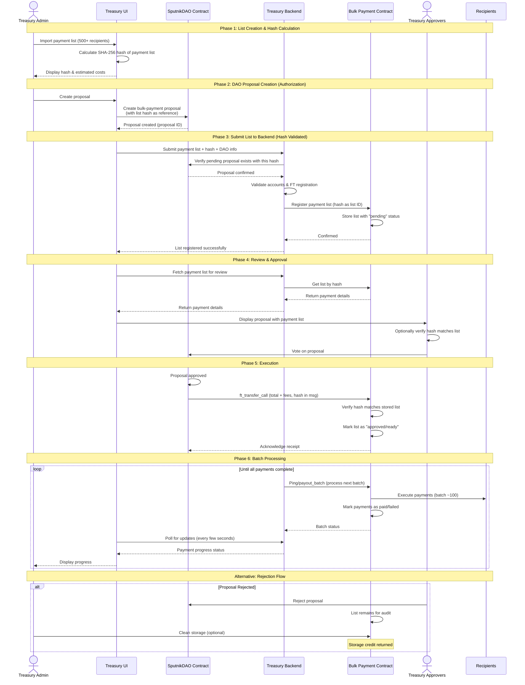

# Trezu implementation reference

Fetched: 2026-11-11T11:53:23.796Z

Upstream: https://github.com/NEAR-DevHub/trezu

Pinned revision: `62cf0e41d4b2d2358a496d47c80fcd2e59094247`

## How to use this file

Use for Trezu architecture, payment proposal construction, backend proposal retrieval, and receipt interpretation. Source files document this revision of Trezu; internal frontend helpers and backend routes are not a promised public SDK. Confirm authentication, service availability and compatibility before designing an adapter. Bulk payment is a reference option, not a selected dependency.

This is a local reference bundle, not application code. Upstream setup commands are reference material only; do not execute them automatically. MDX components and relative links are preserved as source text and may require consulting the linked upstream file. Embedded sources are delimited with long fences so their internal Markdown remains intact.

## Contents

- [README.md](https://github.com/NEAR-DevHub/trezu/blob/62cf0e41d4b2d2358a496d47c80fcd2e59094247/README.md)
- [nt-fe/README.md](https://github.com/NEAR-DevHub/trezu/blob/62cf0e41d4b2d2358a496d47c80fcd2e59094247/nt-fe/README.md)
- [nt-be/README.md](https://github.com/NEAR-DevHub/trezu/blob/62cf0e41d4b2d2358a496d47c80fcd2e59094247/nt-be/README.md)
- [nt-fe/near-connect/README.md](https://github.com/NEAR-DevHub/trezu/blob/62cf0e41d4b2d2358a496d47c80fcd2e59094247/nt-fe/near-connect/README.md)
- [nt-fe/lib/near-proposal-builders.ts](https://github.com/NEAR-DevHub/trezu/blob/62cf0e41d4b2d2358a496d47c80fcd2e59094247/nt-fe/lib/near-proposal-builders.ts)
- [nt-fe/app/(treasury)/[treasuryId]/payments/utils/proposal-builder.ts](https://github.com/NEAR-DevHub/trezu/blob/62cf0e41d4b2d2358a496d47c80fcd2e59094247/nt-fe/app/(treasury)/%5BtreasuryId%5D/payments/utils/proposal-builder.ts)
- [nt-fe/lib/proposals-api.ts](https://github.com/NEAR-DevHub/trezu/blob/62cf0e41d4b2d2358a496d47c80fcd2e59094247/nt-fe/lib/proposals-api.ts)
- [nt-fe/features/proposals/types/index.ts](https://github.com/NEAR-DevHub/trezu/blob/62cf0e41d4b2d2358a496d47c80fcd2e59094247/nt-fe/features/proposals/types/index.ts)
- [nt-fe/features/proposals/utils/receipt-utils.ts](https://github.com/NEAR-DevHub/trezu/blob/62cf0e41d4b2d2358a496d47c80fcd2e59094247/nt-fe/features/proposals/utils/receipt-utils.ts)
- [nt-be/src/handlers/proposals/mod.rs](https://github.com/NEAR-DevHub/trezu/blob/62cf0e41d4b2d2358a496d47c80fcd2e59094247/nt-be/src/handlers/proposals/mod.rs)
- [nt-be/src/handlers/proposals/get_proposals.rs](https://github.com/NEAR-DevHub/trezu/blob/62cf0e41d4b2d2358a496d47c80fcd2e59094247/nt-be/src/handlers/proposals/get_proposals.rs)
- [contracts/bulk-payment/README.md](https://github.com/NEAR-DevHub/trezu/blob/62cf0e41d4b2d2358a496d47c80fcd2e59094247/contracts/bulk-payment/README.md)
- [contracts/bulk-payment/docs/ARCHITECTURE.md](https://github.com/NEAR-DevHub/trezu/blob/62cf0e41d4b2d2358a496d47c80fcd2e59094247/contracts/bulk-payment/docs/ARCHITECTURE.md)

## README.md

Source: https://raw.githubusercontent.com/NEAR-DevHub/trezu/62cf0e41d4b2d2358a496d47c80fcd2e59094247/README.md

`````markdown
# Treasury26

A comprehensive treasury management platform for NEAR DAOs. Manage members, process payments, create vesting schedules, track balances, and handle multi-signature approvals through Sputnik DAO integration.

## Project Structure

| Directory | Description | Documentation |
|-----------|-------------|---------------|
| [nt-be](./nt-be/) | Backend API (Rust/Axum) - Balance tracking, monitoring, CSV export | [README](./nt-be/README.md) |
| [nt-fe](./nt-fe/) | Frontend (Next.js) - Web interface for treasury management | [README](./nt-fe/README.md) |
| [contracts](./contracts/) | NEAR smart contracts for bulk payments | [README](./contracts/README.md) |
| [sandbox](./sandbox/) | Local development environment with Docker | [README](./sandbox/README.md) |
| [e2e-tests](./e2e-tests/) | End-to-end tests for contract integration | [README](./e2e-tests/bulk-payment/README.md) |

## Quick Links

- **Production Backend**: https://near-treasury-backend.onrender.com
- **Add Account for Tracking**: See [nt-be/README.md](./nt-be/README.md#1-register-an-account-for-monitoring)

## Features

### Treasury Management
- Create and configure treasuries with custom policies
- Member management with role-based permissions (proposer, approver, financial member)
- Dashboard with total balance overview and USD valuations

### Financial Operations
- Single and bulk payments in NEAR, NEP-141 tokens, and cross-chain via Intents
- Token vesting schedules with cliff dates and configurable release
- Automatic balance tracking and historical charts
- CSV export of transaction history

### DAO Integration
- Sputnik DAO proposal creation and management
- Multi-signature approval workflows
- Proposal filtering by status, token type, date, and participants

### Balance Monitoring
- Register accounts for automatic balance tracking
- Real-time balance change detection across multiple token types
- Staking rewards tracking
- Historical balance data with gap-filling

### Smart Contracts
- Bulk payment processing (up to 100 payments per batch)
- Storage credit system for batch operations
- Content-addressed payment lists (SHA-256)
- Support for NEAR, fungible tokens, and NEAR Intents

## Development

See individual README files for setup instructions:

- Backend: [nt-be/README.md](./nt-be/README.md)
- Frontend: [nt-fe/README.md](./nt-fe/README.md)
- Contracts: [contracts/README.md](./contracts/README.md)
- Local sandbox: [sandbox/README.md](./sandbox/README.md)

### Telegram Bot (Local Development)

The platform supports Telegram notifications for treasury events. To develop and test the Telegram integration locally:

#### 1. Create a Bot

Open Telegram, message [@BotFather](https://t.me/BotFather), and run `/newbot`. Save the bot token it gives you.

#### 2. Expose Your Local Backend via ngrok

Telegram requires an HTTPS URL to deliver webhook updates. Use [ngrok](https://ngrok.com/) to tunnel to your local backend (port 3002 by default):

```bash
ngrok http 3002
```

Copy the `https://` forwarding URL from the ngrok output (e.g. `https://ab12-34-56.ngrok-free.app`).

#### 3. Register the Webhook

Open this URL in your browser (replace the placeholders):

```
https://api.telegram.org/bot<BOT_TOKEN>/setWebhook?url=<NGROK_URL>/api/telegram/webhook&secret_token=1234567890
```

You should see `{"ok":true,"result":true,"description":"Webhook was set"}`.

#### 4. Set Environment Variables

> **Note:** Telegram rejects `localhost` URLs in bot messages (e.g. connect-treasury links). Use `127.0.0.1` instead.

Backend (`nt-be`):
```bash
export TELEGRAM_BOT_TOKEN=<your-bot-token>
export TELEGRAM_WEBHOOK_SECRET=1234567890
export FRONTEND_BASE_URL=http://127.0.0.1:3001
```

Frontend (root `.env`):
```bash
export CORS_ALLOWED_ORIGINS=http://127.0.0.1:3001
export NEXT_PUBLIC_BACKEND_API_BASE=http://127.0.0.1:3002
```

Then start the backend and frontend as usual. Add the bot to a Telegram group — it should respond with a "Connect Treasury" button linking to your local frontend.

`````

## nt-fe/README.md

Source: https://raw.githubusercontent.com/NEAR-DevHub/trezu/62cf0e41d4b2d2358a496d47c80fcd2e59094247/nt-fe/README.md

`````markdown
# Treasury26 Frontend

Next.js frontend for Treasury26 - a cross-chain multisig security platform for managing digital assets on NEAR Protocol.

## Features

- 🔐 **Ledger Hardware Wallet Support** - Secure authentication with Ledger Nano X/S/Flex
- 💼 **Treasury Management** - Multi-signature wallet management
- 💸 **Payment Requests** - Create and approve payment proposals
- 📊 **Dashboard** - Overview of treasury assets and activity

## Getting Started

### Prerequisites

- [Bun](https://bun.sh/) (recommended) or Node.js 18+
- For Ledger support: Chrome/Edge browser with WebHID API support

### Installation

```bash
bun install
```

### Development

#### Option 1: Using Production Backend (Recommended for Testing)

When developing locally but connecting to the production backend (https://api.trezu.app), you need to use the CORS proxy to avoid cross-origin issues:

1. **Start the proxy server** (in one terminal):
   ```bash
   bun run proxy
   ```
   This starts a CORS proxy on `http://localhost:8888` that forwards requests to the production backend.

2. **Start the dev server** (in another terminal):
   ```bash
   NEXT_PUBLIC_BACKEND_API_BASE=http://localhost:8888 bun run dev
   ```

3. Open [http://localhost:3000](http://localhost:3000)

#### Option 2: Using Local Backend

If you have the backend running locally:

```bash
NEXT_PUBLIC_BACKEND_API_BASE=http://localhost:8080 bun run dev
```

### CORS Proxy Server

The `proxy-server.js` provides a simple HTTP proxy that:
- Forwards API requests from `localhost:8888` to the production backend
- Handles CORS headers automatically
- Logs all proxied requests for debugging

**Environment Variables:**
- `PROXY_PORT` - Port for the proxy server (default: 8888)
- `BACKEND_PROXY_TARGET` - Target backend URL (default: https://api.trezu.app)

**Example:**
```bash
PROXY_PORT=9000 BACKEND_PROXY_TARGET=https://api.trezu.app bun run proxy
```

### Viewing a testnet DAO locally (omni chain-signature proposals)

The production backend is mainnet-only. To open a NEAR **testnet** DAO in the UI
without building `nt-be`, run the dev-only mock backend, which serves proposals,
policy and config straight from testnet RPC view calls and forwards every other
`/api` route to the real backend:

```bash
bun run testnet:mock
```

then in a second terminal:

```bash
NEXT_PUBLIC_NEAR_NETWORK=testnet \
NEXT_PUBLIC_NEAR_RPC_URL=https://rpc.testnet.fastnear.com \
NEXT_PUBLIC_BACKEND_API_BASE=http://127.0.0.1:8889 \
bun run dev
```

and open `http://localhost:3000/<dao>.sputnik-v2.testnet/requests`. Use
`127.0.0.1`, not `localhost`, for `NEXT_PUBLIC_BACKEND_API_BASE`: Next's
server-side fetch may resolve `localhost` to `::1`. Options: `MOCK_PORT`,
`MOCK_NEAR_RPC_URL`, `MOCK_FORWARD_TARGET` (see
`scripts/testnet-mock-backend.mjs`). Execution-transaction links, assets and
activity stay empty for testnet DAOs (no indexer).

## Scripts

- `bun run dev` - Start development server
- `bun run dev:ledger` - Watch and rebuild Ledger wallet on changes
- `bun run build` - Build for production (includes Ledger wallet)
- `bun run build:ledger` - Build Ledger wallet only
- `bun run start` - Start production server
- `bun run proxy` - Start CORS proxy server
- `bun run testnet:mock` - Dev-only mock backend for viewing a NEAR testnet DAO
- `bun run lint` - Run Biome linter
- `bun run format` - Format code with Biome
- `bun run test:e2e` - Run Playwright E2E tests
- `bun run test:e2e:ui` - Run E2E tests with UI

## Ledger Support

This application supports Ledger hardware wallets (Nano X, Nano S, Nano S Plus, Flex) for secure authentication using NEP-413 message signing.

### Requirements

- **Browser:** Chrome, Edge, or any Chromium-based browser with WebHID support
- **Ledger App:** NEAR app v2.4.3+ installed via Ledger Live
- **Ledger Device:** Unlocked with NEAR app open during sign-in

### Implementation Details

The Ledger integration uses:
- WebHID/WebUSB/WebBLE API for device communication
- NEP-413 message signing standard
- NEP-366 delegate actions (meta-transactions)
- Borsh serialization for payload formatting
- Base64 encoding for signatures

## Project Structure

```
nt-fe/
├── app/                    # Next.js app directory
│   ├── (init)/            # Onboarding and authentication flows
│   ├── (treasury)/        # Main treasury application
│   └── api/               # API routes (if any)
├── components/            # Reusable UI components
├── features/              # Feature-specific components and logic
├── hooks/                 # Custom React hooks
├── lib/                   # Utility functions and API clients
├── stores/                # Zustand state management
├── types/                 # TypeScript type definitions
└── proxy-server.js        # Development CORS proxy

```

## Environment Variables

- `NEXT_PUBLIC_BACKEND_API_BASE` - Backend API base URL (default: http://localhost:8080)
- `NEXT_PUBLIC_GTM_ID` - Google Tag Manager container ID (for example: GTM-XXXXXXX). Marketing configures conversion tags and ad pixels inside GTM.
- `NEXT_PUBLIC_GA_MEASUREMENT_ID` - Google Analytics 4 measurement ID (for example: G-XXXXXXXXXX). Loaded alongside GTM for direct GA4 tracking.

## Tech Stack

- **Framework:** Next.js 16 with App Router
- **Language:** TypeScript
- **Styling:** Tailwind CSS
- **State Management:** Zustand
- **Data Fetching:** TanStack Query
- **Wallet Integration:** @hot-labs/near-connect
- **Hardware Wallet:** Ledger WebHID
- **Package Manager:** Bun

## Learn More

- [Next.js Documentation](https://nextjs.org/docs)
- [NEAR Protocol](https://near.org)
- [NEP-413 Standard](https://github.com/near/NEPs/blob/master/neps/nep-0413.md)
- [Ledger Developer Docs](https://developers.ledger.com/)

`````

## nt-be/README.md

Source: https://raw.githubusercontent.com/NEAR-DevHub/trezu/62cf0e41d4b2d2358a496d47c80fcd2e59094247/nt-be/README.md

`````markdown
# Treasury26 Backend - Treasury History APIs

## Overview

Treasury activity, charts, and balances are served from the unified gold
ledger (`gold_treasury_ledger_events`), one table covering both public
(sputnik DAO) and confidential (intents) treasuries. Rows are projected from
the medallion pipeline (bronze chain events → silver transfer legs/balance
history → gold) and verified against on-chain / 1Click balances at projection
time.

- **NEAR** - Native NEAR token
- **FT Tokens** - NEP-141 fungible tokens
- **Intents Tokens** - Multi-token balances on intents.near (NEP-141 and NEP-245)
- **Staking** - Staked balances observed per pool and shown as chart series

## Quick Start

### 1. Register an Account for Monitoring

**Production** (https://near-treasury-backend.onrender.com):
```bash
curl -X POST https://near-treasury-backend.onrender.com/api/monitored-accounts \
  -H "Content-Type: application/json" \
  -d '{
    "account_id": "your-treasury.sputnik-dao.near",
    "enabled": true
  }'
```

**Local development**:
```bash
curl -X POST http://localhost:3000/api/monitored-accounts \
  -H "Content-Type: application/json" \
  -d '{
    "account_id": "webassemblymusic-treasury.sputnik-dao.near",
    "enabled": true
  }'
```

### 2. Query Treasury Activity

```bash
# All activity for an account (newest first)
curl "http://localhost:3000/api/balance-changes?accountId=webassemblymusic-treasury.sputnik-dao.near"

# Filter by token
curl "http://localhost:3000/api/balance-changes?accountId=webassemblymusic-treasury.sputnik-dao.near&tokenIds=near"

# Paginate
curl "http://localhost:3000/api/balance-changes?accountId=webassemblymusic-treasury.sputnik-dao.near&limit=50&offset=50"
```

## API Reference

### Get Balance Changes

**GET** `/api/balance-changes`

Query parameters (camelCase):
- `accountId` (required) - Account to query
- `tokenIds` / `excludeTokenIds` (optional) - Comma-separated token filters
- `transactionTypes` (optional) - `incoming`, `outgoing`, `exchange`
- `startTime` / `endTime` (optional) - ISO 8601 range
- `minAmount` / `maxAmount` (optional) - Decimal-adjusted, single-token filter only
- `txHash` (optional) - Partial transaction-hash match
- `fromAccounts` / `toAccounts` (+ `...Not` variants) (optional) - Counterparty filters
- `limit` / `offset` (optional) - Pagination (default limit 100, max 1000)
- `includeMetadata` / `includePrices` / `includeChainMetadata` (optional) - Enrichment flags

Exchanges are returned as a single fulfillment row carrying the full swap
(sent + received legs) in the `swap` object.

### Recent Activity (UI feed)

**GET** `/api/recent-activity` - Paginated feed with plan-limit windowing,
token metadata, and USD values.
**GET** `/api/recent-activity/senders` / `/api/recent-activity/recipients` -
Distinct counterparty options for the feed's filter dropdowns.

### Charts and Exports

**GET** `/api/balance-history/chart` - Balance snapshots at
hourly/daily/weekly/monthly intervals, with USD series and freshness metadata
(`chartMeta.status`: `ok` / `stale` / `unavailable`).
**GET** `/api/balance-history/export?format=csv|json|xlsx` - Accounting
export; consumes an export credit and honors plan history limits.

## Development

### Run Tests

```bash
# All tests (needs a local Postgres with migrations applied)
cargo test

# One suite
cargo test --test balance_history_apis_test
```

### Database Setup

See [DATABASE.md](./DATABASE.md) for PostgreSQL setup instructions.

## Token Format

### FT Tokens
Simple contract address: `wrap.near`, `token.v2.ref-finance.near`

### Intents Tokens
Full path format: `intents.near:nep141:btc.omft.near`
- Preserves the underlying FT contract for metadata queries
- Format: `intents.near:{standard}:{ft_contract}`

### Staking
Staked balances appear in charts as `staking:{pool_contract}` series derived
from staking observations; the activity feed shows only user-visible
transfers.

`````

## nt-fe/near-connect/README.md

Source: https://raw.githubusercontent.com/NEAR-DevHub/trezu/62cf0e41d4b2d2358a496d47c80fcd2e59094247/nt-fe/near-connect/README.md

`````markdown
# NEAR Connect Plugin for Trezu

[NEAR Connect](https://github.com/azbang/near-connect) is a wallet selector for NEAR Protocol wallets. This is a plugin that enables Trezu support there.

See it in action [here](https://youtu.be/CVWi5OMeFhY).

This implementation is a stripped down version of `near-connect/near-wallets` with only Trezu Wallet implementation.

## Build

```
bun install
bun run build
```

`````

## nt-fe/lib/near-proposal-builders.ts

Source: https://raw.githubusercontent.com/NEAR-DevHub/trezu/62cf0e41d4b2d2358a496d47c80fcd2e59094247/nt-fe/lib/near-proposal-builders.ts

`````typescript
import type { FunctionCallAction, FunctionCallKind } from "@/lib/proposals-api";
import {
    FT_TRANSFER_GAS,
    STORAGE_DEPOSIT_AMOUNT,
    STORAGE_DEPOSIT_GAS,
} from "@/lib/near-ft-gas";
import {
    getBatchStorageDepositIsRegistered,
    isSponsorStorageAllowed,
} from "@/lib/api";
import { isValidNearAddressFormat } from "@/lib/near-validation";
import { decodeArgs, jsonToBase64 } from "@/lib/utils";
import { NEAR_NETWORK_ID, WRAP_NEAR_TOKEN_ID } from "@/constants/network-ids";
import Big from "@/lib/big";

export function buildIntentsTransferProposal(
    tokenAddress: string,
    depositAddress: string,
    amountIn: string,
): FunctionCallKind {
    return {
        FunctionCall: {
            receiver_id: "intents.near",
            actions: [
                {
                    method_name: "mt_transfer",
                    args: jsonToBase64({
                        receiver_id: depositAddress,
                        amount: amountIn,
                        token_id: tokenAddress,
                    }),
                    deposit: "1",
                    gas: FT_TRANSFER_GAS,
                },
            ],
        },
    };
}

export function buildNativeNearIntentsKind(
    depositAddress: string,
    amountIn: string,
): FunctionCallKind {
    return {
        FunctionCall: {
            receiver_id: WRAP_NEAR_TOKEN_ID,
            actions: [
                {
                    method_name: "near_deposit",
                    args: jsonToBase64({}),
                    deposit: amountIn,
                    gas: STORAGE_DEPOSIT_GAS,
                },
                {
                    method_name: "ft_transfer",
                    args: jsonToBase64({
                        receiver_id: depositAddress,
                        amount: amountIn,
                    }),
                    deposit: "1",
                    gas: FT_TRANSFER_GAS,
                },
            ],
        },
    };
}

/** DAO-paid NEP-141 registration. The token contract refunds this when the account is already registered. */
export function storageDepositAction(accountId: string): FunctionCallAction {
    return {
        method_name: "storage_deposit",
        args: jsonToBase64({
            account_id: accountId,
            registration_only: true,
        }),
        deposit: STORAGE_DEPOSIT_AMOUNT,
        gas: STORAGE_DEPOSIT_GAS,
    };
}

/**
 * Prepend `storage_deposit` actions onto a FunctionCall whose receiver is the
 * token contract. Same-proposal ordering is required: a separate proposal's
 * cross-contract call is not finished before the transfer starts.
 */
export function prependStorageDeposits(
    kind: FunctionCallKind,
    accountIds: string[],
): FunctionCallKind {
    if (accountIds.length === 0) return kind;
    return {
        FunctionCall: {
            receiver_id: kind.FunctionCall.receiver_id,
            actions: [
                ...accountIds.map(storageDepositAction),
                ...kind.FunctionCall.actions,
            ],
        },
    };
}

/**
 * Accounts the proposal must register itself. Empty when the sponsor pays
 * (token is allowlisted) or every account is already registered.
 * A failed allowlist or registration check is treated as "not sponsored",
 * so the treasury pays rather than the relayer calling an unknown contract.
 */
export async function accountsNeedingProposalStorageDeposit(
    tokenId: string,
    accountIds: string[],
): Promise<string[]> {
    const unique = [
        ...new Set(
            accountIds.filter((accountId) =>
                isValidNearAddressFormat(accountId),
            ),
        ),
    ];
    if (unique.length === 0) return [];
    if (await isSponsorStorageAllowed(tokenId)) return [];

    const statuses = await getBatchStorageDepositIsRegistered(
        unique.map((accountId) => ({ accountId, tokenId })),
    );
    const registered = new Set(
        statuses
            .filter((status) => status.isRegistered)
            .map((status) => status.accountId),
    );
    return unique.filter((accountId) => !registered.has(accountId));
}

export function buildNearFtIntentsKind(
    tokenAddress: string,
    depositAddress: string,
    amountIn: string,
): FunctionCallKind {
    return {
        FunctionCall: {
            receiver_id: tokenAddress,
            actions: [
                {
                    method_name: "ft_transfer",
                    args: jsonToBase64({
                        receiver_id: depositAddress,
                        amount: amountIn,
                    }),
                    deposit: "1",
                    gas: FT_TRANSFER_GAS,
                },
            ],
        },
    };
}

export interface IntentsDepositCall {
    residency: "Near" | "Ft" | "Intents";
    /** Display token id: `near`, the NEP-141 contract, or the intents token id. */
    tokenId: string;
    /** Recipient of the `ft_transfer` or `mt_transfer`, not a leading `storage_deposit`. */
    depositAddress: string;
    amountRaw: string;
}

function parseTransferArgs(
    args: string,
): { depositAddress: string; amountRaw: string; tokenId?: string } | null {
    const decoded = decodeArgs(args);
    if (!decoded || typeof decoded !== "object") return null;
    const { receiver_id, amount, token_id } = decoded as Record<
        string,
        unknown
    >;
    if (typeof receiver_id !== "string" || receiver_id.length === 0) {
        return null;
    }
    if (typeof amount !== "string" || !/^[0-9]+$/.test(amount)) return null;
    if (Big(amount).lte(0)) return null;
    return {
        depositAddress: receiver_id,
        amountRaw: amount,
        tokenId: typeof token_id === "string" ? token_id : undefined,
    };
}

/**
 * Decode and validate a public-to-confidential move call — exactly the
 * shapes the builders above produce (wrap-and-transfer, single `ft_transfer`,
 * single `mt_transfer`), with decodable args, a receiver, a positive amount
 * and (for wrap) `near_deposit` == the transferred amount. An Ft call may
 * start with one or more `storage_deposit` actions whose deposit is
 * `STORAGE_DEPOSIT_AMOUNT`; the decoded recipient is still the `ft_transfer`
 * receiver. The requests list uses this same parser. Anything else is not a
 * move.
 */
export function parseIntentsDepositKind(
    kind: unknown,
): IntentsDepositCall | null {
    if (!kind || typeof kind !== "object" || !("FunctionCall" in kind)) {
        return null;
    }
    const { receiver_id, actions } = (kind as FunctionCallKind).FunctionCall;
    if (receiver_id === WRAP_NEAR_TOKEN_ID) {
        if (actions.length !== 2) return null;
        const [wrap, transfer] = actions;
        if (
            wrap.method_name !== "near_deposit" ||
            transfer.method_name !== "ft_transfer" ||
            transfer.deposit !== "1"
        ) {
            return null;
        }
        const parsed = parseTransferArgs(transfer.args);
        if (!parsed || wrap.deposit !== parsed.amountRaw) return null;
        return {
            residency: "Near",
            tokenId: NEAR_NETWORK_ID,
            depositAddress: parsed.depositAddress,
            amountRaw: parsed.amountRaw,
        };
    }
    if (receiver_id === "intents.near") {
        if (actions.length !== 1 || actions[0].deposit !== "1") return null;
        const action = actions[0];
        if (action.method_name !== "mt_transfer") return null;
        const parsed = parseTransferArgs(action.args);
        if (!parsed?.tokenId) return null;
        return {
            residency: "Intents",
            tokenId: parsed.tokenId,
            depositAddress: parsed.depositAddress,
            amountRaw: parsed.amountRaw,
        };
    }
    const transferIndex = actions.findIndex(
        (action) => action.method_name === "ft_transfer",
    );
    if (transferIndex < 0 || transferIndex !== actions.length - 1) return null;
    const transfer = actions[transferIndex];
    if (transfer.deposit !== "1") return null;
    const deposits = actions.slice(0, transferIndex);
    if (
        deposits.some(
            (action) =>
                action.method_name !== "storage_deposit" ||
                action.deposit !== STORAGE_DEPOSIT_AMOUNT,
        )
    ) {
        return null;
    }
    const parsed = parseTransferArgs(transfer.args);
    if (!parsed) return null;
    return {
        residency: "Ft",
        tokenId: receiver_id,
        depositAddress: parsed.depositAddress,
        amountRaw: parsed.amountRaw,
    };
}

export function isIntentsDepositKind(kind: unknown): kind is FunctionCallKind {
    return parseIntentsDepositKind(kind) !== null;
}

`````

## nt-fe/app/(treasury)/[treasuryId]/payments/utils/proposal-builder.ts

Source: https://raw.githubusercontent.com/NEAR-DevHub/trezu/62cf0e41d4b2d2358a496d47c80fcd2e59094247/nt-fe/app/(treasury)/%5BtreasuryId%5D/payments/utils/proposal-builder.ts

`````typescript
import type { FunctionCallKind, TransferKind } from "@/lib/proposals-api";
import type { Token } from "@/components/token-input";
import { default_near_token } from "@/constants/token";
import { FT_TRANSFER_GAS } from "@/lib/near-ft-gas";
import { jsonToBase64 } from "@/lib/utils";

// ─── Proposal builders ────────────────────────────────────────────────────────
//
// Allowlisted token contracts are registered by the backend at approval time.
// A token outside that list gets a `storage_deposit` action on the proposal
// itself (`buildDirectFtTransferCallKind` plus `prependStorageDeposits`).
// Intents kinds are built via the `*Kind` helpers in @/lib/near-proposal-builders.

/**
 * Builds a Transfer kind for a direct NEAR or NEAR FT payment.
 * Native NEAR uses token_id="" as per the DAO contract convention.
 */
export function buildDirectTransferKind(
    address: string,
    token: Token,
    parsedAmount: string,
    isConfidential: boolean,
): TransferKind {
    const isNEAR = token.address === default_near_token(isConfidential).address;
    return {
        Transfer: {
            token_id: isNEAR ? "" : token.address,
            receiver_id: address,
            amount: parsedAmount,
            msg: null,
        },
    };
}

/**
 * Direct FT payment as a FunctionCall, so a `storage_deposit` for an
 * unregistered recipient can sit in front of `ft_transfer` on the same
 * token contract. Used when the sponsor will not pay that registration.
 */
export function buildDirectFtTransferCallKind(
    address: string,
    tokenAddress: string,
    parsedAmount: string,
): FunctionCallKind {
    return {
        FunctionCall: {
            receiver_id: tokenAddress,
            actions: [
                {
                    method_name: "ft_transfer",
                    args: jsonToBase64({
                        receiver_id: address,
                        amount: parsedAmount,
                    }),
                    deposit: "1",
                    gas: FT_TRANSFER_GAS,
                },
            ],
        },
    };
}

`````

## nt-fe/lib/proposals-api.ts

Source: https://raw.githubusercontent.com/NEAR-DevHub/trezu/62cf0e41d4b2d2358a496d47c80fcd2e59094247/nt-fe/lib/proposals-api.ts

`````typescript
import { getProposalStatus } from "@/features/proposals/utils/proposal-utils";
import Big from "@/lib/big";
import { http as axios } from "@/lib/http";
import { isAxiosErrorWithStatus } from "@/lib/query-retry";
import { nanosToMs } from "@/lib/utils";
import type { Policy, VotePolicy } from "@/types/policy";

const BACKEND_API_BASE = `${process.env.NEXT_PUBLIC_BACKEND_API_BASE}/api`;

export type ProposalStatus =
    | "Approved"
    | "Rejected"
    | "InProgress"
    | "Expired"
    | "Removed"
    | "Moved"
    | "Failed";

export type Vote = "Approve" | "Reject" | "Remove";

export interface TransferKind {
    Transfer: {
        amount: string;
        msg: string | null;
        receiver_id: string;
        token_id: string;
    };
}

export interface FunctionCallAction {
    args: string;
    deposit: string;
    gas: string;
    method_name: string;
}

export interface FunctionCallKind {
    FunctionCall: {
        actions: FunctionCallAction[];
        receiver_id: string;
    };
}

export interface ChangePolicyKind {
    ChangePolicy: {
        policy: {
            bounty_bond: string;
            bounty_forgiveness_period: string;
            default_vote_policy: {
                quorum: string;
                threshold: [number, number] | string;
                weight_kind: string;
            };
            proposal_bond: string;
            proposal_period: string;
            roles: Array<{
                kind: {
                    Group: string[];
                };
                name: string;
                permissions: string[];
                vote_policy: Record<
                    string,
                    {
                        quorum: string;
                        threshold: string | [number, number];
                        weight_kind: string;
                    }
                >;
            }>;
        };
    };
}

export interface ChangeConfigKind {
    ChangeConfig: {
        config: {
            metadata: string;
            purpose: string;
            name: string;
        };
    };
}

export interface ChangePolicyUpdateParametersKind {
    ChangePolicyUpdateParameters: {
        parameters: {
            bounty_bond: string | null;
            bounty_forgiveness_period: string | null;
            proposal_bond: string | null;
            proposal_period: string | null;
        };
    };
}

export interface AddMemberToRoleKind {
    AddMemberToRole: {
        member_id: string;
        role: string;
    };
}

export interface RemoveMemberFromRoleKind {
    RemoveMemberFromRole: {
        member_id: string;
        role: string;
    };
}

export interface UpgradeSelfKind {
    UpgradeSelf: {
        hash: string;
    };
}

export interface UpgradeRemoteKind {
    UpgradeRemote: {
        receiver_id: string;
        method_name: string;
        hash: string;
    };
}

export interface SetStakingContractKind {
    SetStakingContract: {
        staking_id: string;
    };
}

export interface Bounty {
    description: string;
    token: string;
    amount: string;
    times: number;
    max_deadline: string;
}

export interface AddBountyKind {
    AddBounty: {
        bounty: Bounty;
    };
}

export interface BountyDoneKind {
    BountyDone: {
        bounty_id: number;
        receiver_id: string;
    };
}

export interface VoteKind {
    Vote: {};
}

export interface FactoryInfo {
    factory_id: string;
    auto_update: boolean;
}

export interface FactoryInfoUpdateKind {
    FactoryInfoUpdate: {
        factory_info: FactoryInfo;
    };
}

export type RoleKind =
    | { Everyone: {} }
    | { Member: string }
    | { Group: string[] };

export type WeightKind = "TokenWeight" | "RoleWeight";

export type WeightOrRatio = { Weight: string } | { Ratio: [number, number] };

export interface RolePermission {
    name: string;
    kind: RoleKind;
    permissions: string[];
    vote_policy: Record<string, VotePolicy>;
}

export interface ChangePolicyAddOrUpdateRoleKind {
    ChangePolicyAddOrUpdateRole: {
        role: RolePermission;
    };
}

export interface ChangePolicyRemoveRoleKind {
    ChangePolicyRemoveRole: {
        role: string;
    };
}

export interface ChangePolicyUpdateDefaultVotePolicyKind {
    ChangePolicyUpdateDefaultVotePolicy: {
        vote_policy: VotePolicy;
    };
}

export type ProposalKind =
    | TransferKind
    | FunctionCallKind
    | ChangePolicyKind
    | ChangePolicyUpdateParametersKind
    | ChangeConfigKind
    | AddMemberToRoleKind
    | RemoveMemberFromRoleKind
    | UpgradeSelfKind
    | UpgradeRemoteKind
    | SetStakingContractKind
    | AddBountyKind
    | BountyDoneKind
    | VoteKind
    | FactoryInfoUpdateKind
    | ChangePolicyAddOrUpdateRoleKind
    | ChangePolicyRemoveRoleKind
    | ChangePolicyUpdateDefaultVotePolicyKind;

export interface VoteCounts {
    [roleName: string]: [number, number, number];
}

export interface Proposal {
    description: string;
    id: number;
    kind: ProposalKind;
    last_actions_log: string | null;
    proposer: string;
    status: ProposalStatus;
    submission_time: string;
    vote_counts: VoteCounts;
    votes: {
        [account: string]: Vote;
    };
    /** Populated by backend for confidential (v1.signer) proposals */
    confidential_metadata?: {
        quote_metadata?: {
            quote: {
                amountIn: string;
                amountInFormatted: string;
                amountInUsd: string;
                amountOut: string;
                amountOutFormatted: string;
                amountOutUsd: string;
                minAmountOut: string;
                timeEstimate: number;
                depositAddress: string;
                deadline: string;
            };
            quoteRequest: {
                originAsset: string;
                destinationAsset: string;
                recipient: string;
                amount: string;
                [key: string]: unknown;
            };
            signature: string;
            timestamp: string;
        };
        status?: string;
        correlation_id?: string;
        notes?: string;
        proposal_created_at?: string | null;
        proposal_executed_at?: string | null;
        gold_metadata?: {
            amount_in_usd?: string | null;
            amount_out_usd?: string | null;
            usd_change?: string | null;
        };
        /**
         * Public-to-confidential move binding (set for proposals carrying the
         * `public-to-confidential` marker). `verified` means the backend
         * matched the call's deposit address + asset to a 1Click quote in
         * this DAO's confidential history.
         */
        public_move?: {
            verified: boolean;
            deposit_address: string;
            origin_asset: string;
            amount_raw: string;
            status?: string | null;
            quote_created_at?: string | null;
            amount_in_formatted?: string | null;
        };
        /** Bulk-payment overlay (only set for bulk header proposals). */
        bulk?: {
            status: string;
            bulk_account_id: string;
            proposal_id?: number | null;
            recipients: Array<{
                payload_hash: string;
                quote_metadata?: Record<string, unknown> | null;
                status: string;
                submit_result?: Record<string, unknown> | null;
            }>;
        };
    };
    /**
     * Persisted 1Click outcome of the swap an approved intents-routed request
     * paid for, attached by the backend from its own history tables. The
     * backend buckets the request into the Failed tab from the same value,
     * so a status derived from it always matches the tab it sits in. Absent
     * when the request is not intents-routed or no outcome is stored yet.
     */
    swap_status?: SwapStatus | null;
    /** Populated by backend for public payment/exchange proposals */
    public_metadata?: {
        proposal_created_at?: string | null;
        proposal_executed_at?: string | null;
        gold_metadata?: {
            amount_in_usd?: string | null;
            amount_out_usd?: string | null;
            usd_change?: string | null;
            transaction_type?: "sent" | "exchange" | string;
        };
    };
}

export interface ProposalsResponse {
    page: number;
    page_size: number;
    total: number;
    proposals: Proposal[];
}

/**
 * Sputnik unit-variant kinds (only `Vote` today) serialize to plain JSON
 * strings in the contract state the backend passes through verbatim.
 * Normalize them to the object form the rest of the app expects, so
 * `"Vote" in proposal.kind` checks work.
 */
function normalizeProposalKind(proposal: Proposal): Proposal {
    if (typeof proposal.kind === "string") {
        return {
            ...proposal,
            kind: { [proposal.kind]: {} } as unknown as ProposalKind,
        };
    }
    return proposal;
}

export type StakeType = "stake" | "unstake" | "Withdraw Earnings" | "whitelist";

export type SourceType = "sputnikdao" | "intents" | "lockup";

export type SortBy = "CreationTime" | "ExpiryTime";

export type SortDirection = "asc" | "desc";

export interface ProposalFilters {
    // Status filters
    statuses?: ProposalStatus[];

    // Search filters
    search?: string;
    search_not?: string[];

    // Request type filters
    types?: string[];
    types_not?: string[];

    proposal_types?: string[];

    // User filters
    proposers?: string[];
    proposers_not?: string[];
    approvers?: string[];
    approvers_not?: string[];
    voter_votes?: string; // format: "account:vote,account:vote" where vote is "approved", "rejected", or "no_voted"

    // Payment-specific filters
    recipients?: string[];
    recipients_not?: string[];
    token?: string;
    token_not?: string;
    amount_min?: string;
    amount_max?: string;
    amount_equal?: string;

    // Stake delegation filters
    stake_type?: StakeType[];
    stake_type_not?: StakeType[];
    validators?: string[];
    validators_not?: string[];

    // Source filters
    source?: SourceType[];
    source_not?: SourceType[];

    // Date filters (YYYY-MM-DD format)
    created_date_from?: string;
    created_date_to?: string;
    created_date_from_not?: string;
    created_date_to_not?: string;

    // Pagination & sorting
    page?: number;
    page_size?: number;
    sort_by?: SortBy;
    sort_direction?: SortDirection;
}

/**
 * Get proposals for a specific DAO with optional filtering
 */
export async function getProposals(
    daoId: string,
    filters?: ProposalFilters,
): Promise<ProposalsResponse> {
    if (!daoId) {
        return { page: 0, page_size: 0, total: 0, proposals: [] };
    }

    try {
        const url = `${BACKEND_API_BASE}/proposals/${daoId}`;

        // Build query parameters
        const params: Record<string, string> = {};

        if (filters) {
            // Array filters - join with commas
            if (filters.statuses) params.statuses = filters.statuses.join(",");
            if (filters.types) params.types = filters.types.join(",");
            if (filters.types_not)
                params.types_not = filters.types_not.join(",");
            if (filters.proposal_types)
                params.proposal_types = filters.proposal_types.join(",");
            if (filters.proposers)
                params.proposers = filters.proposers.join(",");
            if (filters.proposers_not)
                params.proposers_not = filters.proposers_not.join(",");
            if (filters.approvers)
                params.approvers = filters.approvers.join(",");
            if (filters.approvers_not)
                params.approvers_not = filters.approvers_not.join(",");
            if (filters.recipients)
                params.recipients = filters.recipients.join(",");
            if (filters.recipients_not)
                params.recipients_not = filters.recipients_not.join(",");
            if (filters.token) params.token = filters.token;
            if (filters.token_not) params.token_not = filters.token_not;
            if (filters.stake_type)
                params.stake_type = filters.stake_type.join(",");
            if (filters.stake_type_not)
                params.stake_type_not = filters.stake_type_not.join(",");
            if (filters.validators)
                params.validators = filters.validators.join(",");
            if (filters.validators_not)
                params.validators_not = filters.validators_not.join(",");
            if (filters.source) params.source = filters.source.join(",");
            if (filters.source_not)
                params.source_not = filters.source_not.join(",");
            if (filters.search_not)
                params.search_not = filters.search_not.join(",");

            // String filters
            if (filters.search) params.search = filters.search;
            if (filters.amount_min) params.amount_min = filters.amount_min;
            if (filters.amount_max) params.amount_max = filters.amount_max;
            if (filters.amount_equal)
                params.amount_equal = filters.amount_equal;
            if (filters.created_date_from)
                params.created_date_from = filters.created_date_from;
            if (filters.created_date_to)
                params.created_date_to = filters.created_date_to;
            if (filters.created_date_from_not)
                params.created_date_from_not = filters.created_date_from_not;
            if (filters.created_date_to_not)
                params.created_date_to_not = filters.created_date_to_not;
            if (filters.voter_votes) params.voter_votes = filters.voter_votes;

            // Pagination and sorting
            if (filters.page !== undefined)
                params.page = filters.page.toString();
            if (filters.page_size)
                params.page_size = filters.page_size.toString();
            if (filters.sort_by) params.sort_by = filters.sort_by;
            if (filters.sort_direction)
                params.sort_direction = filters.sort_direction;
        }

        const response = await axios.get<ProposalsResponse>(url, {
            params,
            withCredentials: true,
        });

        return {
            ...response.data,
            proposals: response.data.proposals.map(normalizeProposalKind),
        };
    } catch (error) {
        console.error(`Error getting proposals for DAO ${daoId}`, error);
        return { page: 0, page_size: 0, total: 0, proposals: [] };
    }
}

export async function getProposal(
    daoId: string,
    proposalId: string,
): Promise<Proposal | null> {
    if (!daoId || !proposalId) {
        return null;
    }

    try {
        const url = `${BACKEND_API_BASE}/proposal/${daoId}/${proposalId}`;
        const response = await axios.get<Proposal>(url, {
            withCredentials: true,
        });
        return normalizeProposalKind(response.data);
    } catch (error) {
        console.error(
            `Error getting proposal for DAO ${daoId} and proposal ${proposalId}`,
            error,
        );
        return null;
    }
}

export interface ProposersResponse {
    proposers: string[];
    total: number;
}

export interface ApproversResponse {
    approvers: string[];
    total: number;
}

export interface ProposalTransactionResponse {
    transaction_hash: string;
    nearblocks_url: string;
    block_height: number;
    timestamp: number;
}

/**
 * Get all unique proposers for a specific DAO
 */
export async function getDaoProposers(daoId: string): Promise<string[]> {
    if (!daoId) {
        return [];
    }

    try {
        const url = `${BACKEND_API_BASE}/proposals/${daoId}/proposers`;
        const response = await axios.get<ProposersResponse>(url, {
            withCredentials: true,
        });
        return response.data.proposers;
    } catch (error) {
        console.error(`Error getting proposers for DAO ${daoId}`, error);
        return [];
    }
}

/**
 * Get all unique approvers (voters) for a specific DAO
 */
export async function getDaoApprovers(daoId: string): Promise<string[]> {
    if (!daoId) {
        return [];
    }

    try {
        const url = `${BACKEND_API_BASE}/proposals/${daoId}/approvers`;
        const response = await axios.get<ApproversResponse>(url, {
            withCredentials: true,
        });
        return response.data.approvers;
    } catch (error) {
        console.error(`Error getting approvers for DAO ${daoId}`, error);
        return [];
    }
}

/**
 * Get the execution transaction for a specific proposal
 */
export async function getProposalTransaction(
    daoId: string,
    proposal: Proposal,
    policy: Policy,
): Promise<ProposalTransactionResponse | null> {
    if (!daoId || !proposal || !policy) {
        return null;
    }

    if (proposal.status === "InProgress" || proposal.status === "Expired") {
        return null;
    }

    try {
        const url = `${BACKEND_API_BASE}/proposal/${daoId}/${proposal.id}/tx`;

        // Calculate the proposal timeframe using the actual proposal timestamps
        const submissionTimestamp = Big(proposal.submission_time);
        const expirationTimestamp = submissionTimestamp.add(
            policy.proposal_period,
        );

        // Convert nanoseconds to milliseconds and create UTC dates
        const submissionDate = new Date(
            nanosToMs(submissionTimestamp.toFixed(0)),
        );
        const expirationDate = new Date(
            nanosToMs(expirationTimestamp.toFixed(0)),
        );

        const afterDate = new Date(
            submissionDate.getTime() - 24 * 60 * 60 * 1000,
        )
            .toISOString()
            .split("T")[0];
        const beforeDate = new Date(
            expirationDate.getTime() + 7 * 24 * 60 * 60 * 1000,
        )
            .toISOString()
            .split("T")[0]; // Add 7 days buffer

        const status = getProposalStatus(proposal, policy);
        const action =
            status === "Executed" || status === "Failed"
                ? "VoteApprove"
                : status === "Rejected"
                  ? "VoteReject"
                  : "VoteRemove";

        // Build query parameters for time constraints
        const params: Record<string, string> = {
            afterDate,
            beforeDate,
            action,
        };

        const response = await axios.get<ProposalTransactionResponse>(url, {
            params,
        });
        return response.data;
    } catch (error) {
        // 404 is the backend's normal answer while NearBlocks has not indexed
        // the execution yet (or never will, for non-mainnet DAOs); the caller
        // polls, so this is not an error worth logging.
        if (isAxiosErrorWithStatus(error, 404)) {
            return null;
        }
        console.error(
            `Error getting transaction for proposal ${daoId}/${proposal.id}`,
            error,
        );
        return null;
    }
}

export interface ProposalStakingAmountResponse {
    amount: string | null;
    blockHeight: number;
    poolId: string;
    method: string;
    kind: "unstake" | "withdraw";
}

/**
 * Resolve the actual NEAR amount moved by a full-amount staking proposal
 * (unstake_all / withdraw_all / withdraw_all_from_staking_pool).
 * Only valid for executed proposals.
 */
export async function getProposalStakingAmount(
    daoId: string,
    proposal: Proposal,
    policy: Policy,
): Promise<ProposalStakingAmountResponse | null> {
    if (!daoId || !proposal || !policy) return null;
    if (proposal.status === "InProgress" || proposal.status === "Expired") {
        return null;
    }

    try {
        const url = `${BACKEND_API_BASE}/proposal/${daoId}/${proposal.id}/staking-amount`;

        const submissionTimestamp = Big(proposal.submission_time);
        const expirationTimestamp = submissionTimestamp.add(
            policy.proposal_period,
        );
        const submissionDate = new Date(
            nanosToMs(submissionTimestamp.toFixed(0)),
        );
        const expirationDate = new Date(
            nanosToMs(expirationTimestamp.toFixed(0)),
        );
        const afterDate = new Date(
            submissionDate.getTime() - 24 * 60 * 60 * 1000,
        )
            .toISOString()
            .split("T")[0];
        const beforeDate = new Date(
            expirationDate.getTime() + 7 * 24 * 60 * 60 * 1000,
        )
            .toISOString()
            .split("T")[0];

        const status = getProposalStatus(proposal, policy);
        const action =
            status === "Executed" || status === "Failed"
                ? "VoteApprove"
                : status === "Rejected"
                  ? "VoteReject"
                  : "VoteRemove";

        const response = await axios.get<ProposalStakingAmountResponse>(url, {
            params: { afterDate, beforeDate, action },
        });
        return response.data;
    } catch (error) {
        console.error(
            `Error getting staking amount for proposal ${daoId}/${proposal.id}`,
            error,
        );
        return null;
    }
}

/**
 * Swap status types and API
 */
export type SwapStatus =
    | "KNOWN_DEPOSIT_TX"
    | "PENDING_DEPOSIT"
    | "INCOMPLETE_DEPOSIT"
    | "PROCESSING"
    | "SUCCESS"
    | "REFUNDED"
    | "FAILED";

export interface SwapStatusResponse {
    status: SwapStatus;
    updatedAt: string;
}

export interface SwapQuoteResponse {
    amountInFormatted?: string | null;
    amountOutFormatted?: string | null;
    amountInUsd?: string | null;
    amountOutUsd?: string | null;
}

export interface TokenPriceAtTimestampResponse {
    priceUsd: number | null;
    source: "token_prices";
}

export type ReceiptMetric = "generated" | "print";

/**
 * Get swap execution status for an asset exchange proposal
 */
/**
 * Get the last proposal ID from the DAO contract via NEAR RPC.
 * Returns the count of proposals (the next proposal will have ID = count).
 */
export async function getLastProposalId(daoId: string): Promise<number> {
    const rpcUrl =
        process.env.NEXT_PUBLIC_NEAR_RPC_URL ||
        "https://archival-rpc.mainnet.fastnear.com";

    const resp = await fetch(rpcUrl, {
        method: "POST",
        headers: { "Content-Type": "application/json" },
        body: JSON.stringify({
            jsonrpc: "2.0",
            id: 1,
            method: "query",
            params: {
                request_type: "call_function",
                finality: "final",
                account_id: daoId,
                method_name: "get_last_proposal_id",
                args_base64: Buffer.from("{}").toString("base64"),
            },
        }),
    });

    if (!resp.ok) {
        throw new Error(
            `RPC request failed with status ${resp.status}: ${resp.statusText}`,
        );
    }

    const data = await resp.json();

    if (data?.error) {
        throw new Error(
            `RPC error: ${data.error.message || JSON.stringify(data.error)}`,
        );
    }

    const resultBytes: number[] = data?.result?.result;
    if (!resultBytes) {
        throw new Error(
            "Failed to query get_last_proposal_id: no result bytes in RPC response",
        );
    }
    const decoded = new TextDecoder().decode(new Uint8Array(resultBytes));
    return JSON.parse(decoded) as number;
}

export async function getSwapStatus(
    depositAddress: string,
    depositMemo?: string,
    daoId?: string,
): Promise<SwapStatusResponse | null> {
    if (!depositAddress) {
        return null;
    }

    try {
        const response = await axios.get<SwapStatusResponse>(
            `${BACKEND_API_BASE}/intents/swap-status`,
            {
                params: {
                    depositAddress,
                    depositMemo,
                    daoId,
                },
            },
        );
        return response.data;
    } catch (error) {
        if (isAxiosErrorWithStatus(error, 404)) {
            return null;
        }
        console.error(
            `Error getting swap status for deposit address ${depositAddress}`,
            error,
        );
        throw error;
    }
}

export async function getQuoteByDepositAddress(
    depositAddress: string,
    depositMemo?: string,
): Promise<SwapQuoteResponse | null> {
    if (!depositAddress) {
        return null;
    }

    try {
        const response = await axios.get<SwapQuoteResponse>(
            `${BACKEND_API_BASE}/intents/quote-by-deposit-address`,
            {
                params: {
                    depositAddress,
                    depositMemo,
                },
            },
        );
        return response.data;
    } catch (error) {
        if (isAxiosErrorWithStatus(error, 404)) {
            return null;
        }
        console.error(
            `Error getting quote by deposit address ${depositAddress}`,
            error,
        );
        throw error;
    }
}

export async function getTokenPriceAtTimestamp(
    tokenId: string,
    timestamp: string,
): Promise<TokenPriceAtTimestampResponse | null> {
    if (!tokenId || !timestamp) {
        return null;
    }

    try {
        const response = await axios.get<TokenPriceAtTimestampResponse>(
            `${BACKEND_API_BASE}/prices/token-at-timestamp`,
            {
                params: {
                    tokenId,
                    timestamp,
                },
            },
        );
        return response.data;
    } catch (error) {
        if (isAxiosErrorWithStatus(error, 404)) {
            return null;
        }
        console.error(
            `Error getting token price at timestamp for token ${tokenId}`,
            error,
        );
        throw error;
    }
}

export async function recordReceiptMetric(
    daoId: string,
    metric: ReceiptMetric,
): Promise<void> {
    if (!daoId) {
        return;
    }

    try {
        await axios.post(
            `${BACKEND_API_BASE}/dao/receipt-metric`,
            {
                daoId,
                metric,
            },
            {
                withCredentials: true,
            },
        );
    } catch (error) {
        console.error(
            `Error recording receipt metric '${metric}' for DAO ${daoId}`,
            error,
        );
    }
}

`````

## nt-fe/features/proposals/types/index.ts

Source: https://raw.githubusercontent.com/NEAR-DevHub/trezu/62cf0e41d4b2d2358a496d47c80fcd2e59094247/nt-fe/features/proposals/types/index.ts

`````typescript
import type { WRAP_NEAR_TOKEN_ID } from "@/constants/network-ids";
import type { OmniProposalData } from "@/features/omni/types";
import type { ProposalPermissionKind } from "@/lib/config-utils";
import type { Proposal } from "@/lib/proposals-api";
import type { Policy } from "@/types/policy";

/**
 * UI representation of proposal kinds
 * This is the user-facing categorization of proposals
 */
export type ProposalUIKind =
    | "Batch Payment Request"
    | "Payment Request"
    | "Confidential Request"
    | "Move to Confidential"
    | "Exchange"
    | "Function Call"
    | "Change Policy"
    | "Update General Settings"
    | "Earn NEAR"
    | "Unstake NEAR"
    | "Vesting"
    | "Withdraw Earnings"
    | "Members"
    | "Upgrade"
    | "Set Staking Contract"
    | "Bounty"
    | "Vote"
    | "Factory Info Update"
    | "Omni Chain Signature"
    | "Unsupported";

/**
 * @deprecated Use ProposalUIKind instead
 */
export type ProposalType = ProposalUIKind;

/**
 * Vesting schedule details
 */
export interface VestingSchedule {
    start_timestamp: string;
    end_timestamp: string;
    cliff_timestamp: string;
}

/**
 * Data structure for Payment Request proposals
 * Used for both direct transfers and FT transfers
 */
export interface PaymentRequestData {
    tokenId: string;
    amount: string;
    receiver: string;
    notes?: string;
    url?: string;
    /** Present when the payment was routed through the 1Click Intents protocol */
    depositAddress?: string;
    quoteSignature?: string;
    /** Network fee in token units (not raw smallest units) */
    networkFee?: string;
    /** USD value from confidential gold projection. null means intentionally hidden/missing. */
    usdValue?: number | null;
    /** Destination id (e.g. "near.com", "near", "nep141:...omft.near") */
    destinationAssetId?: string;
    /** Optional quote-provided USD value for display */
    quoteAmountInUsd?: string;
    /** Enables NearBlocks FT metadata fallback for on-chain NEAR fungible tokens */
    nearFt?: boolean;
}

export interface FunctionCallAction {
    methodName: string;
    args: Record<string, any>;
    gas: string;
    deposit: string;
}

/**
 * Data structure for Function Call proposals
 */
export interface FunctionCallData {
    receiver: string;
    actions: FunctionCallAction[];
}

export interface PolicyChange {
    field:
        | "proposal_bond"
        | "proposal_period"
        | "bounty_bond"
        | "bounty_forgiveness_period";
    oldValue: string | null;
    newValue: string | null;
}

export interface MemberRoleChange {
    member: string;
    oldRoles?: string[] | null; // Previous roles (groups) the member was assigned to
    newRoles?: string[] | null; // New roles (groups) the member is assigned to
}

export interface RoleDefinitionChange {
    roleName: string;
    proposalKind: string;
    oldThreshold?: any;
    newThreshold?: any;
    oldQuorum?: string | null;
    newQuorum?: string | null;
    oldWeightKind?: string | null;
    newWeightKind?: string | null;
    oldPermissions?: string[] | null;
    newPermissions?: string[] | null;
}

export interface RoleChange {
    addedMembers: MemberRoleChange[];
    removedMembers: MemberRoleChange[];
    updatedMembers: MemberRoleChange[];
    roleDefinitionChanges: RoleDefinitionChange[];
}

export interface VotePolicyChange {
    field: "weight_kind" | "quorum" | "threshold";
    oldValue: any;
    newValue: any;
}

/**
 * Data structure for Change Policy proposals
 * Unified representation showing only what changed
 */
export interface ChangePolicyData {
    newPolicy: Policy | null;
    originalProposalKind: any; // Store the original proposal kind for Transaction Details
}

/**
 * Data structure for Change Config proposals
 */
export interface ChangeConfigData {
    newConfig: {
        name: string;
        purpose: string;
        metadata: Record<string, any>;
    };
}

/**
 * Data structure for Staking proposals (and Withdraw)
 */
export interface StakingData {
    tokenId: string;
    amount: string;
    receiver: string;
    action:
        | "stake"
        | "deposit"
        | "deposit_and_stake"
        | "withdraw"
        | "withdraw_all"
        | "withdraw_all_from_staking_pool"
        | "unstake"
        | "unstake_all";
    sourceWallet: "Lockup" | "Wallet";
    validatorUrl: string;
    isLockup: boolean;
    lockupPool: string;
    notes: string;
    isFullAmount: boolean;
}

/**
 * Data structure for Vesting proposals
 */
export interface VestingData {
    tokenId: string;
    amount: string;
    receiver: string;
    vestingSchedule: VestingSchedule | null;
    whitelistAccountId: string;
    foundationAccountId: string;
    allowCancellation: boolean;
    allowStaking: boolean;
    notes: string;
}

/**
 * Data structure for Confidential Transfer proposals (v1.signer signing proposals).
 * Quote metadata is populated from the backend's confidential_intents table.
 */
export type MappedConfidentialRequest =
    | { type: "swap"; data: SwapRequestData }
    | { type: "payment"; data: PaymentRequestData }
    | { type: "bulk"; data: ConfidentialBulkData }
    | null;

export interface ConfidentialRequestData {
    correlationId?: string;
    payloadHash?: string;
    status?: string;
    proposalCreatedAt?: string | null;
    executedAt?: string | null;
    mapped?: MappedConfidentialRequest;
    title: string;
}

export interface SwapRequestData {
    source: "exchange" | typeof WRAP_NEAR_TOKEN_ID;
    timeEstimate?: string;
    intentsTokenContractId?: string;
    quoteSignature?: string;
    depositAddress?: string;
    tokenIn: string; // Token ID extracted from actions (e.g., "wrap.near")
    tokenInSymbol?: string; // LEGACY: Token symbol for old proposals (e.g., "NEAR")
    tokenInAddress?: string; // NEW: Token address for new proposals (e.g., "near")
    sourceNetwork: string;
    destinationNetwork?: string; // LEGACY: Destination network - only for old proposals
    amountIn: string;
    amountInUsd?: number | null;
    tokenOut: string; // Token symbol (LEGACY for old proposals, empty for new ones)
    tokenOutAddress?: string; // NEW: Token address for new proposals
    amountOut: string;
    amountOutUsd?: number | null;
    slippage?: string;
    quoteDeadline?: string;
    /** Absent on proposals created before the flag was stored. */
    hasAppFee?: boolean;
}

/**
 * Data structure for Batch Payment Request proposals
 */
export interface BatchPaymentRequestData {
    tokenId: string;
    totalAmount: string;
    batchId: string;
    notes?: string;
    /**
     * Receive network from proposal description `destinationNetwork`, when
     * present (e.g. public bulk with nearcom: recipients → `near.com`).
     * Confidential bulk usually supplies this from quote metadata instead.
     */
    destinationAssetId?: string;
}

/**
 * Per-recipient row inside a confidential bulk payment.
 *
 * `quoteMetadata` is the full 1Click quote returned at prepare time —
 * recipient address, amount, destinationAsset, depositAddress, etc. all live
 * inside its `quote` and `quoteRequest` sub-objects (same shape as the
 * single-confidential `ConfidentialRequestData.mapped.data`).
 */
export interface ConfidentialBulkRecipient {
    payloadHash: string;
    quoteMetadata?: Record<string, unknown> | null;
    /** pending | submitted | failed | missing */
    status: string;
    submitResult?: Record<string, unknown> | null;
}

/**
 * Bulk-confidential payload mapped from `confidential_metadata.bulk`.
 * Surfaced as `ConfidentialRequestData.mapped` with `type: "bulk"`, so the
 * single Confidential Request UIKind handles both legs (single + bulk).
 */
export interface ConfidentialBulkData {
    /** Sub-account that signs each recipient leg. */
    bulkAccountId?: string;
    /** pending | activating | signing | completed | failed (BE state machine) */
    bulkStatus?: string;
    /** Origin asset id (Intents) — uniform across recipients. */
    tokenId: string;
    /** Sum of recipient amounts in smallest units. */
    totalAmount: string;
    /**
     * Receive-network asset id from recipient-leg quotes (bridge asset id, or
     * near.com for intra-Intents). Same field single confidential payment uses.
     */
    destinationAssetId?: string;
    /** Notes for the proposal */
    notes?: string;
    /** Per-recipient rows from the linked `confidential_intents` rows. */
    recipients: ConfidentialBulkRecipient[];
}

/**
 * Data structure for Unknown proposals
 */
export interface UnknownData {
    proposalType?: ProposalPermissionKind;
}

/**
 * Data structure for Members proposals (Add/Remove Member to/from Role)
 */
export interface MembersData {
    memberId: string;
    role: string;
    action: "add" | "remove";
}

/**
 * Data structure for Upgrade proposals (Self/Remote)
 */
export interface UpgradeData {
    hash: string;
    type: "self" | "remote";
    receiverId?: string;
    methodName?: string;
}

/**
 * Data structure for Set Staking Contract proposals
 */
export interface SetStakingContractData {
    stakingId: string;
}

/**
 * Data structure for Bounty proposals (Add/Done)
 */
export interface BountyData {
    action: "add" | "done";
    bountyId?: number;
    receiverId?: string;
    description?: string;
    token?: string;
    amount?: string;
    times?: number;
    maxDeadline?: string;
}

/**
 * Data structure for Vote proposals (signaling only)
 */
export interface VoteData {
    message: string;
}

/**
 * Data structure for Factory Info Update proposals
 */
export interface FactoryInfoUpdateData {
    factoryId: string;
    autoUpdate: boolean;
}

/**
 * Mapping of proposal types to their data structures
 */
export interface ProposalTypeDataMap {
    "Payment Request": PaymentRequestData;
    "Confidential Request": ConfidentialRequestData;
    "Move to Confidential": PaymentRequestData;
    "Function Call": FunctionCallData;
    "Change Policy": ChangePolicyData;
    "Update General Settings": ChangeConfigData;
    "Earn NEAR": StakingData;
    "Unstake NEAR": StakingData;
    "Withdraw Earnings": StakingData;
    Vesting: VestingData;
    Exchange: SwapRequestData;
    "Batch Payment Request": BatchPaymentRequestData;
    Members: MembersData;
    Upgrade: UpgradeData;
    "Set Staking Contract": SetStakingContractData;
    Bounty: BountyData;
    Vote: VoteData;
    "Factory Info Update": FactoryInfoUpdateData;
    "Omni Chain Signature": OmniProposalData;
    Unsupported: UnknownData;
}

/**
 * Extract proposal data based on type
 * @template T The proposal UI kind
 */
export type ProposalDataForType<T extends ProposalUIKind> =
    ProposalTypeDataMap[T];

/**
 * Helper type for proposal data extractors
 * These functions extract and normalize data from raw proposals
 */
export type ProposalDataExtractor<T extends ProposalUIKind> = (
    proposal: Proposal,
) => ProposalDataForType<T> | null;

/**
 * Union type of all proposal data structures
 */
export type AnyProposalData =
    | PaymentRequestData
    | BatchPaymentRequestData
    | ConfidentialRequestData
    | FunctionCallData
    | ChangePolicyData
    | ChangeConfigData
    | StakingData
    | VestingData
    | SwapRequestData
    | MembersData
    | UpgradeData
    | SetStakingContractData
    | BountyData
    | VoteData
    | FactoryInfoUpdateData
    | OmniProposalData
    | UnknownData;

`````

## nt-fe/features/proposals/utils/receipt-utils.ts

Source: https://raw.githubusercontent.com/NEAR-DevHub/trezu/62cf0e41d4b2d2358a496d47c80fcd2e59094247/nt-fe/features/proposals/utils/receipt-utils.ts

`````typescript
import type {
    BatchPaymentRequestData,
    ConfidentialBulkData,
    ConfidentialRequestData,
    PaymentRequestData,
    SwapRequestData,
} from "@/features/proposals/types/index";
import {
    extractConfidentialBulkDestinationAssetId,
    mapConfidentialBulkRecipientPayment,
} from "@/features/proposals/utils/confidential-bulk-utils";
import { extractProposalData } from "@/features/proposals/utils/proposal-extractors";
import type {
    Proposal,
    SwapStatus,
    SwapStatusResponse,
} from "@/lib/proposals-api";

export type { ConfidentialBulkRecipientLeg } from "@/features/proposals/utils/confidential-bulk-utils";
export {
    extractConfidentialBulkDestinationAssetId,
    mapConfidentialBulkRecipientPayment,
} from "@/features/proposals/utils/confidential-bulk-utils";

export interface ReceiptProposalData {
    variant: "payment" | "exchange";
    sourceTokenId?: string;
    destinationTokenId?: string;
    depositAddress?: string;
    receiverAddress?: string;
    sourceAmountRaw?: string;
    destinationAmountWithDecimals?: string;
    sourceAmountUsd?: number;
    destinationAmountUsd?: number;
}

/** Receipt/batch payment shape — net amount the recipient receives. */
export interface ConfidentialBulkReceiptPayment {
    recipient: string;
    /** Recipient net amount in smallest units (quote amountOut). */
    amount: string;
}

export interface ConfidentialBulkReceiptData {
    tokenId: string;
    /** Receive-network asset id (bridge asset or near.com), when known. */
    destinationAssetId?: string;
    payments: ConfidentialBulkReceiptPayment[];
}

export function toConfidentialBulkReceiptData(
    data: ConfidentialBulkData,
): ConfidentialBulkReceiptData {
    return {
        tokenId: data.tokenId,
        destinationAssetId:
            data.destinationAssetId ??
            extractConfidentialBulkDestinationAssetId(data.recipients),
        payments: data.recipients.map((recipient) => {
            const leg = mapConfidentialBulkRecipientPayment(
                recipient.quoteMetadata,
            );
            return { recipient: leg.recipient, amount: leg.amountOut };
        }),
    };
}

/**
 * Extract multi-recipient receipt rows for a confidential bulk payment.
 * Returns null for non-bulk confidential requests and other proposal kinds.
 */
export function extractConfidentialBulkReceiptData(
    proposal: Proposal,
    treasuryId?: string,
): ConfidentialBulkReceiptData | null {
    try {
        const { type, data } = extractProposalData(proposal, treasuryId);
        if (type !== "Confidential Request") {
            return null;
        }

        const confidentialData = data as ConfidentialRequestData;
        if (confidentialData.mapped?.type !== "bulk") {
            return null;
        }

        return toConfidentialBulkReceiptData(confidentialData.mapped.data);
    } catch {
        return null;
    }
}

export function isReceiptEligibleProposalKind(proposalKind?: string): boolean {
    return (
        proposalKind === "Payment Request" ||
        proposalKind === "Move to Confidential" ||
        proposalKind === "Batch Payment Request" ||
        proposalKind === "Exchange" ||
        proposalKind === "Confidential Request"
    );
}

export function isTerminalSwapStatus(status?: SwapStatus | null): boolean {
    return status === "SUCCESS" || status === "REFUNDED" || status === "FAILED";
}

export function getProposalExecutedDate(
    swapStatus: SwapStatusResponse | null | undefined,
    transaction: { timestamp: number } | null | undefined,
): Date | null {
    if (swapStatus?.updatedAt) {
        return new Date(swapStatus.updatedAt);
    }

    if (transaction?.timestamp) {
        return new Date(transaction.timestamp / 1000000);
    }

    return null;
}

/**
 * Shared execution-timestamp resolution for table / sidebar / receipt.
 * Keeps swap-vs-NearBlocks loading rules in one place so call sites can't drift.
 */
export function resolveExecutionTimestamp({
    swapStatus,
    transaction,
    shouldUseSwapDate,
    isLoadingSwapStatus,
    isLoadingTransaction,
    isAwaitingTransaction,
    fallbackDate,
}: {
    swapStatus: SwapStatusResponse | null | undefined;
    transaction: { timestamp: number } | null | undefined;
    shouldUseSwapDate: boolean;
    isLoadingSwapStatus: boolean;
    isLoadingTransaction: boolean;
    isAwaitingTransaction: boolean;
    /** e.g. confidential metadata executedAt */
    fallbackDate?: Date | null;
}): { executedDate: Date | null; isDateLoading: boolean } {
    const executedDate =
        fallbackDate ??
        getProposalExecutedDate(swapStatus, transaction) ??
        null;

    if (executedDate) {
        return { executedDate, isDateLoading: false };
    }

    const isAwaitingSwapDate =
        shouldUseSwapDate &&
        !swapStatus?.updatedAt &&
        !isTerminalSwapStatus(swapStatus?.status);

    const isDateLoading =
        (shouldUseSwapDate ? isLoadingSwapStatus : isLoadingTransaction) ||
        (shouldUseSwapDate ? isAwaitingSwapDate : isAwaitingTransaction);

    return { executedDate, isDateLoading };
}

function toPaymentReceiptData(data: PaymentRequestData): ReceiptProposalData {
    return {
        variant: "payment",
        sourceTokenId: data.tokenId,
        destinationTokenId: data.destinationAssetId,
        depositAddress: data.depositAddress,
        receiverAddress: data.receiver,
        sourceAmountRaw: data.amount,
        destinationAmountWithDecimals: undefined,
        sourceAmountUsd: data.usdValue ?? undefined,
        destinationAmountUsd: data.usdValue ?? undefined,
    };
}

function toExchangeReceiptData(
    data: SwapRequestData,
    treasuryId?: string,
): ReceiptProposalData {
    return {
        variant: "exchange",
        sourceTokenId: data.tokenInAddress || data.tokenIn,
        destinationTokenId: data.tokenOutAddress || data.tokenOut,
        depositAddress: data.depositAddress,
        receiverAddress: treasuryId,
        sourceAmountRaw: data.amountIn,
        destinationAmountWithDecimals: data.amountOut,
        sourceAmountUsd: data.amountInUsd ?? undefined,
        destinationAmountUsd: data.amountOutUsd ?? undefined,
    };
}

export function extractReceiptProposalData(
    proposal: Proposal,
    treasuryId?: string,
): ReceiptProposalData | null {
    try {
        const { type, data } = extractProposalData(proposal, treasuryId);

        if (type === "Payment Request" || type === "Move to Confidential") {
            return toPaymentReceiptData(data as PaymentRequestData);
        }

        if (type === "Batch Payment Request") {
            const batchData = data as BatchPaymentRequestData;
            return {
                variant: "payment",
                sourceTokenId: batchData.tokenId,
                destinationTokenId: undefined,
                depositAddress: undefined,
                receiverAddress: undefined,
                sourceAmountRaw: batchData.totalAmount,
                destinationAmountWithDecimals: undefined,
            };
        }

        if (type === "Exchange") {
            return toExchangeReceiptData(data as SwapRequestData, treasuryId);
        }

        if (type === "Confidential Request") {
            const confidentialData = data as ConfidentialRequestData;
            if (confidentialData.mapped?.type === "payment") {
                return toPaymentReceiptData(confidentialData.mapped.data);
            }

            if (confidentialData.mapped?.type === "swap") {
                return toExchangeReceiptData(
                    confidentialData.mapped.data,
                    treasuryId,
                );
            }

            // Bulk receipts render via the multi-card path using
            // extractConfidentialBulkReceiptData — surface token/total here so
            // eligibility checks treat the proposal as receipt-capable.
            if (confidentialData.mapped?.type === "bulk") {
                const bulkData = confidentialData.mapped.data;
                return {
                    variant: "payment",
                    sourceTokenId: bulkData.tokenId,
                    destinationTokenId: undefined,
                    depositAddress: undefined,
                    receiverAddress: undefined,
                    sourceAmountRaw: bulkData.totalAmount,
                    destinationAmountWithDecimals: undefined,
                };
            }
        }
    } catch {
        // Keep fallback values.
    }

    return null;
}

`````

## nt-be/src/handlers/proposals/mod.rs

Source: https://raw.githubusercontent.com/NEAR-DevHub/trezu/62cf0e41d4b2d2358a496d47c80fcd2e59094247/nt-be/src/handlers/proposals/mod.rs

`````rust
pub mod filters;
pub mod get_proposals;
pub mod scraper;
pub mod staking_amount;
pub mod swap_outcome;
pub mod tx;

`````

## nt-be/src/handlers/proposals/get_proposals.rs

Source: https://raw.githubusercontent.com/NEAR-DevHub/trezu/62cf0e41d4b2d2358a496d47c80fcd2e59094247/nt-be/src/handlers/proposals/get_proposals.rs

`````rust
use axum::{
    Json,
    extract::{Path, Query, State},
    http::StatusCode,
};
use near_api::AccountId;
use serde::Deserialize;
use std::collections::HashMap;
use std::sync::Arc;

use crate::handlers::intents::confidential::types::accounts_equal;
use crate::handlers::proposals::{
    filters::{ProposalFilters, SortBy},
    scraper::{
        Policy, Proposal, PublicToConfidentialCall, extract_from_description,
        extract_payload_hash_from_kind, fetch_policy, fetch_proposal, fetch_proposals,
    },
    swap_outcome::SwapStatusLookup,
};
use crate::handlers::public_history::quotes::quote_asset_matches_token;
use crate::{
    AppState,
    auth::OptionalAuthUser,
    utils::cache::{CacheKey, CacheTier},
};
use sqlx::PgPool;

#[derive(Deserialize)]
pub struct GetProposalsQuery {
    pub types: Option<String>,
    pub types_not: Option<String>,
    pub statuses: Option<String>,
    pub search: Option<String>,
    pub search_not: Option<String>,
    pub proposal_types: Option<String>,
    pub sort_by: Option<String>,
    pub sort_direction: Option<String>,
    pub category: Option<String>,
    pub created_date_from: Option<String>,
    pub created_date_to: Option<String>,
    pub created_date_from_not: Option<String>,
    pub created_date_to_not: Option<String>,
    pub amount_min: Option<String>,
    pub amount_max: Option<String>,
    pub amount_equal: Option<String>,
    pub proposers: Option<String>,
    pub proposers_not: Option<String>,
    /// When true, also exclude the backend gas-sponsor / confidential-setup
    /// signer (`SIGNER_ID` / `AppState.signer_id`) from results. Only those
    /// setup proposals are dropped; a different sponsor account will not match.
    pub exclude_setup_proposer: Option<bool>,
    pub approvers: Option<String>,
    pub approvers_not: Option<String>,
    pub voter_votes: Option<String>,
    pub source: Option<String>,
    pub source_not: Option<String>,
    pub recipients: Option<String>,
    pub recipients_not: Option<String>,
    pub token: Option<String>,
    pub token_not: Option<String>,
    pub stake_type: Option<String>,
    pub stake_type_not: Option<String>,
    pub validators: Option<String>,
    pub validators_not: Option<String>,
    pub page: Option<usize>,
    pub page_size: Option<usize>,
}

#[derive(serde::Serialize)]
pub struct PaginatedProposals {
    pub proposals: Vec<Proposal>,
    pub total: usize,
    pub page: usize,
    pub page_size: usize,
}

#[derive(sqlx::FromRow)]
struct ConfidentialProposalMetadataRow {
    payload_hash: String,
    quote_metadata: Option<serde_json::Value>,
    status: String,
    correlation_id: Option<String>,
    notes: Option<String>,
    proposal_created_at: Option<chrono::DateTime<chrono::Utc>>,
    proposal_executed_at: Option<chrono::DateTime<chrono::Utc>>,
    gold_amount_in_usd: Option<String>,
    gold_amount_out_usd: Option<String>,
    gold_usd_change: Option<String>,
}

#[derive(sqlx::FromRow)]
struct PublicProposalMetadataRow {
    proposal_id: i64,
    proposal_created_at: Option<chrono::DateTime<chrono::Utc>>,
    proposal_executed_at: Option<chrono::DateTime<chrono::Utc>>,
    amount_in_usd: Option<String>,
    amount_out_usd: Option<String>,
    usd_change: Option<String>,
    transaction_type: String,
}

pub async fn get_proposals(
    State(state): State<Arc<AppState>>,
    auth_user: OptionalAuthUser,
    Path(dao_id): Path<AccountId>,
    Query(query): Query<GetProposalsQuery>,
) -> Result<(StatusCode, Json<PaginatedProposals>), (StatusCode, String)> {
    // Create cache key for proposals
    let cache_key = CacheKey::new("dao-proposals").with(&dao_id).build();

    // Try to get from cache first
    let (proposals, policy): (Vec<Proposal>, Policy) = state
        .cache
        .cached_contract_call(CacheTier::ShortTerm, cache_key, async {
            let proposals = fetch_proposals(&state.network, &dao_id).await?;

            let policy = fetch_policy(&state.network, &dao_id).await?;

            Ok((proposals, policy))
        })
        .await?;

    // Create filters from query params
    let proposers_not = if query.exclude_setup_proposer.unwrap_or(false) {
        let signer = state.signer_id.as_str();
        Some(match query.proposers_not {
            Some(existing) if !existing.is_empty() => {
                format!("{},{}", existing, signer)
            }
            _ => signer.to_string(),
        })
    } else {
        query.proposers_not
    };

    let filters = ProposalFilters {
        statuses: query.statuses,
        search: query.search,
        search_not: query.search_not,
        proposal_types: query.proposal_types,
        sort_by: query.sort_by.and_then(|s| match s.as_str() {
            "CreationTime" => Some(SortBy::CreationTime),
            "ExpiryTime" => Some(SortBy::ExpiryTime),
            _ => None,
        }),
        types: query.types,
        types_not: query.types_not,
        sort_direction: query.sort_direction,
        created_date_from: query.created_date_from,
        created_date_to: query.created_date_to,
        created_date_from_not: query.created_date_from_not,
        created_date_to_not: query.created_date_to_not,
        amount_min: query.amount_min,
        amount_max: query.amount_max,
        amount_equal: query.amount_equal,
        proposers: query.proposers,
        proposers_not,
        approvers: query.approvers,
        approvers_not: query.approvers_not,
        voter_votes: query.voter_votes,
        source: query.source,
        source_not: query.source_not,
        recipients: query.recipients,
        recipients_not: query.recipients_not,
        token: query.token,
        token_not: query.token_not,
        stake_type: query.stake_type,
        stake_type_not: query.stake_type_not,
        validators: query.validators,
        validators_not: query.validators_not,
        page: query.page,
        page_size: query.page_size,
    };

    // Enrich confidential proposals BEFORE filtering so filters can see subtype.
    // Only enrich if the caller is an authenticated DAO member.
    let confidentiality_check = auth_user
        .verify_member_if_confidential(&state.db_pool, dao_id.as_ref())
        .await;
    let mut proposals = proposals;
    if matches!(confidentiality_check, Ok(true)) {
        enrich_confidential_proposals(&mut proposals, &state.db_pool, dao_id.as_ref()).await;
        enrich_public_to_confidential_proposals(&mut proposals, &state.db_pool, dao_id.as_ref())
            .await;
    }
    // Before filtering: the status filter buckets an approved request whose
    // swap failed under "Failed". Gated like the confidential enrichment so a
    // non-member learns nothing about a confidential treasury's swaps.
    if confidentiality_check.is_ok() {
        attach_swap_statuses(&mut proposals, &state.db_pool, dao_id.as_ref()).await;
    }

    // Apply filters
    let filtered_proposals = filters
        .filter_proposals_async(
            proposals,
            &policy,
            &state.cache,
            &state.network,
            &state.bulk_payment_contract_id,
            dao_id.as_ref(),
        )
        .await
        .map_err(|e| {
            tracing::warn!("Error filtering proposals: {}", e);
            (
                StatusCode::INTERNAL_SERVER_ERROR,
                "Failed to filter proposals".to_string(),
            )
        })?;

    let total = filtered_proposals.len();

    // Handle pagination
    let mut proposals = match (query.page, query.page_size) {
        (Some(page), Some(page_size)) => {
            let start = page * page_size;
            let end = start + page_size;

            if start < total {
                filtered_proposals[start..total.min(end)].to_vec()
            } else {
                vec![]
            }
        }
        _ => filtered_proposals,
    };

    if matches!(confidentiality_check, Ok(false)) {
        enrich_public_proposals(&mut proposals, &state.db_pool, dao_id.as_ref()).await;
    }

    let response = PaginatedProposals {
        proposals,
        total,
        page: query.page.unwrap_or(0),
        page_size: query.page_size.unwrap_or(total),
    };

    Ok((StatusCode::OK, Json(response)))
}

pub async fn get_proposal(
    State(state): State<Arc<AppState>>,
    auth_user: OptionalAuthUser,
    Path((dao_id, proposal_id)): Path<(AccountId, u64)>,
) -> Result<(StatusCode, Json<Proposal>), (StatusCode, String)> {
    // Create cache key for specific proposal
    let cache_key = CacheKey::new("dao-proposal")
        .with(&dao_id)
        .with(proposal_id)
        .build();

    // Try to get from cache first
    let mut proposal: Proposal = state
        .cache
        .cached_contract_call(CacheTier::ShortTerm, cache_key, async {
            fetch_proposal(&state.network, &dao_id, proposal_id).await
        })
        .await?;

    // Enrich if confidential — only for authenticated DAO members
    let confidentiality_check = auth_user
        .verify_member_if_confidential(&state.db_pool, dao_id.as_ref())
        .await;
    if matches!(confidentiality_check, Ok(true)) {
        enrich_confidential_proposals(
            std::slice::from_mut(&mut proposal),
            &state.db_pool,
            dao_id.as_ref(),
        )
        .await;
        enrich_public_to_confidential_proposals(
            std::slice::from_mut(&mut proposal),
            &state.db_pool,
            dao_id.as_ref(),
        )
        .await;
    } else if matches!(confidentiality_check, Ok(false)) {
        enrich_public_proposals(
            std::slice::from_mut(&mut proposal),
            &state.db_pool,
            dao_id.as_ref(),
        )
        .await;
    }
    if confidentiality_check.is_ok() {
        attach_swap_statuses(
            std::slice::from_mut(&mut proposal),
            &state.db_pool,
            dao_id.as_ref(),
        )
        .await;
    }

    Ok((StatusCode::OK, Json(proposal)))
}

/// Stamp the persisted 1Click outcome on approved intents-routed proposals.
/// A lookup failure degrades to on-chain status rather than failing the
/// request, matching the other enrichers.
async fn attach_swap_statuses(proposals: &mut [Proposal], pool: &PgPool, dao_id: &str) {
    if let Err(error) = SwapStatusLookup::new(pool, dao_id).attach(proposals).await {
        tracing::warn!(dao_id, %error, "Failed to attach swap statuses to proposals");
    }
}

#[derive(serde::Serialize)]
pub struct ProposersResponse {
    pub proposers: Vec<String>,
    pub total: usize,
}

pub async fn get_dao_proposers(
    State(state): State<Arc<AppState>>,
    Path(dao_id): Path<AccountId>,
) -> Result<(StatusCode, Json<ProposersResponse>), (StatusCode, String)> {
    // Create cache key for proposals
    let cache_key = CacheKey::new("dao-proposals").with(&dao_id).build();

    // Get cached proposals
    let (proposals, _policy): (Vec<Proposal>, Policy) = state
        .cache
        .cached_contract_call(CacheTier::ShortTerm, cache_key, async {
            let proposals = fetch_proposals(&state.network, &dao_id).await?;

            let policy = fetch_policy(&state.network, &dao_id).await?;

            Ok((proposals, policy))
        })
        .await?;

    // Extract unique proposers from all proposals
    let mut proposers: std::collections::HashSet<String> = std::collections::HashSet::new();
    for proposal in &proposals {
        proposers.insert(proposal.proposer.clone());
    }

    let mut proposers_vec: Vec<String> = proposers.into_iter().collect();
    proposers_vec.sort_unstable(); // Sort alphabetically for consistent ordering

    let total = proposers_vec.len();

    let response = ProposersResponse {
        proposers: proposers_vec,
        total,
    };

    Ok((StatusCode::OK, Json(response)))
}

#[derive(serde::Serialize)]
pub struct ApproversResponse {
    pub approvers: Vec<String>,
    pub total: usize,
}

pub async fn get_dao_approvers(
    State(state): State<Arc<AppState>>,
    Path(dao_id): Path<AccountId>,
) -> Result<(StatusCode, Json<ApproversResponse>), (StatusCode, String)> {
    // Create cache key for proposals
    let cache_key = CacheKey::new("dao-proposals").with(&dao_id).build();

    // Get cached proposals
    let (proposals, _policy): (Vec<Proposal>, Policy) = state
        .cache
        .cached_contract_call(CacheTier::ShortTerm, cache_key, async {
            let proposals = fetch_proposals(&state.network, &dao_id).await?;

            let policy = fetch_policy(&state.network, &dao_id).await?;

            Ok((proposals, policy))
        })
        .await?;

    // Extract unique approvers from all proposals
    let mut approvers: std::collections::HashSet<String> = std::collections::HashSet::new();
    for proposal in &proposals {
        // Add all voters from the votes HashMap
        for voter in proposal.votes.keys() {
            approvers.insert(voter.clone());
        }
    }

    let mut approvers_vec: Vec<String> = approvers.into_iter().collect();
    approvers_vec.sort_unstable(); // Sort alphabetically for consistent ordering

    let total = approvers_vec.len();

    let response = ApproversResponse {
        approvers: approvers_vec,
        total,
    };

    Ok((StatusCode::OK, Json(response)))
}

/// Enrich confidential proposals (v1.signer) with quote_metadata, status, and
/// correlation_id from the `confidential_intents` table.
/// Operates in-place on the proposals slice; non-confidential proposals are untouched.
async fn enrich_confidential_proposals(proposals: &mut [Proposal], pool: &PgPool, dao_id: &str) {
    // Collect (index, payload_hash) pairs for all confidential proposals
    let hash_indices: Vec<(usize, String)> = proposals
        .iter()
        .enumerate()
        .filter_map(|(i, p)| extract_payload_hash_from_kind(&p.kind).map(|hash| (i, hash)))
        .collect();

    if hash_indices.is_empty() {
        return;
    }

    let hashes: Vec<&str> = hash_indices.iter().map(|(_, h)| h.as_str()).collect();

    // Batch query all matching intents
    let rows = sqlx::query_as::<_, ConfidentialProposalMetadataRow>(
        r#"
        SELECT
            ci.payload_hash,
            ci.quote_metadata,
            ci.status,
            ci.correlation_id,
            ci.notes,
            ci.proposal_created_at,
            ci.proposal_executed_at,
            gold.amount_in_usd::TEXT AS gold_amount_in_usd,
            gold.amount_out_usd::TEXT AS gold_amount_out_usd,
            gold.usd_change::TEXT AS gold_usd_change
        FROM confidential_intents ci
        LEFT JOIN LATERAL (
            -- Unified in/out naming is inverted vs the old confidential
            -- table (in = credit, out = debit); swap back so the response
            -- keeps the 1Click amountIn/amountOut convention.
            SELECT
                amount_out_usd AS amount_in_usd,
                amount_in_usd AS amount_out_usd,
                usd_change
            FROM gold_treasury_ledger_events
            WHERE gold_event_key = 'confidential:' || ci.history_event_id
        ) gold ON TRUE
        WHERE ci.dao_id = $1 AND ci.payload_hash = ANY($2)
        "#,
    )
    .bind(dao_id)
    .bind(&hashes)
    .fetch_all(pool)
    .await;

    let rows = match rows {
        Ok(rows) => rows,
        Err(e) => {
            tracing::warn!("Failed to fetch confidential intent metadata: {}", e);
            return;
        }
    };

    // Build lookup map: payload_hash → metadata
    let metadata_map: std::collections::HashMap<&str, serde_json::Value> = rows
        .iter()
        .map(|row| {
            (
                row.payload_hash.as_str(),
                serde_json::json!({
                    "quote_metadata": row.quote_metadata,
                    "status": row.status,
                    "correlation_id": row.correlation_id,
                    "notes": row.notes,
                    "proposal_created_at": row.proposal_created_at,
                    "proposal_executed_at": row.proposal_executed_at,
                    "gold_metadata": {
                        "amount_in_usd": row.gold_amount_in_usd,
                        "amount_out_usd": row.gold_amount_out_usd,
                        "usd_change": row.gold_usd_change,
                    },
                }),
            )
        })
        .collect();

    // Attach single-intent metadata to proposals
    for (idx, hash) in &hash_indices {
        if let Some(metadata) = metadata_map.get(hash.as_str()) {
            proposals[*idx].confidential_metadata = Some(metadata.clone());
        }
    }

    // ── Bulk-payment overlay ────────────────────────────────────────────
    // Pre-filter: only proposals whose description carries a `payload_hashes`
    // field can possibly be bulk headers. Skip the DB hop entirely if none.
    let bulk_candidate_hashes: Vec<&str> = hash_indices
        .iter()
        .filter_map(|(idx, hash)| {
            extract_from_description(&proposals[*idx].description, "Payload Hashes")
                .map(|_| hash.as_str())
        })
        .collect();

    if bulk_candidate_hashes.is_empty() {
        return;
    }

    // For any of these hashes that are bulk *headers*, fetch the linked
    // recipient intents and attach a `bulk` field beside the existing
    // single-intent metadata. Two batched queries — no N+1.
    let bulk_rows = sqlx::query_as::<_, (
        String,         // header_payload_hash
        String,         // bulk_account_id (sub)
        Vec<String>,    // recipient_payload_hashes
        String,         // status
        Option<i64>,    // proposal_id
    )>(
        "SELECT header_payload_hash, bulk_account_id, recipient_payload_hashes, status, proposal_id \
         FROM confidential_bulk_payments \
         WHERE dao_id = $1 AND header_payload_hash = ANY($2)",
    )
    .bind(dao_id)
    .bind(&bulk_candidate_hashes)
    .fetch_all(pool)
    .await;

    let bulk_rows = match bulk_rows {
        Ok(rows) => rows,
        Err(e) => {
            tracing::warn!("Failed to fetch bulk-payment metadata: {}", e);
            return;
        }
    };

    if bulk_rows.is_empty() {
        return;
    }

    // Flatten all recipient hashes for one batched lookup, paired with the
    // sub_id (used as `dao_id` for recipient rows in `confidential_intents`).
    let mut recipient_keys: Vec<(String, String)> = Vec::new(); // (sub_id, hash)
    for (_, sub_id, recipients, _, _) in &bulk_rows {
        for h in recipients {
            recipient_keys.push((sub_id.clone(), h.clone()));
        }
    }
    // Hash alone is unique enough — `confidential_intents.payload_hash` is
    // a NEP-413 SHA-256, no collisions across DAOs in practice. Skipping
    // the dao_id filter avoids the per-sub fan-out.
    let recipient_hashes_flat: Vec<&str> = recipient_keys.iter().map(|(_, h)| h.as_str()).collect();

    let recipient_rows = sqlx::query_as::<
        _,
        (
            String,                    // dao_id
            String,                    // payload_hash
            Option<serde_json::Value>, // quote_metadata
            String,                    // status
            Option<serde_json::Value>, // submit_result
        ),
    >(
        "SELECT dao_id, payload_hash, quote_metadata, status, submit_result \
         FROM confidential_intents \
         WHERE payload_hash = ANY($1)",
    )
    .bind(&recipient_hashes_flat)
    .fetch_all(pool)
    .await;

    let recipient_rows = match recipient_rows {
        Ok(rows) => rows,
        Err(e) => {
            tracing::warn!("Failed to fetch bulk recipient intents: {}", e);
            return;
        }
    };

    // hash → recipient summary
    let recipient_map: std::collections::HashMap<&str, serde_json::Value> = recipient_rows
        .iter()
        .map(|(_sub, hash, quote_meta, status, submit_result)| {
            (
                hash.as_str(),
                serde_json::json!({
                    "payload_hash": hash,
                    "quote_metadata": quote_meta,
                    "status": status,
                    "submit_result": submit_result,
                }),
            )
        })
        .collect();

    // header_hash → bulk overlay JSON
    let bulk_map: std::collections::HashMap<&str, serde_json::Value> = bulk_rows
        .iter()
        .map(|(header_hash, sub_id, recipients, status, proposal_id)| {
            let recipients_json: Vec<serde_json::Value> = recipients
                .iter()
                .map(|h| {
                    recipient_map.get(h.as_str()).cloned().unwrap_or_else(|| {
                        serde_json::json!({
                            "payload_hash": h,
                            "quote_metadata": null,
                            "status": "missing",
                            "submit_result": null,
                        })
                    })
                })
                .collect();
            (
                header_hash.as_str(),
                serde_json::json!({
                    "status": status,
                    "bulk_account_id": sub_id,
                    "proposal_id": proposal_id,
                    "recipients": recipients_json,
                }),
            )
        })
        .collect();

    // Merge bulk overlay into the per-proposal confidential_metadata.
    for (idx, hash) in &hash_indices {
        if let Some(bulk) = bulk_map.get(hash.as_str()) {
            let existing = proposals[*idx]
                .confidential_metadata
                .clone()
                .unwrap_or_else(|| serde_json::json!({}));
            let mut merged = existing;
            if let serde_json::Value::Object(ref mut map) = merged {
                map.insert("bulk".into(), bulk.clone());
            }
            proposals[*idx].confidential_metadata = Some(merged);
        }
    }
}

#[derive(sqlx::FromRow)]
struct PublicMoveQuoteRow {
    deposit_address: String,
    status: String,
    deposit_type: String,
    recipient_type: Option<String>,
    recipient: Option<String>,
    origin_asset: Option<String>,
    created_at_external: chrono::DateTime<chrono::Utc>,
    amount_in_formatted: Option<String>,
}

/// Bind public-to-confidential move proposals to a 1Click quote from this
/// DAO's own confidential history (bronze, fetched with the DAO JWT). The
/// description marker is proposer-controlled; a proposal is only
/// `verified` when its decoded call pays the deposit address of a quote
/// whose recipient is this DAO's confidential balance and whose origin
/// asset matches the transferred token. Unverified proposals render as
/// plain function calls on the frontend.
async fn enrich_public_to_confidential_proposals(
    proposals: &mut [Proposal],
    pool: &PgPool,
    dao_id: &str,
) {
    let candidates: Vec<(usize, PublicToConfidentialCall)> = proposals
        .iter()
        .enumerate()
        .filter(|(_, p)| PublicToConfidentialCall::is_marked(p))
        .filter_map(|(i, p)| match PublicToConfidentialCall::from_kind(&p.kind) {
            Some(call) => Some((i, call)),
            None => {
                // Marked but not one of the builder shapes: stays a plain
                // function call. Logged so a new builder shape (or a forged
                // marker) is visible instead of silently unlabelled.
                tracing::warn!(
                    "proposal {} of {} carries the public-to-confidential marker but not a move call shape",
                    p.id,
                    dao_id
                );
                None
            }
        })
        .collect();
    if candidates.is_empty() {
        return;
    }

    let addresses: Vec<&str> = candidates
        .iter()
        .map(|(_, call)| call.deposit_address.as_str())
        .collect();
    let rows = sqlx::query_as::<_, PublicMoveQuoteRow>(
        r#"
        SELECT DISTINCT ON (deposit_address)
            deposit_address,
            status,
            deposit_type,
            recipient_type,
            recipient,
            origin_asset,
            created_at_external,
            raw_payload->>'amountInFormatted' AS amount_in_formatted
        FROM bronze_confidential_history_events
        WHERE account_id = $1 AND deposit_address = ANY($2)
        ORDER BY deposit_address, created_at_external DESC
        "#,
    )
    .bind(dao_id)
    .bind(&addresses)
    .fetch_all(pool)
    .await;
    let rows = match rows {
        Ok(rows) => rows,
        Err(e) => {
            tracing::warn!("Failed to fetch public-to-confidential quotes: {}", e);
            return;
        }
    };
    let quotes: HashMap<&str, &PublicMoveQuoteRow> = rows
        .iter()
        .map(|row| (row.deposit_address.as_str(), row))
        .collect();

    for (index, call) in candidates {
        let quote = quotes.get(call.deposit_address.as_str()).copied();
        let verified = quote.is_some_and(|quote| {
            quote
                .recipient_type
                .as_deref()
                .is_some_and(|t| t.eq_ignore_ascii_case("CONFIDENTIAL_INTENTS"))
                && quote
                    .recipient
                    .as_deref()
                    .is_some_and(|recipient| accounts_equal(recipient, dao_id))
                && ["ORIGIN_CHAIN", "INTENTS"]
                    .iter()
                    .any(|t| quote.deposit_type.eq_ignore_ascii_case(t))
                // Tolerant id match (`nep141:` prefix, wrap/near forms,
                // `intents.near:` prefix) — 1Click's stored id and the
                // builder's id must not have to agree byte-for-byte.
                && quote
                    .origin_asset
                    .as_deref()
                    .is_some_and(|origin| quote_asset_matches_token(origin, &call.origin_asset))
        });
        let public_move = serde_json::json!({
            "verified": verified,
            "deposit_address": call.deposit_address,
            "origin_asset": call.origin_asset,
            "amount_raw": call.amount_raw.to_string(),
            "status": quote.map(|q| q.status.clone()),
            "quote_created_at": quote.map(|q| q.created_at_external),
            "amount_in_formatted": quote.and_then(|q| q.amount_in_formatted.clone()),
        });
        let mut merged = proposals[index]
            .confidential_metadata
            .take()
            .unwrap_or_else(|| serde_json::json!({}));
        if let serde_json::Value::Object(ref mut map) = merged {
            map.insert("public_move".into(), public_move);
        }
        proposals[index].confidential_metadata = Some(merged);
    }
}

/// Enrich public payment/exchange proposals with historical dates and USD
/// values from public gold history. This is display-only metadata, so list
/// responses call it after filtering/pagination to avoid querying unseen rows.
async fn enrich_public_proposals(proposals: &mut [Proposal], pool: &PgPool, dao_id: &str) {
    let proposal_indices: Vec<(usize, i64)> = proposals
        .iter()
        .enumerate()
        .filter_map(|(index, proposal)| {
            i64::try_from(proposal.id)
                .ok()
                .map(|proposal_id| (index, proposal_id))
        })
        .collect();

    if proposal_indices.is_empty() {
        return;
    }

    let proposal_ids: Vec<i64> = proposal_indices
        .iter()
        .map(|(_, proposal_id)| *proposal_id)
        .collect();

    let rows = sqlx::query_as::<_, PublicProposalMetadataRow>(
        r#"
        SELECT DISTINCT ON (proposal_id)
            proposal_id,
            proposal_created_at,
            proposal_executed_at,
            amount_in_usd::TEXT,
            amount_out_usd::TEXT,
            usd_change::TEXT,
            transaction_type::TEXT AS transaction_type
        FROM gold_treasury_ledger_events
        WHERE dao_id = $1
          AND history_visible
          AND source_kind = 'public_silver_leg'
          AND proposal_id = ANY($2::BIGINT[])
          AND transaction_type IN ('sent', 'exchange')
        ORDER BY proposal_id, COALESCE(proposal_executed_at, proposal_created_at, event_time) DESC, id DESC
        "#,
    )
    .bind(dao_id)
    .bind(&proposal_ids)
    .fetch_all(pool)
    .await;

    let rows = match rows {
        Ok(rows) => rows,
        Err(error) => {
            tracing::warn!("Failed to fetch public proposal metadata: {}", error);
            return;
        }
    };

    let metadata_map: HashMap<i64, serde_json::Value> = rows
        .iter()
        .map(|row| {
            (
                row.proposal_id,
                serde_json::json!({
                    "proposal_created_at": row.proposal_created_at,
                    "proposal_executed_at": row.proposal_executed_at,
                    "gold_metadata": {
                        "amount_in_usd": row.amount_in_usd,
                        "amount_out_usd": row.amount_out_usd,
                        "usd_change": row.usd_change,
                        "transaction_type": row.transaction_type,
                    },
                }),
            )
        })
        .collect();

    for (index, proposal_id) in proposal_indices {
        if let Some(metadata) = metadata_map.get(&proposal_id) {
            proposals[index].public_metadata = Some(metadata.clone());
        }
    }
}

`````

## contracts/bulk-payment/README.md

Source: https://raw.githubusercontent.com/NEAR-DevHub/trezu/62cf0e41d4b2d2358a496d47c80fcd2e59094247/contracts/bulk-payment/README.md

`````markdown
# NEAR Treasury Bulk Payment Contract

A NEAR smart contract for batch payment processing with DAO integration.

## Features

- **Batch Payments**: Process up to 100 payments per batch with dynamic gas metering
- **Multiple Token Types**: Support for native NEAR, NEP-141 fungible tokens, and NEAR Intents
- **Storage Credit System**: Pre-purchase storage credits with a 10% revenue margin
- **DAO Integration**: Designed for use with Sputnik DAOs
- **Content-Addressed Lists**: Payment lists are identified by their SHA-256 hash

## Token Support

| Token Type | Token ID Format | Payment Method |
|------------|-----------------|----------------|
| Native NEAR | `native`, `near`, `NEAR` | Direct transfer |
| NEP-141 FT | `<contract_id>` | `ft_transfer` |
| NEAR Intents | `nep141:<token_contract>` | `ft_withdraw` via intents.near |

## API Reference

### Storage Management

#### `calculate_storage_cost(num_records: u64) -> NearToken`
Calculate the required deposit for a given number of payment records.

#### `buy_storage(num_records: u64, beneficiary_account_id: Option<AccountId>) -> NearToken`
Purchase storage credits. Requires exact deposit.

#### `view_storage_credits(account_id: AccountId) -> NearToken`
View current storage credits for an account.

### Payment List Operations

#### `submit_list(list_id: ListId, token_id: String, payments: Vec<PaymentInput>, submitter_id: Option<AccountId>) -> ListId`
Submit a new payment list. Requires storage credits.

#### `approve_list(list_id: ListId)`
Approve a payment list. Requires exact payment deposit.

#### `reject_list(list_id: ListId)`
Reject a pending payment list.

#### `view_list(list_id: ListId) -> PaymentList`
View payment list details.

### Payment Processing

#### `payout_batch(list_id: ListId) -> u64`
Process approved payments in batches. Returns remaining pending count.

#### `get_payment_transactions(list_id: ListId) -> Vec<PaymentTransaction>`
Get completed payment transactions with block heights.

### Token Callbacks

#### `ft_on_transfer(sender_id: AccountId, amount: U128, msg: String) -> U128`
NEP-141 callback for fungible token approval.

#### `mt_on_transfer(sender_id: AccountId, previous_owner_ids: Vec<AccountId>, token_ids: Vec<String>, amounts: Vec<U128>, msg: String) -> Vec<U128>`
NEP-245 callback for multi-token approval.

## List ID Calculation

List IDs are SHA-256 hashes of the canonical payment list:

```javascript
function generateListId(submitterId, tokenId, payments) {
  const sortedPayments = [...payments].sort((a, b) =>
    a.recipient.localeCompare(b.recipient)
  );
  const canonical = JSON.stringify({
    payments: sortedPayments.map((p) => ({
      amount: p.amount,
      recipient: p.recipient,
    })),
    submitter: submitterId,
    token_id: tokenId,
  });
  return crypto.createHash("sha256").update(canonical).digest("hex");
}
```

## Storage Costs

Each payment record requires 216 bytes of storage:
- AccountId: 100 bytes max
- amount: 16 bytes (u128)
- status: ~50 bytes
- overhead: ~50 bytes

Storage cost = `216 * num_records * 10^19 yoctoNEAR * 1.1`

## Usage Example

### 1. Purchase Storage

```bash
near call bulk-payment.near buy_storage \
  '{"num_records": 100}' \
  --accountId dao.near \
  --deposit 2.3760 \
  --gas 30000000000000
```

### 2. Submit Payment List

The API service verifies the list_id and DAO proposal before submission.

### 3. Create DAO Proposal

```bash
near call dao.sputnik-dao.near add_proposal \
  '{"proposal": {"description": "Bulk payment: <list_id>", "kind": {"FunctionCall": {"receiver_id": "bulk-payment.near", "actions": [{"method_name": "approve_list", "args": "<base64>", "deposit": "<total_amount>", "gas": "150000000000000"}]}}}}' \
  --accountId member.near \
  --deposit 0.1
```

### 4. Approve Proposal

```bash
near call dao.sputnik-dao.near act_proposal \
  '{"id": <proposal_id>, "action": "VoteApprove"}' \
  --accountId member.near \
  --gas 300000000000000
```

### 5. Process Payments

Payments are processed automatically by the API worker, or manually:

```bash
near call bulk-payment.near payout_batch \
  '{"list_id": "<list_id>"}' \
  --accountId any.near \
  --gas 300000000000000
```

## Building

```bash
# Build WASM
cargo build --target wasm32-unknown-unknown --release

# Run tests
cargo test
```

## Testing

```bash
# Unit tests
cargo test --lib

# Integration tests (requires near-sandbox)
cargo test --tests
```

## License

MIT

`````

## contracts/bulk-payment/docs/ARCHITECTURE.md

Source: https://raw.githubusercontent.com/NEAR-DevHub/trezu/62cf0e41d4b2d2358a496d47c80fcd2e59094247/contracts/bulk-payment/docs/ARCHITECTURE.md

`````markdown
# Bulk Payment Import Architecture

This document describes the architecture for the NEAR Treasury Bulk Payment system.

## Key Security Feature: Hash-Based List Validation

The payment list ID is a SHA-256 hash of the list contents. This ensures:
- The API cannot be called with arbitrary payloads - every list must have a corresponding pending DAO proposal with a matching hash
- The stored payment list exactly matches what was proposed (integrity guarantee)
- Only authorized DAO members can trigger list storage (proper authorization)
- No auto-incrementing IDs needed - the hash is deterministic and prevents duplicates

**Hash Calculation:**
```
list_id = SHA256(canonical_json)
```
Where `canonical_json` is:
- Keys sorted alphabetically: `{"payments":[...],"submitter":"...","token_id":"..."}`
- Payment keys sorted alphabetically: `{"amount":"...","recipient":"..."}`
- Payments sorted by recipient account ID

---

## Flow Overview

1. **Treasury bulk payments UI** helps draft all transfer requests and calculates a SHA-256 hash of the payment list

2. **UI creates DAO proposal first** with the list hash as the bulk-payment reference. This requires proper DAO permissions, preventing unauthorized submissions.

3. **UI submits payment list to Treasury backend** along with the hash
   - Backend verifies the SHA-256 hash of the payload matches the provided list_id (integrity check)
   - Backend queries the DAO contract to verify a pending proposal exists with this hash
   - Backend validates accounts are valid and registered in target FT contracts
   - Backend submits the list to the bulk payment contract using the hash as the list ID
   - Only if the hash matches the payload AND a pending DAO proposal exists will the list be accepted

4. **Treasury displays** custom "bulk-payment" proposals showing the actual payment list (fetched from backend/contract using the hash)

5. **Approvers review and vote** on the proposal. They can independently verify the list by recalculating the hash.

6. **Once approved**, the DAO transfers the total amount + fees to the bulk-payment contract via `ft_transfer_call` with the list hash in the msg field

7. **If rejected**, the list stays in storage for audit purposes. A method exists to clean storage of rejected proposals (reclaiming storage credit).

8. **Batch execution**: Since >100 transfers per transaction is not possible, the backend calls a "ping" operation multiple times to process payments in batches:
   - Actual payouts executed through "ping" until the pending list is empty
   - Each payment marked as paid/failed in contract storage
   - Frontend polls backend for progress updates

---

## Bulk Payment Sequence Diagram



This sequence diagram visualizes the end-to-end flow with hash-based validation, ensuring the API cannot accept payment lists without a corresponding authorized DAO proposal.

---

## Contract Implementation

The bulk payment contract (`near-treasury-bulk-payment-contract`) implements the following:

### List ID Format

- **Type**: 64-character hexadecimal string (SHA-256 hash)
- **Validation**: Must match regex `^[0-9a-f]{64}$`
- **Generation**: Client-side SHA-256 of canonical JSON payment list

### Contract State

```rust
pub struct BulkPaymentContract {
    payment_lists: IterableMap<ListId, PaymentList>,  // ListId = String (64-char hex)
    storage_credits: IterableMap<AccountId, NearToken>,
}
```

### Payment List Structure

```rust
pub struct PaymentList {
    pub owner: AccountId,
    pub status: ListStatus,        // Pending | Approved | Rejected
    pub token_type: TokenType,     // Native | NEP141 | Intents
    pub payments: Vec<PaymentRecord>,
}

pub struct PaymentRecord {
    pub recipient: AccountId,
    pub amount: U128,
    pub payment_status: PaymentStatus,  // Pending | Paid | Failed
}
```

### Key Methods

| Method | Description |
|--------|-------------|
| `buy_storage()` | Purchase storage credits (10% markup for revenue) |
| `submit_list(list_id, ...)` | Submit payment list with client-generated hash as ID |
| `approve_list(list_id)` | Approve list via direct deposit |
| `ft_on_transfer(...)` | NEP-141 callback for approval via ft_transfer_call |
| `mt_on_transfer(...)` | NEP-245 callback for NEAR Intents approval |
| `payout_batch(list_id, count)` | Execute batch of payments |
| `retry_failed(list_id)` | Retry failed payments |
| `reject_list(list_id)` | Reject pending list |
| `view_list(list_id)` | View payment list details |

### Token Support

- **Native NEAR**: Direct transfers via `Promise::new().transfer()`
- **NEP-141 Fungible Tokens**: Via `ft_transfer` cross-contract calls
- **NEAR Intents (BTC, etc.)**: Via `mt_burn` for multi-token withdrawals

---

## Benefits of Hash-Based List IDs

1. **Prevents API abuse**: The backend cannot be called with arbitrary payloads - every list must have a corresponding pending DAO proposal with a matching hash. This prevents storage spam.

2. **Integrity guarantee**: The hash ensures the stored payment list exactly matches what was proposed. No tampering possible between proposal creation and list storage.

3. **Proper authorization**: DAO proposal creation requires proper DAO permissions, so only authorized members can trigger list storage.

4. **Deterministic list IDs**: Using the content hash as the list ID means:
   - No need for auto-incrementing IDs in the contract
   - The same list always produces the same ID
   - Duplicate lists are naturally prevented
   - Easy verification: anyone can hash the list and confirm it matches the proposal

5. **Simplified verification**: Approvers can independently verify the list contents match the proposal by recalculating the hash.

`````
