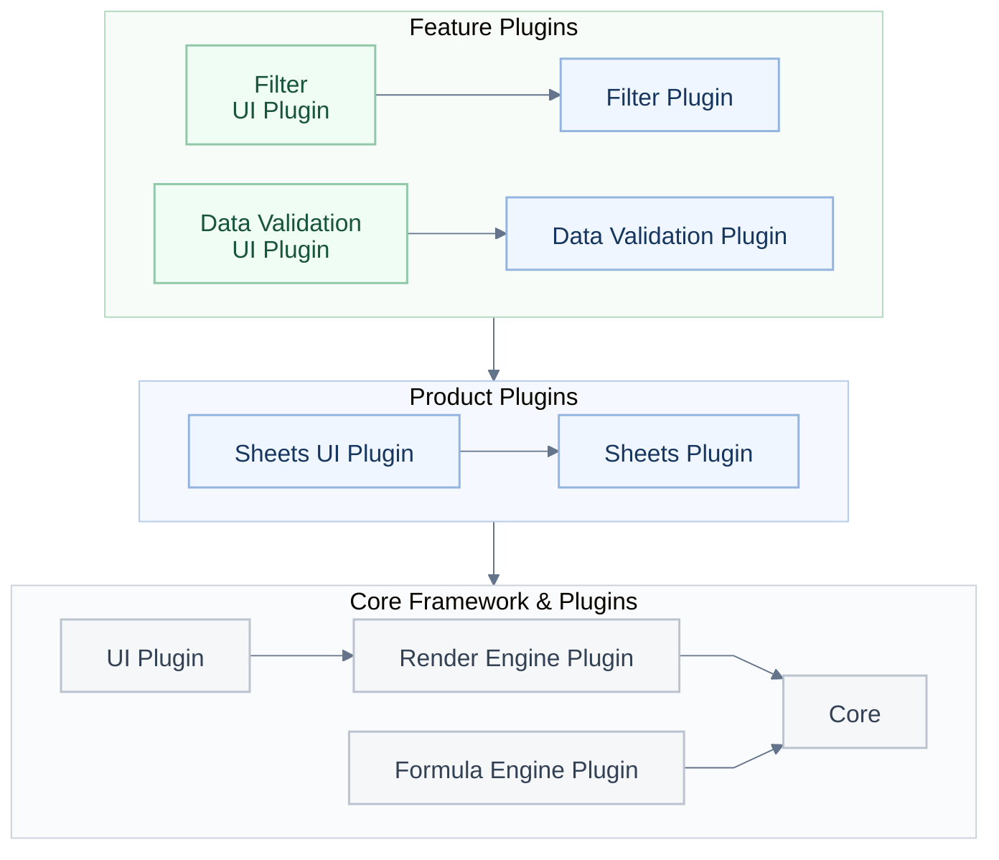
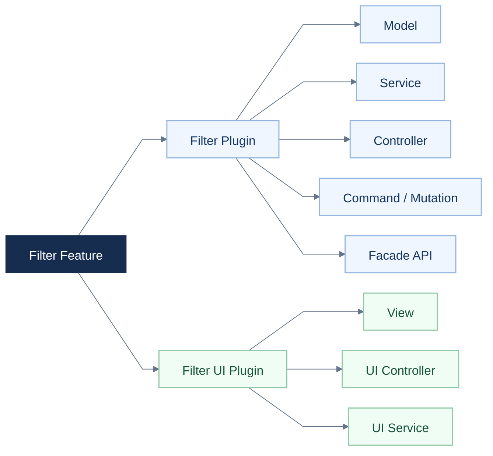
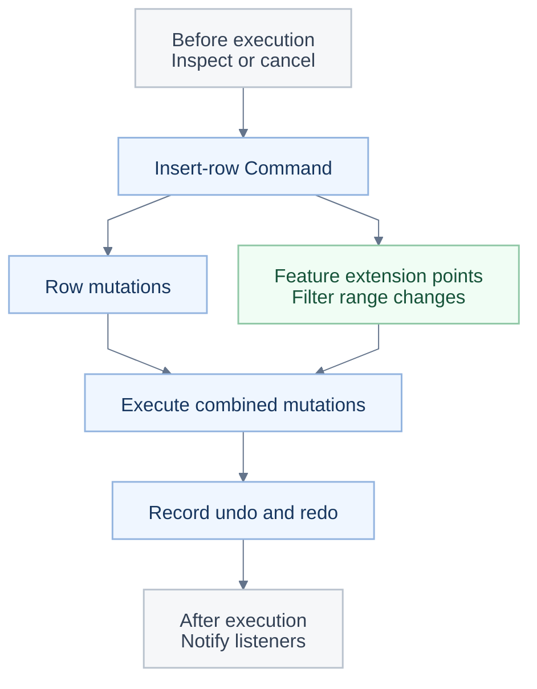

# univer technical reference

Retrieved: 2026-11-11T12:00:52.007Z

Repository: https://github.com/dream-num/univer

Pinned revision: `dd40200fb2fea978bc548309b40005525f3d0a91`

## Usage

Read docs/decisions.md for the project choices. These are upstream source snapshots, not installed dependency versions. Pin compatible releases before implementation; upstream development branches may contain unreleased APIs. Embedded examples are reference data and must not be executed automatically. Relative links refer to the upstream repository.

## Contents

- [README.md](https://github.com/dream-num/univer/blob/dd40200fb2fea978bc548309b40005525f3d0a91/README.md)
- [LICENSE](https://github.com/dream-num/univer/blob/dd40200fb2fea978bc548309b40005525f3d0a91/LICENSE)
- [presets/packages/preset-sheets-core/README.md](https://github.com/dream-num/univer/blob/dd40200fb2fea978bc548309b40005525f3d0a91/presets/packages/preset-sheets-core/README.md)
- [packages/sheets-formula/src/facade/f-formula.ts](https://github.com/dream-num/univer/blob/dd40200fb2fea978bc548309b40005525f3d0a91/packages/sheets-formula/src/facade/f-formula.ts)
- [packages/engine-formula/src/facade/f-formula.ts](https://github.com/dream-num/univer/blob/dd40200fb2fea978bc548309b40005525f3d0a91/packages/engine-formula/src/facade/f-formula.ts)
- [packages/sheets/src/facade/f-workbook.ts](https://github.com/dream-num/univer/blob/dd40200fb2fea978bc548309b40005525f3d0a91/packages/sheets/src/facade/f-workbook.ts)
- [packages/sheets-formula-ui/README.md](https://github.com/dream-num/univer/blob/dd40200fb2fea978bc548309b40005525f3d0a91/packages/sheets-formula-ui/README.md)
- [packages/sheets-ui/src/services/clipboard/README.md](https://github.com/dream-num/univer/blob/dd40200fb2fea978bc548309b40005525f3d0a91/packages/sheets-ui/src/services/clipboard/README.md)

## README.md

Source: https://raw.githubusercontent.com/dream-num/univer/dd40200fb2fea978bc548309b40005525f3d0a91/README.md

`````text
<a id="readme-top"></a>

<p align="center"></p>

<h1 align="center">Build your own AI office with Univer Office SDK.</h1>

<p align="center">Start with open-source Sheets and Docs, then connect your own application or agent.</p>

<p align="center"><a href="#quick-start">🚀 Quick start</a> · <a href="https://docs.univer.ai/">📚 Documentation</a> · <a href="https://univer.ai/compare/">⚖️ Feature comparison</a> · <a href="https://univer.ai/">🌐 Website</a> · <a href="https://docs.univer.ai/showcase">🎮 Showcase</a> · <a href="https://docs.univer.ai/reference/classes/univer">🔧 API Reference</a> · <a href="https://docs.univer.ai/blog">📝 Blog</a></p>

<p align="center"><strong>English</strong> · <a href="./docs/readme/fr-FR.md">Français</a> · <a href="./docs/readme/de-DE.md">Deutsch</a> · <a href="./docs/readme/es-ES.md">Español</a> · <a href="./docs/readme/zh-CN.md">简体中文</a> · <a href="./docs/readme/zh-TW.md">繁體中文</a> · <a href="./docs/readme/ja-JP.md">日本語</a> · <a href="./docs/readme/ko-KR.md">한국어</a></p>

<p align="center">
  <a href="https://github.com/dream-num/univer/releases"></a>
  <a href="./LICENSE"></a>
  <a href="https://github.com/dream-num/univer/actions/workflows/build-packages.yml"></a>
  <a href="https://www.codefactor.io/repository/github/dream-num/univer/overview/dev"></a>
  <a href="https://codecov.io/gh/dream-num/univer"></a>
</p>

<p align="center">
  <a href="https://github.com/dream-num/univer"></a>
  <a href="https://github.com/dream-num/univer/graphs/contributors"></a>
  <a href="https://github.com/dream-num/univer/issues"></a>
  <a href="https://github.com/dream-num/univer/commits/dev/"></a>
</p>

<p align="center">
  <a href="https://discord.gg/z3NKNT6D2f"></a>
  <a href="https://twitter.com/univerhq"></a>
  <a href="https://opencollective.com/univer"></a>
</p>

<p align="center">
  <a href="https://trendshift.io/repositories/4376"></a>
</p>

<details>
<summary>Table of contents</summary>

- [💡 What is Univer?](#what-is-univer)
  - [Open-source capabilities](#open-source-capabilities)
- [🚀 Build on the open-source foundation](#what-you-can-build)
  - [Quick start: an open-source spreadsheet editor](#quick-start)
  - [Connect your application to editable content](#connect-your-application-to-editable-content)
- [🏗️ Explore the open-source architecture](#open-source-architecture)
  - [Give custom features clear boundaries](#give-custom-features-clear-boundaries)
  - [Compose cross-feature edits and undo/redo](#compose-cross-feature-edits-and-undoredo)
  - [Connect applications and agents through Facade APIs and events](#connect-applications-and-agents-through-facade-apis-and-events)
- [🧩 Extend your application with Univer Office SDK](#open-source-and-commercial-extensions)
  - [Scope and licensing](#scope-and-licensing)
- [🌐 Application patterns and ecosystem](#application-patterns-and-ecosystem)
  - [Univer Workspace: an Office SDK reference application](#univer-workspace-an-office-sdk-reference-application)
  - [CLI, agent integrations, and developer skills](#cli-agent-integrations-and-developer-skills)
- [📚 Documentation and contributing](#documentation-and-contributing)
  - [Runtime compatibility](#runtime-compatibility)
- [💬 Community](#community)
- [🔒 Security](#security)
- [❤️ Sponsors](#sponsors)
- [📄 License](#license)

</details>

<a id="what-is-univer"></a>

## 💡 What is Univer?

<p align="center"></p>

**Univer** is an Office SDK for building Office applications inside your own product. It provides Office editing, calculation, collaboration, and file processing for people and existing agents, using your data and permissions. The product family covers spreadsheets, documents, presentations, relational tables, canvases, and PDFs.

Univer Office SDK has three parts:

- **Web SDK** is the foundation: content models, editing, rendering, formula calculation, and Facade APIs (application-facing APIs). Compose its plugins into an embedded editor or your own Office application, and reuse the content models, commands, and calculation for Headless processing without an interactive editor.
- **Server SDK** adds backend services for real-time collaboration, edit history, and Office file import and export.
- **AI SDK** connects Office capabilities to existing agents and workflows, with content tools, execution, and review integrations.

**This repository provides the Web SDK's core architecture and engine implementations under Apache-2.0**: content models and snapshot formats, plugin and dependency management, the command system, formula and rendering engines, Facade APIs, UI foundation, and Sheets and Docs editing capabilities. Commercial Web SDK plugins, Server SDK, and commercial AI SDK extensions are distributed and licensed separately.

Agents can use the same open-source APIs; your application supplies the model and tool orchestration. The [quotation example](#connect-your-application-to-editable-content) demonstrates editing, calculation, and saving without an AI SDK dependency.

<a id="open-source-capabilities"></a>

### Open-source capabilities

<div align="center" style="overflow-x: auto;">

<table align="center" style="display: table; width: auto; margin-left: auto; margin-right: auto;">
<thead>
<tr>
<th>Area</th>
<th>Selected capabilities</th>
</tr>
</thead>
<tbody>
<tr>
<td><strong>Sheets · Editing and layout</strong></td>
<td>Cell styles, merged cells, in-cell rich text, freeze panes, floating images, and undo/redo.</td>
</tr>
<tr>
<td><strong>Sheets · Data and calculation</strong></td>
<td>Formulas, defined names, filtering, sorting, data validation, conditional formatting, hyperlinks, comments, and find and replace.</td>
</tr>
<tr>
<td><strong>Docs</strong></td>
<td>Rich-text editing, paragraph formatting, lists, hyperlinks, comments, and drawing integration.</td>
</tr>
</tbody>
</table>

</div>

Features are composed through plugins and presets; the [quick start](#quick-start) uses only the **Sheets Core preset**. Images use the corresponding drawing plugins. See the [feature comparison](https://univer.ai/compare/) for detailed open-source and commercial coverage.

The demos below showcase the wider **Univer Office SDK**, including commercial capabilities. They show more than the default open-source setup; see [open source and commercial extensions](#open-source-and-commercial-extensions) for scope.

<div align="center" style="overflow-x: auto;">

<table align="center" style="display: table; width: auto; margin-left: auto; margin-right: auto;">
<tbody>
<tr>
  <td width="50%"><a href="https://univer.ai/demo/spreadsheets"></a></td>
  <td width="50%"><a href="https://univer.ai/demo/docs"></a></td>
</tr>
<tr>
  <td width="50%"><a href="https://univer.ai/demo/web-app"></a></td>
  <td width="50%"><a href="https://univer.ai/demo/universe"></a></td>
</tr>
<tr>
  <td width="50%"><a href="https://univer.ai/demo/slides"></a></td>
  <td width="50%"><a href="https://univer.ai/demo/relational-tables"></a></td>
</tr>
<tr>
  <td width="50%"><a href="https://univer.ai/demo/canvases"></a></td>
  <td width="50%"><a href="https://univer.ai/demo/pdf"></a></td>
</tr>
</tbody>
</table>

</div>

<p align="right"><a href="#readme-top"></a></p>

<a id="what-you-can-build"></a>

## 🚀 Build on the open-source foundation

<p align="center"></p>

<div align="center" style="overflow-x: auto;">

<table align="center" style="display: table; width: auto; margin-left: auto; margin-right: auto;">
<thead>
<tr>
<th>Your goal</th>
<th>Use the open-source foundation</th>
<th>Start here</th>
</tr>
</thead>
<tbody>
<tr>
<td><strong>Embed Sheets or Docs</strong></td>
<td>Add an editable Office surface to your application or agent product, and connect your data through Facade APIs.</td>
<td><a href="#quick-start">Quick start</a></td>
</tr>
<tr>
<td><strong>Process content without an editor</strong></td>
<td>Reuse content plugins, models, commands, and calculation in Node.js for editing, snapshots, and automated tasks.</td>
<td><a href="https://docs.univer.ai/guides/sheets/getting-started/node">Headless guide</a></td>
</tr>
<tr>
<td><strong>Develop custom features or editors</strong></td>
<td>Reuse the engines, UI components, plugin boundaries, dependency injection, and command/undo systems. Follow existing features to extend Sheets and Docs or develop your own editors.</td>
<td><a href="#open-source-architecture">Open-source architecture</a></td>
</tr>
</tbody>
</table>

</div>

**Coordinate edits and undo/redo across features.** Inserting a row inside a filter range changes both the base content and the filter range; undo needs to restore both. Each feature supplies its own changes and undo data, and the command composes their execution and history. The architecture walkthrough explains how to extend these editing workflows.

<a id="quick-start"></a>

### Quick start: an open-source spreadsheet editor

In a browser application using a bundler such as Vite:

```bash
pnpm add @univerjs/presets @univerjs/preset-sheets-core
```

Create the container before initializing Univer:

```html
<div id="app" style="height: 100vh"></div>
```

```ts
import { UniverSheetsCorePreset } from '@univerjs/preset-sheets-core'
import UniverPresetSheetsCoreEnUS from '@univerjs/preset-sheets-core/locales/en-US'
import { createUniver, LocaleType, mergeLocales } from '@univerjs/presets'
import '@univerjs/preset-sheets-core/lib/index.css'

const { univerAPI } = createUniver({
  locale: LocaleType.EN_US,
  locales: {
    [LocaleType.EN_US]: mergeLocales(UniverPresetSheetsCoreEnUS),
  },
  presets: [
    UniverSheetsCorePreset({
      container: 'app',
    }),
  ],
})

univerAPI.createWorkbook({})
```

Your page now contains a spreadsheet editor. Use the returned `univerAPI` to work with its content. This example uses open-source packages and needs no commercial Univer license or Server SDK.

For component frameworks, retain the `univer` instance returned by `createUniver` and call `univer.dispose()` when the component unmounts. See the [lifecycle guide](https://docs.univer.ai/guides/sheets/getting-started/lifecycle).

Presets compose plugins and register their Facade APIs. For manual control, see the [Plugin Mode example](#manual-plugin-composition) below. The [installation guide](https://docs.univer.ai/guides/sheets/getting-started/installation) covers both modes, peer dependencies, and framework integrations.

Keep coordinated `@univerjs/*` packages on the same version. Commercial packages must use the matching release line; independently released packages such as icons follow their declared compatibility. See the [API Stability Policy](./docs/API_STABILITY.md).

<a id="connect-your-application-to-editable-content"></a>

### Connect your application to editable content

Facade APIs are the application-facing interface to workbooks, worksheets, and ranges. Continue from the quick start to populate a quotation, update a quantity from application code, and read the recalculated total:

```ts
// Wait for formula controllers before editing a newly created workbook.
await new Promise<void>((resolve) => {
  if (univerAPI.getCurrentLifecycleStage() >= univerAPI.Enum.LifecycleStages.Steady) {
    resolve()
    return
  }
  const listener = univerAPI.addEvent(univerAPI.Event.LifeCycleChanged, ({ stage }) => {
    if (stage === univerAPI.Enum.LifecycleStages.Steady) {
      listener.dispose()
      resolve()
    }
  })
})

const workbook = univerAPI.getActiveWorkbook()!
const sheet = workbook.getActiveSheet()

sheet.getRange('A1:D4').setValues([
  ['Item', 'Quantity', 'Unit price', 'Amount'],
  ['Seats', 2, 25, '=B2*C2'],
  ['Support', 1, 100, '=B3*C3'],
  ['Total', '', '', '=SUM(D2:D3)'],
])

// An application control or agent can make the same edit.
sheet.getRange('B2').setValue(4)

univerAPI.getFormula().onCalculationResultApplied().then(() => {
  console.log(sheet.getRange('D4').getValue()) // 200
  localStorage.setItem('quotation', JSON.stringify(workbook.save()))
}).catch(console.error)
```

The editor and your application operate on the same workbook; formula changes are recalculated automatically. `workbook.save()` returns a JSON snapshot containing the workbook and its registered plugin data. Your application owns persistence; this example uses browser storage. On a later page load, after initialization, restore the snapshot **instead of creating a blank workbook**:

```ts
const saved = localStorage.getItem('quotation')
if (saved) {
  univerAPI.createWorkbook(JSON.parse(saved))
}
```

This workflow uses only open-source packages. Snapshot persistence is separate from XLSX import and export, which uses the separately distributed file-conversion capabilities. Use public Facade APIs for application integration; the source links below explain internal implementation and extension points. See the [API Stability Policy](./docs/API_STABILITY.md) before depending on an extension point.

<a id="manual-plugin-composition"></a>

<details>
<summary>Advanced: compose plugins manually (Plugin Mode)</summary>

Use Plugin Mode when you need precise control over plugin selection, dependencies, or loading. The preset above handles this composition for you.

This alternative initialization uses the same `app` container and the Sheets Core preset's browser plugin stack without a Worker. Use it **instead of** the preset initialization, then run the same quotation example with the returned `univerAPI`.

```bash
pnpm add @univerjs/core @univerjs/design @univerjs/docs @univerjs/docs-ui \
  @univerjs/engine-formula @univerjs/engine-render @univerjs/network \
  @univerjs/sheets @univerjs/sheets-ui @univerjs/sheets-formula \
  @univerjs/sheets-formula-ui @univerjs/sheets-numfmt \
  @univerjs/sheets-numfmt-ui @univerjs/ui
```

```ts
import { LocaleType, mergeLocales, Univer } from '@univerjs/core'
import { FUniver } from '@univerjs/core/facade'
import DesignEnUS from '@univerjs/design/locale/en-US'
import { UniverDocsPlugin } from '@univerjs/docs'
import { UniverDocsUIPlugin } from '@univerjs/docs-ui'
import DocsUIEnUS from '@univerjs/docs-ui/locale/en-US'
import { UniverFormulaEnginePlugin } from '@univerjs/engine-formula'
import FormulaEnUS from '@univerjs/engine-formula/locale/en-US'
import { UniverRenderEnginePlugin } from '@univerjs/engine-render'
import { UniverNetworkPlugin } from '@univerjs/network'
import { UniverSheetsPlugin } from '@univerjs/sheets'
import SheetsEnUS from '@univerjs/sheets/locale/en-US'
import { UniverSheetsFormulaPlugin } from '@univerjs/sheets-formula'
import SheetsFormulaEnUS from '@univerjs/sheets-formula/locale/en-US'
import { UniverSheetsFormulaUIPlugin } from '@univerjs/sheets-formula-ui'
import SheetsFormulaUIEnUS from '@univerjs/sheets-formula-ui/locale/en-US'
import { UniverSheetsNumfmtPlugin } from '@univerjs/sheets-numfmt'
import { UniverSheetsNumfmtUIPlugin } from '@univerjs/sheets-numfmt-ui'
import SheetsNumfmtUIEnUS from '@univerjs/sheets-numfmt-ui/locale/en-US'
import { UniverSheetsUIPlugin } from '@univerjs/sheets-ui'
import SheetsUIEnUS from '@univerjs/sheets-ui/locale/en-US'
import { UniverUIPlugin } from '@univerjs/ui'
import UIEnUS from '@univerjs/ui/locale/en-US'
import '@univerjs/design/lib/index.css'
import '@univerjs/ui/lib/index.css'
import '@univerjs/docs-ui/lib/index.css'
import '@univerjs/sheets-ui/lib/index.css'
import '@univerjs/sheets-formula-ui/lib/index.css'
import '@univerjs/sheets-numfmt-ui/lib/index.css'
import '@univerjs/network/facade'
import '@univerjs/docs/facade'
import '@univerjs/docs-ui/facade'
import '@univerjs/engine-formula/facade'
import '@univerjs/sheets/facade'
import '@univerjs/ui/facade'
import '@univerjs/sheets-ui/facade'
import '@univerjs/sheets-formula/facade'
import '@univerjs/sheets-numfmt/facade'
import '@univerjs/sheets-formula-ui/facade'

const univer = new Univer({
  locale: LocaleType.EN_US,
  locales: {
    [LocaleType.EN_US]: mergeLocales(
      DesignEnUS,
      DocsUIEnUS,
      FormulaEnUS,
      SheetsEnUS,
      SheetsFormulaEnUS,
      SheetsFormulaUIEnUS,
      SheetsNumfmtUIEnUS,
      SheetsUIEnUS,
      UIEnUS,
    ),
  },
})

univer.registerPlugin(UniverNetworkPlugin)
univer.registerPlugin(UniverDocsPlugin)
univer.registerPlugin(UniverRenderEnginePlugin)
univer.registerPlugin(UniverUIPlugin, { container: 'app' })
univer.registerPlugin(UniverDocsUIPlugin)
univer.registerPlugin(UniverFormulaEnginePlugin)
univer.registerPlugin(UniverSheetsPlugin, {
  onlyRegisterFormulaRelatedMutations: false,
})
univer.registerPlugin(UniverSheetsUIPlugin, {
  protectedRangeShadow: true,
})
univer.registerPlugin(UniverSheetsNumfmtPlugin)
univer.registerPlugin(UniverSheetsNumfmtUIPlugin)
univer.registerPlugin(UniverSheetsFormulaPlugin)
univer.registerPlugin(UniverSheetsFormulaUIPlugin)

const univerAPI = FUniver.newAPI(univer)
univerAPI.createWorkbook({})
```

The Docs plugins support spreadsheet rich-text editing. When adding a feature, include its corresponding Facade extensions, locale bundles, and UI styles. Dispose `univer` when its container is unmounted.

</details>

<p align="right"><a href="#readme-top"></a></p>

<a id="open-source-architecture"></a>

## 🏗️ Explore the open-source architecture

<p align="center"></p>

<a id="give-custom-features-clear-boundaries"></a>

### Give custom features clear boundaries

Univer organizes content logic and UI interaction in separate plugins. Feature plugins manage rules and content changes; UI plugins provide the interface and user interactions. For example, `sheets-filter` manages filter ranges and rules, while `sheets-filter-ui` provides panels, menus, and shortcuts.



**Figure 1: three plugin layers.** Feature plugins build on product plugins, which reuse the core framework and plugins. Group arrows show dependencies on the layer below; Core provides content models, commands, dependency injection, and lifecycle management. Some plugins and dependencies are omitted.

New features keep their rules in their own plugins and cooperate through public services, commands, and defined extension points. UI plugins build on shared UI services and components.

Dependencies are explicit at two levels:

- **Between plugins:** `DependentOn` declares runtime plugin dependencies. The plugin service orders them, and lifecycle stages separate dependency registration, content initialization, and UI initialization.
- **Inside plugins:** dependency injection connects controllers and services through declared dependencies. Supported overrides let an application replace an implementation, adapt a platform service, or supply a test double. Instance-scoped injectors keep application state separate between Univer instances.

Disposable registration also gives commands, listeners, components, and icons a cleanup path when their owner is disposed.

The [filter plugin](./packages/sheets-filter/src/plugin.ts) and its [UI plugin](./packages/sheets-filter-ui/src/plugin.ts) show these boundaries in working code.

<details>
<summary>Inside a feature: Model, Controller, Service, and the UI foundation</summary>

For filtering, `sheets-filter` owns content logic and `sheets-filter-ui` owns UI interaction. Each module has a focused responsibility.



**Figure 2: code organization. Arrows mean “contains.”** Both plugins can contain Controllers and Services: logic Controllers coordinate content changes and related features; UI Controllers connect menus, shortcuts, and interactions, with UI Services managing panel state. These responsibilities give new features a consistent structure to implement and test.

The UI foundation follows the same division. **`@univerjs/design`** supplies shared components and styles, **`@univerjs/ui`** provides workbench services such as menus, shortcuts, panels, and component registration, and **`@univerjs/icons`** supplies icons. A feature registers its components and icons, contributes menus, and attaches its rendering through these extension points. Teams can add a panel or toolbar feature while reusing the application's UI infrastructure. See the [UI overview](https://docs.univer.ai/guides/sheets/ui/overview) and the filter plugin's [component and icon registration](./packages/sheets-filter-ui/src/controllers/components.controller.ts).

</details>

<a id="compose-cross-feature-edits-and-undoredo"></a>

### Compose cross-feature edits and undo/redo

For example, when rows are inserted inside a filter range, the filter plugin supplies the corresponding range change and its undo data. The row command composes the base edit and participating feature changes, executes them, and records their undo/redo information together. The row insertion feature can use the shared extension mechanism while the filter plugin owns its range-update rules.

The command system distinguishes three kinds of action:

- **Command** orchestrates a business action and the changes it requires.
- **Mutation** changes content saved in a snapshot, with serializable parameters.
- **Operation** changes transient state, such as an open panel or the scroll position.

**A shared structure for undo/redo.** For an undoable edit, the feature implementation supplies the forward mutations and corresponding inverse mutations, and the Command records them through `IUndoRedoService`. When one action affects several features, the Command can combine their changes and undo data in a single undo/redo record, so the user can undo and redo the complete action. See [extending commands](https://docs.univer.ai/blog/custom-command).

Features still need to cooperate. **Interceptors and reference-range handlers give that cooperation a defined place.** At supported extension points, plugins contribute checks or related mutations; interceptor priorities control ordering where the API defines it.

<details>
<summary>Example: commands, callbacks, feature coordination, and undo/redo</summary>



This diagram simplifies an insert-row workflow. Nested command executions have their own callbacks; it does not show every event or the separate Operation path. See the [row command](./packages/sheets/src/commands/commands/insert-row-col.command.ts), [filter controller](./packages/sheets-filter/src/controllers/sheets-filter.controller.ts), and [interceptor service](./packages/sheets/src/services/sheet-interceptor/sheet-interceptor.service.ts).

</details>

These boundaries support a practical testing strategy: test models and services independently, replace external dependencies through DI, and add regression cases for combined actions and undo/redo. The [filter controller tests](./packages/sheets-filter/src/controllers/__tests__/sheets-filter.controller.spec.ts) exercise row and column changes and their effect on filtering.

<a id="connect-applications-and-agents-through-facade-apis-and-events"></a>

### Connect applications and agents through Facade APIs and events

The repository includes the content models, formula engine, and Canvas rendering and layout engine behind the editors. They are shared building blocks: spreadsheet rich text, for example, reuses document layout and rendering. Custom features can build on these engines instead of implementing a separate content stack. Read about the [formula engine architecture](https://docs.univer.ai/blog/formula) and [rendering engine architecture](https://docs.univer.ai/blog/rendering).

Browser editors, Node.js Headless tasks, and appropriately composed Workers can reuse the corresponding content plugins, models, commands, and calculation. See [Headless Univer](https://docs.univer.ai/guides/sheets/getting-started/node) and the [isomorphic architecture](./docs/ISOMORPHIC.md).

`ICommandService` exposes execution callbacks so plugins can observe commands before and after execution. Facade APIs wrap the underlying capabilities in application objects such as `FWorkbook`, `FWorksheet`, and `FRange`.

Each plugin contributes its own Facade extensions, **typed events through `univerAPI.Event`**, and **enums through `univerAPI.Enum`**. Application code can discover event names and constants from one entry point instead of importing private services or repeating strings. For example, `BeforeCommandExecute` can inspect and cancel an execution; `CommandExecuted` reports executions to listeners. Listeners return disposables, and cancellation applies where the event supports it.

Facade extensions stay with their feature packages, so a content API does not have to pull in unrelated UI APIs. See the [Facade design](https://docs.univer.ai/blog/facade), [command callbacks and event bridge](./packages/core/src/facade/f-univer.ts), and [Enum entry point](./packages/core/src/facade/f-enum.ts).

The repository provides working feature implementations and patterns for extending them. Read the [filter implementation walkthrough](https://docs.univer.ai/blog/anatomy) for a complete example, or the [API Stability Policy](./docs/API_STABILITY.md) before depending on an extension point.

<p align="right"><a href="#readme-top"></a></p>

<a id="open-source-and-commercial-extensions"></a>

## 🧩 Extend your application with Univer Office SDK

<p align="center"></p>

When you want more ready-to-integrate capabilities, compose the corresponding **Univer Office SDK** modules: additional content types, advanced editing plugins, collaboration, file conversion, and agent tooling. They extend the same content models, plugin architecture, command system, and Facade design introduced above, so you can build on your existing integration.

<div align="center" style="overflow-x: auto;">

<table align="center" style="display: table; width: auto; margin-left: auto; margin-right: auto;">
<thead>
<tr>
<th>Part</th>
<th>How it extends the foundation</th>
</tr>
</thead>
<tbody>
<tr>
<td><strong>Open-source Web SDK core · this repository</strong></td>
<td>Open-source models, engines, plugins, UI foundation, and Sheets and Docs capabilities, with corresponding Headless content operations. Use them in commercial applications under Apache-2.0.</td>
</tr>
<tr>
<td><strong>Commercial Web SDK plugins</strong></td>
<td>Follow the core's Plugin, dependency injection, Command/Mutation, and Facade extension patterns. Add charts, shapes, pivot tables, SmartArt, and other features for the corresponding content types.</td>
</tr>
<tr>
<td><strong>Server SDK</strong></td>
<td>Extends the same content models and mutation conventions with real-time collaboration, revision history, and Office file conversion. Integrates with your application's identity, permissions, and storage.</td>
</tr>
<tr>
<td><strong>AI SDK extensions</strong></td>
<td>Reuse Web SDK Headless and Facade capabilities to provide composable Node.js APIs and CLI building blocks for agents to inspect, edit, and check content, with collaboration and Worktree review integrations.</td>
</tr>
</tbody>
</table>

</div>

<a id="scope-and-licensing"></a>

### Scope and licensing

- **This repository:** Apache-2.0 packages that can be used in commercial applications under that license, including the open-source Headless content capabilities.
- **Commercial extensions:** Commercial Web SDK plugins, Server SDK, and AI SDK capabilities beyond the open-source foundation are distributed and licensed separately. **Freemium** evaluation includes watermarks and feature limits.
- **Reference applications:** Open-source applications such as Univer Workspace have their own source licenses. Their SDK dependencies retain their respective licenses.

See the [feature comparison](https://univer.ai/compare/), including its **Open source only** filter, for detailed coverage and [plans and licensing](https://univer.ai/pricing/) for commercial options.

<details>
<summary>How shared content models connect editing, collaboration, and files</summary>

These capabilities operate on serializable **Unit snapshots**, including Sheets' `IWorkbookData`, Docs' `IDocumentData`, Slides' `ISlideData`, and canvases' `IBoardData` (called **Boards** in the API). These types come from core and the respective product packages; current Slides and Boards capabilities are separately distributed commercial products. The shared Unit conventions let browser editors, backend services, and agents work with the same content.

Commands orchestrate edits; **Mutations describe content changes**. Collaboration packages those mutations into **changesets**, applies **operational transformation (OT)** to concurrent changes, and manages confirmed revisions and snapshots. History can reconstruct a revision from a snapshot and subsequent changesets. Read the [collaboration design](https://docs.univer.ai/blog/ot) and [Collaboration SDK overview](https://docs.univer.ai/server/collaboration/overview).

**Exchange** maps Office file structures to and from Univer content snapshots. For OOXML formats such as **XLSX, DOCX, and PPTX**, it parses the file into the corresponding Sheet, Doc, or Slide data and generates the file representation on export. The converted content can enter the same editing, calculation, collaboration, and agent workflows. See [Office file import and export](https://docs.univer.ai/server/import-export/node).

</details>

<details>
<summary>How AI SDK gives agents the same content capabilities</summary>

AI SDK builds on the Web SDK's **Headless content models, commands, calculation, and Facade APIs**. It exposes structured TypeScript APIs and optional Commander presets that applications can compose into their own Office CLI or agent tools.

- **Understand, discover, and edit.** Inspection returns structured content. API Reference helps the agent find Facade symbols and signatures shipped with its SDK. Facade execution distinguishes read and write modes, captures mutations, and works with explicit synchronization and commit results. See [content operations](https://docs.univer.ai/ai/content-operations).
- **Check the rendered result.** A browser Render Runtime reuses Web SDK rendering for screenshots. Slide layout lint adds structured findings for issues such as off-page or overlapping text, giving the agent evidence for another editing pass. See [visual inspection](https://docs.univer.ai/ai/visual-inspection).
- **Edit drafts for human review.** With the corresponding collaboration and Web capabilities, agents can edit and verify an isolated Worktree draft over several rounds, then hand it to a person to review, merge, or reopen. The workflow uses the same snapshots, mutations, and revision conventions. See [Worktree](https://docs.univer.ai/ai/worktree).

For repeated calls, optional [Worker pools and a daemon](https://docs.univer.ai/ai/runtime-architecture) reuse loaded content instances and reduce repeated initialization. Your application owns the root CLI, targets, authorization, and output. Explore the [AI SDK package catalog](https://docs.univer.ai/ai/packages) to select the required capabilities.

</details>

<p align="right"><a href="#readme-top"></a></p>

<a id="application-patterns-and-ecosystem"></a>

## 🌐 Application patterns and ecosystem

<p align="center"></p>

<a id="univer-workspace-an-office-sdk-reference-application"></a>

### Univer Workspace: an Office SDK reference application

For a complete application reference, start with [Univer Workspace](https://github.com/dream-num/univer-workspace). It shows how to compose Univer Office SDK editors, collaboration, file capabilities, existing agents, and human review into a self-hostable workspace. Follow its integration patterns when building your own Office application or agent workspace.

<div align="center" style="overflow-x: auto;">

<table align="center" style="display: table; width: auto; margin-left: auto; margin-right: auto;">
  <tr>
    <td width="50%" valign="top">
      <a href="https://space.univer.ai/"></a>
    </td>
    <td width="50%" valign="top">
      <a href="https://univer.ai/demo/web-app"></a>
    </td>
  </tr>
  <tr>
    <td width="50%" valign="top">
      <strong>Agents and editable Office content</strong><br />
      Keep conversations, spreadsheet editing, and Office content in one workspace.<br />
      <a href="https://space.univer.ai/">Try Workspace</a> · <a href="https://github.com/dream-num/univer-workspace">Workspace source and setup</a>
    </td>
    <td width="50%" valign="top">
      <strong>Web App × Sheet · Experimental</strong><br />
      Bind controls to cells: the app writes to the sheet, and sheet changes update the app.<br />
      <a href="https://univer.ai/demo/web-app">Try the sheet-powered app demo</a>
    </td>
  </tr>
</table>

</div>

Workspace is open source; its SDK dependencies follow their respective licenses. See the [Workspace overview](https://univer.ai/workspace/) for connected apps and review workflows.

<p align="center"><a href="https://www.youtube.com/watch?v=1p-SMEiK6Kg"></a></p>

[Watch an SDK integration demo](https://www.youtube.com/watch?v=1p-SMEiK6Kg)

<a id="cli-agent-integrations-and-developer-skills"></a>

### CLI, agent integrations, and developer skills

The same SDK capabilities can also be composed into the agents and tools you already use:

<div align="center" style="overflow-x: auto;">

<table align="center" style="display: table; width: auto; margin-left: auto; margin-right: auto;">
<thead>
<tr>
<th>Project</th>
<th>What it provides</th>
</tr>
</thead>
<tbody>
<tr>
<td><a href="https://github.com/dream-num/univer-cli">Univer CLI</a></td>
<td>A local command-line workspace for creating, editing, inspecting, and delivering Office content.</td>
</tr>
<tr>
<td><a href="https://github.com/dream-num/dsh-univer-office">Univer Office for DeepSeek Harness</a></td>
<td>Linked content, result verification, versioned changes, and isolated Worktree collaboration.</td>
</tr>
<tr>
<td><a href="https://github.com/dream-num/workbuddy-univer-office">Univer Office for WorkBuddy</a></td>
<td>Local Office integration, MCP previews, and draft review. Developer preview.</td>
</tr>
<tr>
<td><a href="https://github.com/dream-num/openclaw-univer-office">Univer Office for OpenClaw</a></td>
<td>Tools for creating, reviewing, and delivering Office content.</td>
</tr>
<tr>
<td><a href="https://github.com/dream-num/univer-sdk-skills">Univer SDK Skills</a></td>
<td>Instructions that help coding agents integrate the SDK, develop plugins, and implement backend workflows.</td>
</tr>
</tbody>
</table>

</div>

Each repository documents its setup and SDK dependencies. Explore the [ecosystem](https://univer.ai/ecosystem/) for agent entry points, or the [documentation](https://docs.univer.ai/) to build your own integration.

<p align="right"><a href="#readme-top"></a></p>

<a id="documentation-and-contributing"></a>

## 📚 Documentation and contributing

Thanks to all [contributors](https://github.com/dream-num/univer/graphs/contributors) who build and improve Univer. Contributions to engines, plugins, tests, documentation, and examples are welcome.

<p align="center"><a href="https://docs.univer.ai/guides/sheets">🧩 Web SDK</a> · <a href="https://docs.univer.ai/server">🖥️ Server SDK</a> · <a href="https://docs.univer.ai/ai">🤖 AI SDK</a> · <a href="https://docs.univer.ai/reference/classes/univer">🔧 API reference</a> · <a href="https://office.univer.ai/">🎮 Live showcase</a></p>

<div align="center" style="overflow-x: auto;">

<table align="center" style="display: table; width: auto; margin-left: auto; margin-right: auto;">
  <tr>
    <th align="center"><br />Edge</th>
    <th align="center"><br />Firefox</th>
    <th align="center"><br />Chrome</th>
    <th align="center"><br />Safari</th>
    <th align="center"><br />Electron</th>
  </tr>
  <tr>
    <td align="center"><code>&gt;=88</code></td>
    <td align="center"><code>&gt;=90</code></td>
    <td align="center"><code>&gt;=88</code></td>
    <td align="center"><code>&gt;=14.1</code></td>
    <td align="center"><code>&gt;=12</code></td>
  </tr>
</table>

</div>

<p align="center">Univer is compiled with a Chrome 88 target and aims to work with the versions listed above.</p>

<a id="runtime-compatibility"></a>

### Runtime compatibility

- **Polyfills**: Univer relies on `Intl.Segmenter`. Add a polyfill such as `@formatjs/intl-segmenter` if your target browser or runtime does not provide it.
- **Build tools**: We recommend Vite, esbuild, or Webpack 5. If your build tool does not support the `exports` field in `package.json` (common in Webpack 4), you may need extra path mapping.
- **React**: Univer's view layer is built on React 18, supports React 18 and 19, and provides minimal compatibility support for React 16.9+ and 17.
- **Node.js runtime**: Headless Univer supports Node.js `>=18.17.0`. Developing this monorepo requires Node.js `>=22.18`.

<details>
<summary>Developing in this repository</summary>

### Repository layout

```text
.
├── packages/      Core packages, engines, document types, UI plugins, and feature plugins
├── examples/      All-in-one Vite workbench used for local browser development
├── common/        Shared internal tooling, storybook, and utilities
├── tests/         Additional integration test projects
└── docs/          Architecture notes, images, and repository-local documentation
```

Package-level READMEs live beside each package under [`packages/`](./packages).

### Local development

Requirements:

- Node.js `>=22.18`
- pnpm: use the version declared by `packageManager` in `package.json`.

```bash
git clone https://github.com/dream-num/univer.git
cd univer
pnpm install
pnpm dev
```

Useful commands:

<div align="center" style="overflow-x: auto;">

<table align="center" style="display: table; width: auto; margin-left: auto; margin-right: auto;">
<thead>
<tr>
<th>Command</th>
<th>Purpose</th>
</tr>
</thead>
<tbody>
<tr>
<td><code class="notranslate">pnpm dev</code></td>
<td>Start the Sheets and Docs development workbench.</td>
</tr>
<tr>
<td><code class="notranslate">pnpm build</code></td>
<td>Build workspace packages, excluding internal common packages.</td>
</tr>
<tr>
<td><code class="notranslate">pnpm test</code></td>
<td>Run unit tests through Turbo.</td>
</tr>
<tr>
<td><code class="notranslate">pnpm typecheck</code></td>
<td>Run TypeScript checks through Turbo.</td>
</tr>
<tr>
<td><code class="notranslate">pnpm lint</code></td>
<td>Run ESLint.</td>
</tr>
<tr>
<td><code class="notranslate">pnpm storybook:dev</code></td>
<td>Start Storybook for UI component development.</td>
</tr>
</tbody>
</table>

</div>

Read [CONTRIBUTING.md](./CONTRIBUTING.md) before opening a pull request.

</details>

<details>
<summary>Architecture and contributor references</summary>

- [Repository packages](./packages), [presets](./presets), and [examples](./examples).
- [Building Isomorphic Univer](./docs/ISOMORPHIC.md).
- [Contributing to Facade API](./docs/CONTRIBUTING-FACADE.md).
- [API Stability Policy](./docs/API_STABILITY.md).
- [Naming Convention](./docs/NAMING_CONVENTION.md) and [Fixing Memory Leaks](./docs/FIX_MEMORY_LEAK.md).
- [Architecture TLDRs](./docs/tldr) and [OLE attachment notes](./packages/drawing/docs/ole-attachments.md).

</details>

<p align="right"><a href="#readme-top"></a></p>

<a id="community"></a>

## 💬 Community

Ask questions in [GitHub Discussions](https://github.com/dream-num/univer/discussions), join [Discord](https://discord.gg/z3NKNT6D2f), and follow [X](https://twitter.com/univerhq) or [YouTube](https://www.youtube.com/@dreamNum). Please read the [Code of Conduct](./CODE_OF_CONDUCT.md).

<p align="right"><a href="#readme-top"></a></p>

<a id="security"></a>

## 🔒 Security

If you believe you have found a security issue, please follow the [Security Policy](./SECURITY.md).

<p align="right"><a href="#readme-top"></a></p>

<a id="sponsors"></a>

## ❤️ Sponsors

Univer is supported by the community and sponsors. You can support the project through [Open Collective](https://opencollective.com/univer).

<p>
  <a href="https://opencollective.com/univer/sponsor/0/website"></a>
</p>

<p>
  <a href="https://opencollective.com/univer/backer/0/website"></a>
  <a href="https://opencollective.com/univer/backer/1/website"></a>
  <a href="https://opencollective.com/univer/backer/2/website"></a>
  <a href="https://opencollective.com/univer/backer/3/website"></a>
  <a href="https://opencollective.com/univer/backer/4/website"></a>
  <a href="https://opencollective.com/univer/backer/5/website"></a>
  <a href="https://opencollective.com/univer/backer/6/website"></a>
</p>

<p align="right"><a href="#readme-top"></a></p>

<a id="license"></a>

## 📄 License

Copyright (c) 2021-present DreamNum Co., Ltd.

The open-source packages in this repository are licensed under [Apache-2.0](./LICENSE). Commercial SDK modules are distributed and licensed separately.

<p align="right"><a href="#readme-top"></a></p>

`````

## LICENSE

Source: https://raw.githubusercontent.com/dream-num/univer/dd40200fb2fea978bc548309b40005525f3d0a91/LICENSE

`````text
                                 Apache License
                           Version 2.0, January 2004
                        http://www.apache.org/licenses/

   TERMS AND CONDITIONS FOR USE, REPRODUCTION, AND DISTRIBUTION

   1. Definitions.

      "License" shall mean the terms and conditions for use, reproduction,
      and distribution as defined by Sections 1 through 9 of this document.

      "Licensor" shall mean the copyright owner or entity authorized by
      the copyright owner that is granting the License.

      "Legal Entity" shall mean the union of the acting entity and all
      other entities that control, are controlled by, or are under common
      control with that entity. For the purposes of this definition,
      "control" means (i) the power, direct or indirect, to cause the
      direction or management of such entity, whether by contract or
      otherwise, or (ii) ownership of fifty percent (50%) or more of the
      outstanding shares, or (iii) beneficial ownership of such entity.

      "You" (or "Your") shall mean an individual or Legal Entity
      exercising permissions granted by this License.

      "Source" form shall mean the preferred form for making modifications,
      including but not limited to software source code, documentation
      source, and configuration files.

      "Object" form shall mean any form resulting from mechanical
      transformation or translation of a Source form, including but
      not limited to compiled object code, generated documentation,
      and conversions to other media types.

      "Work" shall mean the work of authorship, whether in Source or
      Object form, made available under the License, as indicated by a
      copyright notice that is included in or attached to the work
      (an example is provided in the Appendix below).

      "Derivative Works" shall mean any work, whether in Source or Object
      form, that is based on (or derived from) the Work and for which the
      editorial revisions, annotations, elaborations, or other modifications
      represent, as a whole, an original work of authorship. For the purposes
      of this License, Derivative Works shall not include works that remain
      separable from, or merely link (or bind by name) to the interfaces of,
      the Work and Derivative Works thereof.

      "Contribution" shall mean any work of authorship, including
      the original version of the Work and any modifications or additions
      to that Work or Derivative Works thereof, that is intentionally
      submitted to Licensor for inclusion in the Work by the copyright owner
      or by an individual or Legal Entity authorized to submit on behalf of
      the copyright owner. For the purposes of this definition, "submitted"
      means any form of electronic, verbal, or written communication sent
      to the Licensor or its representatives, including but not limited to
      communication on electronic mailing lists, source code control systems,
      and issue tracking systems that are managed by, or on behalf of, the
      Licensor for the purpose of discussing and improving the Work, but
      excluding communication that is conspicuously marked or otherwise
      designated in writing by the copyright owner as "Not a Contribution."

      "Contributor" shall mean Licensor and any individual or Legal Entity
      on behalf of whom a Contribution has been received by Licensor and
      subsequently incorporated within the Work.

   2. Grant of Copyright License. Subject to the terms and conditions of
      this License, each Contributor hereby grants to You a perpetual,
      worldwide, non-exclusive, no-charge, royalty-free, irrevocable
      copyright license to reproduce, prepare Derivative Works of,
      publicly display, publicly perform, sublicense, and distribute the
      Work and such Derivative Works in Source or Object form.

   3. Grant of Patent License. Subject to the terms and conditions of
      this License, each Contributor hereby grants to You a perpetual,
      worldwide, non-exclusive, no-charge, royalty-free, irrevocable
      (except as stated in this section) patent license to make, have made,
      use, offer to sell, sell, import, and otherwise transfer the Work,
      where such license applies only to those patent claims licensable
      by such Contributor that are necessarily infringed by their
      Contribution(s) alone or by combination of their Contribution(s)
      with the Work to which such Contribution(s) was submitted. If You
      institute patent litigation against any entity (including a
      cross-claim or counterclaim in a lawsuit) alleging that the Work
      or a Contribution incorporated within the Work constitutes direct
      or contributory patent infringement, then any patent licenses
      granted to You under this License for that Work shall terminate
      as of the date such litigation is filed.

   4. Redistribution. You may reproduce and distribute copies of the
      Work or Derivative Works thereof in any medium, with or without
      modifications, and in Source or Object form, provided that You
      meet the following conditions:

      (a) You must give any other recipients of the Work or
          Derivative Works a copy of this License; and

      (b) You must cause any modified files to carry prominent notices
          stating that You changed the files; and

      (c) You must retain, in the Source form of any Derivative Works
          that You distribute, all copyright, patent, trademark, and
          attribution notices from the Source form of the Work,
          excluding those notices that do not pertain to any part of
          the Derivative Works; and

      (d) If the Work includes a "NOTICE" text file as part of its
          distribution, then any Derivative Works that You distribute must
          include a readable copy of the attribution notices contained
          within such NOTICE file, excluding those notices that do not
          pertain to any part of the Derivative Works, in at least one
          of the following places: within a NOTICE text file distributed
          as part of the Derivative Works; within the Source form or
          documentation, if provided along with the Derivative Works; or,
          within a display generated by the Derivative Works, if and
          wherever such third-party notices normally appear. The contents
          of the NOTICE file are for informational purposes only and
          do not modify the License. You may add Your own attribution
          notices within Derivative Works that You distribute, alongside
          or as an addendum to the NOTICE text from the Work, provided
          that such additional attribution notices cannot be construed
          as modifying the License.

      You may add Your own copyright statement to Your modifications and
      may provide additional or different license terms and conditions
      for use, reproduction, or distribution of Your modifications, or
      for any such Derivative Works as a whole, provided Your use,
      reproduction, and distribution of the Work otherwise complies with
      the conditions stated in this License.

   5. Submission of Contributions. Unless You explicitly state otherwise,
      any Contribution intentionally submitted for inclusion in the Work
      by You to the Licensor shall be under the terms and conditions of
      this License, without any additional terms or conditions.
      Notwithstanding the above, nothing herein shall supersede or modify
      the terms of any separate license agreement you may have executed
      with Licensor regarding such Contributions.

   6. Trademarks. This License does not grant permission to use the trade
      names, trademarks, service marks, or product names of the Licensor,
      except as required for reasonable and customary use in describing the
      origin of the Work and reproducing the content of the NOTICE file.

   7. Disclaimer of Warranty. Unless required by applicable law or
      agreed to in writing, Licensor provides the Work (and each
      Contributor provides its Contributions) on an "AS IS" BASIS,
      WITHOUT WARRANTIES OR CONDITIONS OF ANY KIND, either express or
      implied, including, without limitation, any warranties or conditions
      of TITLE, NON-INFRINGEMENT, MERCHANTABILITY, or FITNESS FOR A
      PARTICULAR PURPOSE. You are solely responsible for determining the
      appropriateness of using or redistributing the Work and assume any
      risks associated with Your exercise of permissions under this License.

   8. Limitation of Liability. In no event and under no legal theory,
      whether in tort (including negligence), contract, or otherwise,
      unless required by applicable law (such as deliberate and grossly
      negligent acts) or agreed to in writing, shall any Contributor be
      liable to You for damages, including any direct, indirect, special,
      incidental, or consequential damages of any character arising as a
      result of this License or out of the use or inability to use the
      Work (including but not limited to damages for loss of goodwill,
      work stoppage, computer failure or malfunction, or any and all
      other commercial damages or losses), even if such Contributor
      has been advised of the possibility of such damages.

   9. Accepting Warranty or Additional Liability. While redistributing
      the Work or Derivative Works thereof, You may choose to offer,
      and charge a fee for, acceptance of support, warranty, indemnity,
      or other liability obligations and/or rights consistent with this
      License. However, in accepting such obligations, You may act only
      on Your own behalf and on Your sole responsibility, not on behalf
      of any other Contributor, and only if You agree to indemnify,
      defend, and hold each Contributor harmless for any liability
      incurred by, or claims asserted against, such Contributor by reason
      of your accepting any such warranty or additional liability.

   END OF TERMS AND CONDITIONS

`````

## presets/packages/preset-sheets-core/README.md

Source: https://raw.githubusercontent.com/dream-num/univer/dd40200fb2fea978bc548309b40005525f3d0a91/presets/packages/preset-sheets-core/README.md

`````text
# @univerjs/preset-sheets-core

[](https://npmjs.com/package/@univerjs/preset-sheets-core)
[](https://npmjs.com/package/@univerjs/preset-sheets-core)
[](https://npmjs.com/package/@univerjs/preset-sheets-core)

`@univerjs/preset-sheets-core` provides a preset for core Univer Sheets spreadsheet features.

## Package Overview

| Package | UMD global | CSS | Locales | Facade entry | Worker entry |
| --- | --- | :---: | :---: | :---: | :---: |
| `@univerjs/preset-sheets-core` | — | Yes | Yes | No | Yes |

## Installation

```sh
pnpm add @univerjs/preset-sheets-core
# or
npm install @univerjs/preset-sheets-core
```

## Usage

```ts
import { UniverSheetsCorePreset } from '@univerjs/preset-sheets-core';

// Use with createUniver:
// createUniver({ presets: [UniverSheetsCorePreset()] });
```

### Worker usage

On the main thread, import `UniverSheetsCorePreset` from `@univerjs/preset-sheets-core`. Set `workerURL` to the worker URL or instance.

In the worker entry, import `UniverSheetsCoreWorkerPreset` from `@univerjs/preset-sheets-core/worker`:

```ts
import { UniverSheetsCoreWorkerPreset } from '@univerjs/preset-sheets-core/worker';
import { createUniver } from '@univerjs/presets';

createUniver({ presets: [UniverSheetsCoreWorkerPreset()] });
```

## Resources

- [Documentation](https://docs.univer.ai)
- [NPM package](https://npmjs.com/package/@univerjs/preset-sheets-core)
- [GitHub repository](https://github.com/dream-num/univer)

`````

## packages/sheets-formula/src/facade/f-formula.ts

Source: https://raw.githubusercontent.com/dream-num/univer/dd40200fb2fea978bc548309b40005525f3d0a91/packages/sheets-formula/src/facade/f-formula.ts

`````typescript
/**
 * Copyright 2023-present DreamNum Co., Ltd.
 *
 * Licensed under the Apache License, Version 2.0 (the "License");
 * you may not use this file except in compliance with the License.
 * You may obtain a copy of the License at
 *
 *     http://www.apache.org/licenses/LICENSE-2.0
 *
 * Unless required by applicable law or agreed to in writing, software
 * distributed under the License is distributed on an "AS IS" BASIS,
 * WITHOUT WARRANTIES OR CONDITIONS OF ANY KIND, either express or implied.
 * See the License for the specific language governing permissions and
 * limitations under the License.
 */

import type { IDisposable, ILocales } from '@univerjs/core';
import type {
    IFunctionInfo,
    IRegisterAsyncFunction,
    IRegisterFunction,
    ISingleFunctionRegisterParams,
} from '@univerjs/engine-formula';
import type { CalculationMode, IUniverSheetsFormulaBaseConfig } from '@univerjs/sheets-formula';
import { debounce, IConfigService, ILogService, LifecycleService, LifecycleStages } from '@univerjs/core';
import { IRegisterFunctionService, SetTriggerFormulaCalculationStartMutation } from '@univerjs/engine-formula';
import { FFormula } from '@univerjs/engine-formula/facade';
import { PLUGIN_CONFIG_KEY_BASE } from '@univerjs/sheets-formula';

/**
 * @ignore
 */
export interface IFFormulaSheetsMixin {
    /**
     * Update the calculation mode of the formula. It will take effect the next time the Univer Sheet is constructed.
     * The calculation mode only handles formulas data when the workbook initializes data.
     * @param {CalculationMode} calculationMode - The calculation mode of the formula.
     * @example
     * ```ts
     * const formulaEngine = univerAPI.getFormula();
     * formulaEngine.setInitialFormulaComputing(0);
     * ```
     */
    setInitialFormulaComputing(calculationMode: CalculationMode): void;

    /**
     * Register a custom synchronous formula function.
     * @param {string} name - The name of the function to register. This will be used in formulas (e.g., =MYFUNC()).
     * @param {IRegisterFunction} func - The implementation of the function.
     * @param {string} [description] - A string describing the function's purpose and usage.
     * @returns {IDisposable} A disposable object that will unregister the function when disposed.
     * @example
     * ```ts
     * // Register a simple greeting function
     * const formulaEngine = univerAPI.getFormula();
     * formulaEngine.registerFunction(
     *   'HELLO',
     *   (name) => `Hello, ${name}!`,
     *   'A simple greeting function'
     * );
     *
     * // Use the function in a cell
     * const fWorkbook = univerAPI.getActiveWorkbook();
     * const fWorksheet = fWorkbook.getSheetByName('Sheet1');
     * if (!fWorksheet) return;
     * const cellA1 = fWorksheet.getRange('A1');
     * cellA1.setValue('World');
     * const cellA2 = fWorksheet.getRange('A2');
     * cellA2.setValue({ f: '=HELLO(A1)' });
     *
     * // A2 will display: "Hello, World!"
     * formulaEngine.calculationEnd((functionsExecutedState) => {
     *   if (functionsExecutedState === 3) {
     *     console.log(cellA2.getValue()); // Hello, World!
     *   }
     * })
     * ```
     * @example
     * ```ts
     * // Register a discount calculation function
     * const formulaEngine = univerAPI.getFormula();
     * formulaEngine.registerFunction(
     *   'DISCOUNT',
     *   (price, discountPercent) => price * (1 - discountPercent / 100),
     *   'Calculates final price after discount'
     * );
     *
     * // Use the function in a cell
     * const fWorkbook = univerAPI.getActiveWorkbook();
     * const fWorksheet = fWorkbook.getSheetByName('Sheet1');
     * if (!fWorksheet) return;
     * const cellA1 = fWorksheet.getRange('A1');
     * cellA1.setValue(100);
     * const cellA2 = fWorksheet.getRange('A2');
     * cellA2.setValue({ f: '=DISCOUNT(A1, 20)' });
     *
     * // A2 will display: 80
     * formulaEngine.calculationEnd((functionsExecutedState) => {
     *   if (functionsExecutedState === 3) {
     *     console.log(cellA2.getValue()); // 80
     *   }
     * })
     * ```
     * @example
     * ```ts
     * // Registered formulas support lambda functions
     * const formulaEngine = univerAPI.getFormula();
     * formulaEngine.registerFunction(
     *   'CUSTOMSUM',
     *   (...variants) => {
     *     let sum = 0;
     *     const last = variants[variants.length - 1];
     *
     *     if (last.isLambda && last.isLambda()) {
     *       variants.pop();
     *       const variantsList = variants.map((variant) => Array.isArray(variant) ? variant[0][0]: variant);
     *       sum += last.executeCustom(...variantsList).getValue();
     *     }
     *
     *     for (const variant of variants) {
     *       sum += Number(variant) || 0;
     *     }
     *
     *     return sum;
     *   },
     *   'Adds its arguments'
     * );
     *
     * // Use the function in a cell
     * const fWorkbook = univerAPI.getActiveWorkbook();
     * const fWorksheet = fWorkbook.getSheetByName('Sheet1');
     * if (!fWorksheet) return;
     * const cellA1 = fWorksheet.getRange('A1');
     * cellA1.setValue(1);
     * const cellA2 = fWorksheet.getRange('A2');
     * cellA2.setValue(2);
     * const cellA3 = fWorksheet.getRange('A3');
     * cellA3.setValue({ f: '=CUSTOMSUM(A1,A2,LAMBDA(x,y,x*y))' });
     *
     * // A3 will display: 5
     * formulaEngine.calculationEnd((functionsExecutedState) => {
     *   if (functionsExecutedState === 3) {
     *     console.log(cellA3.getValue()); // 5
     *   }
     * })
     * ```
     */
    registerFunction(name: string, func: IRegisterFunction, description?: string): IDisposable;
    /**
     * Register a custom synchronous formula function with localization support.
     * @param {string} name - The name of the function to register. This will be used in formulas (e.g., =MYFUNC()).
     * @param {IRegisterFunction} func - The implementation of the function.
     * @param {{ locales?: ILocales; description?: string | IFunctionInfo }} [options] - Object containing locales and description.
     * @param {ILocales} options.locales - Object containing locales.
     * @param {string | IFunctionInfo} options.description - Object containing description.
     * @returns {IDisposable} A disposable object that will unregister the function when disposed.
     * @example
     * ```js
     * // Register a simple greeting function
     * const formulaEngine = univerAPI.getFormula();
     * formulaEngine.registerFunction(
     *   'HELLO',
     *   (name) => `Hello, ${name}!`,
     *   {
     *     description: 'customFunction.HELLO.description',
     *     locales: {
     *       'zhCN': {
     *         'customFunction': {
     *           'HELLO': {
     *             'description': '一个简单的问候函数'
     *           }
     *         }
     *       },
     *       'enUS': {
     *         'customFunction': {
     *           'HELLO': {
     *             'description': 'A simple greeting function'
     *           }
     *         }
     *       }
     *     }
     *   }
     * );
     *
     * // Use the function in a cell
     * const fWorkbook = univerAPI.getActiveWorkbook();
     * const fWorksheet = fWorkbook.getSheetByName('Sheet1');
     * if (!fWorksheet) return;
     * const cellA1 = fWorksheet.getRange('A1');
     * cellA1.setValue('World');
     * const cellA2 = fWorksheet.getRange('A2');
     * cellA2.setValue({ f: '=HELLO(A1)' });
     *
     * // A2 will display: "Hello, World!"
     * formulaEngine.calculationEnd((functionsExecutedState) => {
     *   if (functionsExecutedState === 3) {
     *     console.log(cellA2.getValue()); // Hello, World!
     *   }
     * })
     * ```
     */
    registerFunction(name: string, func: IRegisterFunction, { locales, description }: { locales?: ILocales; description?: string | IFunctionInfo }): IDisposable;

    /**
     * Register a custom asynchronous formula function.
     * @param {string} name - The name of the function to register. This will be used in formulas (e.g., =ASYNCFUNC()).
     * @param {IRegisterAsyncFunction} func - The async implementation of the function.
     * @param {string} [description] - A string describing the function's purpose and usage.
     * @returns {IDisposable} A disposable object that will unregister the function when disposed.
     * @example
     * ```ts
     * const formulaEngine = univerAPI.getFormula();
     * formulaEngine.registerAsyncFunction(
     *   'RANDOM_DELAYED',
     *   async () => {
     *     await new Promise(resolve => setTimeout(resolve, 500));
     *     return Math.random();
     *   },
     *   'Mock a random number generation function'
     * );
     *
     * // Use the function in a cell
     * const fWorkbook = univerAPI.getActiveWorkbook();
     * const fWorksheet = fWorkbook.getSheetByName('Sheet1');
     * if (!fWorksheet) return;
     * const cellA1 = fWorksheet.getRange('A1');
     * cellA1.setValue({ f: '=RANDOM_DELAYED()' });
     *
     * // After 0.5 second, A1 will display a random number
     * ```
     */
    registerAsyncFunction(name: string, func: IRegisterAsyncFunction, description?: string): IDisposable;
    /**
     * Register a custom asynchronous formula function with description.
     * @param {string} name - The name of the function to register. This will be used in formulas (e.g., =ASYNCFUNC()).
     * @param {IRegisterAsyncFunction} func - The async implementation of the function.
     * @param {{ locales?: ILocales; description?: string | IFunctionInfo }} [options] - Object containing locales and description.
     * @param {ILocales} options.locales - Object containing locales.
     * @param {string | IFunctionInfo} options.description - Object containing description.
     * @returns {IDisposable} A disposable object that will unregister the function when disposed.
     * @example
     * ```ts
     * // Mock a user score fetching function
     * const formulaEngine = univerAPI.getFormula();
     * formulaEngine.registerAsyncFunction(
     *   'FETCH_USER_SCORE',
     *   async (userId) => {
     *     await new Promise(resolve => setTimeout(resolve, 1000));
     *     // Mock fetching user score from database
     *     return userId * 10 + Math.floor(Math.random() * 20);
     *   },
     *   {
     *     description: 'customFunction.FETCH_USER_SCORE.description',
     *     locales: {
     *       'zhCN': {
     *         'customFunction': {
     *           'FETCH_USER_SCORE': {
     *             'description': '从数据库中获取用户分数'
     *           }
     *         }
     *       },
     *       'enUS': {
     *         'customFunction': {
     *           'FETCH_USER_SCORE': {
     *             'description': 'Mock fetching user score from database'
     *           }
     *         }
     *       }
     *     }
     *   }
     * );
     *
     * // Use the function in a cell
     * const fWorkbook = univerAPI.getActiveWorkbook();
     * const fWorksheet = fWorkbook.getSheetByName('Sheet1');
     * if (!fWorksheet) return;
     * const cellA1 = fWorksheet.getRange('A1');
     * cellA1.setValue({ f: '=FETCH_USER_SCORE(42)' });
     *
     * // After 1 second, A1 will display a score
     * ```
     */
    registerAsyncFunction(name: string, func: IRegisterAsyncFunction, { locales, description }: { locales?: ILocales; description?: string | IFunctionInfo }): IDisposable;

}

export class FFormulaSheetsMixin extends FFormula implements IFFormulaSheetsMixin {
    /**
     * RegisterFunction may be executed multiple times, triggering multiple formula forced refreshes.
     */
    declare private _debouncedFormulaCalculation: () => void;

    /**
     * Initialize the FUniver instance.
     * @ignore
     */
    override _initialize(): void {
        this._debouncedFormulaCalculation = debounce(() => {
            this._commandService.executeCommand(
                SetTriggerFormulaCalculationStartMutation.id,
                {
                    commands: [],
                    forceCalculation: true,
                },
                {
                    onlyLocal: true,
                }
            );
        }, 10);
    }

    override setInitialFormulaComputing(calculationMode: CalculationMode): void {
        const lifecycleService = this._injector.get(LifecycleService);
        const lifecycleStage = lifecycleService.stage;

        const logService = this._injector.get(ILogService);
        const configService = this._injector.get(IConfigService);

        if (lifecycleStage > LifecycleStages.Starting) {
            logService.warn('[FFormula]', 'CalculationMode is called after the Starting lifecycle and will take effect the next time the Univer Sheet is constructed. If you want it to take effect when the Univer Sheet is initialized this time, consider calling it before the Ready lifecycle or using configuration.');
        }

        const config = configService.getConfig<Partial<IUniverSheetsFormulaBaseConfig>>(PLUGIN_CONFIG_KEY_BASE);

        if (!config) {
            configService.setConfig(PLUGIN_CONFIG_KEY_BASE, { initialFormulaComputing: calculationMode });
            return;
        }

        config.initialFormulaComputing = calculationMode;
    }

    override registerFunction(name: string, func: IRegisterFunction): IDisposable;
    override registerFunction(name: string, func: IRegisterFunction, description: string): IDisposable;
    override registerFunction(
        name: string,
        func: IRegisterFunction,
        options?: string | { locales?: ILocales; description?: string | IFunctionInfo }
    ): IDisposable {
        const registerFunctionService = this._injector.get(IRegisterFunctionService);

        const params: ISingleFunctionRegisterParams = {
            name,
            func,
            description: typeof options === 'string' ? options : options?.description ?? '',
            locales: typeof options === 'object' ? options.locales : undefined,
        };

        const functionsDisposable = registerFunctionService.registerFunction(params);
        this._debouncedFormulaCalculation();
        return functionsDisposable;
    }

    override registerAsyncFunction(name: string, func: IRegisterAsyncFunction): IDisposable;
    override registerAsyncFunction(name: string, func: IRegisterAsyncFunction, description: string): IDisposable;
    override registerAsyncFunction(
        name: string,
        func: IRegisterAsyncFunction,
        options?: string | { locales?: ILocales; description?: string | IFunctionInfo }
    ): IDisposable {
        const registerFunctionService = this._injector.get(IRegisterFunctionService);

        const params: ISingleFunctionRegisterParams = {
            name,
            func,
            description: typeof options === 'string' ? options : options?.description ?? '',
            locales: typeof options === 'object' ? options.locales : undefined,
        };

        const functionsDisposable = registerFunctionService.registerAsyncFunction(params);
        this._debouncedFormulaCalculation();
        return functionsDisposable;
    }
}

FFormula.extend(FFormulaSheetsMixin);
declare module '@univerjs/engine-formula/facade' {
    // eslint-disable-next-line ts/naming-convention
    interface FFormula extends IFFormulaSheetsMixin {}
}

`````

## packages/engine-formula/src/facade/f-formula.ts

Source: https://raw.githubusercontent.com/dream-num/univer/dd40200fb2fea978bc548309b40005525f3d0a91/packages/engine-formula/src/facade/f-formula.ts

`````typescript
/**
 * Copyright 2023-present DreamNum Co., Ltd.
 *
 * Licensed under the Apache License, Version 2.0 (the "License");
 * you may not use this file except in compliance with the License.
 * You may obtain a copy of the License at
 *
 *     http://www.apache.org/licenses/LICENSE-2.0
 *
 * Unless required by applicable law or agreed to in writing, software
 * distributed under the License is distributed on an "AS IS" BASIS,
 * WITHOUT WARRANTIES OR CONDITIONS OF ANY KIND, either express or implied.
 * See the License for the specific language governing permissions and
 * limitations under the License.
 */

import type { ICommandInfo, IDisposable, IUnitRange } from '@univerjs/core';
import type {
    FormulaExecutedStateType,
    IExecutionInProgressParams,
    IExprTreeNode,
    IFormulaDependencyTreeFullJson,
    IFormulaDependencyTreeJson,
    IFormulaDependentsAndInRangeResults,
    IFormulaExecuteResultMap,
    IFormulaStringMap,
    ISequenceNode,
    ISetCellFormulaDependencyCalculationResultMutation,
    ISetFormulaCalculationNotificationMutation,
    ISetFormulaCalculationResultMutation,
    ISetFormulaCalculationStartMutation,
    ISetFormulaDependencyCalculationResultMutation,
    ISetFormulaStringBatchCalculationResultMutation,
    ISetQueryFormulaDependencyAllResultMutation,
} from '@univerjs/engine-formula';
import { ICommandService, IConfigService, Inject, Injector } from '@univerjs/core';
import { FBase } from '@univerjs/core/facade';
import {
    ENGINE_FORMULA_RETURN_DEPENDENCY_TREE,
    FormulaCalculationSessionService,
    IDefinedNamesService,
    IFunctionService,
    ISuperTableService,
    LexerTreeBuilder,
    SetCellFormulaDependencyCalculationMutation,
    SetCellFormulaDependencyCalculationResultMutation,
    SetFormulaCalculationNotificationMutation,
    SetFormulaCalculationStartMutation,
    SetFormulaCalculationStopMutation,
    SetFormulaDependencyCalculationMutation,
    SetFormulaDependencyCalculationResultMutation,
    SetFormulaStringBatchCalculationMutation,
    SetFormulaStringBatchCalculationResultMutation,
    SetQueryFormulaDependencyAllMutation,
    SetQueryFormulaDependencyAllResultMutation,
    SetQueryFormulaDependencyMutation,
    SetQueryFormulaDependencyResultMutation,
    SetTriggerFormulaCalculationStartMutation,
} from '@univerjs/engine-formula';

/**
 * This interface class provides methods to modify the behavior of the operation formula.
 * @hideconstructor
 */
export class FFormula extends FBase {
    constructor(
        @Inject(ICommandService) protected readonly _commandService: ICommandService,
        @Inject(Injector) protected readonly _injector: Injector,
        @Inject(LexerTreeBuilder) private _lexerTreeBuilder: LexerTreeBuilder,
        @IConfigService protected readonly _configService: IConfigService,
        @IFunctionService private readonly _functionService: IFunctionService,
        @IDefinedNamesService private readonly _definedNamesService: IDefinedNamesService,
        @ISuperTableService private readonly _superTableService: ISuperTableService

    ) {
        super();
        this._initialize();
    }

    /**
     * @ignore
     */
    _initialize(): void {
        // do nothing
    }

    /**
     * The tree builder for formula string.
     * @type {LexerTreeBuilder}
     */
    get lexerTreeBuilder(): LexerTreeBuilder {
        return this._lexerTreeBuilder;
    }

    /**
     * Offsets the formula
     * @param {string} formulaString - The formula string to offset
     * @param {number} refOffsetX - The offset column
     * @param {number} refOffsetY - The offset row
     * @param {boolean} [ignoreAbsolute] - Whether to ignore the absolute reference
     * @returns {string} The offset formula string
     *
     * @example
     * ```ts
     * const formulaEngine = univerAPI.getFormula();
     * const result = formulaEngine.moveFormulaRefOffset('=SUM(A1,B2)', 1, 1);
     * console.log(result);
     * ```
     */
    moveFormulaRefOffset(formulaString: string, refOffsetX: number, refOffsetY: number, ignoreAbsolute?: boolean): string {
        return this._lexerTreeBuilder.moveFormulaRefOffset(formulaString, refOffsetX, refOffsetY, ignoreAbsolute);
    }

    /**
     * Resolves the formula string to a 'node' node
     * @param {string} formulaString - The formula string to resolve
     * @returns {Array<ISequenceNode | string>} The nodes of the formula string
     *
     * @example
     * ```ts
     * const formulaEngine = univerAPI.getFormula();
     * const nodes = formulaEngine.sequenceNodesBuilder('=SUM(A1,B2)');
     * console.log(nodes);
     * ```
     */
    sequenceNodesBuilder(formulaString: string): (string | ISequenceNode)[] {
        return this._lexerTreeBuilder.sequenceNodesBuilder(formulaString) || [];
    }

    /**
     * Forces formula calculation explicitly.
     *
     * Normal facade mutations such as `range.setFormula()` already mark formula
     * data dirty and schedule calculation automatically. Use this method only when
     * an external data change did not produce a dirty command or an explicit full
     * recalculation is required.
     *
     * @example
     * ```ts
     * const formulaEngine = univerAPI.getFormula();
     * formulaEngine.executeCalculation();
     * ```
     */
    executeCalculation(): void {
        this._commandService.executeCommand(SetTriggerFormulaCalculationStartMutation.id, { commands: [], forceCalculation: true }, { onlyLocal: true });
    }

    /**
     * Stop the calculation of the formula.
     *
     * @example
     * ```ts
     * const formulaEngine = univerAPI.getFormula();
     * formulaEngine.stopCalculation();
     * ```
     */
    stopCalculation(): void {
        this._commandService.executeCommand(SetFormulaCalculationStopMutation.id, {});
    }

    /**
     * Listening calculation starts.
     * @param {Function} callback - The callback function to be called when the formula calculation starts.
     * @returns {IDisposable} The disposable instance.
     *
     * @example
     * ```ts
     * const formulaEngine = univerAPI.getFormula();
     * formulaEngine.calculationStart((forceCalculation) => {
     *   console.log('Calculation start', forceCalculation);
     * });
     * ```
     */
    calculationStart(callback: (forceCalculation: boolean) => void): IDisposable {
        return this._commandService.onCommandExecuted((command: ICommandInfo) => {
            if (command.id === SetFormulaCalculationStartMutation.id) {
                const params = command.params as ISetFormulaCalculationStartMutation;
                callback(params.forceCalculation);
            }
        });
    }

    /**
     * Listening calculation ends.
     * @param {Function} callback - The callback function to be called when the formula calculation ends.
     * @returns {IDisposable} The disposable instance.
     *
     * @example
     * ```ts
     * const formulaEngine = univerAPI.getFormula();
     * formulaEngine.calculationEnd((functionsExecutedState) => {
     *   console.log('Calculation end', functionsExecutedState);
     * });
     * ```
     */
    calculationEnd(callback: (functionsExecutedState: FormulaExecutedStateType) => void): IDisposable {
        return this._commandService.onCommandExecuted((command: ICommandInfo) => {
            if (command.id !== SetFormulaCalculationNotificationMutation.id) {
                return;
            }

            const params = command.params as ISetFormulaCalculationNotificationMutation;

            if (params.functionsExecutedState !== undefined) {
                callback(params.functionsExecutedState);
            }
        });
    }

    /**
     * Listens for formula results after every affected model has applied them.
     * @param {(result: ISetFormulaCalculationResultMutation) => void} callback Receives each applied formula result asynchronously.
     * @returns {IDisposable} A disposable that unsubscribes from future result notifications.
     */
    calculationResultApplied(callback: (result: ISetFormulaCalculationResultMutation) => void): IDisposable {
        const subscription = this._injector.get(FormulaCalculationSessionService).resultApplied$.subscribe((result) => {
            if (typeof requestIdleCallback === 'function') {
                requestIdleCallback(() => callback(result));
                return;
            }

            queueMicrotask(() => callback(result));
        });

        return { dispose: () => subscription.unsubscribe() };
    }

    /**
     * Waits until the latest formula-calculation results have been applied.
     * @param {number} [timeout] Maximum wait in milliseconds. Omit to wait without an overall timeout.
     * @returns {Promise<void>} Resolves when the latest calculation results have been applied; rejects if the supplied timeout expires.
     */
    onCalculationResultApplied(timeout?: number): Promise<void> {
        return this._injector.get(FormulaCalculationSessionService).waitForLatestApplied(timeout);
    }

    /**
     * Listening calculation processing.
     * @param {Function} callback - The callback function to be called when the formula calculation is in progress.
     * @returns {IDisposable} The disposable instance.
     *
     * @example
     * ```ts
     * const formulaEngine = univerAPI.getFormula();
     * formulaEngine.calculationProcessing((stageInfo) => {
     *   console.log('Calculation processing', stageInfo);
     * });
     * ```
     */
    calculationProcessing(callback: (stageInfo: IExecutionInProgressParams) => void): IDisposable {
        return this._commandService.onCommandExecuted((command: ICommandInfo) => {
            if (command.id !== SetFormulaCalculationNotificationMutation.id) {
                return;
            }

            const params = command.params as ISetFormulaCalculationNotificationMutation;

            if (params.stageInfo !== undefined) {
                callback(params.stageInfo);
            }
        });
    }

    /**
     * Execute a batch of formulas asynchronously and receive computed results.
     *
     * Each formula cell is represented as a string array:
     *   [fullFormula, ...subFormulas]
     *
     * Where:
     *   - fullFormula (index 0) is the complete formula expression written in the cell.
     *     Example: "=SUM(A1:A10) + SQRT(D7)".
     *
     *   - subFormulas (index 1+) are **optional decomposed expressions** extracted from
     *     the full formula. Each of them can be independently computed by the formula engine.
     *
     *     These sub-expressions can include:
     *       - Single-cell references:  "A2", "B2", "C5"
     *       - Range references:        "A1:A10"
     *       - Function calls:          "SQRT(D7)", "ABS(A2-B2)"
     *       - Any sub-formula that was parsed out of the original formula and can be
     *         evaluated on its own.
     *
     *     The batch execution engine may use these sub-formulas for dependency resolution,
     *     incremental computation, or performance optimizations.
     *
     * @param {IFormulaStringMap} formulas
     *        Nested structure (unit → sheet → row → column) describing formulas and
     *        their decomposed sub-expressions.
     *
     * @param {number} [timeout]
     *        Optional timeout in milliseconds. If no result is received within this
     *        period, the promise will be rejected.
     *
     * @returns {Promise<IFormulaExecuteResultMap>}
     *          A promise that resolves with the computed value map mirroring
     *          the input structure.
     *
     * @example
     * ```ts
     * const formulaEngine = univerAPI.getFormula();
     * const formulas = {
     *   Book1: {
     *     Sheet1: {
     *       2: {
     *         3: [
     *           // Full formula:
     *           "=SUM(A1:A10) + SQRT(D7)",
     *
     *           // Decomposed sub-formulas (each one can be evaluated independently):
     *           "SUM(A1:A10)",   // sub-formula 1
     *           "SQRT(D7)",      // sub-formula 2
     *           "A1:A10",        // range reference
     *           "D7",            // single-cell reference
     *         ],
     *       },
     *       4: {
     *         5: [
     *           "=A2 + B2 + SQRT(C5)",
     *           "A2",
     *           "B2",
     *           "SQRT(C5)",
     *         ],
     *       }
     *     },
     *   },
     * };
     *
     * const result = await formulaEngine.executeFormulas(formulas);
     * console.log(result);
     * ```
     */
    executeFormulas(
        formulas: IFormulaStringMap,
        timeout = 30_000
    ): Promise<IFormulaExecuteResultMap> {
        return new Promise((resolve, reject) => {
            const disposable = this._commandService.onCommandExecuted((command: ICommandInfo) => {
                if (command.id !== SetFormulaStringBatchCalculationResultMutation.id) {
                    return;
                }

                const params = command.params as ISetFormulaStringBatchCalculationResultMutation;

                clearTimeout(timer);
                disposable.dispose();

                if (params.result != null) {
                    resolve(params.result);
                } else {
                    reject(new Error('Formula batch calculation returned no result'));
                }
            });

            const timer = setTimeout(() => {
                disposable.dispose();
                reject(new Error('Formula batch calculation timeout'));
            }, timeout);

            this._commandService.executeCommand(
                SetFormulaStringBatchCalculationMutation.id,
                { formulas },
                { onlyLocal: true }
            );
        });
    }

    /**
     * Retrieve all formula dependency trees that were produced during the latest
     * dependency-analysis run. This triggers a local dependency-calculation command
     * and returns the complete set of dependency trees once the calculation finishes.
     *
     * @param {number} [timeout]
     *        Optional timeout in milliseconds. If no result is received within this
     *        period, the promise will be rejected.
     *
     * @returns {Promise<IFormulaDependencyTreeJson[]>}
     *          A promise that resolves with the array of dependency trees.
     *
     * @example
     * ```ts
     * const formulaEngine = univerAPI.getFormula();
     *
     * // Fetch all dependency trees generated for the current workbook.
     * const trees = await formulaEngine.getAllDependencyTrees();
     * console.log('All dependency trees:', trees);
     * ```
     */
    getAllDependencyTrees(timeout = 30_000): Promise<IFormulaDependencyTreeJson[]> {
        return new Promise((resolve, reject) => {
            const disposable = this._commandService.onCommandExecuted((command: ICommandInfo) => {
                if (command.id !== SetFormulaDependencyCalculationResultMutation.id) {
                    return;
                }

                const params = command.params as ISetFormulaDependencyCalculationResultMutation;

                clearTimeout(timer);
                disposable.dispose();

                if (params.result != null) {
                    resolve(params.result);
                } else {
                    resolve([]); // No trees found; return an empty array instead of failing
                }
            });

            const timer = setTimeout(() => {
                disposable.dispose();
                reject(new Error('Formula dependency calculation timeout'));
            }, timeout);

            this._commandService.executeCommand(
                SetFormulaDependencyCalculationMutation.id,
                undefined,
                { onlyLocal: true }
            );
        });
    }

    /**
     * Retrieve the dependency tree of a specific cell. This triggers a local
     * dependency-calculation command for the given unit, sheet, and cell location,
     * and returns the computed dependency tree when the calculation is completed.
     *
     * @param {object} param The target cell location.
     * @param {string} param.unitId The workbook ID.
     * @param {string} param.sheetId The sheet ID.
     * @param {number} param.row The zero-based row index.
     * @param {number} param.column The zero-based column index.
     *
     * @param {number} [timeout]
     *        Optional timeout in milliseconds. If no result is received within this
     *        period, the promise will be rejected.
     *
     * @returns {Promise<IFormulaDependencyTreeFullJson | undefined>}
     *          A promise that resolves with the dependency tree or `undefined`
     *          if no tree exists for that cell.
     *
     * @example
     * ```ts
     * const formulaEngine = univerAPI.getFormula();
     *
     * // Query the dependency tree for cell B2 in a specific sheet.
     * const tree = await formulaEngine.getCellDependencyTree({
     *   unitId: 'workbook1',
     *   sheetId: 'sheet1',
     *   row: 1,
     *   column: 1,
     * });
     *
     * console.log('Cell dependency tree:', tree);
     * ```
     */
    getCellDependencyTree(
        param: { unitId: string; sheetId: string; row: number; column: number },
        timeout = 30_000
    ): Promise<IFormulaDependencyTreeFullJson | undefined> {
        return new Promise((resolve, reject) => {
            const disposable = this._commandService.onCommandExecuted((command: ICommandInfo) => {
                if (command.id !== SetCellFormulaDependencyCalculationResultMutation.id) {
                    return;
                }

                const params = command.params as ISetCellFormulaDependencyCalculationResultMutation;

                clearTimeout(timer);
                disposable.dispose();

                // `result` may be undefined if the cell has no dependency tree
                resolve(params.result);
            });

            const timer = setTimeout(() => {
                disposable.dispose();
                reject(new Error('Cell dependency calculation timeout'));
            }, timeout);

            this._commandService.executeCommand(
                SetCellFormulaDependencyCalculationMutation.id,
                param,
                { onlyLocal: true }
            );
        });
    }

    /**
     * Retrieve the full dependency trees for all formulas that *depend on* the
     * specified ranges. This triggers a local dependency-calculation command and
     * resolves once the calculation completes.
     *
     * @param unitRanges An array of workbook/sheet ranges to query. Each range
     *   includes:
     *   - `unitId`  The workbook ID.
     *   - `sheetId` The sheet ID.
     *   - `range`   The row/column boundaries.
     *
     * @param {number} [timeout]
     *        Optional timeout in milliseconds. If no result is received within this
     *        period, the promise will be rejected.
     *
     * @returns {Promise<IFormulaDependencyTreeJson[]>}
     *          A promise that resolves with an array of `IFormulaDependencyTreeJson`
     *          representing formulas and their relationships within the dependency graph.
     *
     * @example
     * ```ts
     * const formulaEngine = univerAPI.getFormula();
     *
     * // Query all formulas that depend on A1:B10 in Sheet1.
     * const dependents = await formulaEngine.getRangeDependents([
     *   { unitId: 'workbook1', sheetId: 'sheet1', range: { startRow: 0, endRow: 9, startColumn: 0, endColumn: 1 } }
     * ]);
     *
     * console.log('Dependent formulas:', dependents);
     * ```
     */
    getRangeDependents(
        unitRanges: IUnitRange[],
        timeout = 30_000
    ): Promise<IFormulaDependencyTreeJson[]> {
        return new Promise((resolve, reject) => {
            const disposable = this._commandService.onCommandExecuted((command: ICommandInfo) => {
                if (command.id !== SetQueryFormulaDependencyResultMutation.id) {
                    return;
                }

                const params = command.params as ISetFormulaDependencyCalculationResultMutation;

                clearTimeout(timer);
                disposable.dispose();

                if (params.result != null) {
                    resolve(params.result);
                } else {
                    resolve([]);
                }
            });

            const timer = setTimeout(() => {
                disposable.dispose();
                reject(new Error('Range dependents calculation timeout'));
            }, timeout);

            this._commandService.executeCommand(
                SetQueryFormulaDependencyMutation.id,
                { unitRanges },
                { onlyLocal: true }
            );
        });
    }

    /**
     * Retrieve the dependency trees of all formulas *inside* the specified ranges.
     * Unlike `getRangeDependents`, this API only returns formulas whose definitions
     * physically reside within the queried ranges.
     *
     * Internally this triggers the same dependency-calculation command but with
     * `isInRange = true`, and the promise resolves when the results are ready.
     *
     * @param unitRanges An array of workbook/sheet ranges defining the lookup
     *   boundaries:
     *   - `unitId`  The workbook ID.
     *   - `sheetId` The sheet ID.
     *   - `range`   The zero-based grid range.
     *
     * @param {number} [timeout]
     *        Optional timeout in milliseconds. If no result is received within this
     *        period, the promise will be rejected.
     *
     * @returns {Promise<IFormulaDependencyTreeJson[]>}
     *          A promise that resolves with an array of `IFormulaDependencyTreeJson`
     *          describing every formula found in the provided ranges along with
     *          their parent/child relationships.
     *
     * @example
     * ```ts
     * const formulaEngine = univerAPI.getFormula();
     *
     * // Query all formulas that lie within A1:D20 in Sheet1.
     * const formulasInRange = await formulaEngine.getInRangeFormulas([
     *   { unitId: 'workbook1', sheetId: 'sheet1', range: { startRow: 0, endRow: 19, startColumn: 0, endColumn: 3 } }
     * ]);
     *
     * console.log('Formulas inside range:', formulasInRange);
     * ```
     */
    getInRangeFormulas(
        unitRanges: IUnitRange[],
        timeout = 30_000
    ): Promise<IFormulaDependencyTreeJson[]> {
        return new Promise((resolve, reject) => {
            const disposable = this._commandService.onCommandExecuted((command: ICommandInfo) => {
                if (command.id !== SetQueryFormulaDependencyResultMutation.id) {
                    return;
                }

                const params = command.params as ISetFormulaDependencyCalculationResultMutation;

                clearTimeout(timer);
                disposable.dispose();

                if (params.result != null) {
                    resolve(params.result);
                } else {
                    resolve([]);
                }
            });

            const timer = setTimeout(() => {
                disposable.dispose();
                reject(new Error('In-range formulas calculation timeout'));
            }, timeout);

            this._commandService.executeCommand(
                SetQueryFormulaDependencyMutation.id,
                { unitRanges, isInRange: true },
                { onlyLocal: true }
            );
        });
    }

    /**
     * Enable or disable emitting formula dependency trees after each formula calculation.
     *
     * When enabled, the formula engine will emit the dependency trees produced by
     * each completed formula calculation through the internal command system.
     * Consumers can obtain the result by listening for the corresponding
     * calculation-result command.
     *
     * When disabled, dependency trees will not be emitted.
     *
     * This option only controls whether dependency trees are exposed.
     * It does not affect formula calculation behavior.
     *
     * @param {boolean} value
     *        Whether to emit formula dependency trees after calculation.
     *        - `true`: Emit dependency trees after each calculation.
     *        - `false`: Do not emit dependency trees (default behavior).
     *
     * @example
     * ```ts
     * const formulaEngine = univerAPI.getFormula();
     *
     * // Enable dependency tree emission
     * formulaEngine.setFormulaReturnDependencyTree(true);
     *
     * // Listen for dependency trees produced by formula calculation
     * const trees = await new Promise<IFormulaDependencyTreeJson[]>((resolve, reject) => {
     *   const timer = setTimeout(() => {
     *     disposable.dispose();
     *     reject(new Error('Timeout waiting for formula dependency trees'));
     *   }, 30_000);
     *
     *   const disposable = commandService.onCommandExecuted((command) => {
     *     if (command.id !== SetFormulaDependencyCalculationResultMutation.id) {
     *       return;
     *     }
     *
     *     clearTimeout(timer);
     *     disposable.dispose();
     *
     *     const params = command.params as ISetFormulaDependencyCalculationResultMutation;
     *     resolve(params.result ?? []);
     *   });
     * });
     *
     * console.log('Dependency trees:', trees);
     * ```
     */
    setFormulaReturnDependencyTree(value: boolean): void {
        this._configService.setConfig(ENGINE_FORMULA_RETURN_DEPENDENCY_TREE, value);
    }

    /**
     * Parse a formula string and return its **formula expression tree**.
     *
     * This API analyzes the syntactic structure of a formula and builds an
     * expression tree that reflects how the formula is composed (functions,
     * operators, ranges, and nested expressions), without performing calculation
     * or dependency evaluation.
     *
     * The returned tree is suitable for:
     * - Formula structure visualization
     * - Explaining complex formulas (e.g. LET / LAMBDA)
     * - Debugging or inspecting formula composition
     * - Building advanced formula tooling
     *
     * ---
     *
     * @example
     * ```ts
     * const formulaEngine = univerAPI.getFormula();
     *
     * const formula = '=LET(x,SUM(A1,B1,A1:B10),y,OFFSET(A1:B10,0,1),SUM(x,y)+x)+1';
     *
     * const exprTree = formulaEngine.getFormulaExpressTree(formula);
     *
     * console.log(exprTree);
     * ```
     *
     * Example output (simplified):
     *
     * ```json
     * {
     *   "value": "let(x,sum(A1,B1,A1:B10),y,offset(A1:B10,0,1),sum(x,y)+x)+1",
     *   "children": [
     *     {
     *       "value": "let(x,sum(A1,B1,A1:B10),y,offset(A1:B10,0,1),sum(x,y)+x)",
     *       "children": [
     *         {
     *           "value": "sum(A1,B1,A1:B10)",
     *           "children": [
     *             {
     *               "value": "A1:B10",
     *               "children": []
     *             }
     *           ]
     *         },
     *         {
     *           "value": "offset(A1:B10,0,1)",
     *           "children": [
     *             {
     *               "value": "A1:B10",
     *               "children": []
     *             }
     *           ]
     *         }
     *       ]
     *     }
     *   ]
     * }
     * ```
     *
     * @param formulaString The formula string to parse (with or without leading `=`)
     * @param unitId The workbook unit id used to resolve defined names and tables.
     * @returns A formula expression tree describing the hierarchical structure of the formula
     */
    getFormulaExpressTree(formulaString: string, unitId: string): IExprTreeNode | null {
        return this._lexerTreeBuilder.getFormulaExprTree(formulaString, unitId, this._functionService.hasExecutor.bind(this._functionService), this._definedNamesService.getValueByName.bind(this._definedNamesService), this._superTableService.getTable.bind(this._superTableService));
    }

    /**
     * Retrieve **both**:
     * 1) the full dependency trees of all formulas that **depend on** the specified ranges, and
     * 2) the dependency trees of all formulas that **physically reside inside** the specified ranges.
     *
     * This is a convenience API that combines the behaviors of
     * `getRangeDependents` and `getInRangeFormulas` into a single call.
     *
     * Internally, it triggers a local dependency-calculation command once and
     * resolves when both result sets are available, avoiding duplicate
     * calculations and event listeners.
     *
     * @param unitRanges An array of workbook/sheet ranges to query. Each range
     *   includes:
     *   - `unitId`  The workbook ID.
     *   - `sheetId` The sheet ID.
     *   - `range`   The zero-based row/column boundaries.
     *
     * @param {number} [timeout]
     *        Optional timeout in milliseconds. If the dependency calculation does
     *        not complete within this period, the promise will be rejected.
     *
     * @returns {Promise<IFormulaDependentsAndInRangeResults>}
     *          A promise that resolves with an object containing:
     *          - `dependents`: Dependency trees of all formulas that depend on the
     *            specified ranges (upstream consumers).
     *          - `inRanges`: Dependency trees of all formulas whose definitions
     *            are located inside the specified ranges.
     *
     * @example
     * ```ts
     * const formulaEngine = univerAPI.getFormula();
     *
     * const result = await formulaEngine.getRangeDependentsAndInRangeFormulas([
     *   {
     *     unitId: 'workbook1',
     *     sheetId: 'sheet1',
     *     range: { startRow: 0, endRow: 9, startColumn: 0, endColumn: 1 },
     *   },
     * ]);
     *
     * console.log('Dependent formulas:', result.dependents);
     * console.log('Formulas inside range:', result.inRanges);
     * ```
     */
    getRangeDependentsAndInRangeFormulas(
        unitRanges: IUnitRange[],
        timeout = 30_000
    ): Promise<IFormulaDependentsAndInRangeResults> {
        return new Promise((resolve, reject) => {
            const disposable = this._commandService.onCommandExecuted((command: ICommandInfo) => {
                if (command.id !== SetQueryFormulaDependencyAllResultMutation.id) {
                    return;
                }

                const params = command.params as ISetQueryFormulaDependencyAllResultMutation;

                clearTimeout(timer);
                disposable.dispose();

                if (params.result != null) {
                    resolve(params.result);
                } else {
                    resolve({ dependents: [], inRanges: [] });
                }
            });

            const timer = setTimeout(() => {
                disposable.dispose();
                reject(new Error('Range dependents calculation timeout'));
            }, timeout);

            this._commandService.executeCommand(
                SetQueryFormulaDependencyAllMutation.id,
                { unitRanges },
                { onlyLocal: true }
            );
        });
    }
}

`````

## packages/sheets/src/facade/f-workbook.ts

Source: https://raw.githubusercontent.com/dream-num/univer/dd40200fb2fea978bc548309b40005525f3d0a91/packages/sheets/src/facade/f-workbook.ts

`````typescript
/**
 * Copyright 2023-present DreamNum Co., Ltd.
 *
 * Licensed under the Apache License, Version 2.0 (the "License");
 * you may not use this file except in compliance with the License.
 * You may obtain a copy of the License at
 *
 *     http://www.apache.org/licenses/LICENSE-2.0
 *
 * Unless required by applicable law or agreed to in writing, software
 * distributed under the License is distributed on an "AS IS" BASIS,
 * WITHOUT WARRANTIES OR CONDITIONS OF ANY KIND, either express or implied.
 * See the License for the specific language governing permissions and
 * limitations under the License.
 */

import type {
    CommandListener,
    CustomData,
    ICommandInfo,
    IDisposable,
    IRange,
    IStyleData,
    IWorkbookCalculationSettings,
    IWorkbookData,
    IWorksheetData,
    Workbook,
} from '@univerjs/core';
import type { ISetDefinedNameMutationParam } from '@univerjs/engine-formula';
import type { IRangeThemeStyleJSON, ISetSelectionsOperationParams, ISheetCommandSharedParams } from '@univerjs/sheets';
import {
    ICommandService,
    ILogService,
    Inject,
    Injector,
    IPermissionService,
    IResourceLoaderService,
    IUniverInstanceService,
    mergeWorksheetSnapshotWithDefault,
    RANGE_TYPE,
    RedoCommand,
    toDisposable,
    Tools,
    UndoCommand,
    UniverInstanceType,
} from '@univerjs/core';
import { FBaseInitialable } from '@univerjs/core/facade';
import { IDefinedNamesService } from '@univerjs/engine-formula';
import {
    CopySheetCommand,
    getPrimaryForRange,
    InsertSheetCommand,
    RangeThemeStyle,
    RegisterWorksheetRangeThemeStyleCommand,
    RemoveSheetCommand,
    SetDefinedNameCommand,
    SetSelectionsOperation,
    SetWorkbookCalculationSettingsCommand,
    SetWorkbookNameCommand,
    SetWorksheetActiveOperation,
    SetWorksheetOrderCommand,
    SheetRangeThemeService,
    SheetsSelectionsService,
    UnregisterWorksheetRangeThemeStyleCommand,
    WorkbookEditablePermission,
} from '@univerjs/sheets';
import { SHEETS_CUSTOM_FIELD_WARNING_MESSAGE } from './const';
import { FDefinedName, FDefinedNameBuilder } from './f-defined-name';
import { FRange } from './f-range';
import { FWorksheet } from './f-worksheet';
import { FWorkbookPermission } from './permission/f-workbook-permission';

/**
 * Facade API object bounded to a workbook. It provides a set of methods to interact with the workbook.
 * @hideconstructor
 */
export class FWorkbook extends FBaseInitialable {
    /**
     * The workbook unit id used to identify this workbook in commands and snapshots.
     */
    readonly id: string;

    constructor(
        protected readonly _workbook: Workbook,
        @Inject(Injector) protected override readonly _injector: Injector,
        @Inject(IResourceLoaderService) protected readonly _resourceLoaderService: IResourceLoaderService,
        @Inject(SheetsSelectionsService) protected readonly _selectionManagerService: SheetsSelectionsService,
        @IUniverInstanceService protected readonly _univerInstanceService: IUniverInstanceService,
        @ICommandService protected readonly _commandService: ICommandService,
        @IPermissionService protected readonly _permissionService: IPermissionService,
        @ILogService protected readonly _logService: ILogService,
        @IDefinedNamesService protected readonly _definedNamesService: IDefinedNamesService
    ) {
        super(_injector);

        this.id = this._workbook.getUnitId();
    }

    /**
     * Get the Workbook instance.
     * @returns {Workbook} The Workbook instance.
     * @example
     * ```ts
     * // The code below gets the Workbook instance
     * const fWorkbook = univerAPI.getActiveWorkbook();
     * const workbook = fWorkbook.getWorkbook();
     * console.log(workbook);
     * ```
     */
    getWorkbook(): Workbook {
        return this._workbook;
    }

    /** Releases this facade's resources. Use `univerAPI.disposeUnit()` to unload the owning unit. */
    override dispose(): void {
        super.dispose();
        //@ts-ignore
        this._workbook = null;
    }

    /**
     * Get the id of the workbook.
     * @returns {string} The id of the workbook.
     * @example
     * ```ts
     * // The code below gets the id of the workbook
     * const fWorkbook = univerAPI.getActiveWorkbook();
     * const unitId = fWorkbook.getId();
     * console.log(unitId);
     * ```
     */
    getId(): string {
        return this.id;
    }

    /**
     * Get the name of the workbook.
     * @returns {string} The name of the workbook.
     * @example
     * ```ts
     * // The code below gets the name of the workbook
     * const fWorkbook = univerAPI.getActiveWorkbook();
     * const name = fWorkbook.getName();
     * console.log(name);
     * ```
     */
    getName(): string {
        return this._workbook.name;
    }

    /**
     * Set the name of the workbook.
     * @param {string} name The new name of the workbook.
     * @returns {FWorkbook} The current FWorkbook instance for chaining.
     * @example
     * ```ts
     * // The code below sets the name of the workbook
     * const fWorkbook = univerAPI.getActiveWorkbook();
     * fWorkbook.setName('MyWorkbook');
     * ```
     */
    setName(name: string): this {
        this._commandService.syncExecuteCommand(SetWorkbookNameCommand.id, {
            unitId: this._workbook.getUnitId(),
            name,
        });

        return this;
    }

    /**
     * Save workbook snapshot data, including conditional formatting, data validation, and other plugin data.
     * @returns {IWorkbookData} Workbook snapshot data
     * @example
     * ```ts
     * // The code below saves the workbook snapshot data
     * const fWorkbook = univerAPI.getActiveWorkbook();
     * const snapshot = fWorkbook.save();
     * console.log(snapshot);
     * ```
     */
    save(): IWorkbookData {
        const snapshot = this._resourceLoaderService.saveUnit<IWorkbookData>(this._workbook.getUnitId())!;
        return snapshot;
    }

    /**
     * Get the active sheet of the workbook.
     * @returns {FWorksheet} The active sheet of the workbook
     * @example
     * ```ts
     * // The code below gets the active sheet of the workbook
     * const fWorkbook = univerAPI.getActiveWorkbook();
     * const fWorksheet = fWorkbook.getActiveSheet();
     * if (!fWorksheet) return;
     * console.log(fWorksheet);
     * ```
     */
    getActiveSheet(): FWorksheet {
        const activeSheet = this._workbook.getActiveSheet();
        return this._injector.createInstance(FWorksheet, this, this._workbook, activeSheet);
    }

    /**
     * Gets all the worksheets in this workbook
     * @returns {FWorksheet[]} An array of all the worksheets in the workbook
     * @example
     * ```ts
     * // The code below gets all the worksheets in the workbook
     * const fWorkbook = univerAPI.getActiveWorkbook();
     * const sheets = fWorkbook.getSheets();
     * console.log(sheets);
     * ```
     */
    getSheets(): FWorksheet[] {
        return this._workbook.getSheets().map((sheet) => {
            return this._injector.createInstance(FWorksheet, this, this._workbook, sheet);
        });
    }

    /**
     * Create a new worksheet and returns a handle to it.
     * @param {string} name Name of the new sheet
     * @param {number} rows How many rows would the new sheet have
     * @param {number} columns How many columns would the new sheet have
     * @param {Pick<IInsertSheetCommandParams, 'index' | 'sheet'>} [options] The options for the new sheet
     * @param {number} [options.index] The position index where the new sheet is to be inserted
     * @param {Partial<IWorksheetData>} [options.sheet] The data configuration for the new sheet
     * @returns {FWorksheet} The new created sheet
     * @example
     * ```ts
     * const fWorkbook = univerAPI.getActiveWorkbook();
     *
     * // Create a new sheet named 'MyNewSheet' with 10 rows and 10 columns
     * const newSheet = fWorkbook.create('MyNewSheet', 10, 10);
     * console.log(newSheet);
     *
     * // Create a new sheet named 'MyNewSheetWithData' with 10 rows and 10 columns and some data, and set it as the first sheet
     * const sheetData = {
     *   // ... Omit other properties
     *   cellData: {
     *     0: {
     *       0: {
     *         v: 'Hello Univer!',
     *       }
     *     }
     *   },
     *   // ... Omit other properties
     * };
     * const newSheetWithData = fWorkbook.create('MyNewSheetWithData', 10, 10, {
     *   index: 0,
     *   sheet: sheetData,
     * });
     * console.log(newSheetWithData);
     * ```
     */
    create(name: string, rows: number, columns: number, options?: { index?: number; sheet?: Partial<IWorksheetData> }): FWorksheet {
        const newSheet: Partial<IWorksheetData> = mergeWorksheetSnapshotWithDefault(Tools.deepClone(options?.sheet ?? {}));
        newSheet.name = name;
        newSheet.rowCount = rows;
        newSheet.columnCount = columns;
        newSheet.id = options?.sheet?.id;

        const newSheetIndex = options?.index ?? this._workbook.getSheets().length;

        this._commandService.syncExecuteCommand(InsertSheetCommand.id, {
            unitId: this.id,
            index: newSheetIndex,
            sheet: newSheet,
        });

        this._commandService.syncExecuteCommand(SetWorksheetActiveOperation.id, {
            unitId: this.id,
            subUnitId: this._workbook.getSheets()[newSheetIndex].getSheetId(),
        });

        const worksheet = this._workbook.getActiveSheet();
        if (!worksheet) {
            throw new Error('No active sheet found');
        }

        return this._injector.createInstance(FWorksheet, this, this._workbook, worksheet);
    }

    /**
     * Get a worksheet by sheet id.
     * @param {string} sheetId The id of the sheet to get.
     * @returns {FWorksheet | null} The worksheet with given sheet id
     * @example
     * ```ts
     * // The code below gets a worksheet by sheet id
     * const fWorkbook = univerAPI.getActiveWorkbook();
     * const sheet = fWorkbook.getSheetBySheetId('sheetId');
     * console.log(sheet);
     * ```
     */
    getSheetBySheetId(sheetId: string): FWorksheet | null {
        const worksheet = this._workbook.getSheetBySheetId(sheetId);
        if (!worksheet) {
            return null;
        }

        return this._injector.createInstance(FWorksheet, this, this._workbook, worksheet);
    }

    /**
     * Get a worksheet by sheet name.
     * @param {string} name The name of the sheet to get.
     * @returns {FWorksheet | null} The worksheet with given sheet name
     * @example
     * ```ts
     * // The code below gets a worksheet by sheet name
     * const fWorkbook = univerAPI.getActiveWorkbook();
     * const sheet = fWorkbook.getSheetByName('Sheet1');
     * console.log(sheet);
     * ```
     */
    getSheetByName(name: string): FWorksheet | null {
        const worksheet = this._workbook.getSheetBySheetName(name);
        if (!worksheet) {
            return null;
        }

        return this._injector.createInstance(FWorksheet, this, this._workbook, worksheet);
    }

    /**
     * Sets the given worksheet to be the active worksheet in the workbook.
     * @param {FWorksheet | string} sheet The instance or id of the worksheet to set as active.
     * @returns {FWorksheet} The active worksheet
     * @example
     * ```ts
     * // The code below sets the given worksheet to be the active worksheet
     * const fWorkbook = univerAPI.getActiveWorkbook();
     * const sheet = fWorkbook.getSheets()[1];
     * fWorkbook.setActiveSheet(sheet);
     * ```
     */
    setActiveSheet(sheet: FWorksheet | string): FWorksheet {
        this._commandService.syncExecuteCommand(SetWorksheetActiveOperation.id, {
            unitId: this.id,
            subUnitId: typeof sheet === 'string' ? sheet : sheet.getSheetId(),
        });

        return typeof sheet === 'string' ? this.getSheetBySheetId(sheet)! : sheet;
    }

    /**
     * Inserts a new worksheet into the workbook.
     * Using a default sheet name. The new sheet becomes the active sheet
     * @param {string} [sheetName] The name of the new sheet
     * @param {Pick<IInsertSheetCommandParams, 'index' | 'sheet'>} [options] The options for the new sheet
     * @param {number} [options.index] The position index where the new sheet is to be inserted
     * @param {Partial<IWorksheetData>} [options.sheet] The data configuration for the new sheet
     * @returns {FWorksheet} The new sheet
     * @example
     * ```ts
     * const fWorkbook = univerAPI.getActiveWorkbook();
     *
     * // Create a new sheet with default configuration
     * const newSheet = fWorkbook.insertSheet();
     * console.log(newSheet);
     *
     * // Create a new sheet with custom name and default configuration
     * const newSheetWithName = fWorkbook.insertSheet('MyNewSheet');
     * console.log(newSheetWithName);
     *
     * // Create a new sheet with custom name and custom configuration
     * const sheetData = {
     *   // ... Omit other properties
     *   cellData: {
     *     0: {
     *       0: {
     *         v: 'Hello Univer!',
     *       }
     *     }
     *   },
     *   // ... Omit other properties
     * };
     * const newSheetWithData = fWorkbook.insertSheet('MyNewSheetWithData', {
     *   index: 0,
     *   sheet: sheetData,
     * });
     * console.log(newSheetWithData);
     * ```
     */
    insertSheet(sheetName?: string, options?: { index?: number; sheet?: Partial<IWorksheetData> }): FWorksheet {
        const newSheet: Partial<IWorksheetData> = mergeWorksheetSnapshotWithDefault(Tools.deepClone(options?.sheet ?? {}));
        if (sheetName !== undefined) {
            newSheet.name = sheetName;
        } else {
            delete (newSheet as Partial<IWorksheetData>).name;
        }
        newSheet.id = options?.sheet?.id;

        const newSheetIndex = options?.index ?? this._workbook.getSheets().length;

        this._commandService.syncExecuteCommand(InsertSheetCommand.id, {
            unitId: this.id,
            index: newSheetIndex,
            sheet: newSheet,
        });

        this._commandService.syncExecuteCommand(SetWorksheetActiveOperation.id, {
            unitId: this.id,
            subUnitId: this._workbook.getSheets()[newSheetIndex].getSheetId(),
        });

        const worksheet = this._workbook.getActiveSheet();
        if (!worksheet) {
            throw new Error('No active sheet found');
        }

        return this._injector.createInstance(FWorksheet, this, this._workbook, worksheet);
    }

    /**
     * Deletes the specified worksheet.
     * @param {FWorksheet | string} sheet The instance or id of the worksheet to delete.
     * @returns {boolean} True if the worksheet was deleted, false otherwise.
     * @example
     * ```ts
     * // The code below deletes the specified worksheet
     * const fWorkbook = univerAPI.getActiveWorkbook();
     * const sheet = fWorkbook.getSheets()[1];
     * fWorkbook.deleteSheet(sheet);
     *
     * // The code below deletes the specified worksheet by id
     * // fWorkbook.deleteSheet(sheet.getSheetId());
     * ```
     */
    deleteSheet(sheet: FWorksheet | string): boolean {
        const unitId = this.id;
        const subUnitId = typeof sheet === 'string' ? sheet : sheet.getSheetId();
        return this._commandService.syncExecuteCommand(RemoveSheetCommand.id, {
            unitId,
            subUnitId,
        });
    }

    // #region editing
    /**
     * Undo the last action.
     * @returns {FWorkbook} This workbook, for chaining.
     * @example
     * ```ts
     * // The code below undoes the last action
     * const fWorkbook = univerAPI.getActiveWorkbook();
     * fWorkbook.undo();
     * ```
     */
    undo(): FWorkbook {
        this._univerInstanceService.focusUnit(this.id);
        this._commandService.syncExecuteCommand(UndoCommand.id);
        return this;
    }

    /**
     * Redo the last undone action.
     * @returns {FWorkbook} This workbook, for chaining.
     * @example
     * ```ts
     * // The code below redoes the last undone action
     * const fWorkbook = univerAPI.getActiveWorkbook();
     * fWorkbook.redo();
     * ```
     */
    redo(): FWorkbook {
        this._univerInstanceService.focusUnit(this.id);
        this._commandService.syncExecuteCommand(RedoCommand.id);
        return this;
    }

    /**
     * Callback for command execution.
     * @callback onBeforeCommandExecuteCallback
     * @param {ICommandInfo<ISheetCommandSharedParams>} command The command that was executed.
     */
    /**
     * Register a callback that will be triggered before invoking a command targeting the Univer sheet.
     * @param {onBeforeCommandExecuteCallback} callback the callback.
     * @returns {IDisposable} A function to dispose the listening.
     * @example
     * ```ts
     * // The code below registers a callback that will be triggered before invoking a command targeting the Univer sheet
     * const fWorkbook = univerAPI.getActiveWorkbook();
     * fWorkbook.onBeforeCommandExecute((command) => {
     *   console.log('Before command execute:', command);
     * });
     * ```
     */
    onBeforeCommandExecute(callback: CommandListener): IDisposable {
        return this._commandService.beforeCommandExecuted((command) => {
            if ((command as ICommandInfo<ISheetCommandSharedParams>).params?.unitId !== this.id) {
                return;
            }

            callback(command);
        });
    }

    /**
     * Callback for command execution.
     * @callback onCommandExecutedCallback
     * @param {ICommandInfo<ISheetCommandSharedParams>} command The command that was executed
     */
    /**
     * Register a callback that will be triggered when a command is invoked targeting the Univer sheet.
     * @param {onCommandExecutedCallback} callback the callback.
     * @returns {IDisposable} A function to dispose the listening.
     * @example
     * ```ts
     * // The code below registers a callback that will be triggered when a command is invoked targeting the Univer sheet
     * const fWorkbook = univerAPI.getActiveWorkbook();
     * fWorkbook.onCommandExecuted((command) => {
     *   console.log('Command executed:', command);
     * });
     * ```
     */
    onCommandExecuted(callback: CommandListener): IDisposable {
        return this._commandService.onCommandExecuted((command) => {
            if ((command as ICommandInfo<ISheetCommandSharedParams>).params?.unitId !== this.id) {
                return;
            }

            callback(command);
        });
    }

    /**
     * Callback for selection changes.
     * @callback onSelectionChangeCallback
     * @param {IRange[]} selections The new selection.
     */
    /**
     * Register a callback that will be triggered when the selection changes.
     * @param {onSelectionChangeCallback} callback The callback.
     * @returns {IDisposable} A function to dispose the listening
     * @example
     * ```ts
     * // The code below registers a callback that will be triggered when the selection changes
     * const fWorkbook = univerAPI.getActiveWorkbook();
     * fWorkbook.onSelectionChange((selections) => {
     *   console.log('Selection changed:', selections);
     * });
     * ```
     */
    onSelectionChange(callback: (selections: IRange[]) => void): IDisposable {
        return toDisposable(
            this._selectionManagerService.selectionMoveEnd$.subscribe((selections) => {
                if (this._univerInstanceService.getCurrentUnitOfType<Workbook>(UniverInstanceType.UNIVER_SHEET)!.getUnitId() !== this.id) {
                    return;
                }

                if (!selections?.length) {
                    callback([]);
                } else {
                    // TODO@wzhudev: filtered out ranges changes not other currently sheet
                    callback(selections!.map((s) => s.range));
                }
            })
        );
    }

    /**
     * Used to modify the editing permissions of the workbook. When the value is false, editing is not allowed.
     * @param {boolean} value  editable value want to set
     * @returns {FWorkbook} FWorkbook instance
     * @example
     * ```ts
     * // The code below sets the editing permissions of the workbook
     * const fWorkbook = univerAPI.getActiveWorkbook();
     * fWorkbook.setEditable(false);
     * ```
     */
    setEditable(value: boolean): FWorkbook {
        const instance = new WorkbookEditablePermission(this._workbook.getUnitId());
        const editPermissionPoint = this._permissionService.getPermissionPoint(instance.id);
        if (!editPermissionPoint) {
            this._permissionService.addPermissionPoint(instance);
        }
        this._permissionService.updatePermissionPoint(instance.id, value);

        return this;
    }

    /**
     * Sets the selection region for active sheet.
     * @param {FRange} range The range to set as the active selection.
     * @returns {FWorkbook} FWorkbook instance
     * @example
     * ```ts
     * const fWorkbook = univerAPI.getActiveWorkbook();
     * const fWorksheet = fWorkbook.getSheetByName('Sheet1');
     * if (!fWorksheet) return;
     * const range = fWorksheet.getRange('A10:B10');
     * fWorkbook.setActiveRange(range);
     * ```
     */
    setActiveRange(range: FRange): FWorkbook {
        // In theory, FRange should belong to a specific context, rather than getting the currently active sheet
        const sheet = this.getActiveSheet();
        const sheetId = range.getRange().sheetId || sheet.getSheetId();

        const worksheet = sheetId ? this._workbook.getSheetBySheetId(sheetId) : this._workbook.getActiveSheet(true);
        if (!worksheet) {
            throw new Error('No active sheet found');
        }

        // if the range is not in the current sheet, set the active sheet to the range's sheet
        if (worksheet.getSheetId() !== sheet.getSheetId()) {
            this.setActiveSheet(this._injector.createInstance(FWorksheet, this, this._workbook, worksheet));
        }

        const setSelectionOperationParams: ISetSelectionsOperationParams = {
            unitId: this.getId(),
            subUnitId: sheetId,

            selections: [range].map((r) => ({ range: r.getRange(), primary: getPrimaryForRange(r.getRange(), worksheet), style: null })),
        };

        this._commandService.syncExecuteCommand(SetSelectionsOperation.id, setSelectionOperationParams);

        return this;
    }

    /**
     * Returns the selected range in the active sheet, or null if there is no active range.
     * @returns {FRange | null} The active range
     * @example
     * ```ts
     * const fWorkbook = univerAPI.getActiveWorkbook();
     * const activeRange = fWorkbook.getActiveRange();
     * console.log(activeRange);
     * ```
     */
    // could sheet have no active range ?
    getActiveRange(): FRange | null {
        const activeSheet = this._workbook.getActiveSheet();
        const selections = this._selectionManagerService.getCurrentSelections();
        const active = selections.find((selection) => !!selection.primary);
        if (!active) {
            return null;
        }

        return this._injector.createInstance(FRange, this._workbook, activeSheet, active.range);
    }

    /**
     * Returns the active cell in this spreadsheet.
     * @returns {FRange | null} The active cell
     * @example
     * ```ts
     * const fWorkbook = univerAPI.getActiveWorkbook();
     * console.log(fWorkbook.getActiveCell().getA1Notation());
     * ```
     */
    getActiveCell(): FRange | null {
        const activeSheet = this._workbook.getActiveSheet();
        const selections = this._selectionManagerService.getCurrentSelections();
        const active = selections.find((selection) => !!selection.primary);
        if (!active) {
            return null;
        }

        const cell: IRange = {
            ...active.primary!,
            rangeType: RANGE_TYPE.NORMAL,
        };

        return this._injector.createInstance(FRange, this._workbook, activeSheet, cell);
    }

    /**
     * Deletes the currently active sheet.
     * @returns {boolean} true if the sheet was deleted, false otherwise
     * @example
     * ```ts
     * const fWorkbook = univerAPI.getActiveWorkbook();
     * fWorkbook.deleteActiveSheet();
     * ```
     */
    deleteActiveSheet(): boolean {
        const sheet = this.getActiveSheet();
        return this.deleteSheet(sheet);
    }

    /**
     * Duplicates the given worksheet.
     * @param {FWorksheet} sheet The worksheet to duplicate.
     * @returns {FWorksheet} The duplicated worksheet
     * @example
     * ```ts
     * // The code below duplicates the given worksheet
     * const fWorkbook = univerAPI.getActiveWorkbook();
     * const activeSheet = fWorkbook.getSheetByName('Sheet1');
     * if (!activeSheet) return;
     * const duplicatedSheet = fWorkbook.duplicateSheet(activeSheet);
     * console.log(duplicatedSheet);
     * ```
     */
    duplicateSheet(sheet: FWorksheet): FWorksheet {
        this._commandService.syncExecuteCommand(CopySheetCommand.id, {
            unitId: sheet.getWorkbook().getUnitId(),
            subUnitId: sheet.getSheetId(),
        });

        return this._injector.createInstance(FWorksheet, this, this._workbook, this._workbook.getActiveSheet());
    }

    /**
     * Duplicates the active sheet.
     * @returns {FWorksheet} The duplicated worksheet
     * @example
     * ```ts
     * const fWorkbook = univerAPI.getActiveWorkbook();
     * const duplicatedSheet = fWorkbook.duplicateActiveSheet();
     * console.log(duplicatedSheet);
     * ```
     */
    duplicateActiveSheet(): FWorksheet {
        const sheet = this.getActiveSheet();
        return this.duplicateSheet(sheet);
    }

    /**
     * Get the number of sheets in the workbook.
     * @returns {number} The number of sheets in the workbook
     * @example
     * ```ts
     * // The code below gets the number of sheets in the workbook
     * const fWorkbook = univerAPI.getActiveWorkbook();
     * console.log(fWorkbook.getNumSheets());
     * ```
     */
    getNumSheets(): number {
        return this._workbook.getSheets().length;
    }

    /**
     * Get the URL of the workbook.
     * @returns {string} The URL of the workbook
     * @example
     * ```ts
     * // The code below gets the URL of the workbook
     * const fWorkbook = univerAPI.getActiveWorkbook();
     * const url = fWorkbook.getUrl();
     * console.log(url);
     * ```
     */
    getUrl(): string {
        return location.href;
    }

    /**
     * Move the sheet to the specified index.
     * @param {FWorksheet} sheet The sheet to move
     * @param {number} index The index to move the sheet to
     * @returns {FWorkbook} This workbook, for chaining
     * @example
     * ```ts
     * // The code below moves the sheet to the specified index
     * const fWorkbook = univerAPI.getActiveWorkbook();
     * const sheet = fWorkbook.getSheetByName('Sheet1');
     * if (!sheet) return;
     * fWorkbook.moveSheet(sheet, 1);
     * ```
     */
    moveSheet(sheet: FWorksheet, index: number): FWorkbook {
        let sheetIndexVal = index;
        if (sheetIndexVal < 0) {
            sheetIndexVal = 0;
        } else if (sheetIndexVal > this._workbook.getSheets().length - 1) {
            sheetIndexVal = this._workbook.getSheets().length - 1;
        }
        this._commandService.syncExecuteCommand(SetWorksheetOrderCommand.id, {
            unitId: sheet.getWorkbook().getUnitId(),
            order: sheetIndexVal,
            subUnitId: sheet.getSheetId(),
        });
        return this;
    }

    /**
     * Move the active sheet to the specified index.
     * @param {number} index The index to move the active sheet to
     * @returns {FWorkbook} This workbook, for chaining
     * @example
     * ```ts
     * // The code below moves the active sheet to the specified index
     * const fWorkbook = univerAPI.getActiveWorkbook();
     * fWorkbook.moveActiveSheet(1);
     * ```
     */
    moveActiveSheet(index: number): FWorkbook {
        const sheet = this.getActiveSheet();
        return this.moveSheet(sheet, index);
    }

    /**
     * Get the WorkbookPermission instance for managing workbook-level permissions.
     * This is the new permission API that provides a more intuitive and type-safe interface.
     * @returns {FWorkbookPermission} - The WorkbookPermission instance.
     * @example
     * ```ts
     * const fWorkbook = univerAPI.getActiveWorkbook();
     * const permission = fWorkbook.getWorkbookPermission();
     *
     * // Set workbook to read-only mode
     * await permission.setMode('viewer');
     *
     * // Add a collaborator
     * await permission.addCollaborator({
     *   userId: 'user123',
     *   name: 'John Doe',
     *   role: 'editor'
     * });
     *
     * // Subscribe to permission changes
     * permission.permission$.subscribe(snapshot => {
     *   console.log('Permissions changed:', snapshot);
     * });
     * ```
     */
    getWorkbookPermission(): FWorkbookPermission {
        return this._injector.createInstance(FWorkbookPermission, this._workbook.getUnitId());
    }

    /**
     * Get the defined name by name.
     * @param {string} name The name of the defined name to get
     * @returns {FDefinedName | null} The defined name with the given name
     * @example
     * ```ts
     * // The code below gets the defined name by name
     * const fWorkbook = univerAPI.getActiveWorkbook();
     * const definedName = fWorkbook.getDefinedName('MyDefinedName');
     * console.log(definedName?.getFormulaOrRefString());
     * ```
     */
    getDefinedName(name: string): FDefinedName | null {
        const definedName = this._definedNamesService.getValueByName(this.id, name);
        if (!definedName) {
            return null;
        }

        return this._injector.createInstance(FDefinedName, { ...definedName, unitId: this.id });
    }

    /**
     * Get all the defined names in the workbook.
     * @returns {FDefinedName[]} All the defined names in the workbook
     * @example
     * ```ts
     * // The code below gets all the defined names in the workbook
     * const fWorkbook = univerAPI.getActiveWorkbook();
     * const definedNames = fWorkbook.getDefinedNames();
     * console.log(definedNames, definedNames[0]?.getFormulaOrRefString());
     * ```
     */
    getDefinedNames(): FDefinedName[] {
        const definedNames = this._definedNamesService.getDefinedNameMap(this.id);
        if (!definedNames) {
            return [];
        }
        return Object.values(definedNames).map((definedName) => {
            return this._injector.createInstance(FDefinedName, { ...definedName, unitId: this.id });
        });
    }

    /**
     * Create a new defined name builder.
     * @returns {FDefinedNameBuilder} - The defined name builder.
     * @example
     * ```ts
     * const fWorkbook = univerAPI.getActiveWorkbook();
     * const definedNameParam = fWorkbook.newDefinedNameBuilder()
     *   .setRef('Sheet1!$A$1')
     *   .setName('MyDefinedName')
     *   .setComment('This is a comment')
     *   .build();
     * console.log(definedNameParam);
     * fWorkbook.insertDefinedNameBuilder(definedNameParam);
     * ```
     */
    newDefinedNameBuilder(): FDefinedNameBuilder {
        return this._injector.createInstance(FDefinedNameBuilder, this.id);
    }

    /**
     * Insert a defined name by builder param.
     * @param {ISetDefinedNameMutationParam} param The param to insert the defined name
     * @example
     * ```ts
     * // The code below inserts a defined name by builder param
     * const fWorkbook = univerAPI.getActiveWorkbook();
     * const definedNameParam = fWorkbook.newDefinedNameBuilder()
     *   .setRef('Sheet1!$A$1')
     *   .setName('MyDefinedName')
     *   .setComment('This is a comment')
     *   .build();
     * fWorkbook.insertDefinedNameBuilder(definedNameParam);
     * ```
     */
    insertDefinedNameBuilder(param: ISetDefinedNameMutationParam): void {
        this._commandService.syncExecuteCommand<ISetDefinedNameMutationParam>(SetDefinedNameCommand.id, param);
    }

    /**
     * Update the defined name with the given name.
     * @param {ISetDefinedNameMutationParam} param The param to insert the defined name
     * @example
     * ```ts
     * // The code below updates the defined name with the given name
     * const fWorkbook = univerAPI.getActiveWorkbook();
     * const definedName = fWorkbook.getDefinedName('MyDefinedName');
     * console.log(definedName?.getFormulaOrRefString());
     *
     * // Update the defined name
     * if (definedName) {
     *   const newDefinedNameParam = definedName.toBuilder()
     *     .setName('NewDefinedName')
     *     .setRef('Sheet1!$A$2')
     *     .build();
     *   fWorkbook.updateDefinedNameBuilder(newDefinedNameParam);
     * }
     * ```
     */
    updateDefinedNameBuilder(param: ISetDefinedNameMutationParam): void {
        this._commandService.syncExecuteCommand<ISetDefinedNameMutationParam>(SetDefinedNameCommand.id, param);
    }

    /**
     * Insert a defined name.
     * @param {string} name The name of the defined name to insert
     * @param {string} formulaOrRefString The formula(=sum(A2:b10)) or reference(A1) string of the defined name to insert
     * @returns {FWorkbook} The current FWorkbook instance
     * @example
     * ```ts
     * // The code below inserts a defined name
     * const fWorkbook = univerAPI.getActiveWorkbook();
     * fWorkbook.insertDefinedName('MyDefinedName', 'Sheet1!$A$1');
     * ```
     */
    insertDefinedName(name: string, formulaOrRefString: string): FWorkbook {
        const definedNameParam = this.newDefinedNameBuilder()
            .setName(name)
            .setRef(formulaOrRefString)
            .setScopeToWorkbook()
            .build();
        this.insertDefinedNameBuilder(definedNameParam);
        return this;
    }

    /**
     * Delete the defined name with the given name.
     * @param {string} name The name of the defined name to delete
     * @returns {boolean} true if the defined name was deleted, false otherwise
     * @example
     * ```ts
     * // The code below deletes the defined name with the given name
     * const fWorkbook = univerAPI.getActiveWorkbook();
     * fWorkbook.deleteDefinedName('MyDefinedName');
     * ```
     */
    deleteDefinedName(name: string): boolean {
        const definedName = this.getDefinedName(name);
        if (definedName) {
            definedName.delete();
            return true;
        }

        return false;
    }

    /**
     * Gets the registered range themes.
     * @returns {string[]} The name list of registered range themes.
     * @example
     * ```ts
     * // The code below gets the registered range themes
     * const fWorkbook = univerAPI.getActiveWorkbook();
     * const themes = fWorkbook.getRegisteredRangeThemes();
     * console.log(themes);
     * ```
     */
    getRegisteredRangeThemes(): string[] {
        return this._injector.get(SheetRangeThemeService).getRegisteredRangeThemes();
    }

    /**
     * Register a custom range theme style.
     * @param {RangeThemeStyle} rangeThemeStyle The range theme style to register
     * @example
     * ```ts
     * const fWorkbook = univerAPI.getActiveWorkbook();
     * const rangeThemeStyle = fWorkbook.createRangeThemeStyle('MyTheme', {
     *   secondRowStyle: {
     *     bg: {
     *       rgb: 'rgb(214,231,241)',
     *     },
     *   },
     * });
     * fWorkbook.registerRangeTheme(rangeThemeStyle);
     * ```
     */
    registerRangeTheme(rangeThemeStyle: RangeThemeStyle): void {
        this._commandService.syncExecuteCommand(RegisterWorksheetRangeThemeStyleCommand.id, {
            unitId: this.getId(),
            rangeThemeStyle,
        });
    }

    /**
     * Unregister a custom range theme style.
     * @param {string} themeName The name of the theme to unregister
     * @example
     * ```ts
     * const fWorkbook = univerAPI.getActiveWorkbook();
     * fWorkbook.unregisterRangeTheme('MyTheme');
     * ```
     */
    unregisterRangeTheme(themeName: string): void {
        this._commandService.syncExecuteCommand(UnregisterWorksheetRangeThemeStyleCommand.id, {
            unitId: this.getId(),
            themeName,
        });
    }

    /**
     * Create a range theme style.
     * @param {string} themeName - The name of the theme to register
     * @param {Omit<IRangeThemeStyleJSON, 'name'>} [themeStyleJson] - The theme style json to register
     * @returns {RangeThemeStyle} - The created range theme style
     * @example
     * ```ts
     * const fWorkbook = univerAPI.getActiveWorkbook();
     * const rangeThemeStyle = fWorkbook.createRangeThemeStyle('MyTheme', {
     *   secondRowStyle: {
     *     bg: {
     *       rgb: 'rgb(214,231,241)',
     *     },
     *   },
     * });
     * console.log(rangeThemeStyle);
     * ```
     */
    createRangeThemeStyle(themeName: string, themeStyleJson?: Omit<IRangeThemeStyleJSON, 'name'>): RangeThemeStyle {
        return new RangeThemeStyle(themeName, themeStyleJson);
    }

    /**
     * Set custom metadata of workbook
     * @param {CustomData | undefined} custom custom metadata
     * @returns {FWorkbook} FWorkbook
     * @example
     * ```ts
     * const fWorkbook = univerAPI.getActiveWorkbook();
     * fWorkbook.setCustomMetadata({ key: 'value' });
     * ```
     */
    setCustomMetadata(custom: CustomData | undefined): FWorkbook {
        this._logService.warn(SHEETS_CUSTOM_FIELD_WARNING_MESSAGE);

        this._workbook.setCustomMetadata(custom);
        return this;
    }

    /**
     * Get custom metadata of workbook
     * @returns {CustomData | undefined} custom metadata
     * @example
     * ```ts
     * const fWorkbook = univerAPI.getActiveWorkbook();
     * const custom = fWorkbook.getCustomMetadata();
     * console.log(custom);
     * ```
     */
    getCustomMetadata(): CustomData | undefined {
        this._logService.warn(SHEETS_CUSTOM_FIELD_WARNING_MESSAGE);

        return this._workbook.getCustomMetadata();
    }

    /**
     * Add styles to the workbook styles.
     * @param {Record<string, IStyleData>} styles Styles to add
     * @example
     * ```ts
     * const fWorkbook = univerAPI.getActiveWorkbook();
     *
     * // Add styles to the workbook styles
     * const styles = {
     *   'custom-style-1': {
     *     bg: {
     *       rgb: 'rgb(255, 0, 0)',
     *     }
     *   },
     *   'custom-style-2': {
     *     fs: 20,
     *     n: {
     *       pattern: '@'
     *     }
     *   }
     * };
     * fWorkbook.addStyles(styles);
     *
     * // Set values with the new styles
     * const fWorksheet = fWorkbook.getSheetByName('Sheet1');
     * if (!fWorksheet) return;
     * const fRange = fWorksheet.getRange('A1:B2');
     * fRange.setValues([
     *   [{ v: 'Hello', s: 'custom-style-1' }, { v: 'Univer', s: 'custom-style-1' }],
     *   [{ v: 'To', s: 'custom-style-1' }, { v: '0001', s: 'custom-style-2' }],
     * ]);
     * ```
     */
    addStyles(styles: Record<string, IStyleData>): void {
        this._workbook.addStyles(styles);
    }

    /**
     * Remove styles from the workbook styles.
     * @param {string[]} styleKeys Style keys to remove
     * @example
     * ```ts
     * const fWorkbook = univerAPI.getActiveWorkbook();
     *
     * // Add styles to the workbook styles
     * const styles = {
     *   'custom-style-1': {
     *     bg: {
     *       rgb: 'rgb(255, 0, 0)',
     *     }
     *   },
     *   'custom-style-2': {
     *     fs: 20,
     *     n: {
     *       pattern: '@'
     *     }
     *   }
     * };
     * fWorkbook.addStyles(styles);
     *
     * // Set values with the new styles
     * const fWorksheet = fWorkbook.getSheetByName('Sheet1');
     * if (!fWorksheet) return;
     * const fRange = fWorksheet.getRange('A1:B2');
     * fRange.setValues([
     *   [{ v: 'Hello', s: 'custom-style-1' }, { v: 'Univer', s: 'custom-style-1' }],
     *   [{ v: 'To', s: 'custom-style-1' }, { v: '0001', s: 'custom-style-2' }],
     * ]);
     *
     * // Remove the style `custom-style-1` after 2 seconds
     * setTimeout(() => {
     *   fWorkbook.removeStyles(['custom-style-1']);
     *   fWorksheet.refreshCanvas();
     * }, 2000);
     * ```
     */
    removeStyles(styleKeys: string[]): void {
        this._workbook.removeStyles(styleKeys);
    }

    /**
     * Get the workbook's iterative calculation settings.
     * Missing or invalid settings use the defaults: iteration disabled, 100 iterations and a maximum change of 0.001.
     * @returns {IWorkbookCalculationSettings} A copy of the normalized workbook calculation settings.
     * @example
     * ```ts
     * const fWorkbook = univerAPI.getActiveWorkbook();
     * const settings = fWorkbook.getCalculationSettings();
     * console.log(settings.iterativeCalculation, settings.maxIterations, settings.maxChange);
     * ```
     */
    getCalculationSettings(): IWorkbookCalculationSettings {
        return this._workbook.getCalculationSettings();
    }

    /**
     * Set iterative calculation settings for the entire workbook through an undoable command.
     * @param {IWorkbookCalculationSettings} settings The complete calculation settings.
     * Set `iterativeCalculation` to enable or disable iterative evaluation of circular references.
     * `maxIterations` must be an integer from 1 to 32767, and `maxChange` must be a finite positive number.
     * @returns {boolean} Whether the settings command succeeded. Returns false if the workbook cannot be edited or found.
     * @example
     * ```ts
     * const fWorkbook = univerAPI.getActiveWorkbook();
     * const success = fWorkbook.setCalculationSettings({
     *     iterativeCalculation: true,
     *     maxIterations: 100,
     *     maxChange: 0.001,
     * });
     * console.log('Calculation settings updated:', success);
     * ```
     */
    setCalculationSettings(settings: IWorkbookCalculationSettings): boolean {
        return this._commandService.syncExecuteCommand(SetWorkbookCalculationSettingsCommand.id, {
            unitId: this.id,
            settings,
        });
    }
}

`````

## packages/sheets-formula-ui/README.md

Source: https://raw.githubusercontent.com/dream-num/univer/dd40200fb2fea978bc548309b40005525f3d0a91/packages/sheets-formula-ui/README.md

`````text
# @univerjs/sheets-formula-ui

[](https://npmjs.com/package/@univerjs/sheets-formula-ui)
[](https://npmjs.com/package/@univerjs/sheets-formula-ui)
[](https://npmjs.com/package/@univerjs/sheets-formula-ui)

`@univerjs/sheets-formula-ui` adds formula editing UI for Univer Sheets, including formula input, suggestions, highlighting, and range selection.

## Package Overview

| Package | UMD global | CSS | Locales | Facade entry | Worker entry |
| --- | --- | :---: | :---: | :---: | :---: |
| `@univerjs/sheets-formula-ui` | `UniverSheetsFormulaUi` | Yes | Yes | Yes | No |

## Installation

```sh
pnpm add @univerjs/sheets-formula-ui
# or
npm install @univerjs/sheets-formula-ui
```

## Usage

Start with the [integration setup](https://docs.univer.ai/) for your document type, including its required plugins, styles, and locale resources. The snippet below assumes that setup is complete.

```ts
import '@univerjs/sheets-formula-ui/lib/index.css';
import EnUS from '@univerjs/sheets-formula-ui/locale/en-US';
import { UniverSheetsFormulaUIPlugin } from '@univerjs/sheets-formula-ui';

univer.registerPlugin(UniverSheetsFormulaUIPlugin);

// Merge EnUS into your Univer locale map when this package contributes UI text.
```

## Integration Notes

- Import `@univerjs/sheets-formula-ui/facade` when using this package through Univer Facade APIs.

## Resources

- [Documentation](https://docs.univer.ai)
- [NPM package](https://npmjs.com/package/@univerjs/sheets-formula-ui)
- [GitHub repository](https://github.com/dream-num/univer)

`````

## packages/sheets-ui/src/services/clipboard/README.md

Source: https://raw.githubusercontent.com/dream-num/univer/dd40200fb2fea978bc548309b40005525f3d0a91/packages/sheets-ui/src/services/clipboard/README.md

`````text
# Sheet Clipboard Module Design

## HTML format

To communicate with other spreadsheet softwares, we support HTML format to store the data in clipboard.

A demo:

```html
<html>
    <body>
        <style type="text/css"></style>
        <table
            xmlns="http://www.w3.org/1999/xhtml"
            cellspacing="0"
            cellpadding="0"
            dir="ltr"
            border="1"
            style="table-layout:fixed;font-size:10pt;font-family:Arial;width:0px;border-collapse:collapse;border:none"
        >
            <!-- col style -->
            <colgroup>
                <col width="100" />
                <col width="100" />
                <col width="100" />
            </colgroup>
            <tbody>
                <!-- row style -->
                <tr style="height:21px;">
                    <td style="border-right:1px solid #000000;overflow:hidden;padding:2px 3px 2px 3px;vertical-align:bottom;text-align:right;" data-sheets-value='{"1":3,"3":1}'>
                        1
                    </td>
                    <td
                        style="border-top:1px solid #000000;border-right:1px solid #000000;border-bottom:1px solid #000000;overflow:hidden;padding:2px 3px 2px 3px;vertical-align:bottom;text-align:right;"
                        data-sheets-value='{"1":3,"3":4}'
                    >
                        4
                    </td>
                    <td
                        style="border-top:1px solid #000000;border-right:1px solid #000000;border-bottom:1px solid #000000;overflow:hidden;padding:2px 3px 2px 3px;vertical-align:bottom;text-align:right;"
                        data-sheets-value='{"1":3,"3":5}'
                    >
                        5
                    </td>
                </tr>
                <tr style="height:21px;">
                    <td style="border-right:1px solid #000000;overflow:hidden;padding:2px 3px 2px 3px;vertical-align:bottom;text-align:right;" data-sheets-value='{"1":3,"3":2}'>
                        2
                    </td>
                    <td
                        style="border-right:1px solid #000000;border-bottom:1px solid #000000;overflow:hidden;padding:2px 3px 2px 3px;vertical-align:bottom;text-align:right;"
                        data-sheets-value='{"1":3,"3":6}'
                    >
                        6
                    </td>
                    <td
                        style="border-right:1px solid #000000;border-bottom:1px solid #000000;overflow:hidden;padding:2px 3px 2px 3px;vertical-align:bottom;text-align:right;"
                        data-sheets-value='{"1":3,"3":7}'
                    >
                        7
                    </td>
                </tr>
                <tr style="height:21px;">
                    <td style="border-right:1px solid #000000;overflow:hidden;padding:2px 3px 2px 3px;vertical-align:bottom;text-align:right;" data-sheets-value='{"1":3,"3":3}'>
                        3
                    </td>
                    <td
                        style="border-right:1px solid #000000;border-bottom:1px solid #000000;overflow:hidden;padding:2px 3px 2px 3px;vertical-align:bottom;text-align:right;"
                        data-sheets-value='{"1":3,"3":8}'
                    >
                        8
                    </td>
                    <td
                        style="border-right:1px solid #000000;border-bottom:1px solid #000000;overflow:hidden;padding:2px 3px 2px 3px;vertical-align:bottom;text-align:right;"
                        data-sheets-value='{"1":3,"3":9}'
                    >
                        9
                    </td>
                </tr>
            </tbody>
        </table>
    </body>
</html>
```

## MSO

`````

## Installed-release compatibility note: local UI lifecycle patch (2026-11-13)

This is an application maintenance note, separate from the pinned upstream snapshots above. Installed `@univerjs/ui` 1.4.0 `SingleUnitUIController._bootstrapWorkbench` awaits Ready and then queues rendering after 300ms. Its disposal deletes `_renderManagerService`; a delayed React bootstrap callback or a Ready continuation arriving after disposal can otherwise schedule work against those deleted services, producing the reported `getRenderAll` error. `patches/@univerjs__ui@1.4.0.patch`, registered through pnpm's patchedDependencies and lockfile, adds `_disposed` guards before initialization, after the await, and in the delayed render/steady callbacks. It covers the ES, CommonJS and default JS entries used by the installed release. Mocked lifecycle tests exercise the actual patched controller for late callbacks, disposal during Ready and cancellation during the render delay. Recheck this patch when upgrading Univer. No upstream snapshot content or provenance was changed.
